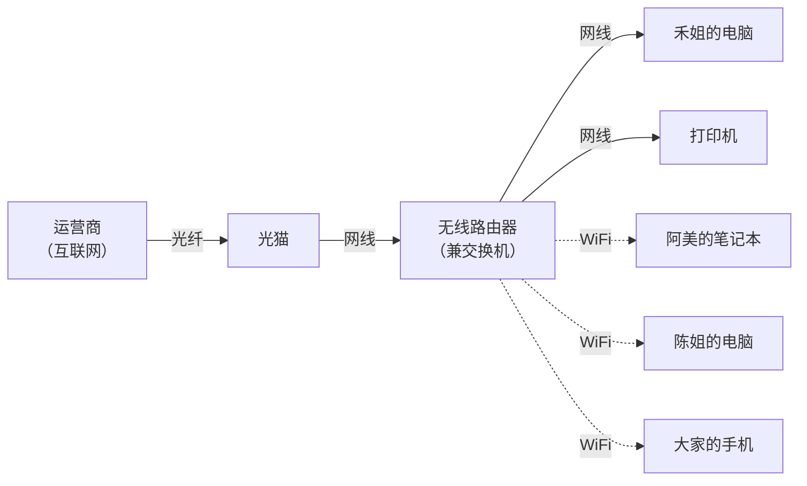
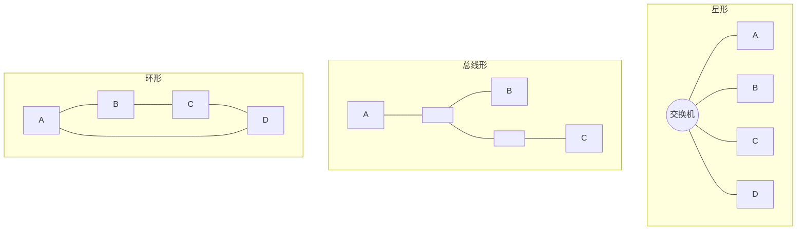
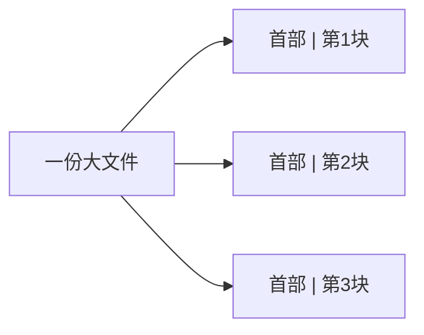
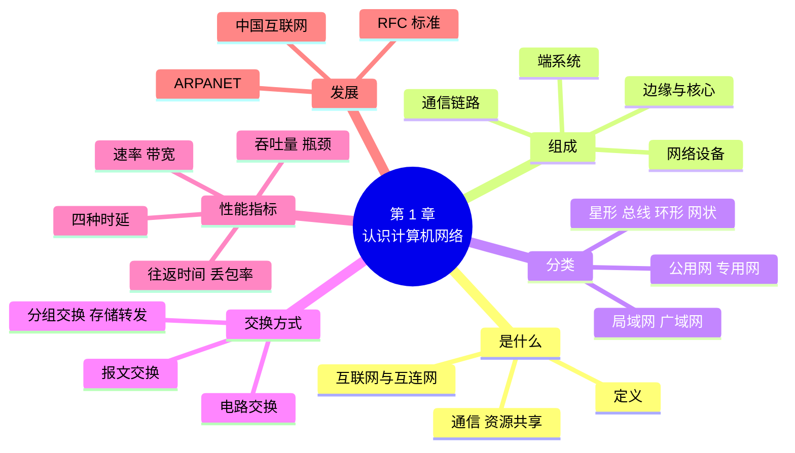

# 第 1 章 认识计算机网络

!!! abstract "本章学时"
    理论 5 学时（线上 4 + 线下 1）· 实验 1 学时（本章共 3 个实验，★ 必做 2 个）

## 学习目标

学完本章，你应该能够：

1. **说出**计算机网络的定义、三类组成部分和常见分类（记忆）；
2. **解释**分组交换为什么比电路交换更适合互联网（理解）；
3. **计算**发送时延和传播时延，**换算** Mbps 与 MB/s（应用）；
4. **使用** `ipconfig` 和 `ping` 查看本机网络信息、测量往返时间和丢包率（应用）；
5. **画出**家庭或单位的网络草图，**判断**网络慢的原因可能出在哪一段（分析）。

!!! info "先修要求"
    本章是全书第一章，不需要网络基础。你需要：

    - 会用 Windows 的文件管理器和浏览器，会打开“命令提示符”（附录 A 有步骤）；
    - 《Python 编程》第 1 章：知道怎样在 Thonny 里运行一个 `.py` 文件（实验 1-3 的选做部分用到）。

??? abstract "本章概念清单（30 个，点击查看定义和例子）"
    1. [计算机网络](../../appendix/glossary.md#g-计算机网络)
    2. [互连网](../../appendix/glossary.md#g-互连网)
    3. [互联网](../../appendix/glossary.md#g-互联网)
    4. [端系统](../../appendix/glossary.md#g-端系统)
    5. [通信链路](../../appendix/glossary.md#g-通信链路)
    6. [网络设备](../../appendix/glossary.md#g-网络设备)
    7. [边缘部分](../../appendix/glossary.md#g-边缘部分)
    8. [核心部分](../../appendix/glossary.md#g-核心部分)
    9. [客户—服务器方式](../../appendix/glossary.md#g-客户—服务器方式)
    10. [光猫](../../appendix/glossary.md#g-光猫)
    11. [局域网](../../appendix/glossary.md#g-局域网)
    12. [广域网](../../appendix/glossary.md#g-广域网)
    13. [拓扑](../../appendix/glossary.md#g-拓扑)
    14. [交换](../../appendix/glossary.md#g-交换)
    15. [电路交换](../../appendix/glossary.md#g-电路交换)
    16. [报文交换](../../appendix/glossary.md#g-报文交换)
    17. [分组交换](../../appendix/glossary.md#g-分组交换)
    18. [分组](../../appendix/glossary.md#g-分组)
    19. [存储转发](../../appendix/glossary.md#g-存储转发)
    20. [速率](../../appendix/glossary.md#g-速率)
    21. [带宽](../../appendix/glossary.md#g-带宽)
    22. [吞吐量](../../appendix/glossary.md#g-吞吐量)
    23. [瓶颈链路](../../appendix/glossary.md#g-瓶颈链路)
    24. [时延](../../appendix/glossary.md#g-时延)
    25. [发送时延](../../appendix/glossary.md#g-发送时延)
    26. [传播时延](../../appendix/glossary.md#g-传播时延)
    27. [排队时延](../../appendix/glossary.md#g-排队时延)
    28. [往返时间](../../appendix/glossary.md#g-往返时间)
    29. [丢包率](../../appendix/glossary.md#g-丢包率)
    30. [RFC](../../appendix/glossary.md#g-RFC)

## 情景导入

小林刚到“小禾设计工作室”上班。工作室只有 5 个人，租了写字楼里一间办公室，老板禾姐让他兼管电脑和网络。

上班第一天就遇到了问题：设计师阿美说传给客户的效果图“发了半天发不出去”；财务陈姐说打印机“时灵时不灵”；禾姐在会议室开视频会议，画面隔一会儿就卡住。小林看着墙角那台闪着灯的小盒子和一堆网线，心里直打鼓：这些设备到底是怎么连在一起的？“网速慢”又该从哪里查起？

他给以前的老师、做了二十年网络工程的老周打了个电话。老周说：“别急，先把三件事弄清楚——你们的网络由哪些东西组成，数据是怎么从一台电脑走到另一台电脑的，怎么用数字说清楚网络‘好不好’。弄明白这些，再动手查。”

这一章，我们就跟着小林，从一条微信消息的旅程说起，认识计算机网络的组成、分类、工作方式和性能指标，最后在自己的电脑上用两条命令摸清自己的网络。小禾工作室的网络会贯穿全书：到第 12 章，你将为它设计一套完整的组网方案。

## 1.1 什么是计算机网络 { #11 }

### 1.1.1 一条微信消息的旅程 { #111 }

你在手机上给朋友发一句“晚上吃火锅？”，按下发送，不到一秒朋友就收到了。这一秒里发生了很多事：

1. 手机把这句话变成一串 0 和 1，通过无线信号发给家里的无线路由器（或者附近的手机基站）；
2. 路由器通过光纤把数据交给运营商（电信、联通、移动等）的网络；
3. 运营商的网络里有很多台路由器，数据像快递包裹一样一站一站往前转，到达微信的服务器；
4. 服务器找到朋友的手机现在连在哪里，再把消息一站一站送过去；
5. 朋友的手机收到这串 0 和 1，还原成文字，弹出通知。

这一路上，数据经过了手机、路由器、光纤、基站、服务器等许多设备，跨越了几十甚至上千公里。把这些设备连起来、让数据能在它们之间可靠地传来传去的系统，就是计算机网络。


### 1.1.2 计算机网络的定义 { #112 }

[**计算机网络**](../../appendix/glossary.md#g-计算机网络 "用通信线路和网络设备把多台功能独立的计算机连接起来，按共同规则交换数据、共享资源的系统"){ .term }是用通信线路和网络设备，把分布在不同地点、功能独立的多台计算机连接起来，按照共同的规则交换数据、共享资源的系统。

这个定义里有四个关键词：

| 关键词 | 意思 | 例子 |
|---|---|---|
| 功能独立 | 每台计算机自己就能工作，不是谁的附属 | 断了网，你的电脑照样能打字、看本地视频 |
| 通信线路和网络设备 | 把计算机连起来的“路”和“路口” | 网线、光纤、无线信号；交换机、路由器 |
| 共同的规则 | 大家说同一种“语言”，才能互相听懂 | 后面要学的各种协议，如 TCP/IP |
| 交换数据、共享资源 | 联网的目的 | 发消息、看网页、共用一台打印机、把文件存到网盘 |

这里的“计算机”是广义的：手机、平板、智能电视、监控摄像头、智能音箱、打印机，只要能联网收发数据，在网络里都算一台“计算机”。

### 1.1.3 网络能做什么 { #113 }

联网带来的好处可以归纳成三类：

- **通信**：微信、电子邮件、视频会议，让相隔很远的人即时交流。
- **资源共享**：硬件共享（工作室 5 个人共用一台打印机）、软件和数据共享（大家在同一个共享文件夹里改设计稿）、计算能力共享（把复杂的计算交给云端服务器，比如用手机调用大模型）。
- **提高可靠性和效率**：重要数据在不同地方存多份，一台服务器坏了另一台顶上；工作可以分给多台计算机同时做。

### 1.1.4 互联网与互连网 { #114 }

把很多个网络再连起来，就成了“网络的网络”，叫[**互连网**](../../appendix/glossary.md#g-互连网 "把多个网络连接起来形成的“网络的网络”"){ .term }（internet，首字母小写），比如一家公司把北京、广州两个分公司的网络连在一起。

全世界范围内、采用 TCP/IP 协议、连接了几十亿台设备的那个最大的互连网，叫[**互联网**](../../appendix/glossary.md#g-互联网 "全球范围内采用 TCP/IP 协议、由大量网络互连而成的最大的计算机网络，也叫因特网"){ .term }（Internet，首字母大写），也叫因特网。我们平时说“上网”，上的就是互联网。

!!! note "两个“互联网”"
    国家标准把 Internet 称为“因特网”，日常和媒体上更多叫“互联网”。本书统一用“互联网”专指 Internet；泛指多个网络相连时，说“网络互连”。考试时注意题目问的是哪一个。

## 1.2 网络由什么组成 { #12 }

### 1.2.1 三类组成部分 { #121 }

不管网络大小，都由三类东西组成：

| 组成部分 | 作用 | 例子 | 比喻 |
|---|---|---|---|
| [**端系统**](../../appendix/glossary.md#g-端系统 "连在网络边缘、产生和使用数据的设备，也叫主机"){ .term }（也叫主机） | 网络的“起点”和“终点”，产生和使用数据 | 电脑、手机、服务器、网络摄像头 | 寄件人和收件人 |
| [**通信链路**](../../appendix/glossary.md#g-通信链路 "在设备之间传输数据的通道"){ .term } | 传输数据的通道 | 双绞线（网线）、光纤、无线电波 | 公路 |
| [**网络设备**](../../appendix/glossary.md#g-网络设备 "在链路交汇处转发或转换数据的设备"){ .term } | 在链路的交汇处转发数据 | 交换机、路由器、无线接入点、光猫 | 路口和快递分拣站 |

链路传输数据的快慢用“每秒能传多少比特”来衡量，单位是 bit/s（比特每秒），常写成 bps、Mbps、Gbps。1.5 节会详细讲。

### 1.2.2 边缘部分与核心部分 { #122 }

从功能上看，互联网可以分成两大块：

- [**边缘部分**](../../appendix/glossary.md#g-边缘部分 "互联网中由所有端系统组成、用户直接使用的部分"){ .term }：所有连在互联网上的端系统，由用户直接使用。你的手机、家里的电脑、视频网站的服务器都在边缘。
- [**核心部分**](../../appendix/glossary.md#g-核心部分 "互联网中由大量网络和路由器组成、为边缘部分提供连通服务的部分"){ .term }：由大量网络和连接它们的路由器组成，负责把数据从一个端系统送到另一个端系统。它为边缘部分提供“连通”服务，用户一般看不到。

端系统之间通信有两种方式：一种是[**客户—服务器方式**](../../appendix/glossary.md#g-客户—服务器方式 "一方请求服务、另一方提供服务的通信方式"){ .term }，一方（客户）请求服务，另一方（服务器）提供服务，比如你用浏览器访问网站；另一种是**对等方式**（P2P），双方地位平等，既是客户又是服务器，比如某些文件共享和下载软件。第 10 章会再讲。

### 1.2.3 家庭和小办公室的网络长什么样 { #123 }

小林按老周说的，先把工作室的设备理了一遍，画出了下面这张图：



这几乎是所有家庭和小办公室网络的样子：

- [**光猫**](../../appendix/glossary.md#g-光猫 "运营商安装在用户家里、把光纤中的光信号与网线中的电信号相互转换的设备"){ .term }（光调制解调器，学名光网络终端 ONT）：运营商装的，把光纤里的光信号转换成网线里的电信号。
- **无线路由器**：一个盒子里装了好几样功能——把内部的设备连起来（交换机的功能）、把内部网络和互联网连起来（路由器的功能）、发出 WiFi 信号（无线接入点的功能），还会自动给每台设备分配地址。第 8 章会拆开看它到底做了几件事。
- **网线和 WiFi**：台式机、打印机常用网线，笔记本和手机用 WiFi。

!!! tip "先画图，再排查"
    遇到网络问题，第一步不是乱重启，而是画出“数据从哪里走到哪里”。阿美的效果图传不出去，可能是她的笔记本到路由器这段 WiFi 信号弱，也可能是光猫到运营商这段带宽不够。有了图，才知道该查哪一段。实验 1-1 会让你画自己家的网络草图。

## 1.3 网络的分类 { #13 }

网络可以从不同角度分类。闭卷考试常考按范围分和按拓扑分。

### 1.3.1 按覆盖范围分 { #131 }

| 类型 | 英文 | 范围 | 例子 |
|---|---|---|---|
| 个人区域网 | PAN | 约 10 米，一个人身边 | 手机用蓝牙连耳机、手表 |
| [**局域网**](../../appendix/glossary.md#g-局域网 "覆盖一栋楼或一个园区、通常由单位自己建设管理的网络"){ .term } | LAN | 一栋楼、一个校园，几米到几公里 | 小禾工作室的办公网、学校机房 |
| 城域网 | MAN | 一座城市，几公里到几十公里 | 城市的有线电视和宽带骨干网 |
| [**广域网**](../../appendix/glossary.md#g-广域网 "覆盖城市、国家乃至全球，通常由运营商建设的网络"){ .term } | WAN | 跨城市、跨国家，几十公里到几千公里 | 运营商的全国骨干网、互联网 |

局域网通常由一个单位自己建设和管理，速度快（常见 1 Gbit/s 到每台电脑）、出错少；广域网一般由运营商建设，覆盖范围大，单位租用它的线路。

### 1.3.2 按拓扑结构分 { #132 }

[**拓扑**](../../appendix/glossary.md#g-拓扑 "网络中设备和链路连接的几何形状，只看谁和谁相连"){ .term }指网络中设备和链路的连接形状，只看“谁和谁连着”，不管距离多远、线有多长。



| 拓扑 | 样子 | 优点 | 缺点 | 今天在哪里见 |
|---|---|---|---|---|
| **星形** | 所有设备连到中央设备 | 好管理，一根线坏了只影响一台 | 中央设备坏了全网瘫痪 | 局域网最常用，办公室、家庭 |
| 总线形 | 所有设备挂在一根线上 | 省线 | 一处断了全断；同一时刻只能一台发 | 早期以太网，已基本淘汰 |
| 环形 | 首尾相连成环 | 每台设备地位相同 | 一处断了可能全断 | 部分城域网、工业网络（常用双环） |
| 树形 | 星形一层层往下扩展 | 易于扩展，分层管理 | 上层设备故障影响下面一片 | 一栋楼：核心交换机 → 楼层交换机 → 电脑 |
| **网状** | 设备之间有多条路径 | 可靠，一条路断了走另一条 | 线多、贵、复杂 | 互联网核心、运营商骨干网 |

实际的网络往往是几种拓扑的混合：工作室内部是星形，各楼层合起来是树形，运营商的骨干网是网状。

### 1.3.3 按使用者分 { #133 }

- **公用网**：运营商建设，任何人交钱都能用，如电信、联通、移动的宽带和移动网络。
- **专用网**：某个单位为自己建设，不对外提供服务，如银行、铁路、电力的内部网络。

还可以按传输介质分为有线网络和无线网络。

## 1.4 数据是怎样“交换”的 { #14 }

两台计算机之间往往没有一根直接相连的线，数据要经过中间的很多设备转送。中间设备怎样把数据从一条线“转”到另一条线上，叫[**交换**](../../appendix/glossary.md#g-交换 "中间设备把数据从一条链路转送到另一条链路的过程"){ .term }。历史上出现过三种交换方式。<sup class="cite">[[1]](#ref1-1)</sup>

### 1.4.1 电路交换：打电话 { #141 }

老式固定电话用的是[**电路交换**](../../appendix/glossary.md#g-电路交换 "通信前先建立专用通路、通信期间一直独占、结束后释放的交换方式"){ .term }：拨号时，电话局在你和对方之间建立一条专用的通路，通话期间这条通路一直被你们两人占着，别人用不了；挂断后才释放。

电路交换分三步：建立连接 → 通话（传数据）→ 释放连接。

- 优点：通路建好后，数据传得稳，延迟固定，适合实时通话。
- 缺点：占着线不一定一直在说话。计算机的数据是“一阵一阵”的（叫突发性），比如你看网页，点一下传一大堆，然后看半天什么也不传。如果一直占着一条专线，线路大部分时间是空的，非常浪费。

### 1.4.2 报文交换 { #142 }

[**报文交换**](../../appendix/glossary.md#g-报文交换 "把整份报文存储后再转发给下一节点的交换方式"){ .term }不预先建立通路，把要发的整份数据（叫报文）一次性交给下一个节点，节点**先完整收下、存起来，再转发**给下一个节点。早期的电报就是这样。

它不浪费线路，但一份报文可能很大，每个节点都要等整份收完才能往下转，延迟大，节点也要有很大的存储空间。

### 1.4.3 分组交换：寄快递 { #143 }

互联网采用的是[**分组交换**](../../appendix/glossary.md#g-分组交换 "把数据切成带首部的小分组，逐个存储转发、共享线路的交换方式"){ .term }。它把一份大数据切成许多小块，每块前面加上一段“首部”（写明从哪里来、到哪里去、是第几块），这样的一小块叫一个[**分组**](../../appendix/glossary.md#g-分组 "分组交换中传送的数据单元，由首部和一段数据组成，也叫数据包"){ .term }（也叫数据包、包）。



就像你网购了一套沙发，商家把它拆成 3 个箱子分别贴上快递单发出：每个箱子到了分拣中心，分拣员看快递单决定往哪送（[**存储转发**](../../appendix/glossary.md#g-存储转发 "节点先完整收下分组、检查后再转发出去的工作方式"){ .term }），不同箱子甚至可能走不同的路线，最后在你家重新拼起来。

分组交换的特点：

- **不需要先建立连接**：数据随到随发，线路不被某一对用户独占。
- **线路利用率高**：很多用户的分组在同一条线上“交错”传输，你不传的时候别人可以传。
- **灵活、可靠**：一条路坏了，分组可以改走别的路。
- **有代价**：每个分组都要带首部，多了一点开销；在路由器里可能要排队，延迟不固定；网络太忙时分组可能被丢弃。

### 1.4.4 三种方式比一比 { #144 }

| | 电路交换 | 报文交换 | 分组交换 |
|---|---|---|---|
| 要不要先建立连接 | 要 | 不要 | 不要 |
| 线路是否独占 | 独占 | 共享 | 共享 |
| 转发单位 | 连续的比特流 | 整份报文 | 小分组 |
| 中间节点是否存储转发 | 否 | 是 | 是 |
| 适合 | 持续、实时的通话 | 早期电报 | 突发性强的计算机数据 |
| 生活比喻 | 打电话包一条专线 | 整车货物一站站中转 | 拆成小箱子分别寄快递 |

<iframe class="sim-frame" src="../../sims/circuit-vs-packet/main.html" height="560" loading="lazy" title="电路交换与分组交换"></iframe>

动画：同样三位用户各发一条消息，电路交换要先“拨号”建立通路、一条线一次只给一个人用，分组交换把消息切成小包交错传输。点“开始”看谁先送完。
{ .sim-caption }

!!! warning "考点"
    “分组交换采用存储转发技术”“电路交换在通信期间始终占用端到端的通信资源”是常见判断题。报文交换也是存储转发，区别在于转发单位是整份报文还是小分组。

## 1.5 怎样说网络“好不好” { #15 }

小林想知道“网速慢”到底慢在哪。老周说，网络好不好，要看几个指标。

### 1.5.1 速率与带宽 { #151 }

[**速率**](../../appendix/glossary.md#g-速率 "数据在链路上每秒传送的比特数，单位 bit/s"){ .term }是数据在链路上传送的快慢，即每秒传送多少比特（bit，一个 0 或 1）。单位是 bit/s，也写作 bps。

| 单位 | 等于 |
|---|---|
| 1 kbit/s | 10³ bit/s = 1 000 bit/s |
| 1 Mbit/s（Mbps，常说“兆”） | 10⁶ bit/s |
| 1 Gbit/s（Gbps，常说“千兆”） | 10⁹ bit/s |

[**带宽**](../../appendix/glossary.md#g-带宽 "在计算机网络中通常指链路能达到的最高速率；在通信中指信号的频率范围"){ .term }本来是通信里的概念，指信号占据的频率范围（单位赫兹 Hz）；在计算机网络里，带宽通常指一条链路**最高能达到的速率**。运营商说的“千兆宽带”，就是你家这条线最高 1 Gbit/s。

!!! example "算一算：Mbps 和 MB/s"
    下载软件显示的速度单位往往是 **MB/s**（兆字节每秒），而宽带标的是 **Mbps**（兆比特每秒）。1 字节（Byte，大写 B）= 8 比特（bit，小写 b）。

    所以 100 Mbps 宽带，理想情况下下载速度约为 100 ÷ 8 = **12.5 MB/s**；千兆宽带约为 125 MB/s。

    实际下载时还要扣掉各层首部等开销，又受到服务器、WiFi 等环节的限制，测到 80%～90% 就算正常。

注意：存储容量的 KB、MB 常按 2 的整数次方（1 KB = 1 024 B）计算，而速率的 k、M、G 按 10 的整数次方计算。本书计算题如无说明，都按 10 的整数次方算。

### 1.5.2 吞吐量 { #152 }

[**吞吐量**](../../appendix/glossary.md#g-吞吐量 "单位时间内实际通过某个网络或接口的数据量"){ .term }是单位时间内实际通过某个网络（或接口）的数据量。带宽是“路有多宽”，吞吐量是“实际过了多少车”。一条 1 Gbit/s 的链路，如果很多人同时用，每个人分到的吞吐量就可能只有几十 Mbit/s。

一条路径上的吞吐量取决于最窄的那一段，叫[**瓶颈链路**](../../appendix/glossary.md#g-瓶颈链路 "一条路径上速率最低、限制了端到端吞吐量的那段链路"){ .term }。小林测得光猫到运营商是 300 Mbit/s，可阿美的笔记本离路由器太远，WiFi 只有 20 Mbit/s，那么她的上传速度最多只有 20 Mbit/s——瓶颈在 WiFi 这一段。

### 1.5.3 时延：数据在路上花的时间 { #153 }

[**时延**](../../appendix/glossary.md#g-时延 "数据从网络一端传到另一端所需的时间，由发送、传播、处理、排队四部分组成"){ .term }是数据从网络的一端传到另一端所需的时间。一个分组在每个节点上的时延由四部分组成<sup class="cite">[[2]](#ref1-2)</sup>：

| 时延 | 发生在哪里 | 怎么算 / 由什么决定 | 比喻 |
|---|---|---|---|
| [**发送时延**](../../appendix/glossary.md#g-发送时延 "把一个分组的全部比特推上链路所需的时间，等于数据长度除以发送速率"){ .term } | 把分组的全部比特推上链路 | 数据长度 ÷ 发送速率 | 货车装车所花的时间 |
| [**传播时延**](../../appendix/glossary.md#g-传播时延 "信号在链路上从一端传到另一端所需的时间，等于链路长度除以传播速度"){ .term } | 信号在链路上“跑”过去 | 链路长度 ÷ 信号传播速度 | 货车在路上开的时间 |
| 处理时延 | 路由器检查首部、查找往哪转 | 由设备性能决定，一般很短 | 分拣员看快递单 |
| 排队时延 | 在路由器里等着被发出去 | 由网络拥挤程度决定，变化最大 | 分拣中心门口排队 |

总时延 = 发送时延 + 传播时延 + 处理时延 + [排队时延](../../appendix/glossary.md#g-排队时延 "分组在路由器缓存中等待被发送的时间，随网络拥挤程度变化"){ .term }

信号在光纤和铜线中的传播速度约为 2×10⁸ m/s，即每毫秒约 200 公里。

!!! example "算一算：发送时延和传播时延"
    阿美要把一份 10 MB 的效果图发给 1 000 km 外的客户，按 10⁶ 计算，忽略处理和排队时延。

    **情况一：上传速率 10 Mbit/s**

    - 发送时延 = 10 × 10⁶ × 8 bit ÷ (10 × 10⁶ bit/s) = **8 s**
    - 传播时延 = 1 000 × 10³ m ÷ (2 × 10⁸ m/s) = 0.005 s = **5 ms**

    **情况二：上传速率提高到 100 Mbit/s**

    - 发送时延 = 80 × 10⁶ ÷ (100 × 10⁶) = **0.8 s**
    - 传播时延仍然是 **5 ms**

    结论：提高带宽能缩短发送时延，但**传播时延只和距离有关**，带宽再高也缩短不了。对大文件，发送时延是大头；对一句聊天消息（几十字节），传播时延才是大头。

<iframe class="sim-frame" src="../../sims/delay-calculator/main.html" height="560" loading="lazy" title="时延计算器"></iframe>

动画：拖动文件大小、发送速率、距离和排队时间，看四种时延各占多少。试试“大文件 + 低带宽”和“小消息 + 远距离”两种情况，哪种时延是大头？
{ .sim-caption }

!!! warning "常见误解：“高速链路”跑得更快？"
    “光纤比网线快”说的不是光在光纤里跑得比电在铜线里快得多（两者传播速度相近），而是光纤能达到的**发送速率**高得多，同样的数据推上链路花的时间少。

### 1.5.4 往返时间与丢包率 { #154 }

[**往返时间**](../../appendix/glossary.md#g-往返时间 "从发出数据到收到对方确认所经历的总时间"){ .term }（Round-Trip Time，RTT）是从发出一个分组开始，到收到对方确认为止的总时间，也就是“一来一回”的时间。`ping` 命令显示的“时间=12ms”就是往返时间。

一般来说：

| 往返时间 | 感受 | 典型情况 |
|---|---|---|
| < 5 ms | 极快 | 同一个局域网内 |
| 10～50 ms | 很好 | 访问国内主流网站 |
| 50～100 ms | 尚可 | 跨省、跨运营商访问 |
| > 150 ms | 视频会议和游戏明显卡顿 | 访问国外网站、网络拥塞 |

[**丢包率**](../../appendix/glossary.md#g-丢包率 "一段时间内丢失的分组数占发出分组总数的比例"){ .term }是在一段时间内丢失的分组数占发出分组总数的比例。`ping` 发 4 个、收回 3 个，丢包率就是 25%。丢包通常说明网络拥塞、信号太差或线路有问题。视频会议对丢包很敏感，丢包率超过 1%～2% 画面就会明显卡顿、花屏。

另外两个指标简单了解即可：**时延抖动**是时延的变化幅度，忽快忽慢比稳定慢更影响视频通话；**利用率**是链路有百分之多少的时间在传数据，利用率越高，排队时延越大，所以运营商不会让链路长期满负荷运行。

### 1.5.5 小林的诊断 { #155 }

把这些指标用起来，小林对上班第一天的三个问题有了思路：

| 现象 | 可能的原因 | 用什么指标验证 |
|---|---|---|
| 效果图发不出去 | 上传带宽小（宽带上传往往只有下载的几分之一），或 WiFi 信号差 | 测上传速率；看 WiFi 信号强度（第 3 章） |
| 打印机时灵时不灵 | 打印机的地址老在变，或者网线松了 | ping 打印机看丢包率；第 8 章学固定地址 |
| 视频会议卡 | 有人在下载大文件，链路被占满，排队时延和丢包增加 | 开会时 ping 网关和外网，看往返时间是否忽高忽低 |

## 1.6 互联网是怎样发展起来的 { #16 }

### 1.6.1 从 ARPANET 到移动互联网 { #161 }

| 年份 | 事件 | 意义 |
|---|---|---|
| 1969 | 美国 ARPANET 连通 4 个节点 | 第一个分组交换网络，互联网的前身 |
| 1974 | Cerf 和 Kahn 发表 TCP/IP 的设计论文<sup class="cite">[[3]](#ref1-3)</sup> | 让不同的网络能够互连 |
| 1983 | ARPANET 全面改用 TCP/IP | 通常被视为互联网诞生之年 |
| 1989—1991 | Berners-Lee 发明万维网（WWW） | 网页、浏览器出现，互联网走向大众 |
| 1990 年代 | 商业运营商（ISP）出现 | 普通家庭可以“拨号上网” |
| 2007 年后 | 智能手机、3G/4G 普及 | 移动互联网时代 |
| 2019 年后 | 5G 商用、千兆光纤入户 | 万物互联、云计算和人工智能的基础设施 |

互联网的结构也在变化：从最初的单个网络，到“主干网 + 地区网”的三级结构，再到今天由许多**互联网服务提供者**（ISP，即运营商）分层组成、通过互联网交换点（IXP）互相连接的多层结构。

### 1.6.2 中国互联网的发展 { #162 }

- 1987 年 9 月，北京发出中国第一封电子邮件：“越过长城，走向世界”。
- 1994 年 4 月 20 日，中国通过一条 64 kbit/s 的国际专线全功能接入互联网，这一天被视为中国互联网的起点。
- 此后，中国建成了全球规模最大的光纤和移动通信网络。据中国互联网络信息中心第 57 次《中国互联网络发展状况统计报告》，截至 2025 年 12 月，我国网民规模达 11.25 亿人，互联网普及率超过 80%；5G 基站达 483.8 万个，全国所有乡镇和 95% 的行政村通了 5G。<sup class="cite">[[4]](#ref1-4)</sup>
- 2022 年起实施的“东数西算”工程，在内蒙古、贵州、甘肃、宁夏等地建设数据中心集群，把东部的计算需求通过高速网络送到能源充足的西部处理。计算和网络正在融合成“算力网络”（第 12 章）。

### 1.6.3 标准由谁来定 { #163 }

网络要互通，大家必须遵守同样的规则。主要的标准化组织有：

| 组织 | 负责什么 | 本书会遇到的标准 |
|---|---|---|
| IETF（互联网工程任务组） | 互联网协议，以 [**RFC**](../../appendix/glossary.md#g-RFC "互联网工程任务组发布的互联网标准文档系列"){ .term } 文档形式发布 | IP、TCP、HTTP、DNS |
| IEEE（电气电子工程师学会） | 局域网、无线局域网 | 802.3 以太网、802.11 WiFi |
| ITU（国际电信联盟） | 电信网络、移动通信 | 5G 标准的认定 |
| ISO（国际标准化组织） | 各类国际标准 | OSI 参考模型 |
| 中国通信标准化协会等 | 我国通信行业标准 | 我国的宽带、5G 行业标准 |

**RFC**（Request for Comments，请求评论）是互联网标准文档的编号系列。一份草案经过讨论修改，才能成为正式的互联网标准。比如定义 IP 协议的是 RFC 791<sup class="cite">[[5]](#ref1-5)</sup>，所有 RFC 都可以在网上免费查到。

## 1.7 本章常见问题对照 { #17 }

| 现象 | 用大白话说 | 怎么查、怎么改 |
|---|---|---|
| 宽带是 100 兆，下载只有 11 MB/s | 没有问题，单位不同：100 Mbps ÷ 8 ≈ 12.5 MB/s | 用测速网站测，看 Mbps 那一栏 |
| 测速很快，但打开某个网站很慢 | 瓶颈不在你家，在对方服务器或中间的网络 | `ping` 和 `tracert` 那个网站（第 7 章） |
| 有线快，WiFi 慢 | WiFi 这段是瓶颈：信号弱、干扰多或设备老 | 靠近路由器再测；第 5 章学 WiFi 优化 |
| `ping` 时有时无“请求超时” | 有丢包：线路接触不良、信号差或网络拥塞 | 换根网线、靠近路由器，观察丢包率变化 |
| 白天快、晚上慢 | 晚上大家都在用，运营商出口拥塞，排队时延变大 | 记录不同时间段的 `ping` 结果，向运营商反映 |
| “命令提示符”找不到 `ipconfig` | 在 PowerShell 或命令提示符里都能用，可能是拼写错误 | 按附录 A 打开命令提示符，注意没有空格 |

## 1.8 AI 与网络：大模型离不开的网络 { #18 }

你在手机上问大模型一个问题，几秒钟就得到回答。这背后，网络至少在三个环节起关键作用：

1. **训练**：训练一个大模型要用成千上万块 GPU 同时计算几周甚至几个月。GPU 之间要不停地交换中间结果，网络稍慢，昂贵的 GPU 就得停下来等。所以 AI 数据中心内部用的是每个端口 400 Gbit/s、800 Gbit/s 的超高速网络，比家里的千兆宽带快几百倍（第 4 章再讲）。
2. **部署**：训练好的模型放在数据中心的服务器上，通过互联网向全国用户提供服务。用户离数据中心越远，往返时间越长；所以大服务商会在多个城市部署。“东数西算”也是把计算放在西部、通过骨干网服务东部用户。
3. **使用**：你的提问通过本章讲的这一路——手机、无线、运营商网络、数据中心——送到模型，答案再一路送回来。你看到文字一个一个“蹦”出来，是因为模型边生成边通过网络发送（第 9 章会抓包看）。

所以，网络是人工智能的“高速公路”。学好网络，以后部署 AI 应用、排查“模型接口调用超时”这类问题，心里才有底。

## 本章实验

!!! abstract "实验总览"
    | 实验 | 类型 | 建议时长 | 内容 |
    |---|---|---|---|
    | 实验 1-1 | ★ 必做 | 25 分钟 | 摸清我的网络：ipconfig 与网络草图 |
    | 实验 1-2 | ★ 必做 | 25 分钟 | 用 ping 测往返时间和丢包率 |
    | 实验 1-3 | ☆ 选做 | 30 分钟 | 测网速，换算 Mbps 与 MB/s |

    本章实验都在自己的 Windows 电脑上完成，不需要安装软件；苹果电脑的写法见附录 A。命令的输出因电脑和网络而异，书中给的是 Windows 11 中文版的**输出格式示意**，地址和数值以你自己电脑上的为准。实验 1-3 的选做部分用到 `labs/ch01/` 里的 Python 小程序，结果是编者实际运行得到的。

### 实验 1-1 ★ 摸清我的网络：ipconfig 与网络草图 { #1-1 }

**实验目的**

1. 会打开命令提示符，用 `ipconfig` 和 `ipconfig /all` 查看本机的网络信息；
2. 认识 IP 地址、子网掩码、默认网关、DNS 服务器、物理地址（MAC 地址）这几项，知道它们大致是什么（后面各章详讲）；
3. 画出自己家或单位的网络草图，作为全书项目的起点。

**实验环境**：本机（Windows 10/11），已联网。

**实验数据**：无。

**实验步骤**

第一档 · 跑通：

1. 按 ++win+r++，输入 `cmd`，回车，打开“命令提示符”黑色窗口。
2. 输入下面的命令，回车：

    ```bat
    ipconfig
    ```

3. 找到你正在使用的网卡：用网线上网的看“以太网适配器”，用 WiFi 的看“无线局域网适配器 WLAN”。记下 IPv4 地址、子网掩码和默认网关。

4. 再输入（注意 `ipconfig` 和 `/all` 之间有一个空格）：

    ```bat
    ipconfig /all
    ```

    在同一块网卡下面，找到“物理地址”“DHCP 已启用”“DNS 服务器”三项。

**运行结果**（输出格式示意，数值以你的电脑为准）

```text
无线局域网适配器 WLAN:

   连接特定的 DNS 后缀 . . . . . . . :
   描述. . . . . . . . . . . . . . . : Intel(R) Wi-Fi 6 AX201 160MHz
   物理地址. . . . . . . . . . . . . : 3C-A9-F4-xx-xx-xx
   DHCP 已启用 . . . . . . . . . . . : 是
   IPv4 地址 . . . . . . . . . . . . : 192.168.1.105(首选)
   子网掩码  . . . . . . . . . . . . : 255.255.255.0
   默认网关. . . . . . . . . . . . . : 192.168.1.1
   DHCP 服务器 . . . . . . . . . . . : 192.168.1.1
   DNS 服务器  . . . . . . . . . . . : 192.168.1.1
```

先认识一下这几项（后面各章会详细讲）：

| 项目 | 大白话 | 详见 |
|---|---|---|
| 物理地址 | 网卡出厂时就有的“身份证号”，也叫 MAC 地址 | 第 4 章 |
| IPv4 地址 | 你的电脑在网络里的“门牌号” | 第 6 章 |
| 子网掩码 | 用来判断别的电脑和你是不是“同一个小区” | 第 6 章 |
| 默认网关 | 要去别的网络时，先把数据交给它，一般就是路由器 | 第 7 章 |
| DHCP 已启用：是 | 地址是路由器自动分配的，不是手动填的 | 第 8 章 |
| DNS 服务器 | 负责把网址“翻译”成 IP 地址的服务器 | 第 10 章 |

第二档 · 改一改：

1. 如果你的电脑既有网线又有 WiFi，分别连一次，对比两块网卡的物理地址和 IPv4 地址有什么不同。
2. 用手机连同一个 WiFi，在手机的“设置 → WLAN → 已连接的网络详情”里找到手机的 IP 地址，和电脑的比较：前三段一样吗？
3. 画出你家（或单位）的网络草图：标出光猫、路由器、每台联网设备，以及它们之间是网线还是 WiFi。可以参考 1.2.3 节小林画的图。

第三档 · 挑战（选做）：在命令提示符里输入 `ipconfig /all > mynet.txt`，把结果保存到文件里，用记事本打开看看。`>` 的作用是什么？

**实验记录表**

| 项目 | 你的结果 |
|---|---|
| 正在使用的网卡（以太网 / WLAN） | |
| 物理地址 | |
| IPv4 地址 | |
| 子网掩码 | |
| 默认网关 | |
| DHCP 已启用 | |
| DNS 服务器 | |
| 手机的 IP 地址 | |
| 家里联网设备一共几台 | |

**常见问题排查**

| 现象 | 原因 | 解决 |
|---|---|---|
| 提示“不是内部或外部命令” | 拼写错了，如写成 `ipconfg` | 仔细核对拼写 |
| 输出很长，找不到 WLAN 那一段 | 电脑有虚拟网卡（如 VMware、蓝牙） | 往上翻，找“无线局域网适配器 WLAN”或“以太网适配器 以太网” |
| IPv4 地址是 169.254 开头 | 没拿到路由器分配的地址 | 检查是否真的连上了网络；第 8 章会讲原因 |
| 媒体状态显示“媒体已断开连接” | 这块网卡没连网线或没连 WiFi | 看另一块网卡的信息 |

**思考与练习**

1. 你家的默认网关和 DNS 服务器是同一个地址吗？为什么家用路由器常常两者都是它自己？
2. 电脑和手机的 IP 地址前三段相同、最后一段不同，你猜这说明什么？

**实验报告要求**：提交实验记录表和网络草图（手绘拍照或用画图软件均可），草图上用不同的线区分有线和无线连接。

### 实验 1-2 ★ 用 ping 测往返时间和丢包率 { #1-2 }

**实验目的**

1. 会用 `ping` 命令测试与某个地址是否连通；
2. 读懂 `ping` 输出中的往返时间、TTL 和丢包率；
3. 比较本机、网关、国内网站、国外网站的往返时间，体会距离和网络环境对时延的影响。

**实验环境**：本机（Windows 10/11），已联网。

**实验数据**：无。

**实验步骤**

第一档 · 跑通：在命令提示符里依次输入下面 4 条命令，每条会发 4 个测试分组：

```bat
ping 127.0.0.1
ping 192.168.1.1
ping www.baidu.com
ping www.cnnic.cn
```

第二条换成你在实验 1-1 中查到的默认网关地址。`127.0.0.1` 是一个特殊地址，表示“本机自己”（第 6 章）。

**运行结果**（输出格式示意，数值以你的电脑为准）

```text
正在 Ping 192.168.1.1 具有 32 字节的数据:
来自 192.168.1.1 的回复: 字节=32 时间=3ms TTL=64
来自 192.168.1.1 的回复: 字节=32 时间=2ms TTL=64
来自 192.168.1.1 的回复: 字节=32 时间=5ms TTL=64
来自 192.168.1.1 的回复: 字节=32 时间=2ms TTL=64

192.168.1.1 的 Ping 统计信息:
    数据包: 已发送 = 4，已接收 = 4，丢失 = 0 (0% 丢失)，
往返行程的估计时间(以毫秒为单位):
    最短 = 2ms，最长 = 5ms，平均 = 3ms
```

怎么读：

- **时间=3ms**：这个测试分组的往返时间；
- **TTL=64**：分组的“寿命”，每经过一个路由器减 1，第 8 章详讲；
- **丢失 = 0 (0% 丢失)**：丢包率；
- **平均 = 3ms**：4 次往返时间的平均值。

第二档 · 改一改：

1. 用 `-n` 参数改变发送次数，例如 `ping -n 20 www.baidu.com`，看 20 次里往返时间的最短、最长相差多少（这就是抖动）。
2. 用 WiFi 的同学，拿着笔记本走到离路由器最远的房间，再 `ping -n 20` 网关，和在路由器旁边的结果比较。
3. 选一个国外网站（例如 `www.ietf.org`）再测一次，与国内网站比较。

!!! note "有的网站 ping 不通，不代表打不开"
    出于安全考虑，有些网站的服务器设置成不回应 `ping`，你会看到“请求超时”，但用浏览器能正常打开。遇到这种情况换一个网站测。

第三档 · 挑战（选做）：输入 `ping -t 192.168.1.1`（换成你的网关）持续测试，同时让家里人看一段在线视频或下载一个大文件，观察往返时间有没有变大；按 ++ctrl+c++ 停止。解释你看到的现象（提示：排队时延）。

**实验记录表**

| 目标 | 平均往返时间 | 最短 / 最长 | 丢包率 | TTL |
|---|---|---|---|---|
| 127.0.0.1 | | | | |
| 网关 | | | | |
| 国内网站：______ | | | | |
| 国外网站：______ | | | | |
| 网关（离路由器最远处） | | | | |

**常见问题排查**

| 现象 | 原因 | 解决 |
|---|---|---|
| “Ping 请求找不到主机” | 网址拼错，或 DNS 解析失败 | 检查拼写；先 `ping` 网关确认网络通 |
| 全部“请求超时” | 对方不回应 ping，或网络不通 | 换一个目标；先 ping 网关 |
| ping 网关也超时 | 本机和路由器之间就不通 | 检查网线、WiFi 连接，重新连接 |
| “一般故障” | 本机网卡没有可用的网络 | 检查网卡是否启用、是否已连接 |

**思考与练习**

1. 为什么 `ping 127.0.0.1` 的时间几乎是 0？
2. 访问国外网站的往返时间往往是国内的好几倍，用 1.5.3 节的四种时延解释原因。

**实验报告要求**：提交实验记录表，用两三句话总结“距离、无线信号、网络忙闲”分别对往返时间有什么影响。

### 实验 1-3 ☆ 测网速，换算 Mbps 与 MB/s { #1-3 }

**实验目的**

1. 用测速网站测出本机的下载和上传速率；
2. 会在 Mbps 和 MB/s 之间换算，能估算下载一个文件需要多长时间；
3. 理解测得的速率为什么总比套餐标称的低。

**实验环境**：本机，已联网；选做部分需要 Python（Thonny）。

**实验数据**：无。

**实验步骤**

第一档 · 跑通：

1. 用浏览器打开一个测速网站（如运营商官方测速页面，或中国信息通信研究院的“全球网测”），点击开始，记录下载速率、上传速率和时延。
2. 按 ++ctrl+shift+esc++ 打开任务管理器，切换到“性能”页，点 WLAN 或以太网，下载一个大文件（如某个软件的安装包）时观察“接收”速率曲线，单位是 Kbps 或 Mbps。

第二档 · 改一改：用下面的 Python 小程序（`labs/ch01/lab1_3_speed.py`）把测得的速率换算成 MB/s，并估算下载一部 4 GB 电影要多久。改 `rate_mbps` 为你测到的下载速率。

```python
rate_mbps = 300                    # ← 改这里：你测到的下载速率，单位 Mbps
file_gb = 4                        # 电影大小，单位 GB（按 1 GB = 10^9 字节）

rate_mb_s = rate_mbps / 8          # 1 字节 = 8 比特，换算成 MB/s
seconds = file_gb * 1000 / rate_mb_s
print(f"{rate_mbps} Mbps ≈ {rate_mb_s:.1f} MB/s")
print(f"下载 {file_gb} GB 理想情况下需要 {seconds:.0f} 秒，约 {seconds / 60:.1f} 分钟")
for eff in (0.9, 0.7):             # 实际效率按 90% 和 70% 估计
    print(f"  按实际效率 {eff:.0%} 计算：约 {seconds / eff / 60:.1f} 分钟")
```

**运行结果**（编者运行，`rate_mbps = 300`）

```text
300 Mbps ≈ 37.5 MB/s
下载 4 GB 理想情况下需要 107 秒，约 1.8 分钟
  按实际效率 90% 计算：约 2.0 分钟
  按实际效率 70% 计算：约 2.5 分钟
```

第三档 · 挑战（选做）：分别在有线和 WiFi、白天和晚上各测一次，填入记录表，分析瓶颈在哪一段。

**实验记录表**

| 条件 | 下载速率（Mbps） | 换算（MB/s） | 上传速率（Mbps） | 时延（ms） |
|---|---|---|---|---|
| 套餐标称 | | | | — |
| WiFi，白天 | | | | |
| WiFi，晚上 | | | | |
| 有线（可选） | | | | |

**常见问题排查**

| 现象 | 原因 | 解决 |
|---|---|---|
| 测速远低于套餐 | WiFi 是瓶颈，或同时有人在用网 | 用网线直连路由器再测；关掉其他下载 |
| 上传比下载低很多 | 家庭宽带的上下行本来就不对称 | 正常现象，套餐详情里有写上行速率 |
| Python 报 `SyntaxError` | 中文标点或缩进错误 | 对照书中代码检查，详见《Python 编程》第 1 章 |

**思考与练习**

1. 套餐是 500 Mbps，下载软件显示 52 MB/s，算一算实际效率是多少？
2. 为什么家庭宽带通常下载快、上传慢？阿美经常要给客户传大文件，你会建议禾姐怎么选宽带套餐？

**实验报告要求**：提交记录表和程序运行截图，写出你家网络的瓶颈在哪一段及理由。

## 本章小结

- **计算机网络**用通信线路和网络设备把功能独立的计算机连起来，按共同的规则交换数据、共享资源。**互联网**是全世界最大的、采用 TCP/IP 的互连网。
- 网络由三类东西组成：**端系统**（起点和终点）、**通信链路**（路）、**网络设备**（路口）。互联网分**边缘部分**和**核心部分**。家庭网络通常是：光猫 → 无线路由器 → 各台设备。
- 按范围分：个人区域网、**局域网**、城域网、**广域网**；按**拓扑**分：星形、总线形、环形、树形、网状，局域网最常用星形。
- **电路交换**先建立专用通路，通话期间独占；**分组交换**把数据切成**分组**，**存储转发**，共享线路、利用率高，是互联网的基础。
- 性能指标：**速率**与**带宽**（bit/s，1 字节 = 8 比特）、**吞吐量**（受**瓶颈链路**限制）、四种**时延**（发送、传播、处理、排队）、**往返时间**、**丢包率**。发送时延 = 数据长度 ÷ 速率，传播时延 = 距离 ÷ 传播速度。
- 互联网从 1969 年的 ARPANET 发展而来；中国 1994 年全功能接入互联网，截至 2025 年底网民 11.25 亿；互联网标准以 **RFC** 形式发布。



**下一章预告**

数据从你的手机到朋友的手机，要经过那么多不同的设备和线路，它们是怎样配合的？下一章学**网络体系结构**：网络为什么要像寄信一样“分层”，每一层负责什么，数据怎样一层层“装信封”再一层层“拆信封”。你还将第一次用 Wireshark 抓包，亲眼看到网络里传来传去的数据长什么样。

## 参考文献

正文中的上标编号（如<sup class="cite">[[1]](#ref1-1)</sup>）对应下面的文献。带链接的可以直接打开；书籍可在图书馆或电子书平台查阅。

<div class="refs" markdown>

**教材与专著**

- <span id="ref1-1"></span>[1] 谢希仁. 计算机网络[M]. 8 版. 北京: 电子工业出版社, 2021.
    <span class="ref-note">国内使用最广的计算机网络教材，本章的网络组成、三种交换方式、性能指标的讲法与它一致，可作为全书的扩展阅读。</span>
- <span id="ref1-2"></span>[2] KUROSE J F, ROSS K W. Computer Networking: A Top-Down Approach[M]. 8th ed. Hoboken: Pearson, 2021.
    <span class="ref-note">国外经典教材（中文版《计算机网络：自顶向下方法》），1.4 节分组交换和 1.5 节四种时延的分析可参考其第 1 章。</span>

**经典论文**

- <span id="ref1-3"></span>[3] CERF V G, KAHN R E. A Protocol for Packet Network Intercommunication[J]. IEEE Transactions on Communications, 1974, 22(5): 637-648.
    <span class="ref-note">提出 TCP/IP 基本思想的论文，让不同的分组交换网络能够互连，对应 1.6.1 节。</span>

**在线资源与数据**

- <span id="ref1-4"></span>[4] 中国互联网络信息中心. 第 57 次中国互联网络发展状况统计报告[R/OL]. (2026-02-05)[2026-11-01]. <https://www.cnnic.cn/NMediaFile/2026/0304/MAIN1772588317069TUXN3827X8.pdf>.
    <span class="ref-note">截至 2025 年 12 月的我国网民规模、互联网普及率、5G 基站等数据，对应 1.6.2 节。</span>
- <span id="ref1-5"></span>[5] POSTEL J. RFC 791: Internet Protocol[S/OL]. IETF, 1981[2026-11-01]. <https://www.rfc-editor.org/rfc/rfc791>.
    <span class="ref-note">IP 协议的标准文档，作为 RFC 的例子出现在 1.6.3 节，第 6 章还会用到。</span>

</div>

## 课后练习

选择题和判断题可以直接点击选项作答，系统会马上告诉你对错，并展开答案与解析；多选题选好后点“提交答案”。简答和实操题请先自己作答，再点开“答案与解析”核对。每道题的解析下方都有“回看”链接，做错了可以直接跳回正文复习。

**一、单项选择题**

<div class="quiz" data-answer="C" markdown>

**1.** 下列关于计算机网络的说法，正确的是（　　）。

- A. 联网的计算机必须由一台主机统一控制
- B. 只有台式电脑和服务器才算网络中的“计算机”
- C. 联网的计算机功能独立，按共同的规则交换数据、共享资源
- D. 计算机网络只能在一栋楼内使用

</div>

??? tip "答案与解析"
    **答案：C**

    计算机网络连接的是功能独立的计算机，按协议通信。A 错，网络中的计算机不是谁的附属；B 错，手机、摄像头等都算；D 错，广域网可以覆盖全球。

    考查：计算机网络的定义 · 认知层次：理解 · [回看 1.1.2](#112)
    { .quiz-meta }

<div class="quiz" data-answer="B" markdown>

**2.** 小禾工作室的光猫、无线路由器属于网络组成中的（　　）。

- A. 端系统
- B. 网络设备
- C. 通信链路
- D. 应用软件

</div>

??? tip "答案与解析"
    **答案：B**

    光猫、路由器、交换机在链路的交汇处转发或转换数据，属于网络设备。端系统是电脑、手机、服务器等；通信链路是网线、光纤、无线信道。

    考查：网络的组成 · 认知层次：理解 · [回看 1.2.1](#121)
    { .quiz-meta }

<div class="quiz" data-answer="A" markdown>

**3.** 目前局域网中最常用的拓扑结构是（　　）。

- A. 星形
- B. 总线形
- C. 环形
- D. 网状

</div>

??? tip "答案与解析"
    **答案：A**

    办公室、家庭局域网中，所有设备都连到交换机或路由器上，是星形拓扑。总线形是早期以太网；网状多用于互联网核心。

    考查：拓扑结构 · 认知层次：记忆 · [回看 1.3.2](#132)
    { .quiz-meta }

<div class="quiz" data-answer="D" markdown>

**4.** 互联网的核心部分采用的交换方式是（　　）。

- A. 电路交换
- B. 报文交换
- C. 人工交换
- D. 分组交换

</div>

??? tip "答案与解析"
    **答案：D**

    互联网把数据切成分组，由路由器存储转发，是分组交换。电路交换用于传统电话网。

    考查：交换方式 · 认知层次：记忆 · [回看 1.4.3](#143)
    { .quiz-meta }

<div class="quiz" data-answer="C" markdown>

**5.** 某家庭宽带为 200 Mbps，理想情况下下载软件显示的速度约为（　　）。

- A. 200 MB/s
- B. 1 600 MB/s
- C. 25 MB/s
- D. 2.5 MB/s

</div>

??? tip "答案与解析"
    **答案：C**

    200 Mbps ÷ 8 = 25 MB/s。B 是错误地乘了 8；A 没有换算单位。

    考查：速率单位换算 · 认知层次：应用 · [回看 1.5.1](#151)
    { .quiz-meta }

<div class="quiz" data-answer="B" markdown>

**6.** 用 100 Mbit/s 的速率发送一个 1 MB（按 10⁶ 字节计）的文件，发送时延为（　　）。

- A. 0.01 s
- B. 0.08 s
- C. 0.8 s
- D. 8 s

</div>

??? tip "答案与解析"
    **答案：B**

    发送时延 = 1 × 10⁶ × 8 bit ÷ (100 × 10⁶ bit/s) = 0.08 s。A 忘了把字节换成比特。

    考查：发送时延计算 · 认知层次：应用 · [回看 1.5.3](#153)
    { .quiz-meta }

<div class="quiz" data-answer="A" markdown>

**7.** 两地相距 2 000 km，信号在光纤中的传播速度为 2×10⁸ m/s，单程传播时延为（　　）。

- A. 10 ms
- B. 1 ms
- C. 100 ms
- D. 20 ms

</div>

??? tip "答案与解析"
    **答案：A**

    2 000 × 10³ m ÷ (2 × 10⁸ m/s) = 0.01 s = 10 ms。D 是往返的传播时延。

    考查：传播时延计算 · 认知层次：应用 · [回看 1.5.3](#153)
    { .quiz-meta }

<div class="quiz" data-answer="D" markdown>

**8.** 定义互联网协议（如 IP、TCP、HTTP）的标准文档系列叫作（　　）。

- A. IEEE 802
- B. ISO 9001
- C. GB/T
- D. RFC

</div>

??? tip "答案与解析"
    **答案：D**

    互联网协议标准由 IETF 以 RFC 文档发布。IEEE 802 是局域网标准系列；ISO 9001 是质量管理标准；GB/T 是我国推荐性国家标准。

    考查：标准化组织 · 认知层次：记忆 · [回看 1.6.3](#163)
    { .quiz-meta }

**二、多项选择题**

<div class="quiz quiz-multi" data-answer="ABD" markdown>

**9.** 与电路交换相比，分组交换的特点有（　　）。

- A. 不需要事先建立连接
- B. 多个用户共享线路，线路利用率高
- C. 时延固定不变
- D. 中间节点采用存储转发

</div>

??? tip "答案与解析"
    **答案：ABD**

    分组可能在路由器里排队，时延不固定，C 错。

    考查：分组交换的特点 · 认知层次：理解 · [回看 1.4.4](#144)
    { .quiz-meta }

<div class="quiz quiz-multi" data-answer="AC" markdown>

**10.** 下列措施中，能够缩短一个大文件的发送时延的有（　　）。

- A. 提高发送速率
- B. 缩短两地之间的距离
- C. 压缩文件，减小数据量
- D. 换用传播速度相同但更粗的电缆

</div>

??? tip "答案与解析"
    **答案：AC**

    发送时延 = 数据长度 ÷ 发送速率，与距离无关。缩短距离减少的是传播时延；电缆粗细不改变发送速率。

    考查：时延的组成 · 认知层次：分析 · [回看 1.5.3](#153)
    { .quiz-meta }

<div class="quiz quiz-multi" data-answer="BCD" markdown>

**11.** 小林用 ping 测试时发现往返时间忽高忽低并出现丢包，可能的原因有（　　）。

- A. 电脑的硬盘容量不够
- B. 有人在下载大文件，链路拥塞
- C. WiFi 信号太弱
- D. 网线接触不良

</div>

??? tip "答案与解析"
    **答案：BCD**

    拥塞会增加排队时延并导致丢包；信号弱、接触不良都会导致重传和丢包。硬盘容量与网络时延无关。

    考查：往返时间与丢包 · 认知层次：分析 · [回看 1.5.4](#154)
    { .quiz-meta }

**三、判断题**

<div class="quiz quiz-judge" data-answer="×" markdown>

**12.** Internet（首字母大写）泛指任意多个网络互相连接而成的网络。（　　）

</div>

??? tip "答案与解析"
    **答案：×**

    首字母大写的 Internet 专指全球最大的、采用 TCP/IP 的互联网；泛指多个网络互连的是 internet（小写）。

    考查：互联网与互连网 · 认知层次：记忆 · [回看 1.1.4](#114)
    { .quiz-meta }

<div class="quiz quiz-judge" data-answer="√" markdown>

**13.** 电路交换在通话期间始终占用端到端的通信资源。（　　）

</div>

??? tip "答案与解析"
    **答案：√**

    电路交换建立连接后，通路被双方独占，直到释放连接。

    考查：电路交换 · 认知层次：理解 · [回看 1.4.1](#141)
    { .quiz-meta }

<div class="quiz quiz-judge" data-answer="×" markdown>

**14.** 链路的带宽越高，信号在链路上的传播速度就越快。（　　）

</div>

??? tip "答案与解析"
    **答案：×**

    带宽高缩短的是发送时延；传播速度由介质决定，光纤和铜线都约为 2×10⁸ m/s。

    考查：带宽与传播时延 · 认知层次：理解 · [回看 1.5.3](#153)
    { .quiz-meta }

<div class="quiz quiz-judge" data-answer="√" markdown>

**15.** 一条路径的端到端吞吐量受其中速率最低的那段链路限制。（　　）

</div>

??? tip "答案与解析"
    **答案：√**

    这段链路叫瓶颈链路，就像水管最细的那一段决定了水流量。

    考查：吞吐量与瓶颈链路 · 认知层次：理解 · [回看 1.5.2](#152)
    { .quiz-meta }

<div class="quiz quiz-judge" data-answer="×" markdown>

**16.** ping 一个网站显示“请求超时”，说明这个网站一定无法访问。（　　）

</div>

??? tip "答案与解析"
    **答案：×**

    有些服务器出于安全考虑不回应 ping，但网页可以正常打开。

    考查：ping 的使用 · 认知层次：理解 · [回看实验 1-2](#1-2)
    { .quiz-meta }

**四、简答题**

**17.** 用寄快递的比喻说明分组交换的工作过程，并说出它的两个优点和一个缺点。

??? tip "答案与解析"
    **参考答案：** 把一份大数据像大件货物一样拆成许多小箱子（分组），每个箱子贴上写明收发地址和编号的快递单（首部）；分拣中心（路由器）收下箱子、看快递单决定下一站再转发（存储转发）；各个箱子可能走不同路线，到达后按编号拼回原样。优点：不用先建立连接；多个用户共享线路，利用率高；一条路断了可以绕行，可靠灵活。缺点：每个分组带首部有额外开销；排队造成时延不固定；网络拥塞时可能丢包。

    考查：分组交换 · 认知层次：理解 · [回看 1.4.3](#143)
    { .quiz-meta }

**18.** 说出时延的四个组成部分，并指出其中哪一部分变化最大、为什么。

??? tip "答案与解析"
    **参考答案：** 发送时延、传播时延、处理时延、排队时延。变化最大的是排队时延，它取决于网络当时的拥挤程度：网络空闲时几乎为 0，拥塞时分组在路由器里排长队，时延可能增加几十到几百毫秒，队列满了还会丢包。

    考查：时延的组成 · 认知层次：理解 · [回看 1.5.3](#153)
    { .quiz-meta }

**19.** 禾姐反映：工作室办的是 300 Mbps 宽带，可她在会议室用笔记本测速只有 40 Mbps，而小林在路由器旁边用网线测有 280 Mbps。请分析原因并提出改进建议。

??? tip "答案与解析"
    **参考答案（合理即可）：** 用网线测接近套餐速率，说明光猫到运营商这段没有问题；会议室笔记本慢，瓶颈在笔记本到路由器的 WiFi 这一段，可能是距离远、隔墙多信号弱，或周边 WiFi 干扰，或笔记本网卡老旧。建议：把路由器放在更居中的位置；在会议室加一个无线接入点或用 Mesh 组网；会议室预留网线接口，开重要视频会议时插网线（第 5 章详讲）。

    考查：瓶颈链路分析 · 认知层次：分析 · [回看 1.5.5](#155)
    { .quiz-meta }

**五、实操题**

**20.** 在自己的电脑上完成：① 用 `ipconfig` 查出默认网关；② 用 `ping -n 10` 分别测试网关和一个国内网站；③ 把两个平均往返时间填入表格，并说明哪一段链路贡献了大部分时延。

??? tip "答案与解析"
    **参考做法：** `ipconfig` 中找到“默认网关”，如 192.168.1.1；执行 `ping -n 10 192.168.1.1` 和 `ping -n 10 www.baidu.com`。一般网关往返时间为 1～10 ms，国内网站为 10～50 ms。网站的往返时间减去网关的往返时间，就是从路由器到网站服务器这一段（运营商网络和服务器）贡献的时延，通常是大头；如果网关的往返时间就很大（如超过 20 ms 或有丢包），说明家里的 WiFi 是问题所在。

    考查：ipconfig 与 ping 的使用 · 认知层次：应用 · [回看实验 1-2](#1-2)
    { .quiz-meta }
