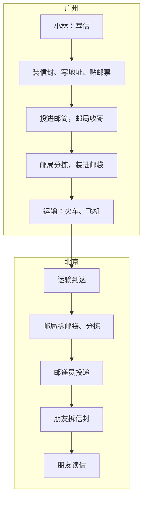
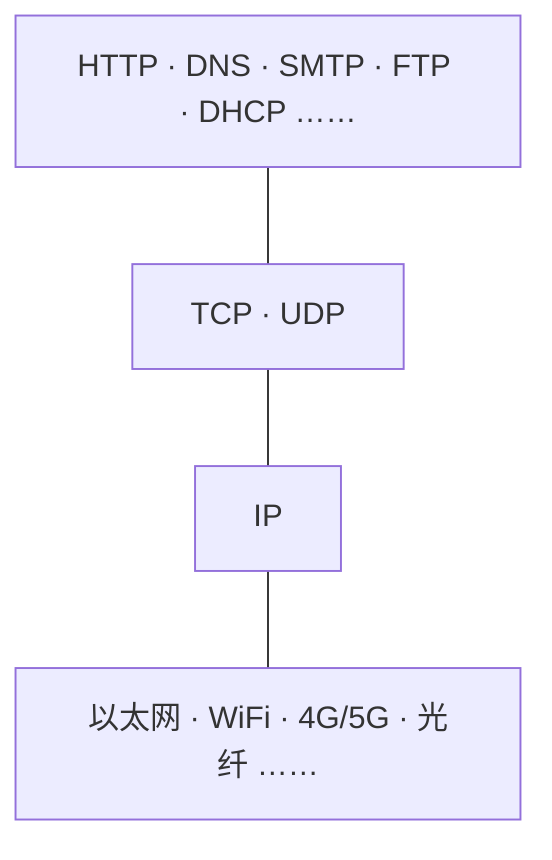
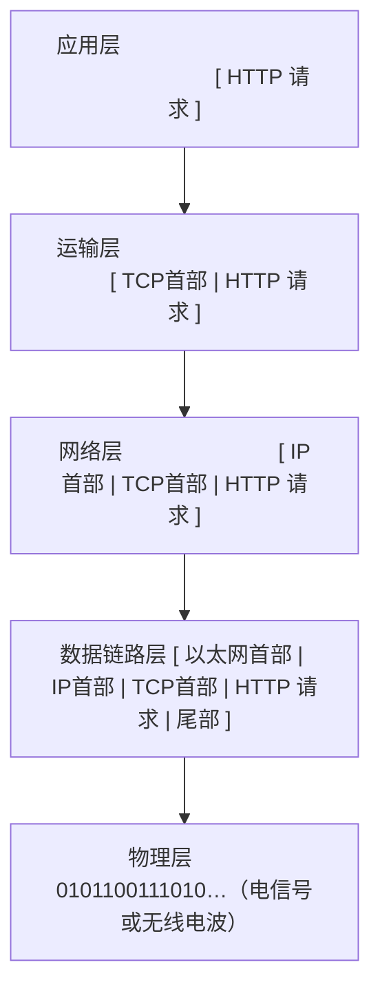
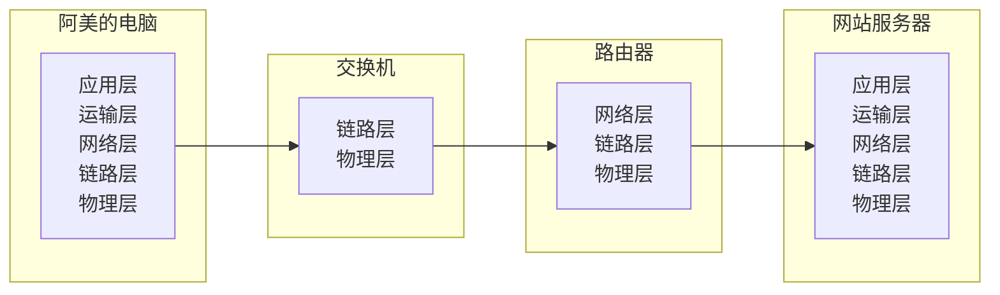
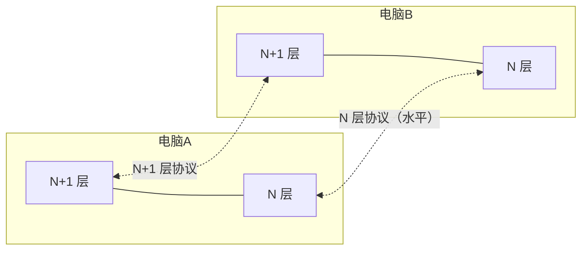
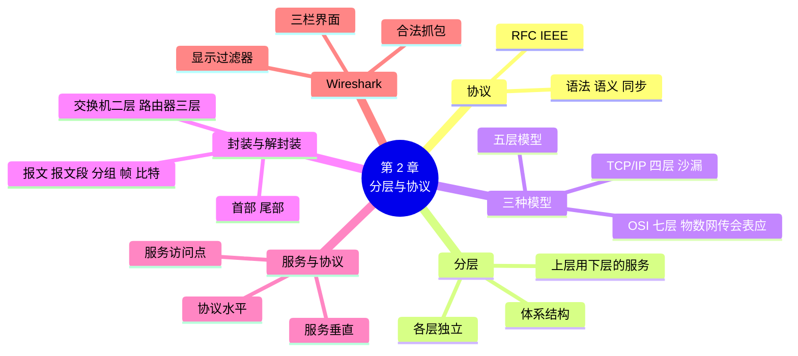

# 第 2 章 网络体系结构：分层与协议

!!! abstract "本章学时"
    理论 5 学时（线上 4 + 线下 1）· 实验 1 学时（本章共 3 个实验，★ 必做 2 个）

## 学习目标

学完本章，你应该能够：

1. **说出**协议的三要素，以及 OSI 七层模型各层的名称和顺序（记忆）；
2. **解释**网络为什么要分层，五层模型中每层负责什么、数据单位叫什么（理解）；
3. **描述**数据从发送方到接收方逐层封装、解封装的过程（理解）；
4. **使用** Wireshark 打开抓包文件、用显示过滤器找到 DNS、TCP、HTTP 数据（应用）；
5. **判断**一个协议或一台设备属于哪一层（分析）。

!!! info "先修要求"
    学习本章前，你需要掌握：

    - [1.2 网络由什么组成](../01-intro/index.md#12)：端系统、链路、网络设备；
    - [1.4.3 分组交换](../01-intro/index.md#143)：分组由首部和数据组成；
    - 会安装 Windows 软件（实验 2-1 安装 Wireshark）。

??? abstract "本章概念清单（24 个，点击查看定义和例子）"
    1. [网络协议](../../appendix/glossary.md#g-网络协议)
    2. [语法](../../appendix/glossary.md#g-语法)
    3. [语义](../../appendix/glossary.md#g-语义)
    4. [同步](../../appendix/glossary.md#g-同步)
    5. [体系结构](../../appendix/glossary.md#g-体系结构)
    6. [OSI 参考模型](../../appendix/glossary.md#g-OSI-参考模型)
    7. [TCP/IP 体系结构](../../appendix/glossary.md#g-TCP-IP-体系结构)
    8. [五层模型](../../appendix/glossary.md#g-五层模型)
    9. [应用层](../../appendix/glossary.md#g-应用层)
    10. [运输层](../../appendix/glossary.md#g-运输层)
    11. [网络层](../../appendix/glossary.md#g-网络层)
    12. [数据链路层](../../appendix/glossary.md#g-数据链路层)
    13. [物理层](../../appendix/glossary.md#g-物理层)
    14. [封装](../../appendix/glossary.md#g-封装)
    15. [解封装](../../appendix/glossary.md#g-解封装)
    16. [首部](../../appendix/glossary.md#g-首部)
    17. [协议数据单元](../../appendix/glossary.md#g-协议数据单元)
    18. [帧](../../appendix/glossary.md#g-帧)
    19. [对等层通信](../../appendix/glossary.md#g-对等层通信)
    20. [服务](../../appendix/glossary.md#g-服务)
    21. [服务访问点](../../appendix/glossary.md#g-服务访问点)
    22. [Wireshark](../../appendix/glossary.md#g-Wireshark)
    23. [抓包](../../appendix/glossary.md#g-抓包)
    24. [显示过滤器](../../appendix/glossary.md#g-显示过滤器)

## 情景导入

小林在第 1 章摸清了工作室网络的样子，可还是想不通一件事：阿美用的是苹果笔记本，陈姐用的是 Windows 台式机，打印机是日本品牌，路由器是国产的，网站服务器装的是 Linux——这么多不同厂家、不同系统的设备，怎么就能互相“听懂”？

老周在电话里笑了：“你寄过快递吧？你只管把东西装好、写清楚地址交给快递员，至于快递公司用货车还是飞机、中途在哪个分拣中心转，你不用管；快递员也不用知道箱子里装的是衣服还是书。每个人只管自己那一段，按约定好的格式交接，事情就办成了。网络也是这样：把复杂的通信分成几层，每层只管一件事，每层都有大家公认的规则。”

“那我能看见这些层吗？”小林问。

“能。装个 Wireshark，它能把网线里传的每一个分组抓下来，一层一层拆开给你看。”

这一章，我们先理解协议和分层，记住几种分层模型；然后学习数据怎样一层层“装信封”、又一层层“拆信封”；最后第一次用 Wireshark，打开编者录好的抓包文件，亲眼看看打开一个网页时网线里到底传了什么。

## 2.1 协议：网络里的“约定” { #21 }

### 2.1.1 什么是协议 { #211 }

两个人打电话，要先说“喂”，对方回“你好”，然后才开始说正事；说完要说“再见”再挂断。这些大家默认遵守的规矩，让通话能顺利进行。

计算机之间通信也需要事先约定好规矩：数据按什么格式排列、每一段是什么意思、谁先发谁后发、出了错怎么办。这些为网络中的数据交换而建立的规则、标准或约定，就叫[**网络协议**](../../appendix/glossary.md#g-网络协议 "为网络中的数据交换而建立的规则、标准或约定，简称协议"){ .term }，简称协议。

协议是网络的“共同语言”。不管设备是哪个厂家生产的、装的什么系统，只要遵守同样的协议，就能互相通信。比如所有浏览器和网站服务器都遵守 HTTP 协议，所以你用任何浏览器都能打开任何网站。

### 2.1.2 协议的三要素 { #212 }

一个协议由三部分组成（考点）<sup class="cite">[[1]](#ref2-1)</sup>：

| 要素 | 规定什么 | 打电话的比喻 | 网络中的例子 |
|---|---|---|---|
| [**语法**](../../appendix/glossary.md#g-语法 "协议三要素之一，规定数据的格式和结构"){ .term } | 数据的格式和结构：先放什么、后放什么、每部分多长 | 先报姓名，再说事情 | 以太网帧的前 6 个字节是目的地址，接着 6 个字节是源地址 |
| [**语义**](../../appendix/glossary.md#g-语义 "协议三要素之一，规定各部分数据的含义和要完成的动作"){ .term } | 每一部分是什么意思、要做什么动作 | “喂”表示我在听 | TCP 首部里 SYN 标志为 1，表示“我想和你建立连接” |
| [**同步**](../../appendix/glossary.md#g-同步 "协议三要素之一，规定事件发生的先后顺序"){ .term } | 事件发生的先后顺序和时机 | 对方说完才轮到我说 | 先三次握手建立连接，再传数据，最后断开 |

可以用一句话记：语法管“怎么写”，语义管“什么意思”，同步管“什么时候做”。

### 2.1.3 协议是谁定的 { #213 }

互联网的大部分协议由 IETF 制定，以 RFC 文档发布（[1.6.3 节](../01-intro/index.md#163)）；局域网协议由 IEEE 制定。协议的名字常用英文缩写，本书会遇到几十个：HTTP、DNS、TCP、UDP、IP、ARP、DHCP、ICMP……不用一下子记住，每一章学几个，到第 10 章你就能串起来了。

## 2.2 为什么要分层 { #22 }

### 2.2.1 寄一封信的过程 { #221 }

假设住在广州的小林要给北京的朋友寄一封信<sup class="cite">[[2]](#ref2-2)</sup>：



这个过程有几个特点：

- **每一层只管自己的事**：写信的人只关心信的内容，不管信走哪条铁路；运输部门只管把邮袋运到，不拆开看信写了什么。
- **上层依靠下层提供的服务**：小林要寄信，靠的是邮局“收寄和投递”的服务；邮局靠的是运输部门“运送邮袋”的服务。
- **同一层之间有约定**：两地邮局按同样的规矩写邮编、分拣；写信的人和读信的人用同一种语言。
- **一层变了，其他层不受影响**：铁路换成飞机，写信的人根本感觉不到。

### 2.2.2 分层的好处 { #222 }

网络通信比寄信复杂得多：要把 0 和 1 变成电信号、要找到对方的地址、要选择路径、要保证不丢不错、要让不同的程序互不干扰……全部塞进一个大程序里，既难写又难改。把它分成若干层，每层完成一部分功能，好处是：

1. **各层相对独立**：每层只要知道下层能提供什么服务、自己要为上层提供什么服务，不需要知道别的层是怎么实现的。
2. **灵活**：某一层的技术更新了（比如网线换成 WiFi），只要它为上层提供的服务不变，上下层都不用改。
3. **易于实现和维护**：大问题拆成小问题，各层可以由不同的厂家、团队开发。
4. **便于标准化**：每层的功能和接口清楚，容易制定标准。

当然，层数不是越多越好：层太少，每层太复杂；层太多，数据要经过很多层处理，效率低。

### 2.2.3 体系结构 { #223 }

计算机网络各层及其协议的集合，叫作网络的[**体系结构**](../../appendix/glossary.md#g-体系结构 "计算机网络各层及其协议的集合"){ .term }。它规定了网络应该分几层、每层做什么，但不规定具体用什么硬件和软件实现。历史上影响最大的体系结构有两个：OSI 七层模型和 TCP/IP 模型。

## 2.3 OSI 七层模型 { #23 }

### 2.3.1 七层各做什么 { #231 }

20 世纪 80 年代，国际标准化组织 ISO 提出了**开放系统互连参考模型**，简称 [**OSI 参考模型**](../../appendix/glossary.md#g-OSI-参考模型 "国际标准化组织提出的七层网络体系结构：物理、数据链路、网络、传输、会话、表示、应用"){ .term }，把网络通信分成 7 层。<sup class="cite">[[3]](#ref2-3)</sup> 从下往上依次是：

| 层号 | 名称 | 主要作用 | 打个比方 |
|---|---|---|---|
| 7 | 应用层 | 为用户的应用程序提供网络服务 | 写信、读信的人 |
| 6 | 表示层 | 数据格式转换、加密解密、压缩解压 | 翻译，把中文信翻成对方能读的文字 |
| 5 | 会话层 | 建立、管理和结束两个程序之间的会话 | 约定“这件事分三封信说完” |
| 4 | 传输层 | 为两台主机上的程序之间提供端到端的可靠传输 | 挂号信：丢了要补寄，按顺序收齐 |
| 3 | 网络层 | 给分组编址，选择从源到目的的路径 | 邮局按地址和邮编决定往哪个城市送 |
| 2 | 数据链路层 | 在相邻两个节点之间可靠地传送帧 | 两个相邻邮局之间交接邮袋 |
| 1 | 物理层 | 在介质上传输比特流（0 和 1） | 公路、铁路和车辆 |

!!! tip "记忆口诀"
    从下往上：**物、数、网、传、会、表、应**（物理、数据链路、网络、传输、会话、表示、应用）。

    也可以用英文首字母 P-D-N-T-S-P-A 编一句：“**P**lease **D**o **N**ot **T**hrow **S**ausage **P**izza **A**way”（请别扔掉香肠披萨）。

### 2.3.2 OSI 为什么没有流行起来 { #232 }

OSI 模型概念清晰、层次分明，是学习网络原理的好框架。但它没有在实际中流行起来，原因主要有：

- 标准制定周期太长，等 OSI 的产品出来，基于 TCP/IP 的互联网已经在全世界铺开了；
- 层次划分不太合理，会话层和表示层的功能很少，而数据链路层和网络层又太复杂；
- 协议实现复杂，运行效率不高。

于是出现了一个有趣的局面：**法律上的国际标准**是 OSI，**事实上的国际标准**是 TCP/IP。今天，人们仍然用 OSI 的层号来称呼各层，比如“二层交换机”“三层交换机”“七层负载均衡”，这里的“二层、三层、七层”就是 OSI 的层号。

## 2.4 TCP/IP 模型与五层模型 { #24 }

### 2.4.1 TCP/IP 四层模型 { #241 }

互联网实际使用的是 [**TCP/IP 体系结构**](../../appendix/glossary.md#g-TCP-IP-体系结构 "互联网实际使用的四层体系结构：应用层、运输层、网际层、网络接口层"){ .term }，因其中最重要的两个协议 TCP 和 IP 而得名。它分为 4 层<sup class="cite">[[5]](#ref2-5)</sup>：

| TCP/IP 层 | 作用 | 代表协议 |
|---|---|---|
| 应用层 | 各种网络应用 | HTTP、DNS、SMTP、FTP、DHCP |
| 运输层（传输层） | 进程之间的端到端通信 | TCP、UDP |
| 网际层 | 主机之间的通信，分组的寻址和转发 | IP、ICMP、ARP |
| 网络接口层 | 接入各种具体的网络 | 以太网、WiFi 等（TCP/IP 本身没有具体规定） |

TCP/IP 有一个重要特点：IP 协议在中间，上面可以跑各种应用，下面可以用各种网络。画出来像一个**沙漏**：上宽下宽、中间细，“IP 一统天下”（everything over IP，IP over everything）。



### 2.4.2 本书使用的五层模型 { #242 }

TCP/IP 的网络接口层没有具体内容，不便于讲清原理；OSI 的七层又太多。所以教学中通常综合两者，采用[**五层模型**](../../appendix/glossary.md#g-五层模型 "教学中综合 OSI 和 TCP/IP 的模型：应用层、运输层、网络层、数据链路层、物理层"){ .term }：应用层、运输层、网络层、数据链路层、物理层。本书第 3～10 章就按这五层从下往上讲。

| OSI 七层 | TCP/IP 四层 | 本书五层 | 数据单位（PDU） | 典型设备 | 本书章节 |
|---|---|---|---|---|---|
| 应用层<br>表示层<br>会话层 | 应用层 | [**应用层**](../../appendix/glossary.md#g-应用层 "为用户的应用程序提供网络服务的层"){ .term } | 报文 | — | 第 10 章 |
| 传输层 | 运输层 | [**运输层**](../../appendix/glossary.md#g-运输层 "为两台主机中的进程提供端到端通信的层，也叫传输层"){ .term } | 报文段（TCP）<br>用户数据报（UDP） | — | 第 9 章 |
| 网络层 | 网际层 | [**网络层**](../../appendix/glossary.md#g-网络层 "负责分组的寻址和路由选择、把分组从源主机送到目的主机的层"){ .term } | 分组（IP 数据报） | 路由器、三层交换机 | 第 6～8 章 |
| 数据链路层 | 网络接口层 | [**数据链路层**](../../appendix/glossary.md#g-数据链路层 "在相邻节点之间以帧为单位传送数据的层"){ .term } | 帧 | 交换机、网卡 | 第 4～5 章 |
| 物理层 | 网络接口层 | [**物理层**](../../appendix/glossary.md#g-物理层 "在传输介质上透明地传送比特流的层"){ .term } | 比特 | 集线器、中继器、网线、光纤 | 第 3 章 |

!!! warning "考点：哪些设备属于哪一层"
    物理层：中继器、集线器（只放大、转发信号，不认地址）；数据链路层：交换机、网桥（认 MAC 地址）；网络层：路由器（认 IP 地址）。注意“设备工作在第几层”指它最高能处理到哪一层：路由器也有物理层和数据链路层的功能，但它最主要的工作在网络层。

本书中“运输层”和“传输层”指同一层，按习惯两种叫法都会出现。

### 2.4.3 每一层到底在干什么 { #243 }

用小禾工作室的一个场景把五层串起来：阿美在浏览器里打开工作室内部网站 `www.xiaohe.com`。

| 层 | 这一层要解决的问题 | 在这个场景里做了什么 |
|---|---|---|
| 应用层 | 我要什么服务？ | 浏览器按 HTTP 协议写出请求：“请把首页给我” |
| 运输层 | 交给对方哪个程序？怎样保证不丢不乱？ | TCP 给请求标上“交给对方的 80 号端口（网站程序）”，并负责可靠送达 |
| 网络层 | 对方在哪里？走哪条路？ | IP 标上源地址 192.168.1.10 和目的地址 203.0.113.10，路由器据此一站站转发 |
| 数据链路层 | 下一站是谁？这一段怎么交接？ | 以太网标上“下一站是路由器的网卡”的 MAC 地址，并加上差错校验 |
| 物理层 | 0 和 1 怎么变成信号？ | 网卡把比特变成网线上的电信号或 WiFi 的无线电波 |

## 2.5 封装与解封装 { #25 }

### 2.5.1 层层“装信封” { #251 }

发送数据时，数据从应用层往下传，每经过一层，这一层就在数据前面加上自己的“[首部](../../appendix/glossary.md#g-首部 "加在数据前面、存放本层控制信息的部分"){ .term }”（数据链路层还要在后面加一个“尾部”），就像把信装进一个又一个信封，每个信封上写着这一层需要的信息。这个过程叫[**封装**](../../appendix/glossary.md#g-封装 "发送方每一层在上层数据前加上本层首部（链路层还加尾部）的过程"){ .term }。



每一层加上首部后形成的数据单元，叫作这一层的[**协议数据单元**](../../appendix/glossary.md#g-协议数据单元 "对等层之间交换的数据单元，各层名称不同"){ .term }（PDU）。各层 PDU 的名字不同（考点）：

| 层 | PDU 名称 | 首部里写了什么（举例） |
|---|---|---|
| 应用层 | 报文 | 请求的网址、浏览器类型 |
| 运输层 | 报文段 / 用户数据报 | 源端口、目的端口、序号 |
| 网络层 | 分组 / IP 数据报 | 源 IP 地址、目的 IP 地址、TTL |
| 数据链路层 | 帧 | 源 MAC 地址、目的 MAC 地址；尾部是校验码 |
| 物理层 | 比特 | （不加首部，直接变成信号） |

!!! example "算一算：一个网页请求被包了几层"
    实验 2-1 的抓包文件中，第 10 个分组是阿美的浏览器发出的网页请求，Wireshark 显示它一共 220 字节，各层分别是：

    | 层 | 部分 | 字节数 |
    |---|---|---|
    | 数据链路层 | 以太网首部 | 14 |
    | 网络层 | IP 首部 | 20 |
    | 运输层 | TCP 首部 | 32 |
    | 应用层 | HTTP 请求 | 154 |
    | **合计** | | **220** |

    真正有用的 HTTP 内容是 154 字节，首部共 14 + 20 + 32 = 66 字节，占 30%。如果只发一个字（比如聊天里的“好”），首部的比例就更大了。这就是 [1.4.3 节](../01-intro/index.md#143)说的分组交换的“首部开销”。（Wireshark 抓到的[帧](../../appendix/glossary.md#g-帧 "数据链路层的协议数据单元"){ .term }通常不显示 4 字节的尾部，因为网卡收到后已经检查并去掉了。）

### 2.5.2 层层“拆信封” { #252 }

接收方收到比特流后，从下往上逐层处理：每一层读取并去掉本层的首部，检查无误后，把剩下的部分交给上一层，直到应用层拿到原始的数据。这个过程叫[**解封装**](../../appendix/glossary.md#g-解封装 "接收方每一层读取并去掉本层首部、把数据交给上层的过程"){ .term }。

关键在于：**接收方的每一层只看对方同一层加的首部**。接收方的 TCP 只读发送方 TCP 写的首部，不关心以太网首部写了什么——就像读信的朋友只看信纸，不看邮袋上的标签。这种同层之间按协议“对话”的关系，叫[**对等层通信**](../../appendix/glossary.md#g-对等层通信 "通信双方同一层之间按协议交换信息，只读对方同层的首部"){ .term }。

### 2.5.3 中间设备拆到哪一层 { #253 }

分组从阿美的电脑到网站服务器，中间要经过交换机和路由器。它们并不会把信封全部拆开：



- **交换机**拆到数据链路层：看目的 MAC 地址，决定从哪个接口转发；
- **路由器**拆到网络层：看目的 IP 地址，查路由表决定下一站，然后**换上新的链路层首部**再发出去；
- 只有两端的主机才会拆到运输层和应用层。

所以说，网络层及以下是“点到点”的，每一段链路都要处理；运输层和应用层是“端到端”的，只在两端的主机上处理。

<iframe class="sim-frame" src="../../sims/encapsulation/main.html" height="600" loading="lazy" title="层层装信封"></iframe>

动画：点“发送”看阿美的网页请求一层层加上首部变成比特，经过交换机和路由器，再在服务器上一层层拆开；数据长度取自实验 2-1 的抓包文件。
{ .sim-caption }

## 2.6 服务、接口与协议 { #26 }

这三个词经常一起出现，考试也常考它们的区别：

- [**服务**](../../appendix/glossary.md#g-服务 "下层为相邻上层提供的功能，是垂直关系"){ .term }：下层为相邻上层提供的功能，是“垂直”的。比如运输层为应用层提供“可靠地把数据送到对方程序”的服务。
- **协议**：对等层之间通信的规则，是“水平”的。比如两台电脑的 TCP 之间按 TCP 协议通信。
- **接口**：相邻两层之间交换信息的地方，也叫[**服务访问点**](../../appendix/glossary.md#g-服务访问点 "相邻两层之间交换信息的接口"){ .term }（SAP）。比如运输层通过“端口号”为不同的应用程序提供服务，端口号就是运输层和应用层之间的服务访问点。



一句话：**协议是水平的，服务是垂直的**。本层的协议靠下层提供的服务来实现；上层只能看见服务，看不见下层的协议。就像寄信的人只能看见邮局的“收寄服务”，看不见邮局内部的分拣规则。

## 2.7 用 Wireshark 看见分层 { #27 }

### 2.7.1 Wireshark 是什么 { #271 }

[**Wireshark**](../../appendix/glossary.md#g-Wireshark "免费开源的网络抓包和协议分析软件"){ .term } 是一款免费、开源的[**抓包**](../../appendix/glossary.md#g-抓包 "把流经网卡的帧记录下来以供分析"){ .term }工具，能把流经网卡的每一个帧都记录下来，并按协议一层层解析给你看。网络工程师用它排查故障，安全人员用它分析攻击，学生用它把课本上的协议“看得见、摸得着”。<sup class="cite">[[4]](#ref2-4)</sup>

抓下来的数据可以保存成文件，扩展名通常是 `.pcapng` 或 `.pcap`。本书在 `labs/data/pcap/` 里提供了编者在一个真实的小网络中录制的 6 个抓包文件，大家打开看到的结果完全一样，便于对照学习。

!!! warning "只抓自己有权抓的网络"
    抓包能看到网络里传输的内容，包括别人没有加密的数据。只能在自己的电脑、自己管理的网络或经授权的实验环境中抓包。未经允许抓取他人网络的数据，可能违反《网络安全法》和《个人信息保护法》（第 11 章）。

### 2.7.2 认识 Wireshark 的界面 { #272 }

打开一个抓包文件后，Wireshark 的窗口分成三栏：

| 区域 | 位置 | 显示什么 |
|---|---|---|
| 分组列表 | 上 | 每行一个帧：编号、时间、源地址、目的地址、协议、长度、简要信息 |
| 分组详情 | 中 | 选中帧的逐层解析，每层一行，点三角形展开 |
| 字节数据 | 下 | 选中帧的原始字节（十六进制和对应字符） |

分组详情栏就是“分层”的最好证明。选中实验 2-1 文件里的第 10 个帧，你会看到这样的 5 行：

```text
Frame 10: 220 bytes on wire (1760 bits), 220 bytes captured (1760 bits)
Ethernet II, Src: RealtekSemic_68:01:0a (00:e0:4c:68:01:0a), Dst: HuaweiTechno_12:34:01 (00:e0:fc:12:34:01)
Internet Protocol Version 4, Src: 192.168.1.10, Dst: 203.0.113.10
Transmission Control Protocol, Src Port: 35070, Dst Port: 80, Seq: 1, Ack: 1, Len: 154
Hypertext Transfer Protocol
```

第 1 行是 Wireshark 自己加的“这一帧的概况”（不属于任何协议层），下面 4 行从上往下依次是数据链路层（Ethernet II）、网络层（IP）、运输层（TCP）、应用层（HTTP）——正好是五层模型去掉物理层（物理层的信号已经被网卡变成了比特，Wireshark 看不到）。

### 2.7.3 显示过滤器 { #273 }

真实网络里一秒钟就能抓到成百上千个帧，要找到想看的，就要用[**显示过滤器**](../../appendix/glossary.md#g-显示过滤器 "Wireshark 中只显示符合条件的帧的过滤表达式"){ .term }：在分组列表上方的过滤栏里输入条件，回车，只显示符合条件的帧。

| 过滤器 | 只显示 |
|---|---|
| `dns` | DNS 查询和回答 |
| `http` | HTTP 请求和响应 |
| `tcp` | 所有 TCP 报文段 |
| `arp` | ARP 请求和回答 |
| `ip.addr == 203.0.113.10` | 源或目的 IP 是这个地址的 |
| `tcp.port == 80` | 源或目的端口是 80 的 |
| `dns or http` | DNS 或 HTTP（用 `or`、`and`、`not` 组合） |

过滤栏变绿表示写法正确，变红表示有错（比如把 `==` 写成了 `=`）。

## 2.8 本章常见问题对照 { #28 }

| 现象 | 用大白话说 | 怎么查、怎么改 |
|---|---|---|
| 分不清“七层”“四层”“五层” | 是三种模型，层的划分不同 | 记住 2.4.2 节的对照表：五层 = TCP/IP 的四层把最下层拆成两层 |
| 搞混“报文”“分组”“帧” | 它们是不同层的 PDU | 应用层报文、运输层报文段、网络层分组、链路层帧、物理层比特 |
| Wireshark 打开后没有网卡可选 | 抓包驱动 Npcap 没装好 | 重新安装 Wireshark，勾选安装 Npcap |
| 过滤栏是红色的 | 过滤器写法不对 | 检查拼写，等于用 `==`，协议名用小写 |
| 抓自己的包看不到 HTTP | 现在大多数网站用 HTTPS 加密，显示为 TLS | 用过滤器 `tls`；看 HTTP 明文请用书里的抓包文件 |
| 自己抓的包太多太乱 | 后台程序一直在联网 | 关掉不用的软件；抓完立刻停止；用过滤器 |

## 2.9 AI 与网络：一次大模型调用穿过的五层 { #29 }

在《Python 编程》第 12 章，你可能用几行代码调用过国产大模型的接口：把问题发过去，等着答案回来。用本章的眼光看，这次调用经历了完整的五层：

| 层 | 这次调用里发生了什么 |
|---|---|
| 应用层 | 程序按大模型平台的接口规定写出 HTTP 请求：网址、你的密钥、JSON 格式的问题 |
| 运输层 | TCP 建立到平台服务器 443 号端口的连接；HTTPS 还要在这里之上做加密（第 11 章） |
| 网络层 | IP 写上你的电脑和平台服务器的地址，经过家里的路由器和运营商的许多台路由器 |
| 数据链路层 | 在每一段链路上换上新的帧首部：WiFi、以太网、运营商的光纤网络 |
| 物理层 | 无线电波、网线里的电信号、光纤里的光脉冲 |

所以当程序报错“连接超时”时，可以按层去想：是应用层的地址写错了？运输层连不上服务器的端口？网络层路由不通？还是物理层根本没联网？这种**分层排查**的思路，第 12 章会系统地讲。

## 本章实验

!!! abstract "实验总览"
    | 实验 | 类型 | 建议时长 | 内容 |
    |---|---|---|---|
    | 实验 2-1 | ★ 必做 | 25 分钟 | 安装 Wireshark，打开抓包文件看五层 |
    | 实验 2-2 | ★ 必做 | 25 分钟 | 抓自己的包，用过滤器找 DNS 和 HTTPS |
    | 实验 2-3 | ☆ 选做 | 15 分钟 | 协议和设备对号入座（在线练习） |

    抓包文件在配套资源 `labs/data/pcap/` 中，录制方法见 `labs/data/README.md`。实验 2-1 中 Wireshark 显示的内容是编者用 Wireshark 4.2（命令行版 tshark）实际打开文件得到的；实验 2-2 抓的是你自己电脑的数据，结果因人而异。

### 实验 2-1 ★ 安装 Wireshark，打开抓包文件看五层 { #2-1 }

**实验目的**

1. 安装 Wireshark，认识它的三栏界面；
2. 打开抓包文件 `web_visit.pcap`，找到网页请求，在分组详情中认出各层；
3. 读出各层首部的长度，验证封装的过程。

**实验环境**：本机（Windows 10/11 或 macOS），安装 Wireshark 4.x（免费，官网 wireshark.org 下载，安装时勾选 Npcap）。

**实验数据**：`labs/data/pcap/web_visit.pcap`——编者的电脑（192.168.1.10）打开工作室内部网站 `www.xiaohe.com` 的全过程，共 18 个帧。

**实验步骤**

第一档 · 跑通：

1. 安装 Wireshark，安装过程中一路“下一步”，遇到 Npcap 安装界面也一并安装。
2. 打开 Wireshark，点菜单“文件 → 打开”，选择 `web_visit.pcap`。
3. 在分组列表中找到第 10 个帧（协议列显示 HTTP，信息列显示 `GET / HTTP/1.1`），单击选中。
4. 在分组详情栏中，依次点开每一行前面的三角形，找到下面的信息。

**运行结果**（编者实际打开文件看到的分组列表，节选第 1～10 个帧）

```text
No.  Time      Source                 Destination            Protocol Length Info
  1  0.000000  RealtekSemic_68:01:0a  Broadcast              ARP      42     Who has 192.168.1.1? Tell 192.168.1.10
  2  0.000017  HuaweiTechno_12:34:01  RealtekSemic_68:01:0a  ARP      42     192.168.1.1 is at 00:e0:fc:12:34:01
  3  0.000019  192.168.1.10           203.0.113.10           DNS      74     Standard query 0x85d7 A www.xiaohe.com
  4  0.000121  192.168.1.10           203.0.113.10           DNS      74     Standard query 0xdbd4 AAAA www.xiaohe.com
  5  0.000443  203.0.113.10           192.168.1.10           DNS      90     Standard query response 0x85d7 A www.xiaohe.com A 203.0.113.10
  6  0.000492  203.0.113.10           192.168.1.10           DNS      74     Standard query response 0xdbd4 AAAA www.xiaohe.com
  7  0.000805  192.168.1.10           203.0.113.10           TCP      74     35070 → 80 [SYN] Seq=0 Win=64240 Len=0 ...
  8  0.000916  203.0.113.10           192.168.1.10           TCP      74     80 → 35070 [SYN, ACK] Seq=0 Ack=1 ...
  9  0.000926  192.168.1.10           203.0.113.10           TCP      66     35070 → 80 [ACK] Seq=1 Ack=1 ...
 10  0.000974  192.168.1.10           203.0.113.10           HTTP     220    GET / HTTP/1.1
```

先不用全看懂。你只需要知道：打开一个网页，电脑先用 ARP 问到路由器的 MAC 地址（第 8 章），再用 DNS 把网址换成 IP 地址（第 10 章），然后用 TCP 三次握手建立连接（第 9 章），最后才发出 HTTP 请求。这正是后面各章要一个个讲的内容。

第 10 个帧的分组详情中，各层的关键信息如下：

```text
Ethernet II, Src: RealtekSemic_68:01:0a (00:e0:4c:68:01:0a), Dst: HuaweiTechno_12:34:01 (00:e0:fc:12:34:01)
    Type: IPv4 (0x0800)
Internet Protocol Version 4, Src: 192.168.1.10, Dst: 203.0.113.10
    .... 0101 = Header Length: 20 bytes (5)
    Time to Live: 64
    Protocol: TCP (6)
Transmission Control Protocol, Src Port: 35070, Dst Port: 80, Seq: 1, Ack: 1, Len: 154
    1000 .... = Header Length: 32 bytes (8)
Hypertext Transfer Protocol
    GET / HTTP/1.1\r\n
    Host: www.xiaohe.com\r\n
    User-Agent: Mozilla/5.0 (Windows NT 10.0; Win64; x64) Chrome/141.0\r\n
```

第二档 · 改一改：

1. 在过滤栏分别输入 `dns`、`tcp`、`http`、`arp`，回车，记下每次显示几个帧。
2. 选中第 14 个帧（服务器回复的 `HTTP/1.1 200 OK`），看它的以太网首部：源和目的 MAC 地址与第 10 个帧相比有什么变化？IP 地址呢？
3. 选中第 10 个帧，在最下面的字节数据栏里点击不同的字节，观察中间栏哪一行被高亮，体会“首部就是最前面的那些字节”。

第三档 · 挑战（选做）：在第 10 个帧上点右键，选“追踪流 → TCP 流”，看看浏览器和服务器之间完整的对话文字。服务器返回的网页里写了什么？

**实验记录表**

| 项目 | 你的结果 |
|---|---|
| 文件一共有几个帧 | |
| 过滤 `dns` / `tcp` / `http` / `arp` 各显示几个帧 | |
| 第 10 帧：源 MAC、目的 MAC | |
| 第 10 帧：源 IP、目的 IP | |
| 第 10 帧：源端口、目的端口 | |
| 第 10 帧：以太网 / IP / TCP 首部和 HTTP 各多少字节 | |
| 第 14 帧与第 10 帧相比，哪些地址对调了 | |

**常见问题排查**

| 现象 | 原因 | 解决 |
|---|---|---|
| 双击 `.pcap` 文件打不开 | 文件没有关联到 Wireshark | 在 Wireshark 里用“文件 → 打开” |
| 界面是英文 | 默认语言 | “Edit → Preferences → Appearance → Language”选简体中文，重启 |
| 源地址显示成 `RealtekSemic_68:01:0a` 而不是数字 | Wireshark 把 MAC 地址的前半部分翻译成了厂商名 | 正常现象；第 4 章会讲 |
| 找不到第 10 帧 | 过滤器还没清空 | 清空过滤栏后回车 |

**思考与练习**

1. 第 10 帧中 TCP 首部的目的端口是 80，这个 80 代表什么？（提示：2.4.3 节）
2. 为什么第 1、2 帧没有 IP 层和 TCP 层？

**实验报告要求**：提交记录表，并画出第 10 帧的封装示意图（像 2.5.1 节那样，标出每层首部的名称和字节数）。

### 实验 2-2 ★ 抓自己的包，用过滤器找 DNS 和 HTTPS { #2-2 }

**实验目的**

1. 用 Wireshark 抓取自己电脑访问网站时的数据；
2. 用过滤器找到 DNS 查询和 HTTPS（TLS）数据；
3. 知道今天大多数网站的内容是加密传输的。

**实验环境**：本机，已安装 Wireshark，已联网。

**实验数据**：你自己电脑的实时数据（只抓自己的电脑）。

**实验步骤**

第一档 · 跑通：

1. 先关闭不需要的软件（微信、网盘、视频软件等），减少无关数据。
2. 打开 Wireshark，在首页双击你正在上网的网卡（WLAN 或以太网，有“心电图”波动的那个），开始抓包。
3. 打开浏览器，访问一个你常用的网站（如 `www.baidu.com`）。
4. 回到 Wireshark，点红色方块停止抓包。
5. 在过滤栏输入 `dns`，回车，找到查询这个网站域名的那一行和对应的回答，记下回答里的 IP 地址。
6. 再输入 `tls`，回车，找到 `Client Hello`，在详情中展开 TLS 层，找到 Server Name（服务器名称）。

第二档 · 改一改：

1. 把过滤器改成 `ip.addr == 你在第 5 步记下的地址`，看看你的电脑和这个网站之间一共传了多少个帧。
2. 选一个 TLS 的“Application Data”帧，看看详情栏里能不能读出网页内容。为什么不能？
3. 点菜单“文件 → 另存为”，把抓到的数据保存成 `my_capture.pcapng`。

第三档 · 挑战（选做）：点菜单“统计 → 协议分级”，看看这次抓包中各种协议各占多少比例，哪种最多？

**实验记录表**

| 项目 | 你的结果 |
|---|---|
| 访问的网站 | |
| DNS 回答的 IP 地址 | |
| `Client Hello` 中的 Server Name | |
| 与该网站之间的帧数 | |
| Application Data 能否看出内容，为什么 | |
| 协议分级中占比最高的协议（选做） | |

**常见问题排查**

| 现象 | 原因 | 解决 |
|---|---|---|
| 过滤 `dns` 什么都没有 | 浏览器已经缓存了这个域名的地址 | 换一个没访问过的网站，或在命令提示符运行 `ipconfig /flushdns` 清空缓存后再抓 |
| 过滤 `dns` 看不到，但能上网 | 浏览器开启了“安全 DNS”（DNS over HTTPS），DNS 也加密了 | 正常现象；第 10 章讲 |
| 首页看不到任何网卡 | Npcap 没装或没有权限 | 重新安装 Wireshark 并勾选 Npcap；以管理员身份运行 |
| 抓包文件很大 | 抓了太久 | 访问完网站立刻停止抓包 |

**思考与练习**

1. 你抓到的网页内容为什么看不到，而实验 2-1 的 `web_visit.pcap` 能看到网页的文字？
2. 抓包时你没有操作电脑，Wireshark 里还是不断出现新的数据，这些可能是什么？

**实验报告要求**：提交记录表和两张截图（DNS 回答、Client Hello 的 Server Name）。

### 实验 2-3 ☆ 协议和设备对号入座 { #2-3 }

**实验目的**：通过拖放练习，熟记五层模型中各层的代表协议、数据单位和设备。

**实验环境**：浏览器，打开下面的在线练习。

**实验步骤**：把下方的卡片拖到（或点选后点击）正确的层里，全部放好后点“检查”。答错的卡片会标红，可以再改。

<iframe class="sim-frame" src="../../sims/layer-sort/main.html" height="620" loading="lazy" title="协议对号入座"></iframe>

动画：20 张卡片包括协议、数据单位和设备，放进五层模型对应的格子；点“检查”立即判分，点“换一批”重新出题。
{ .sim-caption }

**实验记录表**

| 次数 | 得分（满分 20） | 放错的卡片 |
|---|---|---|
| 第 1 次 | | |
| 第 2 次 | | |

**思考与练习**：ARP 有的教材放在网络层，有的放在数据链路层。查一查第 8 章的介绍，说说你的看法。

**实验报告要求**：提交两次练习的得分截图。

## 本章小结

- **网络协议**是为网络中的数据交换而建立的规则，三要素是**语法**（格式）、**语义**（含义）、**同步**（时序）。
- 分层让每层只管一件事、上层使用下层的服务，各层相对独立、灵活、易实现和标准化。各层及其协议的集合叫**体系结构**。
- **OSI 参考模型**七层，从下往上：物理、数据链路、网络、传输、会话、表示、应用（口诀“物数网传会表应”），是法律上的标准；**TCP/IP 体系结构**四层，是事实上的标准，像一个以 IP 为中心的沙漏。教学用**五层模型**：应用、运输、网络、数据链路、物理。
- 发送时逐层**封装**（加首部），接收时逐层**解封装**（去首部）；各层的**协议数据单元**：报文、报文段、分组、帧、比特。交换机处理到数据链路层，路由器处理到网络层。
- **协议**是对等层之间水平的规则，**服务**是下层对上层垂直提供的功能，接口叫服务访问点。
- **Wireshark** 可以**抓包**并逐层解析，用**显示过滤器**（`dns`、`tcp`、`ip.addr == …`）快速找到想看的数据；只能抓自己有权抓的网络。



**下一章预告**

五层模型的最底层是物理层：0 和 1 是怎样变成网线里的电信号、光纤里的光、空气里的无线电波的？“千兆宽带”的“千兆”和网线的“六类”“七类”有什么关系？下一章从物理层开始，自下而上逐层学习。

## 参考文献

正文中的上标编号（如<sup class="cite">[[1]](#ref2-1)</sup>）对应下面的文献。带链接的可以直接打开；书籍可在图书馆或电子书平台查阅。

<div class="refs" markdown>

**教材与专著**

- <span id="ref2-1"></span>[1] 谢希仁. 计算机网络[M]. 8 版. 北京: 电子工业出版社, 2021.
    <span class="ref-note">第 1 章“计算机网络体系结构”一节对协议三要素、五层模型、服务与协议的区别有详细讲解，对应 2.1、2.4、2.6 节。</span>
- <span id="ref2-2"></span>[2] KUROSE J F, ROSS K W. Computer Networking: A Top-Down Approach[M]. 8th ed. Hoboken: Pearson, 2021.
    <span class="ref-note">第 1.5 节“协议层次及其服务模型”用航空旅行的例子讲分层，并配有 Wireshark 实验，对应 2.2、2.7 节。</span>

**标准**

- <span id="ref2-3"></span>[3] ISO/IEC. ISO/IEC 7498-1:1994 Information Technology—Open Systems Interconnection—Basic Reference Model: The Basic Model[S]. Geneva: ISO, 1994.
    <span class="ref-note">OSI 七层参考模型的国际标准，对应 2.3 节。</span>

**在线资源**

- <span id="ref2-4"></span>[4] Wireshark Foundation. Wireshark User's Guide[EB/OL]. [2026-11-01]. <https://www.wireshark.org/docs/wsug_html_chunked/>.
    <span class="ref-note">Wireshark 官方用户手册，界面说明和显示过滤器的写法，对应 2.7 节和实验 2-1、2-2。</span>
- <span id="ref2-5"></span>[5] BRADEN R. RFC 1122: Requirements for Internet Hosts—Communication Layers[S/OL]. IETF, 1989[2026-11-01]. <https://www.rfc-editor.org/rfc/rfc1122>.
    <span class="ref-note">描述 TCP/IP 主机各层（链路层、网际层、运输层）应满足的要求，是 TCP/IP 分层的权威说明，对应 2.4.1 节。</span>

</div>

## 课后练习

选择题和判断题可以直接点击选项作答，系统会马上告诉你对错，并展开答案与解析；多选题选好后点“提交答案”。简答和实操题请先自己作答，再点开“答案与解析”核对。每道题的解析下方都有“回看”链接，做错了可以直接跳回正文复习。

**一、单项选择题**

<div class="quiz" data-answer="B" markdown>

**1.** 协议三要素中，规定“数据的格式和结构”的是（　　）。

- A. 语义
- B. 语法
- C. 同步
- D. 接口

</div>

??? tip "答案与解析"
    **答案：B**

    语法管“怎么写”（格式），语义管“什么意思”，同步管“什么时候做”。接口不是协议的要素。

    考查：协议三要素 · 认知层次：记忆 · [回看 2.1.2](#212)
    { .quiz-meta }

<div class="quiz" data-answer="C" markdown>

**2.** OSI 参考模型从下往上的第三层是（　　）。

- A. 数据链路层
- B. 传输层
- C. 网络层
- D. 会话层

</div>

??? tip "答案与解析"
    **答案：C**

    物理（1）、数据链路（2）、网络（3）、传输（4）、会话（5）、表示（6）、应用（7）。

    考查：OSI 七层 · 认知层次：记忆 · [回看 2.3.1](#231)
    { .quiz-meta }

<div class="quiz" data-answer="A" markdown>

**3.** 在 OSI 模型中，负责数据格式转换、加密解密和压缩的是（　　）。

- A. 表示层
- B. 会话层
- C. 应用层
- D. 传输层

</div>

??? tip "答案与解析"
    **答案：A**

    表示层负责数据的表示形式：格式转换、加密、压缩。会话层管理会话；传输层负责端到端传输。

    考查：OSI 各层功能 · 认知层次：记忆 · [回看 2.3.1](#231)
    { .quiz-meta }

<div class="quiz" data-answer="D" markdown>

**4.** 数据链路层的协议数据单元叫作（　　）。

- A. 报文
- B. 报文段
- C. 分组
- D. 帧

</div>

??? tip "答案与解析"
    **答案：D**

    应用层报文、运输层报文段、网络层分组、数据链路层帧、物理层比特。

    考查：协议数据单元 · 认知层次：记忆 · [回看 2.5.1](#251)
    { .quiz-meta }

<div class="quiz" data-answer="B" markdown>

**5.** 路由器主要工作在五层模型的（　　）。

- A. 物理层
- B. 网络层
- C. 运输层
- D. 应用层

</div>

??? tip "答案与解析"
    **答案：B**

    路由器根据 IP 地址转发分组，工作在网络层。交换机工作在数据链路层，集线器工作在物理层。

    考查：设备所在的层 · 认知层次：理解 · [回看 2.4.2](#242)
    { .quiz-meta }

<div class="quiz" data-answer="C" markdown>

**6.** 下列协议中，属于运输层的是（　　）。

- A. HTTP
- B. IP
- C. UDP
- D. DNS

</div>

??? tip "答案与解析"
    **答案：C**

    运输层有 TCP 和 UDP。HTTP、DNS 属于应用层，IP 属于网络层。

    考查：各层代表协议 · 认知层次：记忆 · [回看 2.4.1](#241)
    { .quiz-meta }

<div class="quiz" data-answer="A" markdown>

**7.** 一个以太网帧共 220 字节，其中以太网首部 14 字节、IP 首部 20 字节、TCP 首部 32 字节，应用层数据有（　　）。

- A. 154 字节
- B. 186 字节
- C. 200 字节
- D. 66 字节

</div>

??? tip "答案与解析"
    **答案：A**

    220 − 14 − 20 − 32 = 154。D 是三个首部之和。

    考查：封装 · 认知层次：应用 · [回看 2.5.1](#251)
    { .quiz-meta }

<div class="quiz" data-answer="D" markdown>

**8.** 在 Wireshark 中只想看与 203.0.113.10 有关的帧，正确的显示过滤器是（　　）。

- A. `ip = 203.0.113.10`
- B. `addr 203.0.113.10`
- C. `ip.addr = 203.0.113.10`
- D. `ip.addr == 203.0.113.10`

</div>

??? tip "答案与解析"
    **答案：D**

    显示过滤器用 `字段名 == 值`，等号是两个。A、C 只有一个等号，过滤栏会变红。

    考查：显示过滤器 · 认知层次：应用 · [回看 2.7.3](#273)
    { .quiz-meta }

**二、多项选择题**

<div class="quiz quiz-multi" data-answer="ABCD" markdown>

**9.** 网络采用分层结构的好处有（　　）。

- A. 各层相对独立，只需知道下层提供的服务
- B. 某层技术改变时，只要服务不变，其他层不受影响
- C. 大问题拆成小问题，易于实现和维护
- D. 便于制定标准

</div>

??? tip "答案与解析"
    **答案：ABCD**

    四项都是分层的好处。注意层数并不是越多越好。

    考查：分层的好处 · 认知层次：理解 · [回看 2.2.2](#222)
    { .quiz-meta }

<div class="quiz quiz-multi" data-answer="AC" markdown>

**10.** 关于路由器转发分组，下列说法正确的有（　　）。

- A. 路由器要读取分组的网络层首部
- B. 路由器要读取并修改 HTTP 请求的内容
- C. 路由器转发时会换上新的数据链路层首部
- D. 路由器会把分组还原成应用层的网页再转发

</div>

??? tip "答案与解析"
    **答案：AC**

    路由器拆到网络层，看目的 IP 地址决定下一站，再重新封装成帧发出。运输层和应用层只在两端主机上处理。

    考查：中间设备拆到哪一层 · 认知层次：理解 · [回看 2.5.3](#253)
    { .quiz-meta }

<div class="quiz quiz-multi" data-answer="BD" markdown>

**11.** 下列说法中，正确的有（　　）。

- A. 协议是“垂直”的，服务是“水平”的
- B. 本层协议的实现要依靠下层提供的服务
- C. 上层能够看见下层的协议细节
- D. 对等层之间按照协议进行通信

</div>

??? tip "答案与解析"
    **答案：BD**

    协议是水平的（对等层之间），服务是垂直的（下层对上层），A 说反了。上层只能看见服务，看不见下层协议，C 错。

    考查：服务与协议 · 认知层次：理解 · [回看 2.6](#26)
    { .quiz-meta }

**三、判断题**

<div class="quiz quiz-judge" data-answer="×" markdown>

**12.** 互联网实际使用的体系结构是 OSI 七层模型。（　　）

</div>

??? tip "答案与解析"
    **答案：×**

    互联网使用 TCP/IP 体系结构，它是事实上的国际标准；OSI 是法律上的国际标准，没有在实际中普及。

    考查：OSI 与 TCP/IP · 认知层次：记忆 · [回看 2.3.2](#232)
    { .quiz-meta }

<div class="quiz quiz-judge" data-answer="√" markdown>

**13.** 接收方逐层去掉首部，把数据交给上一层的过程叫解封装。（　　）

</div>

??? tip "答案与解析"
    **答案：√**

    发送时加首部是封装，接收时去首部是解封装。

    考查：解封装 · 认知层次：记忆 · [回看 2.5.2](#252)
    { .quiz-meta }

<div class="quiz quiz-judge" data-answer="×" markdown>

**14.** 集线器能够识别 MAC 地址，因此工作在数据链路层。（　　）

</div>

??? tip "答案与解析"
    **答案：×**

    集线器只放大和转发信号，不识别地址，工作在物理层；识别 MAC 地址的是交换机。

    考查：设备所在的层 · 认知层次：理解 · [回看 2.4.2](#242)
    { .quiz-meta }

<div class="quiz quiz-judge" data-answer="√" markdown>

**15.** “三层交换机”中的“三层”指 OSI 模型的网络层。（　　）

</div>

??? tip "答案与解析"
    **答案：√**

    人们习惯用 OSI 的层号称呼各层，三层就是网络层，说明这种交换机能按 IP 地址转发。

    考查：OSI 层号的使用 · 认知层次：理解 · [回看 2.3.2](#232)
    { .quiz-meta }

<div class="quiz quiz-judge" data-answer="×" markdown>

**16.** 只要装了 Wireshark，就可以随意抓取公共场所 WiFi 中其他人的数据。（　　）

</div>

??? tip "答案与解析"
    **答案：×**

    只能在自己的设备、自己管理的网络或经授权的环境中抓包，未经许可抓取他人数据可能违法。

    考查：合法抓包 · 认知层次：评价 · [回看 2.7.1](#271)
    { .quiz-meta }

**四、简答题**

**17.** 用寄信的例子说明网络为什么要分层，并说出分层的两个好处。

??? tip "答案与解析"
    **参考答案：** 寄信时，写信人只管写内容、装信封写地址；邮局只管收寄、分拣和投递；运输部门只管运送邮袋。每一层只做自己的事，依靠下一层的服务，同层之间有共同的规矩（如邮编格式）；铁路换成飞机，写信人感觉不到。网络通信很复杂，分层后：① 各层相对独立，只需知道下层提供什么服务；② 某一层技术变化不影响其他层，灵活；③ 大问题拆成小问题，易于实现、维护和标准化（答出两点即可）。

    考查：分层的意义 · 认知层次：理解 · [回看 2.2](#22)
    { .quiz-meta }

**18.** 画出五层模型，写出每层的名称、协议数据单元和一个代表协议（或设备）。

??? tip "答案与解析"
    **参考答案：** 从上往下：应用层—报文—HTTP / DNS；运输层—报文段（TCP）或用户数据报（UDP）—TCP / UDP；网络层—分组（IP 数据报）—IP，设备路由器；数据链路层—帧—以太网，设备交换机；物理层—比特—设备集线器、网线、光纤。

    考查：五层模型 · 认知层次：记忆 · [回看 2.4.2](#242)
    { .quiz-meta }

**19.** 阿美的电脑把网页请求发给服务器，中间经过一台交换机和一台路由器。请说明数据在这四台设备上分别被处理到哪一层，为什么交换机和路由器不需要处理到应用层？

??? tip "答案与解析"
    **参考答案：** 阿美的电脑：从应用层往下封装到物理层；交换机：解封装到数据链路层，看目的 MAC 地址转发；路由器：解封装到网络层，看目的 IP 地址查路由表，再重新封装链路层首部转发；服务器：从物理层一直解封装到应用层，交给网站程序。交换机和路由器的任务只是把数据往下一站送，只需要链路层或网络层首部中的地址信息，不需要知道里面装的是什么应用数据，这也体现了分层的独立性。

    考查：封装与中间设备 · 认知层次：分析 · [回看 2.5.3](#253)
    { .quiz-meta }

**五、实操题**

**20.** 打开 `labs/data/pcap/web_visit.pcap`：① 用过滤器只显示 HTTP，写出看到的帧编号；② 选中服务器回复的 `200 OK`，写出它的源 IP、目的 IP、源端口、目的端口；③ 与浏览器发出的请求相比，说明这些地址和端口有什么规律。

??? tip "答案与解析"
    **参考答案：** ① 过滤 `http` 显示第 10 帧（`GET / HTTP/1.1`）和第 14 帧（`HTTP/1.1 200 OK`）。② 第 14 帧：源 IP 203.0.113.10，目的 IP 192.168.1.10，源端口 80，目的端口 35070。③ 回复与请求相比，源和目的正好对调：请求是从 192.168.1.10 的 35070 端口发往 203.0.113.10 的 80 端口，回复则从服务器的 80 端口回到浏览器的 35070 端口。80 是网站服务固定使用的端口，35070 是浏览器临时选的端口（第 9 章）。

    考查：Wireshark 的使用 · 认知层次：应用 · [回看实验 2-1](#2-1)
    { .quiz-meta }
