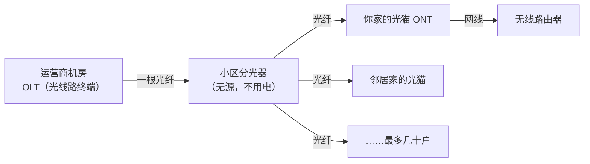
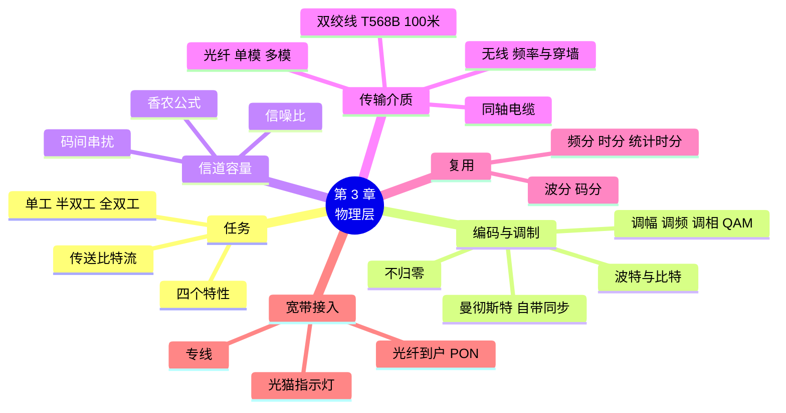

# 第 3 章 物理层：从比特到信号

!!! abstract "本章学时"
    理论 5 学时（线上 4 + 线下 1）· 实验 1 学时（本章共 3 个实验，★ 必做 2 个）

## 学习目标

学完本章，你应该能够：

1. **说出**物理层的任务、单工 / 半双工 / 全双工的区别，以及常见传输介质的特点（记忆）；
2. **识别**不归零编码、曼彻斯特编码和差分曼彻斯特编码的波形（理解、应用）；
3. **解释**带宽、噪声与信道容量的关系，以及复用技术为什么能让一条线同时传多路信号（理解）；
4. **按 T568B 标准**排出网线线序，**区分**单模光纤和多模光纤（应用）；
5. **查看**本机的 WiFi 信号强度、信道和速率，**分析**测速达不到套餐速率的原因（应用、分析）。

!!! info "先修要求"
    学习本章前，你需要掌握：

    - [1.5.1 速率与带宽](../01-intro/index.md#151)：bit/s、Mbps、1 字节 = 8 比特；
    - [2.4.2 五层模型](../02-architecture/index.md#242)：物理层是最下面一层，数据单位是比特。

??? abstract "本章概念清单（30 个，点击查看定义和例子）"
    1. [数据](../../appendix/glossary.md#g-数据)
    2. [信号](../../appendix/glossary.md#g-信号)
    3. [模拟信号](../../appendix/glossary.md#g-模拟信号)
    4. [数字信号](../../appendix/glossary.md#g-数字信号)
    5. [码元](../../appendix/glossary.md#g-码元)
    6. [信道](../../appendix/glossary.md#g-信道)
    7. [单工](../../appendix/glossary.md#g-单工)
    8. [半双工](../../appendix/glossary.md#g-半双工)
    9. [全双工](../../appendix/glossary.md#g-全双工)
    10. [基带信号](../../appendix/glossary.md#g-基带信号)
    11. [编码](../../appendix/glossary.md#g-编码)
    12. [调制](../../appendix/glossary.md#g-调制)
    13. [曼彻斯特编码](../../appendix/glossary.md#g-曼彻斯特编码)
    14. [码间串扰](../../appendix/glossary.md#g-码间串扰)
    15. [频带宽度](../../appendix/glossary.md#g-频带宽度)
    16. [波特](../../appendix/glossary.md#g-波特)
    17. [信噪比](../../appendix/glossary.md#g-信噪比)
    18. [信道容量](../../appendix/glossary.md#g-信道容量)
    19. [香农公式](../../appendix/glossary.md#g-香农公式)
    20. [双绞线](../../appendix/glossary.md#g-双绞线)
    21. [直通线](../../appendix/glossary.md#g-直通线)
    22. [光纤](../../appendix/glossary.md#g-光纤)
    23. [单模光纤](../../appendix/glossary.md#g-单模光纤)
    24. [多模光纤](../../appendix/glossary.md#g-多模光纤)
    25. [光纤到户](../../appendix/glossary.md#g-光纤到户)
    26. [无源光网络](../../appendix/glossary.md#g-无源光网络)
    27. [复用](../../appendix/glossary.md#g-复用)
    28. [时分复用](../../appendix/glossary.md#g-时分复用)
    29. [波分复用](../../appendix/glossary.md#g-波分复用)
    30. [光模块](../../appendix/glossary.md#g-光模块)

## 情景导入

工作室要搬到同一栋楼的大一点的办公室，禾姐让小林负责重新布线。物业给了一张清单让他选：“六类线还是超六类线？”“光纤要单模还是多模？”“要不要升级到千兆光纤宽带？”小林一个都答不上来。

更让他头疼的是，设计师阿美坚持说她的笔记本“明明显示 WiFi 满格，速度却很慢”，而隔壁公司的网管告诉小林：“你们楼层 WiFi 太多了，信道撞车。”

老周听完说：“这些都是物理层的事。物理层管的是最实在的东西：线、光、电、无线电波。0 和 1 怎么变成信号、信号在什么材料里走、一条线怎么同时走好几路信号，这些弄清楚了，买线、选宽带、摆路由器心里就有底了。”

这一章，我们从“0 和 1 怎么变成信号”说起，认识编码和调制、信道能跑多快、各种网线光纤和无线、复用技术和宽带接入，最后动手查看自己的 WiFi 信号，并算一算“千兆宽带下载一部电影要多久”。

## 3.1 物理层要解决什么问题 { #31 }

### 3.1.1 物理层的任务 { #311 }

**物理层**的任务是在各种传输介质上传送比特流，让上面的数据链路层感觉不到底下用的是网线、光纤还是无线电波。它要回答的问题是：用什么信号表示 0 和 1？一秒钟传多少个？插头长什么样、几根针？谁先发谁后发？<sup class="cite">[[1]](#ref3-1)</sup>

物理层用四个特性描述接口（了解）：

| 特性 | 规定什么 | 网线（RJ45）的例子 |
|---|---|---|
| 机械特性 | 接口的形状、尺寸、引脚数目和排列 | 水晶头有 8 个触点 |
| 电气特性 | 电压范围、传输速率、距离限制 | 一段网线最长 100 米 |
| 功能特性 | 每根线的意义 | 哪几根线发送、哪几根线接收 |
| 过程特性 | 各种事件出现的先后顺序 | 先协商速率，再开始传数据 |

注意：网线、光纤这些**传输介质本身不属于物理层**，它们在物理层的下面；物理层规定的是怎样在介质上传比特。

### 3.1.2 数据通信的几个基本概念 { #312 }

一个数据通信系统由三部分组成：**源系统**（发送方，比如电脑）、**传输系统**（网络）、**目的系统**（接收方）。几个常用的概念：

- [**数据**](../../appendix/glossary.md#g-数据 "要传送的信息，在计算机里表示为 0 和 1"){ .term }：要传送的信息，在计算机里是 0 和 1。
- [**信号**](../../appendix/glossary.md#g-信号 "数据的电气或电磁表现，分为模拟信号和数字信号"){ .term }：数据的电气或电磁表现。随时间连续变化的叫[**模拟信号**](../../appendix/glossary.md#g-模拟信号 "随时间连续变化的信号"){ .term }（比如声音的波形），只取几个固定值的叫[**数字信号**](../../appendix/glossary.md#g-数字信号 "只取几个固定值的信号"){ .term }（比如高电平表示 1、低电平表示 0）。
- [**码元**](../../appendix/glossary.md#g-码元 "信号波形中代表一个数字值的基本波形，即一个时间小格里的信号"){ .term }：在信号波形中，代表一个数字值的基本波形，也就是“一个时间小格里的信号”。
- [**信道**](../../appendix/glossary.md#g-信道 "向某一个方向传送信息的通路"){ .term }：向某一个方向传送信息的通路。一条通信线路往往包含一条发送信道和一条接收信道。

### 3.1.3 单工、半双工与全双工 { #313 }

按双方能否同时发送，通信方式分三种（考点）：

| 方式 | 含义 | 生活例子 | 网络例子 |
|---|---|---|---|
| [**单工**](../../appendix/glossary.md#g-单工 "只能单向传送的通信方式"){ .term } | 只能单向传送 | 广播电台、电视 | 早期的单向有线电视 |
| [**半双工**](../../appendix/glossary.md#g-半双工 "双方都能发送但不能同时发送的通信方式"){ .term } | 双方都能发，但不能同时发 | 对讲机（说完要说“完毕”） | 早期集线器连接的以太网；WiFi 同一信道上 |
| [**全双工**](../../appendix/glossary.md#g-全双工 "双方可以同时发送和接收的通信方式"){ .term } | 双方可以同时发送和接收 | 打电话 | 交换机连接的以太网、光纤 |

## 3.2 编码与调制：让 0 和 1 变成信号 { #32 }

来自电脑的数字信号叫[**基带信号**](../../appendix/glossary.md#g-基带信号 "来自信源、未经调制的原始数字信号"){ .term }（基本频带信号）。它往往不能直接在线路上传：有的线路传不了低频，有的介质（如空气、光纤）根本不能传电信号。所以要对它做变换，有两种做法：

- [**编码**](../../appendix/glossary.md#g-编码 "把数字信号变换成另一种数字信号，以便在线路上传输"){ .term }：把数字信号变成另一种数字信号，常用于网线等有线局域网；
- [**调制**](../../appendix/glossary.md#g-调制 "把数字信号装到高频载波上变成模拟信号，分调幅、调频、调相"){ .term }：把数字信号“装”到一个高频的载波上，变成模拟信号，常用于无线、光纤和远距离传输。

### 3.2.1 三种常见编码 { #321 }

```text
比特：        0     1     0     0     1     1
不归零：    ▁▁▁▁▁ ▔▔▔▔▔ ▁▁▁▁▁ ▁▁▁▁▁ ▔▔▔▔▔ ▔▔▔▔▔
曼彻斯特：  ▔▔╲▁▁ ▁▁╱▔▔ ▔▔╲▁▁ ▔▔╲▁▁ ▁▁╱▔▔ ▁▁╱▔▔
```

| 编码 | 规则 | 优点 | 缺点 |
|---|---|---|---|
| **不归零编码**（NRZ） | 高电平表示 1，低电平表示 0（或反过来），一个码元里电平不变 | 简单 | 连续一长串 0 或 1 时没有跳变，接收方分不清“到底是几个”，无法同步 |
| [**曼彻斯特编码**](../../appendix/glossary.md#g-曼彻斯特编码 "每个码元中间都有跳变的编码，本书约定向上跳为 1、向下跳为 0，自带同步"){ .term } | 每个码元**中间都有一次跳变**：本书按以太网标准，中间从低跳到高表示 1，从高跳到低表示 0 | 每位都有跳变，接收方可以从信号中提取时钟，自带同步 | 一个比特要跳变一次，所需的频带宽度是不归零编码的 2 倍 |
| **差分曼彻斯特编码** | 每个码元中间也都有跳变（只用来同步）；用码元**开始处有没有跳变**表示数据：有跳变表示 0，没有跳变表示 1 | 抗干扰更好 | 稍复杂 |

!!! warning "考点：曼彻斯特编码的规定方向"
    曼彻斯特编码中“向上跳表示 1 还是 0”，不同教材规定不同：本书按以太网标准（IEEE 802.3）<sup class="cite">[[5]](#ref3-5)</sup>定为“中间向上跳为 1、向下跳为 0”；有的教材正好相反。考试时**以题目给出的规定为准**，没有给出时按教材的规定。判断“是不是曼彻斯特编码”只要看一点：每个码元中间是否都有跳变。

!!! tip "为什么要“自带同步”"
    想象老师念一串“滴、滴、滴……”，如果没有节拍，连着十几个一样的“滴”你很快就数乱了。曼彻斯特编码相当于每个比特都敲一下节拍器，接收方跟着节拍数，就不会数错。早期 10 Mbit/s 以太网就用曼彻斯特编码；更快的以太网改用效率更高的编码，但“要能同步”这个要求没变。

### 3.2.2 三种基本调制 { #322 }

调制就是用数字信号去改变载波（一个连续的正弦波）的某个特征：

| 调制方式 | 改变载波的什么 | 比喻 |
|---|---|---|
| **调幅**（AM，也叫幅移键控 ASK） | 振幅（波的高低） | 用“大声”表示 1、“小声”表示 0 |
| **调频**（FM，也叫频移键控 FSK） | 频率（波的疏密） | 用“高音”表示 1、“低音”表示 0 |
| **调相**（PM，也叫相移键控 PSK） | 相位（波从哪里开始） | 用“正着唱”表示 1、“倒着唱”表示 0 |

实际的 WiFi、4G/5G、光纤宽带会把几种方式组合起来，比如**正交振幅调制**（QAM）同时改变振幅和相位：如果一个码元能表示 16 种不同的状态，那么一个码元就能携带 4 个比特（2⁴ = 16）。WiFi 6 用到了 1024-QAM，一个码元携带 10 个比特，这就是 WiFi 越来越快的一个重要原因。

<iframe class="sim-frame" src="../../sims/encoding/main.html" height="620" loading="lazy" title="编码与调制"></iframe>

动画：输入一串 0 和 1，同时画出不归零、曼彻斯特、差分曼彻斯特编码和调幅、调频、调相的波形；点某一位，看它在每种波形里的样子。
{ .sim-caption }

### 3.2.3 码元与比特：波特和比特每秒 { #323 }

码元的传输速率叫**波特率**，单位是[**波特**](../../appendix/glossary.md#g-波特 "码元传输速率的单位，每秒传输一个码元为 1 波特"){ .term }（Baud），表示每秒传多少个码元；比特率表示每秒传多少个比特，单位 bit/s。二者的关系：

\[ \text{比特率} = \text{波特率} \times \log_2 M \]

其中 \(M\) 是一个码元可能取的状态数。

!!! example "算一算：波特率和比特率"
    某信道的波特率是 2 400 Baud。

    - 如果每个码元只有 2 种状态（表示 0 或 1），比特率 = 2 400 × log₂2 = **2 400 bit/s**；
    - 如果每个码元有 16 种状态，比特率 = 2 400 × log₂16 = 2 400 × 4 = **9 600 bit/s**。

    所以，在码元速率不变的情况下，让每个码元携带更多比特，就能提高信息传输速率。

## 3.3 信道能传多快 { #33 }

### 3.3.1 为什么速率不能无限提高 { #331 }

信号在信道上传输时会失真：波形被“磨圆”、被噪声干扰。码元传得太快，前后码元的波形就会混在一起分不清，这叫[**码间串扰**](../../appendix/glossary.md#g-码间串扰 "码元传得太快，前后码元的波形混在一起无法分辨的现象"){ .term }。

1924 年，奈奎斯特（Nyquist）得出：在理想的、没有噪声的信道中，码元传输速率有上限。信道的[**频带宽度**](../../appendix/glossary.md#g-频带宽度 "信道能通过的最高频率减去最低频率，单位赫兹（Hz）"){ .term }（能通过的最高频率减去最低频率，单位赫兹 Hz）越宽，码元传输的极限速率就越高。<sup class="cite">[[4]](#ref3-4)</sup>

### 3.3.2 香农公式：带宽、噪声与信道容量 { #332 }

真实的信道都有噪声。1948 年，香农（Shannon）用信息论推导出带噪声信道的极限信息传输速率，叫[**信道容量**](../../appendix/glossary.md#g-信道容量 "带噪声信道的极限信息传输速率，由香农公式给出"){ .term }：<sup class="cite">[[3]](#ref3-3)</sup>

\[ C = W \log_2\left(1 + \frac{S}{N}\right) \]

其中 \(C\) 是信道容量（bit/s），\(W\) 是信道的频带宽度（Hz），\(S/N\) 是[**信噪比**](../../appendix/glossary.md#g-信噪比 "信号平均功率与噪声平均功率之比，常用分贝表示"){ .term }——信号功率与噪声功率之比。信噪比常用分贝（dB）表示：信噪比（dB）= 10 log₁₀(S/N)，例如 S/N = 1 000 时为 30 dB。

本书不要求推导和复杂计算，只记住三个结论：

1. 信道的**频带宽度越宽、信噪比越高**，能达到的极限速率就越高；
2. 只要实际速率不超过信道容量，总能找到某种编码办法实现无差错传输；超过了就一定会出错；
3. 这是理论上限，实际系统总要低于它。

!!! example "算一算：老式电话线能传多快"
    电话线的频带宽度约 3 100 Hz，信噪比约 30 dB（S/N = 1 000）。

    C = 3 100 × log₂(1 + 1 000) ≈ 3 100 × 9.97 ≈ **30 900 bit/s**，约 31 kbit/s。

    这就是 20 世纪 90 年代“拨号上网”的调制解调器最高只能到 33.6 kbit/s 左右的原因（56k 调制解调器另用了数字线路的技巧）。后来的 ADSL 在同一根电话线上用了远高于 3 100 Hz 的频段，才把速率提高到几 Mbit/s。

### 3.3.3 回到“千兆宽带” { #333 }

[香农公式](../../appendix/glossary.md#g-香农公式 "C = W log₂(1 + S/N)，给出带宽和信噪比一定时的极限传输速率"){ .term }告诉我们：WiFi 信号弱（S 小）或周围干扰多（N 大）时，信噪比下降，能达到的速率就下降。所以 WiFi 显示“满格”只说明信号强度还可以，如果同一信道上的干扰很大，速度照样上不去——这正是阿美遇到的情况。实验 3-2 会让你查看自己的 WiFi 信号。

## 3.4 传输介质 { #34 }

传输介质分两大类：**导引型**（信号沿着固体介质传，如网线、光纤）和**非导引型**（在自由空间中传，如无线电波）。

### 3.4.1 双绞线 { #341 }

[**双绞线**](../../appendix/glossary.md#g-双绞线 "把两根绝缘铜线按一定规律绞在一起以减少干扰的传输介质，一段最长 100 米"){ .term }就是我们常说的“网线”：把两根互相绝缘的铜导线按一定的规律绞在一起，四对共八根装在一个外皮里。绞合可以减少相邻导线之间的电磁干扰，绞得越密，抗干扰能力越强。

| 类别 | 常见用途 | 最高速率（100 米内） | 说明 |
|---|---|---|---|
| 五类（Cat5） | 早期百兆网络 | 100 Mbit/s | 已基本淘汰 |
| 超五类（Cat5e） | 家庭、办公千兆 | 1 Gbit/s | 目前最常见 |
| 六类（Cat6） | 办公千兆、短距离万兆 | 1 Gbit/s（万兆约 55 米内） | 新装修推荐 |
| 超六类（Cat6a） | 万兆到桌面、无线接入点 | 10 Gbit/s | 线较粗 |
| 七类、八类 | 数据中心短距离 | 10～40 Gbit/s | 一般家庭和办公用不到 |

双绞线有两个重要的限制：**一段最长 100 米**（超过要加交换机）<sup class="cite">[[2]](#ref3-2)</sup>；外面没有金属屏蔽层的叫**非屏蔽双绞线**（UTP），家庭和办公常用；有屏蔽层的叫**屏蔽双绞线**（STP），用在电磁干扰大的场所。

**水晶头与线序**：双绞线两端压上 **RJ45** 水晶头。8 根线按颜色排列，国际上有两种标准（考点）：

| 引脚 | 1 | 2 | 3 | 4 | 5 | 6 | 7 | 8 |
|---|---|---|---|---|---|---|---|---|
| **T568B** | 白橙 | 橙 | 白绿 | 蓝 | 白蓝 | 绿 | 白棕 | 棕 |
| T568A | 白绿 | 绿 | 白橙 | 蓝 | 白蓝 | 橙 | 白棕 | 棕 |

两端都按 T568B 做的叫[**直通线**](../../appendix/glossary.md#g-直通线 "两端都按 T568B 线序制作的网线，用来连接不同种类设备"){ .term }，用来连接不同种类的设备（电脑—交换机）；一端 T568A、一端 T568B 的叫**交叉线**，过去用来连接同种设备（电脑—电脑、交换机—交换机）。现在的网卡和交换机几乎都能自动识别线序（Auto MDI/MDI-X），所以实际工作中统一做直通线即可，但考试仍会考。

!!! tip "T568B 线序口诀"
    “**白橙橙，白绿蓝，白蓝绿，白棕棕**”。注意第 3 根是白绿，第 6 根才是绿，中间夹着蓝和白蓝。

### 3.4.2 同轴电缆 { #342 }

**同轴电缆**由内导体铜芯、绝缘层、网状编织的外导体屏蔽层和塑料外皮组成，抗干扰能力强。早期以太网用过同轴电缆，现在主要用于有线电视和监控摄像头的视频传输，在计算机网络中已很少使用。

### 3.4.3 光纤 { #343 }

[**光纤**](../../appendix/glossary.md#g-光纤 "用光脉冲传输数据的传输介质，带宽大、损耗小、抗干扰"){ .term }用光脉冲传输数据：有光脉冲表示 1，没有表示 0。它由非常细（比头发还细）的玻璃纤芯和包层组成，光在纤芯和包层的交界面上不断**全反射**，沿着纤芯一路传下去。

光纤分两种（考点）：

| | [**多模光纤**](../../appendix/glossary.md#g-多模光纤 "纤芯较粗、允许多条光线反射传播的光纤，适合短距离"){ .term } | [**单模光纤**](../../appendix/glossary.md#g-单模光纤 "纤芯很细、只让一条光线直线传播的光纤，适合远距离"){ .term } |
|---|---|---|
| 纤芯直径 | 较粗，50 或 62.5 微米 | 很细，约 9 微米 |
| 光的走法 | 多条光线以不同角度反射前进 | 光几乎沿直线传播 |
| 光源 | 便宜的发光二极管或短波激光（850 nm） | 半导体激光器（1310 / 1550 nm） |
| 传输距离 | 短，几百米 | 长，几十公里甚至更远 |
| 外皮颜色（常见） | 橙色或水绿色 | 黄色 |
| 用在哪里 | 楼内、机房内 | 运营商网络、光纤入户、园区之间 |

光纤的优点：通信容量非常大；传输损耗小，距离远；不受电磁干扰；保密性好，难以窃听；体积小、重量轻。缺点是接头和熔接需要专门的工具和技术，弯折过度会断。

!!! warning "常见误解：光纤快是因为光跑得快"
    光在玻璃里的速度约为 2×10⁸ m/s，和电信号在铜线里差不多（[1.5.3 节](../01-intro/index.md#153)）。光纤“快”是因为它的频带宽度极宽、损耗极小，单位时间能传的比特多、能传得远。

### 3.4.4 无线传输 { #344 }

无线传输利用电磁波在空中传播，不用布线，适合移动设备。常见的频段和技术：

| 技术 | 典型频段 | 覆盖范围 | 用途 |
|---|---|---|---|
| WiFi | 2.4 GHz、5 GHz、6 GHz | 几十米 | 家庭、办公无线局域网（第 5 章） |
| 蓝牙 | 2.4 GHz | 约 10 米 | 耳机、手表、键盘鼠标 |
| 4G / 5G 移动通信 | 几百 MHz 到几 GHz（5G 还有毫米波） | 几百米到几公里 | 手机上网 |
| 微波接力 | 几 GHz 到几十 GHz | 每站几十公里，要求直线可见 | 偏远地区的长途通信 |
| 卫星通信 | 多种频段 | 一颗地球同步卫星可覆盖地球表面约三分之一 | 海上、偏远地区；低轨卫星互联网 |

无线信号有一个共同规律：**频率越高，能承载的速率越高，但穿墙能力越差、覆盖距离越短**。这就是 5 GHz 的 WiFi 比 2.4 GHz 快、但隔两堵墙就没信号的原因。

## 3.5 复用：一条线同时走很多路信号 { #35 }

铺一条光纤很贵，如果一条线只能给一对用户用，太浪费。[**复用**](../../appendix/glossary.md#g-复用 "让多路信号共享同一条传输线路的技术"){ .term }就是让多路信号共享同一条传输线路的技术，像一条宽马路划出多条车道。

### 3.5.1 四种复用方式 { #351 }

| 复用方式 | 怎样划分 | 比喻 | 应用 |
|---|---|---|---|
| **频分复用**（FDM） | 把总频带分成多个频段，每路信号占一个频段，**同时**传 | 一条马路分成多条车道，各走各的 | 广播电台、有线电视 |
| [**时分复用**](../../appendix/glossary.md#g-时分复用 "把时间分成时隙，各路信号轮流占用整个频带的复用方式"){ .term }（TDM） | 把时间分成一个个时隙，各路信号**轮流**占用整个频带 | 一条单车道轮流放行 | 传统电话中继线 |
| [**波分复用**](../../appendix/glossary.md#g-波分复用 "在一根光纤中同时传多种不同波长的光，是光的频分复用"){ .term }（WDM） | 光的频分复用：在一根光纤里同时传多种不同波长（颜色）的光 | 一根光纤里同时走红、绿、蓝多种颜色的光 | 运营商骨干网，一根光纤可传几十甚至上百路 |
| **码分复用**（CDM，用于多址时叫 CDMA） | 每个用户分配一个独特的码型，大家在同一时间、同一频段发送，接收方用码型把自己的信号“认”出来 | 一个房间里很多人用不同语言同时说话，你只听得懂说中文的那位 | 3G 移动通信、卫星定位 |

时分复用有个缺点：某路用户没有数据时，分给他的时隙就空着浪费了。改进办法是**统计时分复用**：按需动态分配时隙，谁有数据给谁。这和 [1.4.3 节](../01-intro/index.md#143)分组交换共享线路的思想是一致的。

<iframe class="sim-frame" src="../../sims/multiplexing/main.html" height="560" loading="lazy" title="复用"></iframe>

动画：同一条线路上有 4 路用户，切换频分、时分、统计时分和波分复用，看每路信号占用了哪一块“频率 × 时间”；在时分复用中让某些用户“没话说”，看空时隙浪费了多少。
{ .sim-caption }

## 3.6 宽带接入：家里和单位怎样连上互联网 { #36 }

从用户家里到运营商网络的这一段，叫“接入网”，俗称“最后一公里”。接入技术经历了很大变化：

| 时代 | 技术 | 介质 | 典型速率 |
|---|---|---|---|
| 20 世纪 90 年代 | 拨号上网 | 电话线 | 56 kbit/s |
| 2000 年代 | ADSL | 电话线 | 几 Mbit/s |
| 2010 年代 | 光纤到楼 + 网线入户 | 光纤 + 双绞线 | 几十到 100 Mbit/s |
| 今天 | [**光纤到户**](../../appendix/glossary.md#g-光纤到户 "把光纤直接铺进用户家中的宽带接入方式，简称 FTTH"){ .term }（FTTH） | 光纤直接进家 | 千兆，部分城市 2 000 Mbit/s |
| 移动 | 4G / 5G、5G 家庭宽带 | 无线 | 几十 Mbit/s 到几百 Mbit/s |
| 单位 | 专线 | 光纤 | 按需购买带宽，上下行对称，有固定公网 IP |

### 3.6.1 光纤到户与 PON { #361 }

今天我国家庭宽带的主流是**光纤到户**。它采用[**无源光网络**](../../appendix/glossary.md#g-无源光网络 "用无源分光器把一根光纤分给多户使用的光纤接入网，简称 PON"){ .term }（PON）：运营商机房里的一台设备，通过一根光纤连到小区，再用一种不需要电源的**分光器**把光信号分成几十路，每路一根光纤进入一户人家，接到家里的光猫上。



“无源”是指中间的分光器不需要供电，故障少、维护简单。常用的标准有 GPON（下行 2.5 Gbit/s，多户共享）和 10G PON（下行 10 Gbit/s），后者是“千兆入户”的基础。所以“千兆宽带”严格说是“最高 1 000 Mbit/s”，同一个分光器下的用户在高峰时段共享带宽。

### 3.6.2 光猫指示灯怎么看 { #362 }

光猫是家庭网络排障的第一站。不同品牌略有差别，常见的指示灯含义如下：

| 指示灯 | 正常状态 | 不正常说明什么 |
|---|---|---|
| 电源 | 常亮 | 不亮：没电 |
| PON / 光信号 | 常亮（已注册） | 闪烁：在注册或没注册上；不亮：光纤没接好 |
| LOS（光信号丢失） | 不亮 | **红灯亮或闪：光纤断了或接头松了，打运营商电话报修** |
| 网口（LAN） | 亮或闪烁（有数据） | 不亮：网线没插好或网线坏了 |
| 互联网（Internet） | 亮 | 不亮：账号认证没通过 |

## 3.7 本章常见问题对照 { #37 }

| 现象 | 用大白话说 | 怎么查、怎么改 |
|---|---|---|
| 千兆宽带，电脑只显示 100 Mbps 连接速度 | 网线是五类线、水晶头某根线接触不良，或网卡只支持百兆 | 换超五类以上网线，检查水晶头；看网卡型号 |
| 网线做好后不通 | 线序错了或某根线没压到底 | 用测线仪看 8 个灯是否依次亮；按 T568B 重做 |
| WiFi 满格但很慢 | 信号强度够，但干扰大，信噪比低 | 换信道、换 5 GHz（第 5 章）；实验 3-2 查看 |
| 5 GHz 隔一堵墙就没信号 | 频率高，穿墙能力差 | 在需要的房间加无线接入点，或改用 2.4 GHz |
| 光猫 LOS 红灯 | 光纤断了或接头没插好 | 检查光纤是否弯折、接头是否松动；联系运营商 |
| 网线超过 100 米不稳定 | 超出双绞线的距离限制 | 中间加交换机，或改用光纤 |

## 3.8 AI 与网络：光模块和 AI 数据中心 { #38 }

在 [1.8 节](../01-intro/index.md#18)我们说过，训练大模型的 GPU 之间要不停地交换数据。一个大型 AI 训练集群有上万块 GPU，它们之间的连接几乎全靠光纤。

光纤的两端需要把电信号和光信号互相转换，完成这项工作的部件叫[**光模块**](../../appendix/glossary.md#g-光模块 "在光纤两端把电信号和光信号互相转换的部件"){ .term }，插在交换机和服务器的网口上。普通企业网络常用 1 Gbit/s、10 Gbit/s 的光模块；AI 数据中心则大量使用 400 Gbit/s、800 Gbit/s，甚至正在部署 1.6 Tbit/s 的光模块。一个集群往往要用几万到几十万个光模块，用电量和成本都非常可观。

为了让光模块更省电、更便宜，业界在研究把光电转换直接做到交换芯片旁边（共封装光学，CPO）等新技术。我国企业在光模块领域处于全球领先地位，是 AI 基础设施产业链中的重要一环。这也说明：看起来最“底层”的物理层，正在决定 AI 能发展多快。

## 本章实验

!!! abstract "实验总览"
    | 实验 | 类型 | 建议时长 | 内容 |
    |---|---|---|---|
    | 实验 3-1 | ★ 必做 | 25 分钟 | 认识网线和接口，排出 T568B 线序 |
    | 实验 3-2 | ★ 必做 | 25 分钟 | 看懂无线信号：信号强度、信道和速率 |
    | 实验 3-3 | ☆ 选做 | 25 分钟 | 带宽与下载时间：算一算再测一测 |

    实验 3-1 在浏览器里完成线序练习，有条件的线下课可以动手做网线；实验 3-2 需要用 WiFi 上网的 Windows 电脑，命令输出因电脑而异，书中给的是**输出格式示意**；实验 3-3 的 Python 程序在 `labs/ch03/`，结果是编者实际运行得到的。

### 实验 3-1 ★ 认识网线和接口，排出 T568B 线序 { #3-1 }

**实验目的**

1. 认识超五类 / 六类双绞线、RJ45 水晶头、光纤和光猫的接口；
2. 记住 T568B 线序，知道直通线和交叉线的区别；
3. （线下）动手制作一根网线并用测线仪测试。

**实验环境**：浏览器；线下课另需网线、水晶头、压线钳、测线仪。

**实验数据**：无。

**实验步骤**

第一档 · 跑通：

1. 找出家里或单位的网线，看外皮上印的字，找到类别（如 `CAT.5E`、`CAT6`），记下来。
2. 看看光猫背后有哪些接口：一个接光纤的口（常标 PON）、几个网口（LAN）、可能还有电话口（TEL）和 USB 口。
3. 在下面的练习中，把 8 种颜色的线拖到正确的引脚位置，排出 T568B 线序。

<iframe class="sim-frame" src="../../sims/rj45-order/main.html" height="520" loading="lazy" title="T568B 线序"></iframe>

动画：把 8 根彩色线按 T568B 标准排进水晶头的 1～8 号引脚，点“检查”判对错；切换到 T568A 再练一次，对比两种标准哪几根线交换了位置。
{ .sim-caption }

第二档 · 改一改：

1. 切换到 T568A 标准再排一次，写出两种标准中交换了位置的是哪两对线。
2. 判断下面三种连接应该用直通线还是交叉线（按传统规定）：电脑—交换机、电脑—电脑、交换机—路由器。

第三档 · 挑战（线下选做）：按下面的步骤做一根直通线，用测线仪测试。

1. 用压线钳剥去外皮约 2 厘米，注意不要划伤里面的线；
2. 把四对线拆开、捋直，按 T568B 排好，剪齐留约 1.2 厘米；
3. 水晶头弹片朝下、开口朝自己，把线插到底（从头部能看到 8 根铜芯顶到前端）；
4. 放进压线钳用力压紧；另一端同样做；
5. 插入测线仪两端，观察 1～8 号灯是否依次对应亮起。

**实验记录表**

| 项目 | 你的结果 |
|---|---|
| 家里网线的类别 | |
| 光猫背后的接口 | |
| T568B 线序（1～8） | |
| T568A 与 T568B 交换了位置的线 | |
| 电脑—交换机 / 电脑—电脑 / 交换机—路由器 用什么线 | |
| 线下制作：测线仪结果（选做） | |

**常见问题排查**

| 现象 | 原因 | 解决 |
|---|---|---|
| 测线仪某个灯不亮 | 那根线没压到底或断了 | 剪掉水晶头重做 |
| 测线仪灯亮的顺序错乱 | 线序排错了 | 对照口诀重排 |
| 水晶头一拔就掉线 | 外皮没压进水晶头，只压住了芯线 | 剥皮不要太长，让外皮进入水晶头后部 |

**思考与练习**

1. 为什么双绞线要两两绞在一起？
2. 现在的设备都能自动识别线序，为什么还要学直通线和交叉线？

**实验报告要求**：提交记录表和线序练习“全对”的截图；做了网线的同学附上测线仪照片。

### 实验 3-2 ★ 看懂无线信号：信号强度、信道和速率 { #3-2 }

**实验目的**

1. 用 `netsh wlan show interfaces` 查看当前 WiFi 连接的信号强度、频段、信道、协议和速率；
2. 在不同位置测量，体会距离和墙壁对信号的影响；
3. 用 `netsh wlan show networks mode=bssid` 看看周围有多少个 WiFi、各用什么信道。

**实验环境**：用 WiFi 上网的 Windows 10/11 电脑。

**实验数据**：无。

**实验步骤**

第一档 · 跑通：在命令提示符中输入：

```bat
netsh wlan show interfaces
```

**运行结果**（输出格式示意，数值以你的电脑为准）

```text
    名称                   : WLAN
    描述                   : Intel(R) Wi-Fi 6 AX201 160MHz
    物理地址               : 3c:a9:f4:xx:xx:xx
    状态                   : 已连接
    SSID                   : Xiaohe-Office
    无线电类型             : 802.11ax
    身份验证               : WPA2 - 个人
    频带                   : 5 GHz
    信道                   : 149
    接收速率(Mbps)         : 1201
    传输速率(Mbps)         : 1201
    信号                   : 92%
```

读懂关键几项：

| 项目 | 意思 | 详见 |
|---|---|---|
| 无线电类型 802.11ax | WiFi 6 | 第 5 章 |
| 频带 5 GHz、信道 149 | 用的是 5 GHz 频段的 149 号信道 | 3.4.4 节、第 5 章 |
| 接收 / 传输速率 1201 | 网卡和路由器协商出的**物理层速率**，实际吞吐量通常只有它的一半左右 | 3.3 节 |
| 信号 92% | 信号强度，越高越好；低于 50% 速度会明显下降 | 3.3.3 节 |

第二档 · 改一改：

1. 分别在路由器旁边、隔一堵墙、隔两堵墙（或离路由器最远的房间）各运行一次，记录信号和速率。
2. 运行 `netsh wlan show networks mode=bssid`，数一数你周围能看到几个 WiFi，它们分别用的是哪些信道。和你的 WiFi 同信道的有几个？

第三档 · 挑战（选做）：如果你的路由器同时有 2.4 GHz 和 5 GHz 两个 WiFi，分别连上测一测，比较近处和远处的速率，验证“频率越高、穿墙越差”。

**实验记录表**

| 位置 | 频带 | 信道 | 信号 | 接收速率（Mbps） |
|---|---|---|---|---|
| 路由器旁 | | | | |
| 隔一堵墙 | | | | |
| 最远处 | | | | |
| 周围 WiFi 数量 / 同信道数量 | | | | |

**常见问题排查**

| 现象 | 原因 | 解决 |
|---|---|---|
| 提示“系统上没有无线接口” | 电脑用的是网线，或无线网卡被禁用 | 用笔记本或带无线网卡的电脑；在“设置 → 网络”中启用 WLAN |
| `show networks` 提示需要位置权限 | Windows 11 新版要求开启定位服务才能扫描 WiFi | 在“设置 → 隐私和安全性 → 位置”中打开位置服务 |
| 速率显示很高但实际下载很慢 | 显示的是物理层协商速率，不是实际吞吐量 | 正常；用实验 1-3 的测速对比 |

**思考与练习**

1. 用香农公式解释：为什么周围同信道的 WiFi 很多时，即使信号很强，速度也会变慢？
2. 阿美的笔记本显示“信号 95%，速率 144 Mbps”，而小林的笔记本在同一位置显示“速率 1201 Mbps”，可能是什么原因？

**实验报告要求**：提交记录表，用两三句话总结距离、墙壁、频段对 WiFi 的影响，并给出你家路由器摆放的改进建议。

### 实验 3-3 ☆ 带宽与下载时间：算一算再测一测 { #3-3 }

**实验目的**

1. 会用“数据量 ÷ 速率”估算传输时间，注意字节与比特、10 的幂与 2 的幂；
2. 用程序批量比较不同宽带下载同一文件所需的时间；
3. 理解实际下载时间比理论值长的原因。

**实验环境**：本机，Python（Thonny）。

**实验数据**：无。

**实验步骤**

第一档 · 跑通：运行 `labs/ch03/lab3_3_download_time.py`。

```python
sizes = {"一首歌": 10e6, "一集电视剧": 1.5e9, "一部 4K 电影": 40e9}   # 单位：字节
rates = [100e6, 300e6, 1000e6]                                      # 单位：bit/s ← 改这里

def fmt(sec):                                  # 把秒数变成“几分几秒”
    m, s = divmod(round(sec), 60)
    return f"{m} 分 {s:02d} 秒" if m else f"{sec:.1f} 秒"

print("文件".ljust(10), *[f"{r / 1e6:.0f} Mbps".rjust(12) for r in rates])
for name, size in sizes.items():
    times = [fmt(size * 8 / r) for r in rates]  # 时间 = 字节 × 8 ÷ 速率
    print(name.ljust(10), *[t.rjust(12) for t in times])
```

**运行结果**（编者运行）

```text
文件             100 Mbps     300 Mbps    1000 Mbps
一首歌               0.8 秒        0.3 秒        0.1 秒
一集电视剧          2 分 00 秒       40.0 秒       12.0 秒
一部 4K 电影      53 分 20 秒    17 分 47 秒     5 分 20 秒
```

第二档 · 改一改：

1. 把 `rates` 改成你家宽带的速率和你在实验 1-3 中实测的速率，比较理论与实际。
2. 在 `sizes` 里加一项“工作室一天的设计稿 25 GB”，看千兆宽带要传多久。

第三档 · 挑战（选做）：家庭宽带上行往往只有 30～100 Mbit/s。修改程序，计算阿美用 50 Mbit/s 的上行把 25 GB 的设计稿传给客户要多久，并给禾姐写一句选宽带的建议。

**实验记录表**

| 文件 | 你家宽带理论时间 | 实测速率下的时间 |
|---|---|---|
| 一集电视剧 1.5 GB | | |
| 一部 4K 电影 40 GB | | |
| 设计稿 25 GB（上行） | | |

**常见问题排查**

| 现象 | 原因 | 解决 |
|---|---|---|
| 算出来时间差了 8 倍 | 忘了字节换比特 | 时间 = 字节数 × 8 ÷ 速率 |
| `1.5e9` 看不懂 | 科学记数法，表示 1.5 × 10⁹ | 详见《Python 编程》第 2 章“数字类型” |

**思考与练习**

1. 实际下载一集 1.5 GB 的电视剧，千兆宽带往往要二十多秒而不是 12 秒，说出两个原因。
2. 硬盘上显示 1.5 GB 的文件，如果按 1 GB = 2³⁰ 字节计算，实际有多少字节？这会让下载时间变长还是变短？

**实验报告要求**：提交修改后的程序、运行截图和记录表。

## 本章小结

- **物理层**在传输介质上透明地传送比特流，用机械、电气、功能、过程四个特性描述接口；介质本身不属于物理层。
- 通信方式分**单工**、**半双工**、**全双工**。数字信号叫**基带信号**，可以**编码**（不归零、**曼彻斯特编码**、差分曼彻斯特）或**调制**（调幅、调频、调相，组合成 QAM）。曼彻斯特编码每个码元中间都有跳变，自带同步。
- 比特率 = **波特**率 × log₂M。**香农公式** C = W log₂(1 + S/N)：频带越宽、**信噪比**越高，**信道容量**越大。
- 传输介质：**双绞线**（超五类千兆、六类、超六类万兆，一段最长 100 米，T568B 线序“白橙橙，白绿蓝，白蓝绿，白棕棕”）、同轴电缆、**光纤**（**多模**短距离、**单模**长距离）、无线（频率越高越快、穿墙越差）。
- **复用**让多路信号共享一条线路：**频分**、**时分**（统计时分按需分配）、**波分**（光纤）、**码分**。
- 家庭宽带主流是**光纤到户**，采用**无源光网络**，光猫是排障第一站；单位可租用专线。



**下一章预告**

物理层只负责把比特送过去，但比特在路上可能出错，一条线上的多台电脑也可能“抢着说话”。下一章学**数据链路层**：比特怎样组成帧，怎样发现传错的帧，网卡上的 MAC 地址是什么，交换机怎样“记住”每台电脑插在哪个口——小禾工作室将用一台交换机把办公室的电脑连起来。

## 参考文献

正文中的上标编号（如<sup class="cite">[[1]](#ref3-1)</sup>）对应下面的文献。带链接的可以直接打开；书籍可在图书馆或电子书平台查阅。

<div class="refs" markdown>

**教材与专著**

- <span id="ref3-1"></span>[1] 谢希仁. 计算机网络[M]. 8 版. 北京: 电子工业出版社, 2021.
    <span class="ref-note">第 2 章“物理层”：编码与调制、奈氏准则与香农公式、传输介质、信道复用、宽带接入技术，对应本章各节。</span>
- <span id="ref3-2"></span>[2] 中华人民共和国住房和城乡建设部. GB 50311—2016 综合布线系统工程设计规范[S]. 北京: 中国计划出版社, 2016.
    <span class="ref-note">我国综合布线的国家标准，规定了双绞线类别、信道长度（水平布线最长 90 米 + 跳线共 100 米）等，对应 3.4.1 节。</span>

**经典论文**

- <span id="ref3-3"></span>[3] SHANNON C E. A Mathematical Theory of Communication[J]. The Bell System Technical Journal, 1948, 27(3): 379-423.
    <span class="ref-note">信息论的奠基论文，提出了带噪声信道的信道容量公式，对应 3.3.2 节。</span>
- <span id="ref3-4"></span>[4] NYQUIST H. Certain Topics in Telegraph Transmission Theory[J]. Transactions of the American Institute of Electrical Engineers, 1928, 47(2): 617-644.
    <span class="ref-note">奈奎斯特关于码元传输速率上限的经典论文（奈氏准则），对应 3.3.1 节。</span>

**在线资源**

- <span id="ref3-5"></span>[5] IEEE. IEEE 802.3-2022 IEEE Standard for Ethernet[S/OL]. [2026-11-01]. <https://standards.ieee.org/ieee/802.3/10422/>.
    <span class="ref-note">以太网标准，规定了各种速率以太网的编码、介质和曼彻斯特编码的方向，对应 3.2.1 节和 3.4.1 节。</span>

</div>

## 课后练习

选择题和判断题可以直接点击选项作答，系统会马上告诉你对错，并展开答案与解析；多选题选好后点“提交答案”。简答和实操题请先自己作答，再点开“答案与解析”核对。每道题的解析下方都有“回看”链接，做错了可以直接跳回正文复习。

**一、单项选择题**

<div class="quiz" data-answer="C" markdown>

**1.** 对讲机通话时双方都能说话但不能同时说，这种通信方式是（　　）。

- A. 单工
- B. 全双工
- C. 半双工
- D. 复用

</div>

??? tip "答案与解析"
    **答案：C**

    双方都能发但不能同时发是半双工；只能单向是单工；能同时双向是全双工。

    考查：通信方式 · 认知层次：理解 · [回看 3.1.3](#313)
    { .quiz-meta }

<div class="quiz" data-answer="B" markdown>

**2.** 关于曼彻斯特编码，下列说法正确的是（　　）。

- A. 连续的 1 没有电平跳变
- B. 每个码元的中间都有一次跳变，可以从信号中提取时钟
- C. 所需的频带宽度是不归零编码的一半
- D. 只能用于光纤

</div>

??? tip "答案与解析"
    **答案：B**

    曼彻斯特编码每个码元中间都有跳变，自带同步；代价是所需频带宽度是不归零编码的 2 倍。A 描述的是不归零编码的缺点。

    考查：曼彻斯特编码 · 认知层次：理解 · [回看 3.2.1](#321)
    { .quiz-meta }

<div class="quiz" data-answer="D" markdown>

**3.** 某信道波特率为 1 200 Baud，每个码元有 8 种状态，则比特率为（　　）。

- A. 1 200 bit/s
- B. 2 400 bit/s
- C. 9 600 bit/s
- D. 3 600 bit/s

</div>

??? tip "答案与解析"
    **答案：D**

    比特率 = 1 200 × log₂8 = 1 200 × 3 = 3 600 bit/s。C 是错误地乘了 8。

    考查：波特率与比特率 · 认知层次：应用 · [回看 3.2.3](#323)
    { .quiz-meta }

<div class="quiz" data-answer="A" markdown>

**4.** 根据香农公式，要提高信道的极限传输速率，可以（　　）。

- A. 提高信噪比
- B. 降低频带宽度
- C. 增大噪声功率
- D. 缩短网线长度到 1 米

</div>

??? tip "答案与解析"
    **答案：A**

    C = W log₂(1 + S/N)，频带宽度 W 越宽、信噪比 S/N 越高，C 越大。

    考查：香农公式 · 认知层次：理解 · [回看 3.3.2](#332)
    { .quiz-meta }

<div class="quiz" data-answer="C" markdown>

**5.** 按 T568B 标准，水晶头第 3 号引脚的线是（　　）。

- A. 橙
- B. 蓝
- C. 白绿
- D. 绿

</div>

??? tip "答案与解析"
    **答案：C**

    T568B：白橙、橙、白绿、蓝、白蓝、绿、白棕、棕。第 3 根是白绿，第 6 根才是绿。

    考查：T568B 线序 · 认知层次：记忆 · [回看 3.4.1](#341)
    { .quiz-meta }

<div class="quiz" data-answer="B" markdown>

**6.** 双绞线一段的最大长度一般为（　　）。

- A. 10 米
- B. 100 米
- C. 500 米
- D. 2 公里

</div>

??? tip "答案与解析"
    **答案：B**

    双绞线以太网一段最长 100 米，超过要加交换机或改用光纤。

    考查：双绞线的距离限制 · 认知层次：记忆 · [回看 3.4.1](#341)
    { .quiz-meta }

<div class="quiz" data-answer="D" markdown>

**7.** 运营商连接两个城市、距离 50 公里的光纤链路，应选用（　　）。

- A. 超五类双绞线
- B. 同轴电缆
- C. 多模光纤
- D. 单模光纤

</div>

??? tip "答案与解析"
    **答案：D**

    单模光纤纤芯细、用激光，传输距离可达几十公里；多模光纤只适合几百米内的短距离。

    考查：单模与多模光纤 · 认知层次：应用 · [回看 3.4.3](#343)
    { .quiz-meta }

<div class="quiz" data-answer="A" markdown>

**8.** 在一根光纤中同时传输多种不同波长的光信号，这种复用方式是（　　）。

- A. 波分复用
- B. 时分复用
- C. 码分复用
- D. 统计时分复用

</div>

??? tip "答案与解析"
    **答案：A**

    波分复用就是光的频分复用，用不同波长区分各路信号。

    考查：复用技术 · 认知层次：记忆 · [回看 3.5.1](#351)
    { .quiz-meta }

**二、多项选择题**

<div class="quiz quiz-multi" data-answer="ABD" markdown>

**9.** 与双绞线相比，光纤的优点有（　　）。

- A. 通信容量大
- B. 不受电磁干扰
- C. 接头制作简单，不需要专门工具
- D. 传输损耗小，距离远

</div>

??? tip "答案与解析"
    **答案：ABD**

    光纤的接头和熔接需要专门的工具和技术，C 是它的缺点。

    考查：光纤的特点 · 认知层次：理解 · [回看 3.4.3](#343)
    { .quiz-meta }

<div class="quiz quiz-multi" data-answer="AC" markdown>

**10.** 下列说法中，正确的有（　　）。

- A. 无线信号频率越高，穿墙能力越差
- B. 5 GHz WiFi 的覆盖范围一般比 2.4 GHz 大
- C. WiFi 采用 1024-QAM 后，一个码元可以携带 10 个比特
- D. WiFi 信号满格就一定能跑满速率

</div>

??? tip "答案与解析"
    **答案：AC**

    5 GHz 频率高，覆盖范围比 2.4 GHz 小，B 错；满格只说明信号强，干扰大时信噪比仍然低，D 错。2¹⁰ = 1024，C 对。

    考查：无线传输与调制 · 认知层次：分析 · [回看 3.4.4](#344)
    { .quiz-meta }

<div class="quiz quiz-multi" data-answer="BCD" markdown>

**11.** 关于光纤到户（FTTH）和无源光网络，下列说法正确的有（　　）。

- A. 分光器需要接电源才能工作
- B. 一根光纤经分光器可以分给几十户使用
- C. 用户家中由光猫完成光电转换
- D. 同一分光器下的用户在高峰时段共享带宽

</div>

??? tip "答案与解析"
    **答案：BCD**

    “无源”就是分光器不需要电源，A 错。

    考查：宽带接入 · 认知层次：理解 · [回看 3.6.1](#361)
    { .quiz-meta }

**三、判断题**

<div class="quiz quiz-judge" data-answer="×" markdown>

**12.** 双绞线、光纤等传输介质属于物理层。（　　）

</div>

??? tip "答案与解析"
    **答案：×**

    传输介质在物理层的下面，不属于物理层；物理层规定的是怎样在介质上传送比特。

    考查：物理层的任务 · 认知层次：理解 · [回看 3.1.1](#311)
    { .quiz-meta }

<div class="quiz quiz-judge" data-answer="√" markdown>

**13.** 统计时分复用按需动态分配时隙，比普通时分复用的线路利用率高。（　　）

</div>

??? tip "答案与解析"
    **答案：√**

    普通时分复用中没有数据的用户的时隙会空着浪费，统计时分复用谁有数据给谁。

    考查：时分复用 · 认知层次：理解 · [回看 3.5.1](#351)
    { .quiz-meta }

<div class="quiz quiz-judge" data-answer="×" markdown>

**14.** 光纤传输速度快，主要是因为光在光纤中的传播速度远远大于电在铜线中的传播速度。（　　）

</div>

??? tip "答案与解析"
    **答案：×**

    两者传播速度相近，约 2×10⁸ m/s。光纤快是因为频带极宽、损耗小，能达到的发送速率高。

    考查：光纤 · 认知层次：理解 · [回看 3.4.3](#343)
    { .quiz-meta }

<div class="quiz quiz-judge" data-answer="√" markdown>

**15.** 两端都按 T568B 标准制作的网线是直通线。（　　）

</div>

??? tip "答案与解析"
    **答案：√**

    两端相同为直通线，一端 T568A、一端 T568B 为交叉线。

    考查：直通线与交叉线 · 认知层次：记忆 · [回看 3.4.1](#341)
    { .quiz-meta }

<div class="quiz quiz-judge" data-answer="×" markdown>

**16.** 只要编码方法足够好，信道的实际传输速率可以超过香农公式给出的信道容量。（　　）

</div>

??? tip "答案与解析"
    **答案：×**

    信道容量是理论极限，任何编码方法都不能使无差错传输的速率超过它。

    考查：信道容量 · 认知层次：理解 · [回看 3.3.2](#332)
    { .quiz-meta }

**四、简答题**

**17.** 画出比特串 1 0 1 1 0 的曼彻斯特编码波形（按“中间向上跳为 1、向下跳为 0”），并说明曼彻斯特编码的优缺点。

??? tip "答案与解析"
    **参考答案：** 波形：第 1 位前半低后半高；第 2 位前半高后半低；第 3、4 位前半低后半高；第 5 位前半高后半低（相邻两位相同时，码元边界处会多一次跳变）。优点：每个码元中间都有跳变，接收方可以从中提取时钟，自带同步，不会因为连续的 0 或 1 而失步。缺点：每个比特都要跳变，所需的频带宽度是不归零编码的 2 倍，效率较低。

    考查：曼彻斯特编码 · 认知层次：应用 · [回看 3.2.1](#321)
    { .quiz-meta }

**18.** 比较单模光纤和多模光纤，说出它们在纤芯、光源、传输距离和应用场合上的区别。

??? tip "答案与解析"
    **参考答案：** 单模光纤纤芯约 9 微米，用半导体激光器，光几乎直线传播，可传几十公里，用于运营商网络、光纤入户、园区之间；多模光纤纤芯 50 或 62.5 微米，可用发光二极管或短波激光，多条光线反射前进，只能传几百米，用于楼内、机房内。

    考查：光纤 · 认知层次：理解 · [回看 3.4.3](#343)
    { .quiz-meta }

**19.** 工作室新办公室最远的工位离机柜 130 米，小林打算直接拉一根六类网线过去。你认为可以吗？请给出理由和建议。

??? tip "答案与解析"
    **参考答案：** 不可以。双绞线一段最长 100 米，130 米超出限制，会出现丢包、速率下降甚至不通。建议：① 在中间位置（如楼层弱电间）放一台交换机，把链路分成两段，每段不超过 100 米；② 或者用光纤连到最远工位附近的一台小交换机，再用网线连电脑。

    考查：传输介质的选用 · 认知层次：应用 · [回看 3.4.1](#341)
    { .quiz-meta }

**五、实操题**

**20.** 运行 `netsh wlan show interfaces`，记录频带、信道、信号和接收速率；然后到离路由器最远的位置再测一次，用本章知识解释两次结果的差异。

??? tip "答案与解析"
    **参考做法：** 近处信号通常在 80% 以上，接收速率较高；远处隔墙后信号下降到 40%～60%，接收速率也明显下降，5 GHz 下降更明显。原因：距离和墙壁使信号衰减，信号功率 S 变小、信噪比降低，根据香农公式，信道容量下降，网卡和路由器会自动改用更“稳”的调制方式（每个码元携带更少的比特），协商速率随之降低。

    考查：无线信号与信道容量 · 认知层次：分析 · [回看实验 3-2](#3-2)
    { .quiz-meta }
