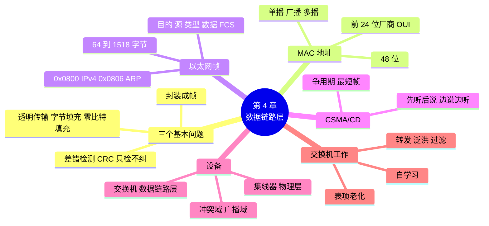

# 第 4 章 数据链路层与以太网交换

!!! abstract "本章学时"
    理论 5 学时（线上 4 + 线下 1）· 实验 1 学时（本章共 3 个实验，★ 必做 2 个）

## 学习目标

学完本章，你应该能够：

1. **说出**数据链路层要解决的三个基本问题，以及 MAC 地址的长度和结构（记忆）；
2. **说出**以太网帧各字段的名称和长度，在抓包结果中**找出**源 MAC、目的 MAC 和类型（理解、应用）；
3. **解释**交换机怎样自学习、转发、泛洪和过滤（理解）；
4. **比较**集线器、交换机和路由器，**数出**一个网络中冲突域和广播域的个数（分析）；
5. 在 Packet Tracer 中用交换机**搭建**一个小型局域网，并用命令**查看** MAC 地址表（应用）。

!!! info "先修要求"
    学习本章前，你需要掌握：

    - [2.4.2 五层模型](../02-architecture/index.md#242)：数据链路层在物理层之上，数据单位是帧；
    - [2.6 节](../02-architecture/index.md#26)：会用 Wireshark 打开抓包文件、看分层详情；
    - [3.4.1 双绞线](../03-physical/index.md#341)：直通线、RJ45 接口。

??? abstract "本章概念清单（29 个，点击查看定义和例子）"
    1. [链路](../../appendix/glossary.md#g-链路)
    2. [封装成帧](../../appendix/glossary.md#g-封装成帧)
    3. [透明传输](../../appendix/glossary.md#g-透明传输)
    4. [差错检测](../../appendix/glossary.md#g-差错检测)
    5. [零比特填充](../../appendix/glossary.md#g-零比特填充)
    6. [误码率](../../appendix/glossary.md#g-误码率)
    7. [循环冗余检验](../../appendix/glossary.md#g-循环冗余检验)
    8. [帧检验序列](../../appendix/glossary.md#g-帧检验序列)
    9. [PPP](../../appendix/glossary.md#g-PPP)
    10. [PPPoE](../../appendix/glossary.md#g-PPPoE)
    11. [以太网](../../appendix/glossary.md#g-以太网)
    12. [MAC 地址](../../appendix/glossary.md#g-MAC-地址)
    13. [OUI](../../appendix/glossary.md#g-OUI)
    14. [广播地址](../../appendix/glossary.md#g-广播地址)
    15. [单播](../../appendix/glossary.md#g-单播)
    16. [多播](../../appendix/glossary.md#g-多播)
    17. [最大传送单元](../../appendix/glossary.md#g-最大传送单元)
    18. [CSMA/CD](../../appendix/glossary.md#g-CSMA-CD)
    19. [争用期](../../appendix/glossary.md#g-争用期)
    20. [集线器](../../appendix/glossary.md#g-集线器)
    21. [交换机](../../appendix/glossary.md#g-交换机)
    22. [MAC 地址表](../../appendix/glossary.md#g-MAC-地址表)
    23. [冲突域](../../appendix/glossary.md#g-冲突域)
    24. [广播域](../../appendix/glossary.md#g-广播域)
    25. [自学习](../../appendix/glossary.md#g-自学习)
    26. [泛洪](../../appendix/glossary.md#g-泛洪)
    27. [广播风暴](../../appendix/glossary.md#g-广播风暴)
    28. [生成树协议](../../appendix/glossary.md#g-生成树协议)
    29. [RoCE](../../appendix/glossary.md#g-RoCE)

## 情景导入

工作室的网络终于要“正规化”了。禾姐买回来一台 24 口的交换机，让小林把办公室的五台电脑都接上。小林把网线一根根插好，给每台电脑设了地址，没想到一试就通：阿美把设计稿拖进共享文件夹，陈姐那边马上就能打开。

小林反而有点不踏实：“我什么都没配置，交换机怎么知道阿美的电脑插在 3 号口、陈姐的电脑插在 5 号口？”他想起仓库里还有一个旧的“八口集线器”，外观和交换机几乎一样，便宜得多，“为什么不用它？”

老周笑着说：“集线器和交换机，看着像双胞胎，干活的方式完全不同。集线器是个大喇叭，谁说话全屋都听见；交换机像楼里的收发室，记得每个人住哪间，信只送到那一间。收发室怎么记住大家的门牌，就是这一章要讲的。”

这一章我们学习数据链路层：数据怎样装成“帧”，怎样发现传错的帧，网卡上的 MAC 地址是什么，以太网帧长什么样，交换机怎样自学习。最后，你将在 Packet Tracer 里亲手搭起小禾工作室的第一个局域网。

## 4.1 数据链路层要做什么 { #41 }

### 4.1.1 链路、数据链路和帧 { #411 }

物理层负责把比特送过去，但它不关心这些比特是什么意思，也不管传错没有。**数据链路层**在物理层提供的比特传输之上，负责把数据从一个节点可靠地送到**相邻**的下一个节点<sup class="cite">[[1]](#ref4-1)</sup>。

- [**链路**](../../appendix/glossary.md#g-链路 "从一个节点到相邻节点的一段物理线路，中间没有任何其他交换节点"){ .term }：从一个节点到相邻节点的一段物理线路，中间没有任何其他交换节点。比如电脑到交换机的一根网线。
- **数据链路**：链路加上实现通信协议的硬件和软件（主要是网卡）。
- **帧**：数据链路层的数据单位。网络层交下来的 IP 数据报，加上首部和尾部就成了帧。

!!! note "比喻：快递的一段路"
    一个包裹从广州寄到北京，要经过多段运输：小区到营业点、营业点到分拣中心、分拣中心到机场……数据链路层只管**其中一段**：把包裹从这一站稳妥地送到下一站。整条路怎么走，是网络层（第 7 章）的事。

数据链路层要解决三个基本问题（考点）：[**封装成帧**](../../appendix/glossary.md#g-封装成帧 "在一段数据的前后加上首部和尾部构成帧，并标出帧的开始和结束"){ .term }、[**透明传输**](../../appendix/glossary.md#g-透明传输 "无论数据中出现什么比特组合都能原样传过去，数据链路层好像“看不见”"){ .term }和[**差错检测**](../../appendix/glossary.md#g-差错检测 "接收方检查收到的帧在传输中是否出错"){ .term }。

### 4.1.2 封装成帧与透明传输 { #412 }

**封装成帧**就是在一段数据的前后分别加上首部和尾部，构成一个帧。首部和尾部的一个重要作用是**帧定界**：让接收方知道一帧从哪里开始、到哪里结束。就像写信时信纸开头写“××你好”、结尾写“此致敬礼”，对方一看就知道一封信从哪到哪。

那么问题来了：如果数据中间恰好出现了和“帧结束标志”一模一样的比特组合，接收方岂不是会误以为帧提前结束了？**透明传输**就是要解决这个问题：不管数据里有什么样的比特组合，都能原样通过，数据链路层好像“看不见”一样。

常用两种办法（了解）：

| 办法 | 做法 | 用在哪里 |
|---|---|---|
| **字节填充** | 数据中出现“标志字节”或“转义字节”时，在它前面插入一个转义字节；接收方再把它删掉 | PPP 协议（异步传输时） |
| [**零比特填充**](../../appendix/glossary.md#g-零比特填充 "发送方每遇到连续 5 个 1 就插入一个 0，接收方再删掉，避免数据中出现帧标志"){ .term } | 发送方在数据中每遇到连续 5 个 1，就自动插入一个 0；接收方遇到 5 个 1 后面的 0 就删掉。这样数据里永远不会出现标志 01111110 中的 6 个连续的 1 | PPP（同步传输时）、HDLC |

以太网采用另一种办法：帧和帧之间必须有一段空闲时间（帧间隙），并且在帧的最前面加上一串固定的“前导码”，让接收方知道新帧来了，所以不需要专门的结束标志。

### 4.1.3 差错检测：CRC { #413 }

比特在传输中可能出错：1 变成 0，或 0 变成 1。在一段时间内，传错的比特数占总比特数的比例叫[**误码率**](../../appendix/glossary.md#g-误码率 "传错的比特数占传输总比特数的比例"){ .term }。数据链路层要能发现传错的帧，常用的方法是[**循环冗余检验**](../../appendix/glossary.md#g-循环冗余检验 "用约定的除数对数据做除法得到余数作为检验值，接收方重算比对来发现错误，简称 CRC"){ .term }（CRC）。

CRC 的过程可以用“对账”来理解：

1. 发送方用一个双方约定好的除数，对要发送的数据做一种特殊的除法，得到的余数叫[**帧检验序列**](../../appendix/glossary.md#g-帧检验序列 "附在帧末尾的检验值，简称 FCS"){ .term }（FCS），附在帧的末尾一起发出；
2. 接收方收到后，用同一个除数再算一遍；
3. 算出来对得上，就认为这一帧没有错，收下；对不上，说明传输中出了错，**直接丢弃**这一帧。

!!! warning "考点：CRC 只能“发现”错误，不能“纠正”错误"
    CRC 检测出错误后，数据链路层只是把这个帧丢掉。要不要重发、怎么重发，以太网的数据链路层不管，交给上面的运输层（第 9 章 TCP）处理。闭卷考试中“CRC 可以纠正错误”“使用 CRC 就实现了可靠传输”都是错误说法。本书不要求手算 CRC 的长除法。

CRC 的特点是：数据哪怕只错一位，算出来的检验值也会完全不同。下面的程序用 Python 自带的 `zlib.crc32`（以太网用的就是 32 位的 CRC）演示这一点：

```python
import zlib                                   # Python 自带，以太网用的就是 CRC-32

a = "小禾设计工作室".encode()                   # 原始数据
b = bytearray(a)
b[0] ^= 1                                     # 把第 1 个字节的最后一位翻转（0 变 1 或 1 变 0）
print("原始数据的 CRC-32：", hex(zlib.crc32(a)))
print("错一位后的 CRC-32：", hex(zlib.crc32(bytes(b))))
```

**运行结果**（编者运行，程序在 `labs/ch04/crc_demo.py`）

```text
原始数据的 CRC-32： 0x164844d2
错一位后的 CRC-32： 0x8992c74c
```

只翻转了一个比特，检验值就面目全非，接收方一对比就知道出错了。

### 4.1.4 点对点链路与 PPP { #414 }

数据链路层使用的信道主要有两种：

- **点对点信道**：一对一通信，比如早年家里用电话线拨号上网，电脑和运营商之间就是一条点对点的链路；
- **广播信道**：一对多通信，一条线路上连着很多台计算机，一台发送，其他都能收到，比如早期的以太网。

点对点链路上最常用的协议是 [**PPP**](../../appendix/glossary.md#g-PPP "点对点协议，用于点对点链路，只做差错检测、出错丢弃，可进行身份认证"){ .term }（点对点协议）。它简单，只负责封装成帧、透明传输和差错检测，出错的帧直接丢弃，不负责重发。PPP 还能在建立连接时检查用户名和密码（身份认证）。

今天你家的宽带“拨号”，用的是它的变种 [**PPPoE**](../../appendix/glossary.md#g-PPPoE "在以太网上运行的 PPP，家庭宽带拨号上网常用"){ .term }（以太网上的 PPP）：光猫或路由器里填的宽带账号和密码，就是 PPPoE 认证用的。所以排查“路由器拨号失败”时，先检查宽带账号密码是不是填错了。

## 4.2 以太网与 MAC 地址 { #42 }

### 4.2.1 以太网是什么 { #421 }

[**以太网**](../../appendix/glossary.md#g-以太网 "由 IEEE 802.3 标准规定的局域网技术，今天局域网的绝对主流"){ .term }（Ethernet）是今天局域网的绝对主流。它诞生于 20 世纪 70 年代的施乐公司帕洛阿尔托研究中心，梅特卡夫（Metcalfe）和博格斯（Boggs）在 1976 年发表的论文中描述了最初的设计<sup class="cite">[[2]](#ref4-2)</sup>；后来由 IEEE 802.3 委员会制定为标准<sup class="cite">[[3]](#ref4-3)</sup>。从最初的 10 Mbit/s 一路发展到今天的 400 Gbit/s、800 Gbit/s，名字和帧格式基本没变。家里电脑网口、单位交换机、数据中心服务器，用的都是以太网。

### 4.2.2 MAC 地址：网卡的“身份证号” { #422 }

在广播信道上，一台电脑发出的帧，同一条线路上所有电脑都能收到。每台电脑怎么判断“这帧是不是发给我的”？靠的是帧首部里的目的地址。这种地址叫 [**MAC 地址**](../../appendix/glossary.md#g-MAC-地址 "固化在网卡中的 48 位硬件地址，前 24 位是厂商编号"){ .term }，也叫硬件地址或物理地址，固化在网卡里。

MAC 地址的特点（考点）：

- 长度 **48 位**（6 个字节），通常写成 12 个十六进制数，例如 `00:e0:4c:68:01:0a`（Linux、Wireshark 写法）、`00-E0-4C-68-01-0A`（Windows 写法）或 `00e0.4c68.010a`（思科设备写法），三种写法是同一个地址；
- **前 24 位**是厂商编号（组织唯一标识符，简称 [**OUI**](../../appendix/glossary.md#g-OUI "IEEE 分配给厂商的 24 位编号，即 MAC 地址的前 24 位"){ .term }），由 IEEE 注册管理机构分配给网卡厂商<sup class="cite">[[4]](#ref4-4)</sup>；**后 24 位**由厂商自己分配，保证每块网卡不重复；
- 48 位全为 1（`ff:ff:ff:ff:ff:ff`）的是[**广播地址**](../../appendix/glossary.md#g-广播地址 "表示发给本网络所有主机的地址：MAC 广播地址是 48 位全 1；IP 广播地址是主机号全 1 的地址（第 6 章）"){ .term }，表示发给这个局域网里的所有电脑。

!!! note "比喻：身份证号与收件地址"
    MAC 地址像身份证号，跟着网卡走，换到哪个城市都不变；第 6 章要学的 IP 地址像收件地址，搬家就要改。快递员送最后一段路时核对的是“这个人是不是收件人”，数据链路层核对的就是 MAC 地址。

在本书的抓包文件 `web_visit.pcap` 里，用 Wireshark 打开就能看到两个 MAC 地址：

| MAC 地址 | 前 24 位 | Wireshark 显示的厂商 | 是谁 |
|---|---|---|---|
| `00:e0:4c:68:01:0a` | `00:e0:4c` | RealtekSemic（瑞昱半导体） | 小林的电脑网卡 |
| `00:e0:fc:12:34:01` | `00:e0:fc` | HuaweiTechno（华为） | 工作室的路由器 |

Wireshark 自带一份从 IEEE 注册表整理出来的厂商名单，所以能自动把前 24 位翻译成厂商名。

!!! tip "动手查：你电脑的 MAC 地址"
    在 Windows 命令提示符中输入 `ipconfig /all`，找到正在使用的网卡，“物理地址”一行就是 MAC 地址。手机连接 WiFi 时常常使用“随机 MAC 地址”保护隐私，所以同一部手机在不同 WiFi 下看到的 MAC 可能不一样。

### 4.2.3 单播、广播和多播 { #423 }

按目的 MAC 地址，以太网帧分三种：

| 类型 | 目的地址 | 谁会收下 | 例子 |
|---|---|---|---|
| [**单播**](../../appendix/glossary.md#g-单播 "发给某一个特定接收方的通信方式"){ .term } | 某一块网卡的地址 | 只有这块网卡 | 小林的电脑把网页请求发给路由器 |
| **广播** | `ff:ff:ff:ff:ff:ff` | 局域网里的所有网卡 | “谁是 192.168.1.1？”这样的 ARP 询问（第 8 章） |
| [**多播**](../../appendix/glossary.md#g-多播 "发给一组接收方的通信方式，也叫组播"){ .term }（组播） | 一组网卡的地址（第一个字节的最低位为 1） | 加入这个组的网卡 | 网络视频会议、IPTV |

网卡收到一个帧，先看目的 MAC：是自己的地址、广播地址或者自己加入的多播组地址，就收下交给上层；否则直接丢弃。

## 4.3 以太网帧格式 { #43 }

### 4.3.1 帧的各个字段 { #431 }

今天最常用的以太网帧格式是 **Ethernet II**（以太网 V2）格式（考点）：

```text
  ← 物理层加上，Wireshark 看不到 →  ←──────────────── 以太网帧（64～1518 字节）───────────────→
 ┌──────────────┬────────┬──────────┬──────────┬────────┬──────────────────┬────────┐
 │ 前导码 7 字节  │ 帧开始 │ 目的地址  │  源地址   │ 类型   │      数据         │  FCS   │
 │ 10101010…    │ 1 字节 │  6 字节   │  6 字节   │ 2 字节  │  46～1500 字节    │ 4 字节  │
 └──────────────┴────────┴──────────┴──────────┴────────┴──────────────────┴────────┘
```

| 字段 | 长度 | 作用 |
|---|---|---|
| 前导码 + 帧开始定界符 | 7 + 1 字节 | 让接收方的时钟同步，并标出帧从哪里开始。由物理层加上，**不算在帧长度里** |
| 目的地址 | 6 字节 | 接收方的 MAC 地址。放在最前面，网卡一收到就能判断是不是给自己的 |
| 源地址 | 6 字节 | 发送方的 MAC 地址 |
| **类型** | 2 字节 | 说明数据部分装的是哪种上层协议：`0x0800` 表示 IPv4，`0x0806` 表示 ARP，`0x86DD` 表示 IPv6 |
| 数据 | 46～1500 字节 | 上层交下来的数据，比如一个 IP 数据报。不足 46 字节要填充到 46 字节 |
| FCS | 4 字节 | CRC 检验值，见 4.1.3 节 |

由此可以算出两个常考的数字：

- **最短帧** = 6 + 6 + 2 + 46 + 4 = **64 字节**。短于 64 字节的帧是无效帧，接收方直接丢弃；
- **最长帧** = 6 + 6 + 2 + 1500 + 4 = **1518 字节**。数据部分最多 1500 字节，这个上限叫[**最大传送单元**](../../appendix/glossary.md#g-最大传送单元 "帧的数据部分允许的最大长度，简称 MTU，以太网为 1500 字节"){ .term }（MTU）。

!!! warning "考点：类型字段是“上下层的接口”"
    第 2 章讲过，每一层收到数据后要知道交给上面哪个协议。以太网帧的类型字段就是干这个的：`0x0800` 交给 IP，`0x0806` 交给 ARP。记住这两个值，闭卷题“看抓包回答问题”经常考。

### 4.3.2 在抓包里认出以太网帧 { #432 }

用 Wireshark 打开 `labs/data/pcap/web_visit.pcap`，点第 1 帧，中间的分层详情里展开 “Ethernet II” 一行，可以看到（编者用 Wireshark 4.2 打开的结果）：

```text
Ethernet II, Src: RealtekSemic_68:01:0a (00:e0:4c:68:01:0a), Dst: Broadcast (ff:ff:ff:ff:ff:ff)
    Destination: Broadcast (ff:ff:ff:ff:ff:ff)
    Source: RealtekSemic_68:01:0a (00:e0:4c:68:01:0a)
    Type: ARP (0x0806)
```

再看下方的字节窗格，帧的前 14 个字节就是以太网首部：

```text
0000  ff ff ff ff ff ff 00 e0 4c 68 01 0a 08 06 00 01
      └──目的地址──────┘ └──源地址────────┘ └类型┘ └ARP 的内容从这里开始…
```

前 6 个字节全是 `ff`，是广播；接着 6 个字节是小林电脑的 MAC；`08 06` 表示里面装的是 ARP。

!!! question "为什么第 1 帧只有 42 字节，比最短帧 64 字节还短？"
    这是在小林的电脑上抓的包。电脑抓到的是网卡**发出前**的数据，这时还没有加上填充和 FCS（网卡硬件会自动补上），所以显示 42 字节（14 字节首部 + 28 字节 ARP 内容）。帧真正在网线上传输时，网卡会把数据填充到 46 字节，再加 4 字节 FCS，正好 64 字节。大多数抓包结果都不显示 FCS，这是正常的。

## 4.4 共享介质与 CSMA/CD { #44 }

### 4.4.1 早期以太网：一根总线大家抢着说话 { #441 }

早期的以太网，所有电脑都连在一根同轴电缆（总线）上，后来改用集线器连接，本质还是一样：**同一时间只能有一台电脑发送**，否则信号叠在一起，谁的数据都看不清，这叫**碰撞**（冲突）。

怎么避免大家抢着说话？以太网采用 [**CSMA/CD**](../../appendix/glossary.md#g-CSMA-CD "载波监听多点接入 / 碰撞检测：先听后说、边说边听、碰撞后随机退避"){ .term } 协议，中文叫“载波监听多点接入 / 碰撞检测”。用一次开会发言来理解它：

| 名字 | 意思 | 开会的比喻 |
|---|---|---|
| 多点接入 | 很多台电脑连在同一条线上 | 很多人在同一个会议室 |
| 载波监听 | 发送前先听听线路上有没有人在发 | **先听后说**：有人在讲就先等着 |
| 碰撞检测 | 一边发送一边监听，发现碰撞立即停止 | **边说边听**：发现有人同时开口，马上闭嘴 |
| 退避重传 | 碰撞后各自随机等一段时间再试 | 两人同时开口后，各自随机等一会儿再说，避免再撞 |

退避的等待时间用的是**二进制指数退避**算法：碰撞次数越多，随机等待的范围就越大（翻倍增长），连续碰撞 16 次就放弃发送。

!!! warning "考点：争用期与最短帧长"
    信号在线路上传播需要时间。一台电脑开始发送后，要等信号到达最远端再返回，才能确定“没有撞上”。这段往返时间叫[**争用期**](../../appendix/glossary.md#g-争用期 "信号在总线上往返一次的时间，10 Mbit/s 以太网为 51.2 微秒"){ .term }，10 Mbit/s 以太网规定为 51.2 微秒，在这段时间里能发送 51.2 μs × 10 Mbit/s = 512 位 = 64 字节。所以以太网规定最短帧长 64 字节：保证一个帧在发完之前，如果发生碰撞一定能被检测到。

### 4.4.2 为什么今天不再需要 CSMA/CD { #442 }

今天的以太网几乎都用交换机连接，并且工作在**全双工**方式下：每台电脑和交换机之间有单独的一根网线，发送和接收各用不同的线对，根本不会发生碰撞，所以 CSMA/CD 已经不起作用了。但它是以太网的“出身”，最短帧长 64 字节等规定也保留了下来，所以仍是考试重点。

!!! note "无线局域网也要“抢着说话”"
    WiFi 的所有设备共享同一片空中的信道，也存在“抢着说话”的问题。不过无线信号无法一边发送一边检测碰撞，所以 WiFi 用的是 CSMA/CA（碰撞**避免**），下一章介绍。

## 4.5 集线器与交换机 { #45 }

### 4.5.1 集线器：一个大喇叭 { #451 }

[**集线器**](../../appendix/glossary.md#g-集线器 "对比特放大后从所有其他接口发出的设备，工作在物理层"){ .term }（Hub）有多个接口，从一个接口收到信号，就放大后从**所有其他接口**发出去。它不认识帧，也不看 MAC 地址，只是对比特做放大和转发，所以工作在**物理层**。

用集线器连接的网络，物理上是星形，逻辑上仍然是一根总线：一台电脑发送，所有电脑都收到；两台同时发送就会碰撞。连的电脑越多，碰撞越频繁，每台电脑分到的带宽越少：10 台电脑共用一个 100 Mbit/s 的集线器，平均每台只有 10 Mbit/s。

### 4.5.2 交换机：楼里的收发室 { #452 }

[**交换机**](../../appendix/glossary.md#g-交换机 "根据目的 MAC 地址转发帧的设备，工作在数据链路层"){ .term }（Switch，以太网交换机）也有很多接口，但它能读懂帧的首部，根据**目的 MAC 地址**决定把帧从哪个接口转发出去，所以工作在**数据链路层**。

交换机内部有一张 [**MAC 地址表**](../../appendix/glossary.md#g-MAC-地址表 "交换机记录“哪个 MAC 地址在哪个接口”的表，靠自学习建立"){ .term }（也叫交换表），记录“哪个 MAC 地址在哪个接口”。有了这张表，交换机就像楼里的收发室：收发员记得每个人住哪间，一封信来了，只送到那一间，不会挨家挨户喊。

| 比较项 | 集线器 | 交换机 |
|---|---|---|
| 工作在哪一层 | 物理层 | 数据链路层 |
| 收到帧后 | 从所有其他接口发出 | 查 MAC 地址表，一般只从目的主机所在的接口发出 |
| 带宽 | 所有接口共享 | 每个接口独享 |
| 双工方式 | 半双工 | 全双工 |
| 碰撞 | 会发生，要用 CSMA/CD | 全双工下不会发生 |
| 今天还用吗 | 基本淘汰 | 局域网的核心设备 |

### 4.5.3 冲突域与广播域 { #453 }

这两个概念是闭卷考试的高频考点，务必分清：

- [**冲突域**](../../appendix/glossary.md#g-冲突域 "同一时间只能有一台设备发送、否则会发生碰撞的范围"){ .term }：网络中一台电脑发送时，可能和它发生碰撞的所有设备组成的范围。在同一个冲突域里，同一时间只能有一台设备发送。
- [**广播域**](../../appendix/glossary.md#g-广播域 "一个广播帧能到达的所有设备组成的范围"){ .term }：网络中一台电脑发出广播帧时，能收到这个广播帧的所有设备组成的范围。

三种设备对它们的影响（考点）：

| 设备 | 工作层次 | 冲突域 | 广播域 |
|---|---|---|---|
| 集线器 | 物理层 | **不隔离**：所有接口在同一个冲突域 | 不隔离 |
| 交换机 | 数据链路层 | **隔离**：每个接口是一个独立的冲突域 | **不隔离**：所有接口在同一个广播域 |
| 路由器 | 网络层 | 隔离 | **隔离**：每个接口是一个独立的广播域 |

口诀：**集线器什么都不隔，交换机隔冲突不隔广播，路由器两个都隔。**

!!! example "算一算：数冲突域和广播域"
    一台交换机连接 4 台电脑，另有一台集线器也接在这台交换机上，集线器下面又连了 3 台电脑。这个网络有几个冲突域、几个广播域？

    **解：** 交换机的每个接口是一个冲突域。交换机用了 5 个接口：4 个接电脑，各是 1 个冲突域；1 个接集线器，集线器和它下面的 3 台电脑在同一个冲突域。所以共有 4 + 1 = **5 个冲突域**。网络中没有路由器，广播会传遍所有设备，所以只有 **1 个广播域**。

<iframe class="sim-frame" src="../../sims/collision-domain/main.html" height="560" loading="lazy" title="冲突域与广播域"></iframe>

动画：点中间的设备和两边的设备，在集线器、交换机、路由器之间切换，看冲突域（彩色细框）和广播域（虚线大框）的范围和个数怎么变。
{ .sim-caption }

## 4.6 交换机怎样工作 { #46 }

### 4.6.1 自学习：MAC 地址表是怎么来的 { #461 }

交换机刚开机时，MAC 地址表是空的。它不需要人去配置，而是在转发帧的过程中自己“学”出来，这叫[**自学习**](../../appendix/glossary.md#g-自学习 "交换机把收到的帧的源 MAC 地址和接收接口记入地址表的过程"){ .term }。规则只有一条：

> 从某个接口收到一个帧，就把帧的**源 MAC 地址**和这个**接口**记到表里。

道理很简单：既然这个帧是从 3 号口进来的，那发送它的电脑一定在 3 号口那边。

### 4.6.2 转发、泛洪和过滤 { #462 }

记下源地址后，交换机再看**目的 MAC 地址**，查表决定怎么处理（考点）：

| 情况 | 交换机怎么做 | 叫什么 |
|---|---|---|
| 表里查到目的地址，且在另一个接口 | 只从那个接口发出去 | **转发** |
| 表里查不到目的地址，或者目的地址是广播 | 从除了进来的接口以外的**所有接口**发出去 | [**泛洪**](../../appendix/glossary.md#g-泛洪 "交换机把帧从除接收接口以外的所有接口发出"){ .term } |
| 表里查到目的地址，且就在进来的那个接口 | 不用转发，直接丢弃 | **过滤** |

我们用小禾工作室的四台电脑走一遍（为了好记，MAC 地址简写成 A、B、C、D）：

| 步骤 | 发生了什么 | 交换机学到 | 怎么处理 | 表里有几条 |
|---|---|---|---|---|
| 1 | 小林的电脑 A（1 号口）发帧给阿美的电脑 C | A 在 1 号口 | 表里没有 C，**泛洪**到 2、3、4 号口；B、D 收到后发现不是给自己的，丢弃 | 1 |
| 2 | C（3 号口）回复 A | C 在 3 号口 | 表里有 A 在 1 号口，**转发**给 1 号口 | 2 |
| 3 | A 再发帧给 C | （A 已经在表里，刷新时间） | 表里有 C，**转发**给 3 号口 | 2 |
| 4 | 陈姐的电脑 D（4 号口）发广播 | D 在 4 号口 | 广播一律**泛洪**到 1、2、3 号口 | 3 |

可以看到：一开始泛洪多，随着大家都说过话，表逐渐填满，泛洪变成精确转发。

!!! info "表项为什么要“过期”"
    电脑可能换了接口，也可能关机拿走了。所以 MAC 地址表中每一条都有寿命，一段时间（思科交换机默认 300 秒）内没有再收到这个地址发出的帧，就把这条删掉，以后需要时再重新学习。

<iframe class="sim-frame" src="../../sims/switch-learning/main.html" height="600" loading="lazy" title="交换机自学习"></iframe>

动画：选一台电脑作为发送方、一台作为接收方（也可以选“广播”），点“发送”，看交换机先记下源地址、再决定转发还是泛洪；多发几次，看 MAC 地址表一行行填满。
{ .sim-caption }

### 4.6.3 交换机的其他特点 { #463 }

- **全双工、独享带宽**：一台 24 口的千兆交换机，每个接口都能同时以 1 Gbit/s 收发，多对电脑可以同时通信，互不影响。
- **即插即用**：普通交换机不用任何配置，插上就能用（工作室的场景正是如此）。能登录进去配置的叫“网管型交换机”，第 5 章用它划分 VLAN。
- **环路问题**（了解）：如果网线接成了一个圈，广播帧会在圈里无休止地转，越转越多，几秒钟就能让整个网络瘫痪，这叫[**广播风暴**](../../appendix/glossary.md#g-广播风暴 "网络存在环路时广播帧无休止地循环、越来越多，导致网络瘫痪"){ .term }。网管型交换机用[**生成树协议**](../../appendix/glossary.md#g-生成树协议 "交换机自动阻塞环路中的某些接口以消除环路的协议，简称 STP"){ .term }（STP）自动把环路中的某个接口“堵住”，打破环路。所以办公室里不要随手把一根网线的两头都插到交换机上。

## 4.7 以太网的发展与交换机的接口 { #47 }

### 4.7.1 从 10M 到 800G { #471 }

| 名称 | 速率 | 常用介质 | 今天的典型用途 |
|---|---|---|---|
| 10BASE-T | 10 Mbit/s | 三类及以上双绞线 | 已淘汰 |
| 100BASE-TX（快速以太网） | 100 Mbit/s | 五类双绞线 | 老旧设备、IP 电话 |
| 1000BASE-T（千兆以太网） | 1 Gbit/s | 超五类双绞线 | 办公电脑、家庭 |
| 10GBASE-T / 10GBASE-SR 等 | 10 Gbit/s | 六类 / 超六类双绞线、光纤 | 服务器、楼层交换机上联 |
| 25G、100G、400G、800G | 25～800 Gbit/s | 光纤 | 数据中心、AI 集群 |

名字里的 “BASE” 表示基带传输，“T” 表示双绞线，“SR” 等字母表示不同的光纤类型。速率提升了几万倍，帧格式却没变，这是以太网长盛不衰的重要原因：新旧设备可以混在一个网络里互通。

### 4.7.2 看懂交换机的接口和指示灯 { #472 }

一台常见的办公交换机，前面板上有一排 RJ45 电口，旁边可能还有几个光口（插光模块，见 [3.8 节](../03-physical/index.md#38)）。接口名称在思科设备上写作 `FastEthernet0/1`（百兆，简写 `Fa0/1`）、`GigabitEthernet0/1`（千兆，简写 `Gi0/1`）。

每个接口上方一般有指示灯。不同品牌含义略有差异，常见的规律是：

| 指示灯 | 一般含义 |
|---|---|
| 不亮 | 没有连接：网线没插好、对端设备没开机或网线坏了 |
| 常亮（绿） | 已连通，暂时没有数据 |
| 闪烁（绿） | 正在收发数据 |
| 橙色 / 黄色 | 速率较低（如百兆）或接口正在启动、被生成树暂时阻塞；以设备说明书为准 |

在 Packet Tracer 里连线时，线两端的小圆点也有类似的颜色：绿色表示连通，橙色表示接口正在启动（交换机接口刚连上时约需 30 秒），红色表示不通。

## 4.8 本章常见问题对照 { #48 }

| 现象 | 用大白话说 | 怎么查、怎么改 |
|---|---|---|
| 网线插上，交换机接口灯不亮 | 物理上没连通 | 换根网线、换个接口；确认电脑网卡已启用；用测线仪测线 |
| 灯是橙色，过一会儿变绿才能通 | 交换机接口正在启动（生成树检查环路） | 正常现象，等 30 秒左右 |
| 换了网线后整个办公室网速突然极慢、灯狂闪 | 可能接成了环路，发生广播风暴 | 拔掉刚接的网线；检查有没有一根线两头都插在交换机上 |
| 电脑插在集线器上，大家一起传文件就很慢 | 集线器共享带宽，还会碰撞 | 换成交换机 |
| 路由器提示“PPPoE 拨号失败” | 宽带账号或密码不对，或光猫没连通 | 核对账号密码；看光猫指示灯（3.6.2 节） |
| Packet Tracer 中两台电脑 ping 不通 | 没配 IP、地址不在同一网段、线型选错 | 逐台检查 IP 配置；用“自动选线”或直通线重连 |

## 4.9 AI 与网络：AI 集群为什么要“更快的以太网” { #49 }

训练一个大模型，要让成千上万块 GPU 一起算。每算完一小步，所有 GPU 都要互相交换计算结果，然后才能开始下一步。只要网络慢一点、丢一个包，所有 GPU 都要停下来等，昂贵的算力就白白浪费了。

普通以太网有两个问题：一是网络拥挤时会丢帧，靠上层重传，时延忽高忽低；二是数据要经过操作系统层层处理，CPU 负担重。为此，AI 数据中心常用两类技术：

- **InfiniBand**：一种专门为高性能计算设计的网络，时延极低、不丢包，但设备较贵、生态较封闭；
- [**RoCE**](../../appendix/glossary.md#g-RoCE "在以太网上实现远程直接内存访问的技术，AI 集群常用"){ .term }（读作“rocky”，以太网上的远程直接内存访问）：在以太网上让一台服务器直接读写另一台服务器的内存，绕过操作系统，再配合“不丢包”的交换机配置，让以太网也能接近 InfiniBand 的性能。

近几年，越来越多的 AI 集群选择基于以太网的方案，因为以太网设备多、价格低、工程师熟悉。业界还成立了专门的组织，研究面向 AI 的新一代以太网。你在本章学的帧、MAC 地址和交换机，正是这些“AI 网络”的地基。

## 本章实验

!!! abstract "实验总览"
    | 实验 | 类型 | 建议时长 | 内容 |
    |---|---|---|---|
    | 实验 4-1 | ★ 必做 | 25 分钟 | 在抓包里看以太网帧 |
    | 实验 4-2 | ★ 必做 | 25 分钟 | Packet Tracer 第一次组网 |
    | 实验 4-3 | ☆ 选做 | 25 分钟 | 用模拟模式看帧怎么走 |

    实验 4-1 用 Wireshark 打开本书的抓包文件，并用一个 Python 小程序读出每一帧的 MAC 地址，结果都是编者实际运行得到的；实验 4-2、4-3 使用 Cisco Packet Tracer，书中的配置按思科 IOS 标准写法给出，设备的 MAC 地址由 Packet Tracer 随机生成，书中命令输出为**输出格式示意**，以你屏幕上的为准。

### 实验 4-1 ★ 在抓包里看以太网帧 { #4-1 }

**实验目的**

1. 在 Wireshark 中找到以太网帧的目的地址、源地址和类型字段；
2. 根据 MAC 地址的前 24 位查出网卡厂商；
3. 用 Python 程序读出抓包文件中每一帧的以太网首部，体会“帧就是一串字节”。

**实验环境**：Windows 电脑，Wireshark 4.x；Python（Thonny）。

**实验数据**：`labs/data/pcap/web_visit.pcap`（编者在隔离的实验网络中录制，18 帧，记录了小林的电脑访问工作室网站的全过程）。

**实验步骤**

第一档 · 跑通：

1. 用 Wireshark 打开 `web_visit.pcap`。
2. 点第 1 帧，展开中间窗格的 “Ethernet II”，记下目的地址、源地址和类型，与 [4.3.2 节](#432)对照。
3. 点第 10 帧（Info 列显示 `GET / HTTP/1.1`），同样记下三项。你会看到目的地址变成了路由器 `00:e0:fc:12:34:01`，类型变成了 `IPv4 (0x0800)`。
4. 运行 `labs/ch04/lab4_1_frames.py`，它会读出前 5 帧的以太网首部：

```python
import struct

def mac(b):                                   # 6 个字节 → "00:e0:4c:68:01:0a"
    return ":".join(f"{x:02x}" for x in b)

TYPES = {0x0800: "IPv4", 0x0806: "ARP", 0x86DD: "IPv6", 0x8100: "VLAN 标签"}
data = open("../data/pcap/web_visit.pcap", "rb").read()
pos, n = 24, 0                                # 跳过 24 字节的文件头
while pos < len(data) and n < 5:              # ← 改这里：显示前几帧
    caplen = struct.unpack("<I", data[pos + 8:pos + 12])[0]   # 这一帧有多少字节
    frame = data[pos + 16:pos + 16 + caplen]                    # 帧的内容
    t = struct.unpack("!H", frame[12:14])[0]                    # 第 13、14 字节是类型
    n += 1
    print(n, "目的", mac(frame[0:6]), "源", mac(frame[6:12]), "类型", f"0x{t:04x}", TYPES.get(t, "?"), caplen, "字节")
    pos += 16 + caplen
```

程序里的 `struct.unpack` 用来把几个字节“拆”成一个数字，看不懂没关系，只要知道 `frame[0:6]` 是前 6 个字节（目的地址）、`frame[6:12]` 是接下来 6 个字节（源地址）、`frame[12:14]` 是类型就够了。切片写法详见《Python 编程》中讲列表的一章。

**运行结果**（编者运行）

```text
1 目的 ff:ff:ff:ff:ff:ff 源 00:e0:4c:68:01:0a 类型 0x0806 ARP 42 字节
2 目的 00:e0:4c:68:01:0a 源 00:e0:fc:12:34:01 类型 0x0806 ARP 42 字节
3 目的 00:e0:fc:12:34:01 源 00:e0:4c:68:01:0a 类型 0x0800 IPv4 74 字节
4 目的 00:e0:fc:12:34:01 源 00:e0:4c:68:01:0a 类型 0x0800 IPv4 74 字节
5 目的 00:e0:4c:68:01:0a 源 00:e0:fc:12:34:01 类型 0x0800 IPv4 90 字节
```

第 1 帧是广播，后面的帧都是电脑和路由器之间的单播，和 Wireshark 显示的一致。

第二档 · 改一改：

1. 把 `n < 5` 改成 `n < 18`，显示全部 18 帧。数一数：有几帧是广播？源地址是路由器的帧有几帧？
2. 把文件名改成 `../data/pcap/vlan_trunk.pcap` 再运行一次。编者运行时前 5 行的类型全是 `0x8100 VLAN 标签`，源地址变成了 `00:e0:4c:10:00:11` 等。这种帧在类型字段的位置多了一个“VLAN 标签”，下一章揭晓它的用途。

第三档 · 挑战（选做）：在本机用 `ipconfig /all` 查出自己电脑的 MAC 地址，取前 6 个十六进制数，到 IEEE 注册管理机构的网站<sup class="cite">[[4]](#ref4-4)</sup>（Search for an Assignment）查一查网卡厂商，和电脑的配置单对照。

**实验记录表**

| 帧号 | 目的 MAC | 源 MAC | 类型 | 单播还是广播 |
|---|---|---|---|---|
| 1 | | | | |
| 10 | | | | |
| 自己电脑 | （自己的 MAC）： | 厂商： | | |

**常见问题排查**

| 现象 | 原因 | 解决 |
|---|---|---|
| `FileNotFoundError` | 程序不在 `labs/ch04/` 目录下运行，找不到相对路径 | 在 Thonny 中打开 `labs/ch04/lab4_1_frames.py` 再运行，或把路径改成文件的完整路径 |
| Wireshark 里看不到厂商名，只有数字 | 关闭了名称解析 | 菜单“视图 → 名称解析 → 解析物理地址”勾上 |
| 帧长度和 64 字节对不上 | 抓包不含 FCS，发送方抓到的短帧还没填充 | 正常，见 4.3.2 节的说明 |

**思考与练习**

1. 第 3 帧是小林的电脑发出的 DNS 查询，最终要发到 203.0.113.10 那一边的服务器，为什么帧的目的 MAC 却是路由器的？（提示：数据链路层只管“相邻的下一站”。）
2. 如果把第 1 帧的目的地址改成 `00:e0:fc:12:34:01`，它还能起到“询问所有人”的作用吗？

**实验报告要求**：提交 Wireshark 截图（第 1 帧和第 10 帧的 Ethernet II 展开），程序运行截图和记录表。

### 实验 4-2 ★ Packet Tracer 第一次组网 { #4-2 }

**实验目的**

1. 安装并认识 Cisco Packet Tracer 的界面；
2. 用一台交换机把工作室的 5 台电脑连成局域网，配置 IP 地址并互相 ping 通；
3. 用 `show mac address-table` 命令查看交换机学到的 MAC 地址表。

**实验环境**：Windows 电脑，Cisco Packet Tracer（9.0 或更新版本）。

**实验数据**：无，按下面的拓扑自己搭建。

**拓扑与地址规划**

```text
                    ┌──────────── Switch0（2960）────────────┐
                    │ Fa0/1   Fa0/2   Fa0/3   Fa0/4   Fa0/5   │
                    └───┬───────┬───────┬───────┬───────┬────┘
                        │       │       │       │       │
                       PC0     PC1     PC2     PC3     PC4
                      小林     禾姐     阿美     陈姐    打印机电脑
```

| 设备 | IP 地址 | 子网掩码 | 接交换机 |
|---|---|---|---|
| PC0 | 192.168.1.11 | 255.255.255.0 | Fa0/1 |
| PC1 | 192.168.1.12 | 255.255.255.0 | Fa0/2 |
| PC2 | 192.168.1.13 | 255.255.255.0 | Fa0/3 |
| PC3 | 192.168.1.14 | 255.255.255.0 | Fa0/4 |
| PC4 | 192.168.1.15 | 255.255.255.0 | Fa0/5 |

IP 地址和子网掩码的含义第 6 章详细讲，现在照表填写即可。

**实验步骤**

第一档 · 跑通：

1. **安装**：Packet Tracer 由思科网络学院免费提供<sup class="cite">[[5]](#ref4-5)</sup>。用邮箱注册一个思科网络学院账号，登录后下载 Windows 64 位安装包，一路“下一步”安装。首次启动要用这个账号登录。（安装由教师在机房统一完成的，可跳过这一步。）
2. **认识界面**：中间的大白板是工作区；左下角是设备库（路由器、交换机、终端设备、连线等分类）；右下角有“实时模式（Realtime）”和“模拟模式（Simulation）”的切换按钮。
3. **放设备**：在设备库“网络设备 → 交换机”中把一台 **2960** 拖到工作区；在“终端设备”中拖 5 台 **PC**。
4. **连线**：在“连接”分类里选**闪电图标（自动选择连接类型）**，依次点 PC0 和交换机，软件会自动选用直通线并接到 `FastEthernet0` 和 `Fa0/1`。按地址规划表依次连好 5 台电脑。连线两端的小圆点先是橙色，等约 30 秒变成绿色。
5. **配 IP**：点 PC0，选 “Desktop（桌面）” 选项卡 → “IP Configuration”，选 Static，填入 IP 地址 `192.168.1.11`、子网掩码 `255.255.255.0` ← 改这里（每台不同）。其余 4 台照表配置。
6. **ping 测试**：在 PC0 的 Desktop 中打开 “Command Prompt”，输入 `ping 192.168.1.13`。正常情况下会看到 4 个 Reply（**输出格式示意**）：

```text
C:\>ping 192.168.1.13

Pinging 192.168.1.13 with 32 bytes of data:

Reply from 192.168.1.13: bytes=32 time<1ms TTL=128
Reply from 192.168.1.13: bytes=32 time<1ms TTL=128
Reply from 192.168.1.13: bytes=32 time<1ms TTL=128
Reply from 192.168.1.13: bytes=32 time<1ms TTL=128

Ping statistics for 192.168.1.13:
    Packets: Sent = 4, Received = 4, Lost = 0 (0% loss),
```

7. **看 MAC 地址表**：点交换机，选 “CLI” 选项卡，按回车，输入下面的命令：

```text
Switch>enable
Switch#show mac address-table
```

输出格式示意（MAC 地址是 Packet Tracer 随机生成的，你的不一样）：

```text
          Mac Address Table
-------------------------------------------

Vlan    Mac Address       Type        Ports
----    -----------       --------    -----

   1    0001.c7a2.3b01    DYNAMIC     Fa0/1
   1    0060.2f4d.9e13    DYNAMIC     Fa0/3
```

表里只有 PC0 和 PC2 的地址，因为目前只有它们俩说过话。`DYNAMIC` 表示这是交换机自学习得到的。

第二档 · 改一改：

1. 让 PC1、PC3、PC4 分别 ping 一下别的电脑，再执行一次 `show mac address-table`，表里应该有 5 条。把每条记录对应到哪台电脑、哪个接口填进记录表（PC 的 MAC 地址可以在 PC 的 Desktop → Command Prompt 里用 `ipconfig /all` 查到）。
2. 输入 `clear mac address-table dynamic` 清空地址表，马上再 `show` 一次，看看表是不是空了；再让 PC0 ping 一次 PC2，表又学到了什么？
3. 把 PC4 的 IP 改成 `192.168.2.15`，再从 PC0 ping 它，结果怎样？（第 6 章会解释原因。）

第三档 · 挑战（选做）：保存文件为 `xiaohe-ch04.pkt`，下一章在此基础上划分 VLAN。再拖一台 2960 交换机，用“自动选择连接类型”把两台交换机连起来，在新交换机上再接 2 台电脑，配置 192.168.1.16、192.168.1.17 后测试能否与原来 5 台电脑互通。

**实验记录表**

| 电脑 | IP 地址 | MAC 地址 | 交换机接口 | 能否 ping 通 PC0 |
|---|---|---|---|---|
| PC0 | 192.168.1.11 | | Fa0/1 | — |
| PC1 | 192.168.1.12 | | | |
| PC2 | 192.168.1.13 | | | |
| PC3 | 192.168.1.14 | | | |
| PC4 | 192.168.1.15 | | | |

**常见问题排查**

| 现象 | 原因 | 解决 |
|---|---|---|
| ping 显示 `Request timed out` | IP 地址或子网掩码填错；连线两端还是橙色 | 逐台检查 IP 配置；等连线变绿后再试 |
| 连线两端是红色 | 线型不对或接口被关闭 | 删除连线，用“自动选择连接类型”重连 |
| CLI 里输入命令提示 `% Invalid input` | 没有先输入 `enable` 进入特权模式，或命令拼错 | 提示符是 `Switch#` 时才能用 `show`、`clear` 命令 |
| `show mac address-table` 是空的 | 电脑之间还没通信过，或表项已过期 | 先 ping 一次再看 |

**思考与练习**

1. 实验中你一条交换机命令都没配，电脑就能互相通信了。这说明交换机的哪个特点？
2. 第二档第 2 步清空地址表后，PC0 第一次 ping PC2 时，交换机对第一个帧是转发还是泛洪？为什么？

**实验报告要求**：提交拓扑截图、PC0 ping 成功的截图、`show mac address-table` 有 5 条记录的截图和记录表。

### 实验 4-3 ☆ 用模拟模式看帧怎么走 { #4-3 }

**实验目的**

1. 学会使用 Packet Tracer 的模拟模式，一步步观察数据的传递；
2. 亲眼看到交换机的泛洪和转发；
3. 对比集线器和交换机转发方式的不同。

**实验环境**：Cisco Packet Tracer，使用实验 4-2 保存的 `xiaohe-ch04.pkt`。

**实验数据**：无。

**实验步骤**

第一档 · 跑通：

1. 打开实验 4-2 的文件，先在交换机 CLI 中执行 `clear mac address-table dynamic`，再在每台 PC 的命令提示符中执行 `arp -d` 清空 ARP 缓存，让一切“从零开始”。
2. 点右下角的 **Simulation** 切换到模拟模式，右边会出现“事件列表”面板。
3. 点面板中的 “Edit Filters（编辑过滤器）”，只勾选 **ARP** 和 **ICMP**，其他协议不看。
4. 在右侧工具栏选“添加简单 PDU”（一个合上的信封图标），先点 PC0，再点 PC2。
5. 反复点“单步前进”按钮（Capture / Forward），观察工作区里信封的走向：
    - 第一个出发的是 ARP 信封（PC0 要先问出 PC2 的 MAC 地址，第 8 章详细讲），它是广播，到达交换机后被**泛洪**到所有其他电脑；
    - PC2 回复的 ARP 信封只走向 PC0，被交换机**转发**；
    - 接下来的 ICMP 信封（ping 的数据）只在 PC0 和 PC2 之间走。
6. 在事件列表中点任意一行的彩色方块，可以看到这个包在各层的详细信息。点 “Outbound PDU Details”，找到 Ethernet II 中的目的 MAC 和源 MAC。

第二档 · 改一改：

1. 再从 PC1 发一个简单 PDU 到 PC3，数一数：ARP 广播被送到了几台电脑？
2. 把交换机换成集线器：删除交换机，从“网络设备 → 集线器”拖一台 **Hub-PT**，把 5 台电脑重新连上。重复第一档第 4、5 步，观察这一次 ICMP 信封是不是也送到了所有电脑。把观察结果填进记录表。

第三档 · 挑战（选做）：在集线器网络里，同时从 PC0 发 PDU 给 PC2、从 PC1 发 PDU 给 PC3（先放两个简单 PDU，再单步前进），观察 Packet Tracer 是否显示碰撞（信封上出现火花图标），并解释原因。

**实验记录表**

| 观察项 | 交换机 | 集线器 |
|---|---|---|
| ARP 广播送到了几台电脑 | | |
| ICMP（单播）送到了几台电脑 | | |
| 是否看到碰撞 | | |

**常见问题排查**

| 现象 | 原因 | 解决 |
|---|---|---|
| 单步前进时只看到 ICMP，没看到 ARP | 电脑已经缓存了对方的 MAC 地址 | 在每台 PC 上执行 `arp -d` 后重新发送 |
| 事件列表里有很多看不懂的协议 | 没设置过滤器 | 在 Edit Filters 中只勾选 ARP、ICMP |
| 信封停住不动 | 模拟模式需要手动前进 | 点“单步前进”或“自动播放” |

**思考与练习**

1. 用自己的话说明：为什么交换机网络里，单播的 ICMP 信封只出现在两台电脑之间，而集线器网络里每台电脑都收到了？
2. 从安全的角度看，集线器网络有什么隐患？

**实验报告要求**：提交交换机和集线器两种情况下 ICMP 信封走向的截图，以及记录表。

## 本章小结

- **数据链路层**把数据从一个节点送到相邻节点，数据单位是**帧**，要解决**封装成帧**、**透明传输**和**差错检测**三个问题。差错检测常用 **CRC**，检测到错误就丢弃，不负责纠正和重传。点对点链路用 **PPP**，家庭宽带拨号用 PPPoE。
- **MAC 地址**48 位，前 24 位是厂商编号（**OUI**），全 1 是**广播地址**。帧分**单播**、**广播**、**多播**。
- **以太网**帧（Ethernet II）：目的地址 6 + 源地址 6 + **类型** 2 + 数据 46～1500 + FCS 4 字节；最短 64 字节，最长 1518 字节，**MTU** 1500 字节。类型 `0x0800` 是 IPv4，`0x0806` 是 ARP。
- 共享介质的以太网用 **CSMA/CD**：先听后说、边说边听、碰撞退避。今天交换机全双工连接，已不再发生碰撞。
- **集线器**工作在物理层，**交换机**工作在数据链路层。集线器什么都不隔，交换机隔**冲突域**不隔**广播域**，路由器两个都隔。
- 交换机靠**自学习**建立 **MAC 地址表**：记源地址，查目的地址，查到就**转发**，查不到或广播就**泛洪**，同一接口就**过滤**。



**下一章预告**

一台交换机下的所有电脑同在一个广播域：工作室变成 30 人、三个部门后，财务部的电脑也会收到设计部的广播，既浪费带宽又不安全。下一章学习**VLAN**：不用多买交换机，也能把一个局域网“切”成几个互相隔离的小网络；还要给工作室装上 WiFi，弄清无线局域网怎样工作、怎样设置才安全。

## 参考文献

正文中的上标编号（如<sup class="cite">[[1]](#ref4-1)</sup>）对应下面的文献。带链接的可以直接打开；书籍可在图书馆或电子书平台查阅。

<div class="refs" markdown>

**教材与专著**

- <span id="ref4-1"></span>[1] 谢希仁. 计算机网络[M]. 8 版. 北京: 电子工业出版社, 2021.
    <span class="ref-note">第 3 章“数据链路层”：三个基本问题、PPP、CSMA/CD、以太网帧格式、以太网交换机的自学习，对应本章 4.1～4.6 节。</span>

**经典论文**

- <span id="ref4-2"></span>[2] METCALFE R M, BOGGS D R. Ethernet: Distributed Packet Switching for Local Computer Networks[J]. Communications of the ACM, 1976, 19(7): 395-404.
    <span class="ref-note">以太网的原始论文，描述了共享总线、载波监听和碰撞后随机退避的设计，对应 4.2.1 节和 4.4 节。</span>

**标准与在线资源**

- <span id="ref4-3"></span>[3] IEEE. IEEE 802.3-2022 IEEE Standard for Ethernet[S/OL]. [2026-11-01]. <https://standards.ieee.org/ieee/802.3/10422/>.
    <span class="ref-note">以太网标准，规定了帧格式、最短和最长帧长、CSMA/CD 以及各种速率的物理层，对应 4.3、4.4 和 4.7 节。</span>
- <span id="ref4-4"></span>[4] IEEE Standards Association. Registration Authority[EB/OL]. [2026-11-01]. <https://standards.ieee.org/products-programs/regauth/>.
    <span class="ref-note">IEEE 注册管理机构，负责分配 MAC 地址的厂商编号（MA-L/OUI），页面中的 Search for an Assignment 可按前 24 位查询厂商，对应 4.2.2 节和实验 4-1。</span>
- <span id="ref4-5"></span>[5] Cisco Networking Academy. What is Cisco Packet Tracer?[EB/OL]. [2026-11-01]. <https://www.netacad.com/cisco-packet-tracer>.
    <span class="ref-note">Packet Tracer 的官方介绍和免费下载入口，需注册思科网络学院账号，对应实验 4-2、4-3。</span>

</div>

## 课后练习

选择题和判断题可以直接点击选项作答，系统会马上告诉你对错，并展开答案与解析；多选题选好后点“提交答案”。简答和实操题请先自己作答，再点开“答案与解析”核对。每道题的解析下方都有“回看”链接，做错了可以直接跳回正文复习。

**一、单项选择题**

<div class="quiz" data-answer="B" markdown>

**1.** 数据链路层要解决的三个基本问题是（　　）。

- A. 编码、调制、复用
- B. 封装成帧、透明传输、差错检测
- C. 路由选择、拥塞控制、流量控制
- D. 域名解析、地址分配、网络地址转换

</div>

??? tip "答案与解析"
    **答案：B**

    A 是物理层的内容；C 主要是网络层和运输层的内容；D 是第 8、10 章的内容。

    考查：数据链路层的三个基本问题 · 认知层次：记忆 · [回看 4.1.1](#411)
    { .quiz-meta }

<div class="quiz" data-answer="C" markdown>

**2.** 以太网的 MAC 地址长度是（　　）。

- A. 16 位
- B. 32 位
- C. 48 位
- D. 128 位

</div>

??? tip "答案与解析"
    **答案：C**

    MAC 地址 48 位（6 字节）。32 位是 IPv4 地址的长度，128 位是 IPv6 地址的长度，第 6 章学习。

    考查：MAC 地址 · 认知层次：记忆 · [回看 4.2.2](#422)
    { .quiz-meta }

<div class="quiz" data-answer="A" markdown>

**3.** MAC 地址 `00-E0-4C-68-01-0A` 中，表示网卡生产厂商的是（　　）。

- A. 00-E0-4C
- B. 68-01-0A
- C. 00-E0
- D. 01-0A

</div>

??? tip "答案与解析"
    **答案：A**

    前 24 位（前 3 个字节）是 IEEE 分配给厂商的编号 OUI，后 24 位由厂商自行分配。

    考查：MAC 地址结构 · 认知层次：理解 · [回看 4.2.2](#422)
    { .quiz-meta }

<div class="quiz" data-answer="D" markdown>

**4.** 以太网规定的最短帧长是（　　）。

- A. 46 字节
- B. 18 字节
- C. 1518 字节
- D. 64 字节

</div>

??? tip "答案与解析"
    **答案：D**

    最短帧 = 首部 14 + 最少数据 46 + FCS 4 = 64 字节。46 字节是数据部分的最小长度，1518 字节是最长帧。

    考查：以太网帧格式 · 认知层次：记忆 · [回看 4.3.1](#431)
    { .quiz-meta }

<div class="quiz" data-answer="B" markdown>

**5.** 交换机收到一个帧，在 MAC 地址表中查不到它的目的地址，交换机会（　　）。

- A. 丢弃这个帧
- B. 从除接收接口以外的所有接口发出
- C. 把这个帧退回给发送方
- D. 等待目的主机先发送数据

</div>

??? tip "答案与解析"
    **答案：B**

    查不到目的地址时交换机泛洪；同时它会把源地址和接收接口记入地址表。

    考查：交换机的转发与泛洪 · 认知层次：理解 · [回看 4.6.2](#462)
    { .quiz-meta }

<div class="quiz" data-answer="A" markdown>

**6.** 集线器工作在（　　）。

- A. 物理层
- B. 数据链路层
- C. 网络层
- D. 运输层

</div>

??? tip "答案与解析"
    **答案：A**

    集线器只对比特做放大和转发，不识别帧和地址，工作在物理层；交换机工作在数据链路层；路由器工作在网络层。

    考查：集线器 · 认知层次：记忆 · [回看 4.5.1](#451)
    { .quiz-meta }

<div class="quiz" data-answer="C" markdown>

**7.** 在 Wireshark 中看到某以太网帧的类型字段为 `0x0806`，说明这个帧的数据部分装的是（　　）。

- A. IPv4 数据报
- B. IPv6 数据报
- C. ARP 报文
- D. VLAN 标签

</div>

??? tip "答案与解析"
    **答案：C**

    `0x0806` 是 ARP，`0x0800` 是 IPv4，`0x86DD` 是 IPv6。

    考查：以太网帧的类型字段 · 认知层次：应用 · [回看 4.3.1](#431)
    { .quiz-meta }

<div class="quiz" data-answer="D" markdown>

**8.** 接收方用 CRC 检测出一个以太网帧有差错后，数据链路层的做法是（　　）。

- A. 自动纠正错误的比特
- B. 要求发送方重发这个帧
- C. 把帧交给网络层，由网络层纠正
- D. 丢弃这个帧

</div>

??? tip "答案与解析"
    **答案：D**

    CRC 只能发现错误，不能纠正。以太网的数据链路层发现错误就丢弃，不负责重传，可靠传输由上层的 TCP 负责。

    考查：CRC 差错检测 · 认知层次：理解 · [回看 4.1.3](#413)
    { .quiz-meta }

**二、多项选择题**

<div class="quiz quiz-multi" data-answer="ABD" markdown>

**9.** 与集线器相比，交换机的特点有（　　）。

- A. 能根据目的 MAC 地址转发帧
- B. 每个接口独享带宽
- C. 能隔离广播域
- D. 每个接口是一个独立的冲突域

</div>

??? tip "答案与解析"
    **答案：ABD**

    交换机隔离冲突域，但不隔离广播域，广播帧仍会被泛洪到所有接口；能隔离广播域的是路由器（以及下一章的 VLAN）。

    考查：集线器与交换机 · 认知层次：分析 · [回看 4.5.3](#453)
    { .quiz-meta }

<div class="quiz quiz-multi" data-answer="AC" markdown>

**10.** 关于 CSMA/CD，下列说法正确的有（　　）。

- A. 发送前先监听信道是否空闲
- B. 发生碰撞后，所有站点立即同时重发
- C. 发送过程中边发送边检测是否发生碰撞
- D. 今天全双工交换式以太网仍然依靠 CSMA/CD 避免碰撞

</div>

??? tip "答案与解析"
    **答案：AC**

    碰撞后各站点按二进制指数退避随机等待，不是立即同时重发，否则会再次碰撞；全双工交换式以太网不会发生碰撞，CSMA/CD 已不起作用。

    考查：CSMA/CD · 认知层次：理解 · [回看 4.4](#44)
    { .quiz-meta }

<div class="quiz quiz-multi" data-answer="BCD" markdown>

**11.** 下列关于以太网帧的说法，正确的有（　　）。

- A. 前导码计算在帧的长度之内
- B. 目的地址字段放在源地址字段前面
- C. 数据部分不足 46 字节时要填充
- D. 目的地址为 `ff:ff:ff:ff:ff:ff` 的帧是广播帧

</div>

??? tip "答案与解析"
    **答案：BCD**

    前导码和帧开始定界符由物理层加上，不算在帧长度内。目的地址放在最前面，便于网卡尽快判断是否接收。

    考查：以太网帧格式 · 认知层次：理解 · [回看 4.3.1](#431)
    { .quiz-meta }

**三、判断题**

<div class="quiz quiz-judge" data-answer="√" markdown>

**12.** 交换机是根据收到的帧的源 MAC 地址来学习，根据目的 MAC 地址来转发的。（　　）

</div>

??? tip "答案与解析"
    **答案：√**

    记源地址（学习）、查目的地址（转发），这是交换机工作的核心规则。

    考查：交换机自学习 · 认知层次：理解 · [回看 4.6.1](#461)
    { .quiz-meta }

<div class="quiz quiz-judge" data-answer="×" markdown>

**13.** 普通交换机必须由管理员手工输入每台电脑的 MAC 地址后才能工作。（　　）

</div>

??? tip "答案与解析"
    **答案：×**

    交换机的 MAC 地址表是自学习得到的，即插即用，不需要手工配置。

    考查：交换机自学习 · 认知层次：理解 · [回看 4.6.1](#461)
    { .quiz-meta }

<div class="quiz quiz-judge" data-answer="×" markdown>

**14.** 一台电脑换了一个城市接入网络，它网卡的 MAC 地址也会随之改变。（　　）

</div>

??? tip "答案与解析"
    **答案：×**

    MAC 地址固化在网卡中，像身份证号一样跟着网卡走；换网络后会改变的是 IP 地址。（手机的“随机 MAC 地址”是为保护隐私专门设计的功能，不是因为换了地方。）

    考查：MAC 地址 · 认知层次：理解 · [回看 4.2.2](#422)
    { .quiz-meta }

<div class="quiz quiz-judge" data-answer="√" markdown>

**15.** 以太网帧数据部分最长 1500 字节，这个值叫做最大传送单元 MTU。（　　）

</div>

??? tip "答案与解析"
    **答案：√**

    以太网的 MTU 为 1500 字节，加上 14 字节首部和 4 字节 FCS，最长帧为 1518 字节。

    考查：以太网帧格式 · 认知层次：记忆 · [回看 4.3.1](#431)
    { .quiz-meta }

<div class="quiz quiz-judge" data-answer="×" markdown>

**16.** 用 PPP 协议传输时，接收方发现帧有差错会自动要求发送方重传。（　　）

</div>

??? tip "答案与解析"
    **答案：×**

    PPP 只做差错检测，出错的帧直接丢弃，不负责重传。

    考查：PPP · 认知层次：理解 · [回看 4.1.4](#414)
    { .quiz-meta }

**四、简答题**

**17.** 一台交换机刚开机，MAC 地址表为空。电脑 A、B、C 分别接在 1、2、3 号接口。依次发生：① A 发帧给 C；② C 发帧给 A；③ B 发广播帧。请写出每一步交换机学到了什么、怎样处理这个帧，以及最后地址表的内容。

??? tip "答案与解析"
    **参考答案：** ① 学到“A 在 1 号口”；表中没有 C，泛洪到 2、3 号口。② 学到“C 在 3 号口”；表中有 A，转发到 1 号口。③ 学到“B 在 2 号口”；广播帧泛洪到 1、3 号口。最后地址表有三条：A—1 号口，B—2 号口，C—3 号口。

    考查：交换机自学习与转发 · 认知层次：应用 · [回看 4.6.2](#462)
    { .quiz-meta }

**18.** 某网络中，路由器 R 的两个接口分别连接交换机 S1 和 S2。S1 连接 PC1、PC2 和一台集线器 H，H 下面连接 PC3、PC4；S2 连接 PC5、PC6。这个网络有几个冲突域、几个广播域？说明理由。

??? tip "答案与解析"
    **参考答案：** 冲突域 7 个：交换机每个接口一个冲突域。S1 有 4 个接口在用（PC1、PC2、H 及其下的 PC3 和 PC4、连 R 的接口），S2 有 3 个接口在用（PC5、PC6、连 R 的接口），共 4 + 3 = 7 个；集线器不隔离冲突域，H、PC3、PC4 同属一个冲突域。广播域 2 个：路由器每个接口一个广播域，S1 一侧一个，S2 一侧一个。

    考查：冲突域与广播域 · 认知层次：分析 · [回看 4.5.3](#453)
    { .quiz-meta }

**19.** 下面是在 Wireshark 字节窗格中看到的某个帧的前 14 个字节：`00 e0 fc 12 34 01 00 e0 4c 68 01 0a 08 00`。请写出这个帧的目的 MAC 地址、源 MAC 地址、类型，并说明它是单播还是广播。

??? tip "答案与解析"
    **参考答案：** 目的 MAC 地址 `00:e0:fc:12:34:01`（华为路由器），源 MAC 地址 `00:e0:4c:68:01:0a`（瑞昱网卡，小林的电脑），类型 `0x0800`，数据部分是 IPv4 数据报。目的地址不是全 1，是单播帧。

    考查：以太网帧格式 · 认知层次：应用 · [回看 4.3.2](#432)
    { .quiz-meta }

**五、实操题**

**20.** 在 Packet Tracer 中，小林执行 `show mac address-table` 后看到下面的输出（输出格式示意）。请回答：① 这些记录是怎么来的？② 如果此时一台 MAC 地址为 `0002.16a8.4c07` 的电脑接在 Fa0/7 上，第一次发帧给 `0060.2f4d.9e13`，交换机会怎样处理？③ 小林想让交换机重新学习，应输入什么命令？

```text
Vlan    Mac Address       Type        Ports
----    -----------       --------    -----
   1    0001.c7a2.3b01    DYNAMIC     Fa0/1
   1    0060.2f4d.9e13    DYNAMIC     Fa0/3
```

??? tip "答案与解析"
    **参考答案：** ① 类型是 DYNAMIC，是交换机根据收到的帧的源地址自学习得到的。② 交换机先把 `0002.16a8.4c07`—Fa0/7 记入表中；再查目的地址 `0060.2f4d.9e13`，表中对应 Fa0/3，于是只从 Fa0/3 转发出去。③ 在特权模式下输入 `clear mac address-table dynamic`。

    考查：交换机 MAC 地址表 · 认知层次：应用 · [回看实验 4-2](#4-2)
    { .quiz-meta }
