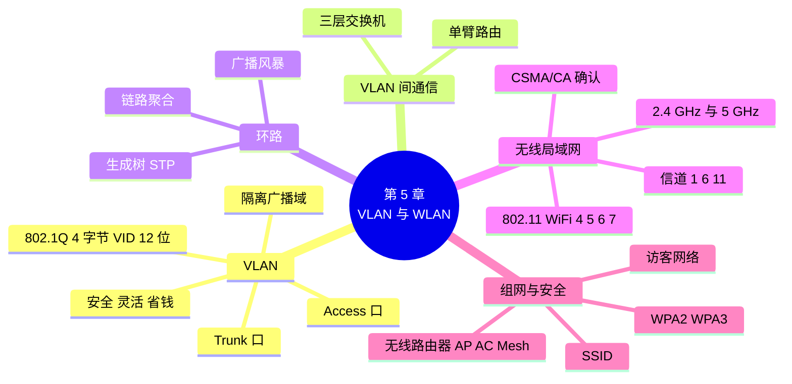

# 第 5 章 VLAN 与无线局域网

!!! abstract "本章学时"
    理论 5 学时（线上 4 + 线下 1）· 实验 1 学时（本章共 3 个实验，★ 必做 2 个）

## 学习目标

学完本章，你应该能够：

1. **说出** VLAN 的作用，以及 Access 口和 Trunk 口的区别（记忆、理解）；
2. **解释** 802.1Q 标签加在帧的什么位置、有什么用，在抓包中**找出** VLAN 号（理解、应用）；
3. 在 Packet Tracer 中**创建** VLAN、把接口划入 VLAN、**配置** Trunk，并**验证**隔离效果（应用）；
4. **说出** WiFi 4/5/6/7 对应的标准，**比较** 2.4 GHz 和 5 GHz 的特点，**解释**为什么要错开信道（理解、分析）；
5. **按照**安全要求设置无线路由器的 SSID、加密方式和访客网络（应用）。

!!! info "先修要求"
    学习本章前，你需要掌握：

    - [4.5.3 冲突域与广播域](../04-datalink/index.md#453)：交换机不隔离广播域；
    - [4.6 交换机怎样工作](../04-datalink/index.md#46)：自学习、转发、泛洪；
    - [实验 4-2](../04-datalink/index.md#4-2)：会在 Packet Tracer 中放设备、连线、配置 PC 的 IP 地址、进入交换机 CLI。

??? abstract "本章概念清单（20 个，点击查看定义和例子）"
    1. [VLAN](../../appendix/glossary.md#g-VLAN)
    2. [Access 口](../../appendix/glossary.md#g-Access-口)
    3. [Trunk 口](../../appendix/glossary.md#g-Trunk-口)
    4. [802.1Q](../../appendix/glossary.md#g-802.1Q)
    5. [VLAN 标识符](../../appendix/glossary.md#g-VLAN-标识符)
    6. [单臂路由](../../appendix/glossary.md#g-单臂路由)
    7. [三层交换机](../../appendix/glossary.md#g-三层交换机)
    8. [链路聚合](../../appendix/glossary.md#g-链路聚合)
    9. [无线局域网](../../appendix/glossary.md#g-无线局域网)
    10. [802.11](../../appendix/glossary.md#g-802.11)
    11. [WiFi](../../appendix/glossary.md#g-WiFi)
    12. [CSMA/CA](../../appendix/glossary.md#g-CSMA-CA)
    13. [确认](../../appendix/glossary.md#g-确认)
    14. [无线路由器](../../appendix/glossary.md#g-无线路由器)
    15. [AP](../../appendix/glossary.md#g-AP)
    16. [Mesh 组网](../../appendix/glossary.md#g-Mesh-组网)
    17. [SSID](../../appendix/glossary.md#g-SSID)
    18. [WPA2](../../appendix/glossary.md#g-WPA2)
    19. [WPA3](../../appendix/glossary.md#g-WPA3)
    20. [访客网络](../../appendix/glossary.md#g-访客网络)

## 情景导入

半年过去，小禾工作室从 5 个人发展到了 20 多人，分成了设计部和财务部，前台还专门给来访的客户留了几个座位。人一多，问题就来了。

陈姐先找到小林：“财务的电脑里都是报表和工资表，可我在网上邻居里能看到设计部的电脑，那设计部是不是也能看到我们？来访的客户插上网线，是不是也能看到？”禾姐的意见很明确：“财务必须单独隔开，访客只能上网，不能碰内部的任何东西。但别让我再买两台交换机。”

另一头，阿美抱怨会议室的 WiFi 时快时慢，客户来了也总问 WiFi 密码。小林发现，工作室的 WiFi 密码三年没换过，连楼下奶茶店的店员都知道。

老周给小林指了两条路：“有线这边，用 VLAN 在一台交换机里‘切’出几个互相隔离的小网络；无线这边，换个不挤的信道，加密方式升级，再给客户开一个单独的访客网络。”

这一章，我们先学 VLAN，再学无线局域网，最后在 Packet Tracer 里把工作室的网络按部门分开，并配置一台安全的无线路由器。

## 5.1 为什么要划分 VLAN { #51 }

### 5.1.1 广播太多的烦恼 { #511 }

上一章学过：交换机隔离冲突域，但**不隔离广播域**。一台交换机（或几台连在一起的交换机）下面的所有电脑，都在同一个广播域里。一台电脑发出广播帧，所有电脑都会收到。

电脑少的时候这没什么问题。可是随着电脑越来越多，麻烦就来了：

- **浪费带宽和处理能力**：很多协议都要发广播（比如第 8 章的 ARP、DHCP），几百台电脑在一个广播域里，每台电脑每秒都要处理大量和自己无关的广播帧；
- **不安全**：所有电脑在同一个网络里，能互相访问，财务电脑和访客电脑“近在咫尺”；
- **不好管理**：部门调整、人员换座位时，想按部门管理网络，只能重新布线。

传统的办法是用路由器把网络分开，或者每个部门买一台交换机、各拉各的线。但这既花钱又不灵活：财务部的人坐到了设计部旁边怎么办？

### 5.1.2 VLAN：一台交换机“切”成几台 { #512 }

**虚拟局域网**（Virtual LAN，[**VLAN**](../../appendix/glossary.md#g-VLAN "虚拟局域网：在交换机上把一个物理局域网按逻辑划分成多个广播域的技术"){ .term }）是在交换机上把一个物理的局域网，按部门、用途等逻辑地划分成多个广播域的技术<sup class="cite">[[1]](#ref5-1)</sup>。每个 VLAN 是一个独立的广播域，就像一台独立的交换机。

!!! note "比喻：一栋楼里的几家公司"
    一栋写字楼（一台交换机）里租给了三家公司（三个 VLAN）。大家共用一栋楼、一套电梯和大堂，但各家公司的门禁卡只能进自己的办公室，内部广播也只在自己公司里响。哪家公司扩张了，只要给新员工发一张本公司的门禁卡（把接口划进对应的 VLAN），不需要另建一栋楼。

VLAN 的作用（考点）：

| 作用 | 说明 |
|---|---|
| **隔离广播** | 广播帧只在本 VLAN 内传播，缩小广播域 |
| **增强安全** | 不同 VLAN 之间默认不能直接通信，财务和访客彼此看不见 |
| **灵活管理** | 按部门而不是按物理位置划分网络，员工换座位只要改一下接口所属的 VLAN |
| **节省成本** | 一台交换机就能当几台用 |

!!! warning "考点：VLAN 隔离的是广播域"
    同一个 VLAN 内的电脑可以直接通信；不同 VLAN 的电脑，即使接在同一台交换机上，也不能直接通信，必须经过路由器或三层交换机（5.3 节）。“划分 VLAN 可以隔离冲突域”这种说法不准确：隔离冲突域靠的是交换机的每个接口，VLAN 的作用是隔离**广播域**。

<iframe class="sim-frame" src="../../sims/vlan-isolation/main.html" height="560" loading="lazy" title="VLAN 隔离广播"></iframe>

动画：给交换机上的 6 台电脑分配 VLAN，点任意一台电脑发广播，看广播帧能到达哪些电脑；把所有电脑放回 VLAN 1，对比没有划分 VLAN 时的情况。
{ .sim-caption }

## 5.2 Access 口、Trunk 口与 802.1Q { #52 }

### 5.2.1 Access 口：只属于一个 VLAN { #521 }

交换机上连接电脑的接口，一般设为 [**Access 口**](../../appendix/glossary.md#g-Access-口 "只属于一个 VLAN 的交换机接口，一般连接电脑，收发普通以太网帧"){ .term }（接入口）。一个 Access 口只属于一个 VLAN。电脑发出的普通帧进入 Access 口后，交换机就知道它属于哪个 VLAN；从 Access 口发给电脑的帧，也是普通的以太网帧。电脑完全不知道 VLAN 的存在。

交换机出厂时，所有接口都属于 **VLAN 1**（默认 VLAN），所以不做任何配置时，所有电脑在同一个广播域里。

### 5.2.2 Trunk 口：多个 VLAN 共用一根线 { #522 }

工作室有两层楼，每层一台交换机，设计部和财务部在两层楼都有人。两台交换机之间要怎么连？

如果每个 VLAN 拉一根线，有几个 VLAN 就要几根线，太浪费。办法是把两台交换机之间相连的接口设为 [**Trunk 口**](../../appendix/glossary.md#g-Trunk-口 "可以同时传送多个 VLAN 帧的交换机接口，一般用于交换机之间，帧带 802.1Q 标签"){ .term }（干道口）：一个 Trunk 口可以同时传送多个 VLAN 的帧。

但问题来了：几个 VLAN 的帧混在一根线上，对面的交换机怎么知道某个帧属于哪个 VLAN？答案是给帧打上“标签”。

### 5.2.3 802.1Q 标签：帧里多了 4 个字节 { #523 }

IEEE [**802.1Q**](../../appendix/glossary.md#g-802.1Q "规定 VLAN 标签格式的 IEEE 标准：在源地址和类型之间插入 4 字节标签"){ .term } 标准规定<sup class="cite">[[2]](#ref5-2)</sup>：帧从 Trunk 口发出时，在以太网帧的源地址和类型字段之间插入一个 **4 字节**的 VLAN 标签：

```text
普通以太网帧：
 ┌──────────┬──────────┬────────┬──────────────┬──────┐
 │ 目的地址 6 │ 源地址 6  │ 类型 2  │ 数据 46～1500 │ FCS 4 │
 └──────────┴──────────┴────────┴──────────────┴──────┘

带 802.1Q 标签的帧（多了 4 个字节）：
 ┌──────────┬──────────┬───────────────────────┬────────┬──────────────┬──────┐
 │ 目的地址 6 │ 源地址 6  │ 802.1Q 标签 4         │ 类型 2  │ 数据 42～1500 │ FCS 4 │
 │          │          │ 0x8100 │ 优先级等 │ VID │        │              │ 重新计算│
 └──────────┴──────────┴───────────────────────┴────────┴──────────────┴──────┘
```

| 标签中的字段 | 长度 | 含义 |
|---|---|---|
| 标签类型 | 2 字节 | 固定为 `0x8100`，表示“后面跟着 VLAN 标签” |
| 优先级等 | 4 位 | 3 位优先级（让语音、视频优先）和 1 位其他标志 |
| [**VLAN 标识符**](../../appendix/glossary.md#g-VLAN-标识符 "802.1Q 标签中 12 位的 VLAN 号，简称 VID，可用 1～4094"){ .term }（VID） | 12 位 | VLAN 号，可用范围 1～4094 |

因为插入了 4 个字节，最长帧变成 1522 字节，FCS 也要重新计算。VID 有 12 位，2¹² = 4096，去掉保留的 0 和 4095，可用 **1～4094**。

标签只在 Trunk 链路上出现：帧从 Access 口进来时没有标签，交换机从 Trunk 口发出前打上标签；对面交换机收到后看标签，再从对应 VLAN 的 Access 口发给电脑，发出前把标签去掉。

!!! example "在抓包里看 802.1Q 标签"
    `labs/data/pcap/vlan_trunk.pcap` 是编者用 Python 的 scapy 库按 802.1Q 标准构造的“Trunk 链路上的帧”（12 帧：设计部和财务部各有一台电脑 ping 另一层楼的同事）。用 Wireshark 打开，第 1 帧的分层详情如下：

    ```text
    Ethernet II, Src: RealtekSemic_10:00:11 (00:e0:4c:10:00:11), Dst: Broadcast (ff:ff:ff:ff:ff:ff)
        Type: 802.1Q Virtual LAN (0x8100)
    802.1Q Virtual LAN, PRI: 0, DEI: 0, ID: 10
        000. .... .... .... = Priority: Best Effort (default) (0)
        ...0 .... .... .... = DEI: Ineligible
        .... 0000 0000 1010 = ID: 10
        Type: ARP (0x0806)
    ```

    字节窗格里，源地址后面的 `81 00 00 0a` 就是标签：`81 00` 是标签类型，`00 0a` 的低 12 位是十进制的 10，即 VLAN 10。

### 5.2.4 VLAN 怎样配置（Cisco 命令一览） { #524 }

在思科交换机上，划分 VLAN 一般分三步（华为命令对照见[附录 C](../../appendix/c-huawei.md)）：

```text
Switch(config)# vlan 10                          ← 第 1 步：创建 VLAN 10
Switch(config-vlan)# name Design                 ← 起个名字（可选）
Switch(config-vlan)# exit
Switch(config)# interface fa0/1                  ← 第 2 步：进入要划分的接口
Switch(config-if)# switchport mode access        ← 设为 Access 口
Switch(config-if)# switchport access vlan 10     ← 划入 VLAN 10
Switch(config-if)# exit
Switch(config)# interface gig0/1                 ← 第 3 步：交换机之间的接口
Switch(config-if)# switchport mode trunk         ← 设为 Trunk 口
```

查看结果用 `show vlan brief`（看每个 VLAN 有哪些接口）和 `show interfaces trunk`（看哪些接口是 Trunk）。具体操作见实验 5-1、5-2。

## 5.3 不同 VLAN 之间怎样通信 { #53 }

VLAN 把部门隔开了，可财务部的陈姐总要把报表发给禾姐吧？不同 VLAN 是不同的广播域，相当于不同的网络，要互相通信，就得经过**网络层**的设备（第 7 章详细讲），常见两种办法（了解）：

| 办法 | 怎么做 | 特点 |
|---|---|---|
| [**单臂路由**](../../appendix/glossary.md#g-单臂路由 "路由器用一个物理接口连到交换机 Trunk 口，划分子接口实现 VLAN 间通信"){ .term } | 路由器用一根线连到交换机的 Trunk 口，在这一个物理接口上划出几个“子接口”，每个子接口负责一个 VLAN | 省接口，但所有跨 VLAN 的流量挤在一根线上，适合小网络 |
| [**三层交换机**](../../appendix/glossary.md#g-三层交换机 "能在内部完成 VLAN 之间转发的交换机，兼具交换和路由功能"){ .term } | 在交换机内部直接完成 VLAN 之间的转发，每个 VLAN 配一个“虚拟接口”作为网关 | 速度快，企业网的主流做法 |

能不能互通、谁能访问谁，还可以再加上访问控制规则（第 11 章）。比如：设计部和财务部可以互相访问，访客 VLAN 只能访问互联网。

## 5.4 冗余、环路与生成树 { #54 }

### 5.4.1 多连一根线，网络反而瘫痪了 { #541 }

为了防止“一根线断了全楼断网”，网络中常常故意多连几根线做**冗余**备份。比如两层楼的交换机之间连两根线，一根坏了另一根顶上。

但以太网有个致命的弱点：**不能有环路**。一旦交换机之间形成环路，一个广播帧会被交换机不停地泛洪，沿着环路一圈圈转下去，而且每经过一台交换机就复制出更多份。几秒钟之内，网络中就充满了广播帧，交换机和电脑全部忙不过来，这就是上一章提到的**广播风暴**。同时，交换机的 MAC 地址表也会因为同一个地址不停地从不同接口“出现”而来回改变，变得混乱。

### 5.4.2 生成树协议：自动“堵住”多余的路 { #542 }

**生成树协议**（STP，IEEE 802.1D）<sup class="cite">[[1]](#ref5-1)</sup>让交换机之间自动交换信息，找出环路，把某些接口设为“阻塞”状态，使整个网络在逻辑上变成一棵没有环路的树。被阻塞的链路平时不转发数据，当正在使用的链路断了，生成树会重新计算，自动打开被阻塞的链路顶上去。

!!! note "比喻：小区的备用门"
    小区开了三个门，如果所有门都敞开，保安就要应付人流来回绕圈。生成树的做法是：平时只开一个主门，其余门锁上但保留钥匙；主门坏了，马上打开一个备用门。

这就是你在 Packet Tracer 中看到“交换机接口刚连上时是橙色，约 30 秒后变绿”的原因：接口要先经过生成树的检查，确认不会形成环路才开始转发。生成树的改进版本（快速生成树 RSTP）能把这个时间缩短到几秒。

### 5.4.3 链路聚合（了解） { #543 }

两台交换机之间连了两根线，生成树会堵住一根，带宽岂不是浪费了一半？[**链路聚合**](../../appendix/glossary.md#g-链路聚合 "把多根物理链路捆绑成一条逻辑链路，叠加带宽并互为备份"){ .term }把多根物理链路捆绑成一条逻辑链路，既能叠加带宽（两根千兆当两千兆用），又能互为备份。它被当作一条链路看待，不会被生成树阻塞。

## 5.5 无线局域网 { #55 }

### 5.5.1 802.11 与 WiFi 的代际 { #551 }

[**无线局域网**](../../appendix/glossary.md#g-无线局域网 "通过无线电波接入的局域网，简称 WLAN"){ .term }（WLAN）让电脑、手机等设备通过无线电波接入局域网。今天最常见的无线局域网标准是 IEEE [**802.11**](../../appendix/glossary.md#g-802.11 "无线局域网的 IEEE 标准系列"){ .term } 系列<sup class="cite">[[3]](#ref5-3)</sup>，生活中叫 [**WiFi**](../../appendix/glossary.md#g-WiFi "基于 802.11 标准的无线局域网的通称，新一代用数字代号命名"){ .term }。WiFi 联盟为了方便大家记，给新一代标准起了数字代号<sup class="cite">[[4]](#ref5-4)</sup>：

| 代号 | 标准 | 发布年份 | 频段 | 理论最高速率 |
|---|---|---|---|---|
| — | 802.11b / a / g | 1999～2003 | 2.4 / 5 GHz | 11～54 Mbit/s |
| WiFi 4 | 802.11n | 2009 | 2.4 / 5 GHz | 600 Mbit/s |
| WiFi 5 | 802.11ac | 2013 | 5 GHz | 约 6.9 Gbit/s |
| WiFi 6 / 6E | 802.11ax | 2019 / 2020 | 2.4 / 5（/ 6）GHz | 约 9.6 Gbit/s |
| WiFi 7 | 802.11be | 2024 | 2.4 / 5 / 6 GHz | 约 46 Gbit/s |

表中的“理论最高速率”是在最理想条件下、多根天线同时工作时的总速率。一部手机实际能用到的速率要低得多，通常只有几百 Mbit/s，原因在第 3 章讨论过：距离、墙壁、干扰都会降低信噪比。

!!! info "6 GHz 频段"
    WiFi 6E 和 WiFi 7 可以使用 6 GHz 频段，频道宽、干扰少。不过各国对这个频段的规划不同，我国目前没有把 6 GHz 频段开放给 WiFi 使用，国内销售的设备主要使用 2.4 GHz 和 5 GHz。选购设备时以国内产品说明为准。

### 5.5.2 2.4 GHz 与 5 GHz：快和远不能兼得 { #552 }

第 3 章说过：频率越高，速率越高，但穿墙能力越差、覆盖越近。WiFi 的两个主要频段正好体现了这一点（考点）：

| 比较项 | 2.4 GHz | 5 GHz |
|---|---|---|
| 覆盖范围、穿墙能力 | 远、强 | 近、弱 |
| 速率 | 较低 | 较高 |
| 可用信道 | 少，我国 1～13 号，互不重叠的只有 3 个 | 多 |
| 干扰 | 大：蓝牙、微波炉、邻居的 WiFi 都用这个频段 | 小 |
| 适合 | 远处房间、智能家居小设备 | 近处、需要高速的设备 |

很多路由器同时发出两个频段的信号，名字分别带 “-5G” 后缀，或者开启“双频合一”，让设备自动选择。注意：这里的“5G”指 5 GHz 频段，和手机的 5G 移动通信是两回事。

### 5.5.3 信道：为什么邻居的 WiFi 会“撞车” { #553 }

一个频段又分成很多**信道**，就像一条马路分成多条车道。2.4 GHz 频段在我国有 13 个信道，相邻信道的中心频率只相差 5 MHz，而一个 WiFi 信号要占用约 20 MHz 宽，所以相邻的几个信道会互相重叠。13 个信道中，**互不重叠**的只有 **1、6、11** 三个（考点）。

如果你家路由器用信道 6，隔壁也用信道 6 或者 4、5、7、8，大家的信号就会互相干扰，都变慢。这就是情景导入中隔壁网管说的“信道撞车”。

解决办法：

1. 用手机上的 WiFi 分析类软件，或第 3 章实验 3-2 的 `netsh wlan show networks mode=bssid` 命令，看看周围的 WiFi 都在用哪些信道；
2. 2.4 GHz 尽量选 1、6、11 中最空闲的一个；
3. 能用 5 GHz 的设备尽量用 5 GHz，信道多、干扰少。

<iframe class="sim-frame" src="../../sims/wifi-channel/main.html" height="560" loading="lazy" title="WiFi 信道"></iframe>

动画：在 2.4 GHz 频段上放几台路由器，拖动选择每台的信道，看它们的频谱是否重叠、互相干扰几处；试着找出让所有路由器都不干扰的信道组合。
{ .sim-caption }

### 5.5.4 CSMA/CA：无线设备怎样“排队说话” { #554 }

一个 WiFi 信道上的所有设备共享同一片“空中”，同一时间只能有一个设备发送，和早期以太网一样存在“抢着说话”的问题。但无线设备做不到“边说边听”（自己发送的信号太强，听不见别人），而且两台离得远的手机可能互相听不见对方（隐藏站问题），所以不能用 CSMA/CD。

802.11 使用 [**CSMA/CA**](../../appendix/glossary.md#g-CSMA-CA "载波监听多点接入 / 碰撞避免：先听、随机退避、发送后等确认"){ .term }（载波监听多点接入 / 碰撞**避免**）。它的思路是“尽量别撞上”：

1. **先听**：发送前先监听信道，信道忙就等着；
2. **再等一会儿**：信道空闲后，不马上发送，而是再随机等待一小段时间（退避），减少大家同时开口的可能；
3. **发送并等确认**：发完一帧，接收方如果正确收到，会回一个[**确认**](../../appendix/glossary.md#g-确认 "接收方正确收到数据后发回的回复，简称 ACK"){ .term }（ACK）；发送方收不到确认，就认为出错了，重新发送。
4. （可选）发送大的帧前，先发一个短的“请求发送”（RTS），对方回一个“允许发送”（CTS），周围的设备听到后就暂时安静，进一步避免碰撞。

!!! warning "考点：CSMA/CD 与 CSMA/CA"
    有线以太网（早期共享式）用 CSMA/CD，碰撞**检测**，发现碰撞立即停止；无线局域网用 CSMA/CA，碰撞**避免**，并且使用确认机制。所以无线局域网的数据链路层要对每一帧确认，而有线以太网不需要。

## 5.6 无线组网与安全 { #56 }

### 5.6.1 无线路由器、AP 与 AC { #561 }

| 设备 | 作用 | 典型场景 |
|---|---|---|
| [**无线路由器**](../../appendix/glossary.md#g-无线路由器 "集成了路由器、交换机和无线接入点功能的设备"){ .term } | 一台设备集成了路由器、交换机和**无线接入点**的功能 | 家庭、小办公室 |
| 无线接入点（[**AP**](../../appendix/glossary.md#g-AP "无线接入点，把无线设备接入有线网络的设备"){ .term }） | 只负责把无线设备接入有线网络，相当于“无线的交换机接口” | 企业每个房间、每层楼装一个 |
| 无线控制器（AC） | 统一管理几十上百个 AP：统一配置、统一升级，手机在 AP 之间移动不断网 | 学校、医院、商场、酒店 |
| [**Mesh 组网**](../../appendix/glossary.md#g-Mesh-组网 "多台路由器互相连接组成一个无线网络，名字密码相同、自动切换"){ .term } | 几台路由器之间用无线（或网线）互相连接，组成一个大的无线网络，名字和密码相同，自动切换 | 大户型、复式住宅、小型办公室 |

每个无线网络有一个名字，叫 [**SSID**](../../appendix/glossary.md#g-SSID "无线网络的名字"){ .term }（服务集标识符），就是你在手机 WiFi 列表里看到的名字。

### 5.6.2 加密方式：WEP、WPA2 与 WPA3 { #562 }

无线信号在空中传播，任何人都能接收到，所以必须加密。常见的加密方式（考点）：

| 加密方式 | 推出时间 | 安全性 | 建议 |
|---|---|---|---|
| 不加密（开放） | — | 任何人都能连接，数据明文传输 | 绝对不要用 |
| WEP | 1997 年 | 已被彻底攻破，几分钟就能破解 | 不要用 |
| WPA | 2003 年 | 过渡方案，已不安全 | 不要用 |
| [**WPA2**](../../appendix/glossary.md#g-WPA2 "使用 AES 加密的无线安全标准，目前广泛使用，需配合强密码"){ .term } | 2004 年 | 使用 AES 加密，目前仍广泛使用；密码太简单时可被暴力破解 | 可以用，配合强密码 |
| [**WPA3**](../../appendix/glossary.md#g-WPA3 "新一代无线安全标准，用 SAE 改进密码交换，更难被暴力破解"){ .term } | 2018 年 | 改进了密码交换过程（SAE），更难被暴力破解 | 设备都支持时首选 |

WPA2 和 WPA3 都有“个人版”（大家用同一个密码，家庭和小办公室用）和“企业版”（每个人用自己的账号登录，单位用）。

### 5.6.3 安全又快的无线网络：常见误区 { #563 }

| 常见做法 | 问题在哪 | 正确做法 |
|---|---|---|
| 密码用 `12345678` 或电话号码 | 破解工具几秒钟就能试出来 | 12 位以上，字母、数字、符号混合，定期更换 |
| 隐藏 SSID 就安全了 | 用工具照样能发现隐藏的网络 | 隐藏 SSID 不能代替加密，用 WPA2/WPA3 才是关键 |
| 开着 WPS“一键连接” | WPS 的 PIN 码有漏洞，可被暴力破解 | 在路由器设置中关闭 WPS |
| 访客直接用内部 WiFi | 访客能访问内部的电脑、打印机、NAS | 开启[**访客网络**](../../appendix/glossary.md#g-访客网络 "单独的 SSID 和密码，只能上网、不能访问内部网络的无线网络"){ .term }：单独的 SSID 和密码，只能上网，不能访问内部网络 |
| 路由器管理密码还是出厂的 `admin` | 任何连上 WiFi 的人都能改你的路由器设置 | 修改管理密码，关闭“远程管理” |
| 路由器放在柜子里、墙角 | 信号被遮挡 | 放在房子中间、高处、开阔的地方 |
| 2.4 GHz 和 5 GHz 都用默认信道 | 和邻居撞车 | 2.4 GHz 选 1、6、11 中最空闲的 |

访客网络在原理上和 VLAN 是一回事：把访客的设备放进一个单独的网络，和内部网络隔离。企业的 AC 和 AP 正是通过“一个 SSID 对应一个 VLAN”来实现隔离的。

## 5.7 本章常见问题对照 { #57 }

| 现象 | 用大白话说 | 怎么查、怎么改 |
|---|---|---|
| 划分 VLAN 后，同一部门的两台电脑也不通了 | 两个接口划进了不同的 VLAN，或电脑 IP 不在同一网段 | `show vlan brief` 检查接口所属 VLAN；检查 IP 配置 |
| 两台交换机上同一 VLAN 的电脑不通 | 交换机之间的接口不是 Trunk 口 | `show interfaces trunk` 检查；在两端接口上配置 `switchport mode trunk` |
| 不同 VLAN 之间不通 | 正常现象，VLAN 就是要隔离 | 需要互通时配置单臂路由或三层交换机（第 7 章） |
| 多连一根线后全网极慢 | 形成环路，广播风暴 | 拔掉多余的线；确认交换机开启了生成树 |
| WiFi 满格但很慢 | 信道拥挤、干扰大 | 查看周围 WiFi 的信道，换到空闲信道；改用 5 GHz |
| 手机搜不到 5 GHz 的 WiFi | 手机较老，不支持 5 GHz；或离路由器太远 | 用 2.4 GHz；靠近路由器 |
| 访客连上 WiFi 后能看到共享文件夹 | 访客和内部用的是同一个网络 | 开启访客网络，或把访客放进单独的 VLAN |

## 5.8 AI 与网络：给智能设备单独一个网络 { #58 }

智能音箱、摄像头、扫地机器人、智能门锁……家庭和办公室里联网的设备越来越多，很多还内置了 AI 语音助手和图像识别功能。这些设备方便的同时，也带来了风险：它们的系统不常更新，有的还用着出厂默认密码，很容易成为黑客进入内部网络的“后门”。

网络安全的常见建议是：把这些智能设备放进一个**单独的网络**，可以是路由器的访客网络、单独的 SSID，在企业里就是一个单独的 VLAN。这样即使某个摄像头被攻破，攻击者也接触不到存有重要文件的电脑。

另一方面，AI 也在帮助管理无线网络。企业级的无线控制器开始用 AI 分析各个 AP 的信号、干扰和用户数量，自动为每个 AP 选择最合适的信道和发射功率，甚至提前预测“下午三点会议室会拥挤”并调整配置。你在本章学的信道、干扰、VLAN 隔离，正是这些 AI 运维工具要考虑的因素。

## 本章实验

!!! abstract "实验总览"
    | 实验 | 类型 | 建议时长 | 内容 |
    |---|---|---|---|
    | 实验 5-1 | ★ 必做 | 25 分钟 | 按部门划分 VLAN |
    | 实验 5-2 | ★ 必做 | 25 分钟 | 两台交换机之间的 Trunk，看 802.1Q 标签 |
    | 实验 5-3 | ☆ 选做 | 25 分钟 | 设置无线路由器 |

    三个实验都使用 Cisco Packet Tracer。书中配置命令按思科 IOS 标准写法给出，命令输出为**输出格式示意**，以你屏幕上的为准。实验 5-2 还用到本书的抓包文件 `vlan_trunk.pcap` 和一个 Python 小程序，结果是编者实际运行得到的。

### 实验 5-1 ★ 按部门划分 VLAN { #5-1 }

**实验目的**

1. 在交换机上创建 VLAN 并给 VLAN 命名；
2. 把接口划入指定的 VLAN；
3. 验证同一 VLAN 能通、不同 VLAN 不通。

**实验环境**：Cisco Packet Tracer，使用实验 4-2 保存的 `xiaohe-ch04.pkt`（没有的话按实验 4-2 的拓扑重新搭建）。

**实验数据**：无。

**VLAN 规划**

| VLAN | 名称 | 接口 | 电脑 | IP 地址 |
|---|---|---|---|---|
| 10 | Design（设计部） | Fa0/1、Fa0/2 | PC0、PC1 | 192.168.1.11、192.168.1.12 |
| 20 | Finance（财务部） | Fa0/3、Fa0/4 | PC2、PC3 | 192.168.1.13、192.168.1.14 |
| 30 | Guest（访客） | Fa0/5 | PC4 | 192.168.1.15 |

为了看清 VLAN 本身的隔离效果，这个实验故意让所有电脑保留同一网段的地址。实际工作中每个 VLAN 用不同的网段（实验 5-2 和第 6 章）。

**实验步骤**

第一档 · 跑通：

1. 打开文件，先从 PC0 分别 ping 192.168.1.13 和 192.168.1.15，确认现在**都能通**（所有接口都在默认的 VLAN 1）。
2. 进入交换机 CLI，创建三个 VLAN：

```text
Switch>enable
Switch#configure terminal
Switch(config)#vlan 10
Switch(config-vlan)#name Design
Switch(config-vlan)#vlan 20
Switch(config-vlan)#name Finance
Switch(config-vlan)#vlan 30
Switch(config-vlan)#name Guest
Switch(config-vlan)#exit
```

3. 把接口划入 VLAN。`interface range` 可以一次选中多个接口：

```text
Switch(config)#interface range fa0/1 - 2
Switch(config-if-range)#switchport mode access
Switch(config-if-range)#switchport access vlan 10
Switch(config-if-range)#interface range fa0/3 - 4
Switch(config-if-range)#switchport mode access
Switch(config-if-range)#switchport access vlan 20
Switch(config-if-range)#interface fa0/5
Switch(config-if)#switchport mode access
Switch(config-if)#switchport access vlan 30
Switch(config-if)#end
```

4. 输入 `show vlan brief` 查看结果，输出格式示意（只列出前几行）：

```text
VLAN Name                             Status    Ports
---- -------------------------------- --------- -------------------------------
1    default                          active    Fa0/6, Fa0/7, Fa0/8, Fa0/9
                                                ……
10   Design                           active    Fa0/1, Fa0/2
20   Finance                          active    Fa0/3, Fa0/4
30   Guest                            active    Fa0/5
```

5. 再从 PC0 ping 192.168.1.12（同在 VLAN 10）、192.168.1.13（VLAN 20）、192.168.1.15（VLAN 30），把结果填入记录表。

第二档 · 改一改：

1. 陈姐（PC3）调到了设计部，座位不变。只改一处配置，让 PC3 能和 PC0 通、和 PC2 不通。写下你用的命令。（提示：`interface fa0/4` 后改 `switchport access vlan` 的值。）
2. 用 `write memory`（或 `copy running-config startup-config`）保存交换机配置，再把文件另存为 `xiaohe-ch05-1.pkt`。

第三档 · 挑战（选做）：在 Fa0/6～Fa0/24 中挑几个空闲接口，划入一个新建的 VLAN 99 并命名为 Unused，再用 `interface range fa0/6 - 24` 和 `shutdown` 把空闲接口关闭。说说为什么这样做能提高安全性。

**实验记录表**

| 从 PC0 ping | 目标所在 VLAN | 划分前 | 划分后 |
|---|---|---|---|
| 192.168.1.12 | | | |
| 192.168.1.13 | | | |
| 192.168.1.15 | | | |
| 改一改后 PC3 | | — | |

**常见问题排查**

| 现象 | 原因 | 解决 |
|---|---|---|
| 输入 `vlan 10` 提示 `% Invalid input` | 不在全局配置模式 | 提示符应为 `Switch(config)#`，先输入 `configure terminal` |
| 同一 VLAN 的两台电脑也不通 | 接口划错了 VLAN | `show vlan brief` 逐个核对 |
| 划分后，不同 VLAN 竟然还能通 | 接口没有划进去，仍在 VLAN 1 | 检查是否在正确的接口下输入了 `switchport access vlan` |
| 重新打开文件后 VLAN 配置不见了 | 没保存交换机配置 | `write memory` 后再保存 pkt 文件 |

**思考与练习**

1. 划分 VLAN 后，PC0 和 PC2 的 IP 地址明明在同一网段，为什么不通了？
2. 访客 VLAN 里只有一台电脑，它发出的广播会被交换机发到哪些接口？

**实验报告要求**：提交 `show vlan brief` 截图、划分前后的 ping 结果截图和记录表。

### 实验 5-2 ★ 两台交换机之间的 Trunk，看 802.1Q 标签 { #5-2 }

**实验目的**

1. 理解 Access 口和 Trunk 口的区别；
2. 配置交换机之间的 Trunk 链路，让同一部门跨楼层互通；
3. 在抓包中找到 802.1Q 标签和 VLAN 号。

**实验环境**：Cisco Packet Tracer；Wireshark；Python（Thonny）。

**实验数据**：`labs/data/pcap/vlan_trunk.pcap`（编者用 scapy 构造的 Trunk 链路帧，12 帧）。

**拓扑与地址规划**

```text
        一楼 Switch0（2960）                         二楼 Switch1（2960）
   Fa0/1        Fa0/2       Gi0/1 ──────────── Gi0/1       Fa0/1        Fa0/2
     │            │              （Trunk）                   │            │
    PC0          PC1                                        PC2          PC3
  设计部        财务部                                     设计部        财务部
 VLAN 10       VLAN 20                                    VLAN 10       VLAN 20
192.168.10.11 192.168.20.11                            192.168.10.21 192.168.20.21
```

子网掩码都用 255.255.255.0。这次每个 VLAN 用不同的网段：设计部 192.168.10.x，财务部 192.168.20.x，与抓包文件中的地址一致。

**实验步骤**

第一档 · 跑通：

1. 新建文件，按拓扑放两台 2960 交换机和 4 台 PC，用“自动选择连接类型”连线。两台交换机之间注意连 **Gi0/1** 接口（连线时会弹出接口列表，手动选择）。按表配置 4 台 PC 的 IP 地址。
2. 在**两台交换机上**都创建 VLAN 10、20，并把 Fa0/1 划入 VLAN 10、Fa0/2 划入 VLAN 20（命令同实验 5-1）。
3. 从 PC0 ping PC2（192.168.10.21）。这时**不通**：两台交换机之间的 Gi0/1 还是默认的 Access 口，只属于 VLAN 1，VLAN 10 的帧过不去。
4. 在两台交换机上把 Gi0/1 设为 Trunk 口：

```text
Switch(config)#interface gig0/1
Switch(config-if)#switchport mode trunk
Switch(config-if)#end
Switch#show interfaces trunk
```

`show interfaces trunk` 的输出格式示意：

```text
Port        Mode         Encapsulation  Status        Native vlan
Gig0/1      on           802.1q         trunking      1

Port        Vlans allowed on trunk
Gig0/1      1-1005
```

5. 再从 PC0 ping PC2，应该能通；PC0 ping PC3（192.168.20.21）仍然不通（不同 VLAN、不同网段）。
6. **看标签（Packet Tracer）**：切换到模拟模式，过滤器只勾选 ICMP，从 PC0 向 PC2 发一个简单 PDU。单步前进，当信封走到两台交换机之间的链路时，点事件列表中这一行，在 “Outbound PDU Details” 中找到 802.1Q 一栏，看 VLAN 号是不是 10。
7. **看标签（Wireshark）**：用 Wireshark 打开 `vlan_trunk.pcap`，点第 1 帧，展开 “802.1Q Virtual LAN”，确认 ID 为 10，与 [5.2.3 节](#523)对照；再点第 7 帧，ID 是多少？
8. 运行 `labs/ch05/lab5_2_vlan_count.py`，统计每个 VLAN 各有几帧：

```python
import struct

data = open("../data/pcap/vlan_trunk.pcap", "rb").read()
count = {}                                     # VLAN 号 → 帧数
pos = 24                                       # 跳过 24 字节的文件头
while pos < len(data):
    caplen = struct.unpack("<I", data[pos + 8:pos + 12])[0]
    frame = data[pos + 16:pos + 16 + caplen]
    if frame[12:14] == b"\x81\x00":            # 类型位置是 0x8100：带 802.1Q 标签
        vid = struct.unpack("!H", frame[14:16])[0] & 0x0FFF   # 取低 12 位：VLAN 号
        count[vid] = count.get(vid, 0) + 1
    pos += 16 + caplen
for vid, n in sorted(count.items()):
    print(f"VLAN {vid}: {n} 帧")
```

`& 0x0FFF` 的意思是“只保留低 12 位”，正好是 VID。字典的 `get` 用法详见《Python 编程》中讲字典的一章。

**运行结果**（编者运行）

```text
VLAN 10: 6 帧
VLAN 20: 6 帧
```

第二档 · 改一改：

1. 把程序中的文件名改成 `../data/pcap/web_visit.pcap` 再运行。结果是什么也不输出，为什么？（提示：这个文件是在普通的 Access 口一侧抓的。）
2. 在 Packet Tracer 中，只把 Switch1 的 Gi0/1 改回 Access 口（`switchport mode access`），Switch0 保持 Trunk，再测试 PC0 ping PC2，记录结果。

第三档 · 挑战（选做）：在两台交换机上都新建 VLAN 30（访客），每层楼各加一台访客电脑（192.168.30.11、192.168.30.21），不改 Trunk 配置，测试访客电脑能否跨楼层互通，并解释原因（提示：看 `show interfaces trunk` 中的 “Vlans allowed on trunk”）。

**实验记录表**

| 测试 | 配置 Trunk 前 | 配置 Trunk 后 |
|---|---|---|
| PC0 → PC2（同为 VLAN 10） | | |
| PC0 → PC3（VLAN 10 → 20） | | |
| PT 模拟模式中看到的 VLAN 号 | — | |
| Wireshark 第 7 帧的 VLAN 号 | — | |

**常见问题排查**

| 现象 | 原因 | 解决 |
|---|---|---|
| 配了 Trunk 仍然不通 | 只配了一端；或对面交换机没有创建 VLAN 10 | 两端都配 Trunk，两台交换机上都要创建 VLAN |
| 找不到 Gi0/1 接口 | 连线时用了 Fa0/24 等其他接口 | 删除连线重连，手动选择 Gi0/1；或者在命令中改用实际的接口名 |
| 模拟模式里看不到 802.1Q | 看的是 PC 和交换机之间的链路 | 标签只在交换机之间的 Trunk 链路上出现 |
| Python 报 `FileNotFoundError` | 不在 `labs/ch05/` 目录运行 | 在 Thonny 中打开该目录下的文件再运行 |

**思考与练习**

1. 为什么帧从交换机发给电脑之前要去掉 802.1Q 标签？
2. 如果工作室以后有 5 个部门、3 层楼，交换机之间需要几根线？和不用 Trunk 相比节省了多少？

**实验报告要求**：提交 `show interfaces trunk` 截图、Trunk 配置前后的 ping 截图、模拟模式中 802.1Q 字段的截图、程序运行截图和记录表。

### 实验 5-3 ☆ 设置无线路由器 { #5-3 }

**实验目的**

1. 在 Packet Tracer 中配置无线路由器的 SSID 和 WPA2 加密；
2. 让笔记本电脑和手机通过无线接入；
3. 对照 5.6.3 节，检查一台无线路由器的安全设置。

**实验环境**：Cisco Packet Tracer；（第三档）家里或宿舍的无线路由器，需取得路由器主人的同意。

**实验数据**：无。

**实验步骤**

第一档 · 跑通：

1. 新建文件，从“网络设备 → 无线设备”中拖一台**无线路由器**（如 WRT300N 或 HomeRouter，不同版本的 Packet Tracer 型号名称略有不同）；从“终端设备”中拖一台 **Laptop**（笔记本）和一台 **Smartphone**（手机）。
2. 点无线路由器，选 “GUI” 选项卡，进入 “Wireless（无线）” 设置：
    - 网络名称（SSID）改为 `Xiaohe-Office` ← 改这里；
    - 安全模式选 **WPA2 Personal**，加密选 **AES**，密码填一个 12 位以上的强密码，比如 `Xh@Studio2026` ← 改这里；
    - 页面底部点 “Save Settings（保存设置）”。
3. 笔记本默认装的是有线网卡，要先换成无线网卡：点 Laptop，选 “Physical（物理）” 选项卡，点电源开关关机，把原来的网卡模块拖回左侧模块列表，再把 **WPC300N**（无线网卡）拖到空槽位，重新开机。
4. 在 Laptop 的 Desktop 中打开 “PC Wireless”，在 “Connect” 页找到 `Xiaohe-Office`，输入密码连接。连接成功后，工作区中会出现笔记本和路由器之间的无线信号线。
5. 手机：点 Smartphone，选 “Config → Wireless0”，填写 SSID `Xiaohe-Office`，选 WPA2-PSK，输入同一个密码。
6. 在 Laptop 的 Command Prompt 中输入 `ipconfig`，看看它自动获取到了什么 IP 地址（无线路由器默认开启了自动分配地址的 DHCP 功能，第 8 章讲）；再 ping 手机的地址（在手机的 Desktop → Command Prompt 中用 `ipconfig` 查）。

第二档 · 改一改：

1. 把路由器的密码改成另一个，保存后观察笔记本和手机的无线连接有什么变化，再让它们用新密码重新连接。
2. 把安全模式改成 “Disabled（不加密）”，看看连接过程有什么不同。做完后改回 WPA2，并在报告中写一句为什么不能用开放网络。

第三档 · 挑战（选做）：在取得路由器主人同意的前提下，登录家里或宿舍的无线路由器管理页面（地址一般印在路由器底部），**只查看、不修改**，对照 5.6.3 节的表格逐项检查：加密方式、WPS 是否开启、管理密码是否还是默认的、有没有访客网络功能、2.4 GHz 用的是哪个信道。写一份不超过 200 字的“安全体检报告”，把建议交给路由器主人自己决定是否修改。

**实验记录表**

| 项目 | 你的设置或观察 |
|---|---|
| SSID | |
| 加密方式 | |
| 笔记本获取的 IP 地址 | |
| 手机获取的 IP 地址 | |
| 笔记本 ping 手机 | |
| 改密码后的现象 | |

**常见问题排查**

| 现象 | 原因 | 解决 |
|---|---|---|
| 笔记本找不到 WiFi | 还装着有线网卡；或无线路由器没保存设置 | 关机换 WPC300N 无线网卡；在 GUI 中点 Save Settings |
| 网卡模块拖不动 | 设备没关机 | 先在 Physical 页点电源开关关机 |
| 连接时提示认证失败 | 密码或加密方式不一致 | 检查两边都是 WPA2 和 AES，密码区分大小写 |
| ipconfig 显示 169.254.x.x | 没有从路由器获取到地址 | 检查无线连接是否成功、路由器的 DHCP 是否开启 |

**思考与练习**

1. 为什么说隐藏 SSID 不能代替加密？
2. 工作室既要给员工用 WiFi，又要给客户用 WiFi，你会怎样设置？结合 VLAN 说明。

**实验报告要求**：提交无线路由器设置页面截图、笔记本连接成功和 ping 通手机的截图、记录表；做了第三档的附上“安全体检报告”（不要包含真实的 WiFi 密码）。

## 本章小结

- 交换机不隔离广播域，电脑一多就会广播泛滥、不安全、不好管理。**VLAN** 在交换机上把一个局域网按逻辑划分成多个广播域，同一 VLAN 能直接通信，不同 VLAN 之间要经过路由器或三层交换机（**单臂路由**、**三层交换机**）。
- 连接电脑的接口设为 **Access 口**，只属于一个 VLAN；交换机之间的接口设为 **Trunk 口**，可以传多个 VLAN 的帧。Trunk 上的帧带 **802.1Q** 标签：4 字节，插在源地址和类型之间，类型 `0x8100`，其中 12 位 **VLAN 标识符**，可用 1～4094。
- 冗余链路会形成环路，引发广播风暴；**生成树协议**自动阻塞多余链路，故障时再打开。**链路聚合**把多根链路捆成一条，叠加带宽。
- **无线局域网**标准是 IEEE **802.11**：WiFi 4 = 802.11n，WiFi 5 = 802.11ac，WiFi 6 = 802.11ax，WiFi 7 = 802.11be。2.4 GHz 远而慢、干扰大，5 GHz 快而近；2.4 GHz 互不重叠的**信道**是 1、6、11。
- 无线局域网使用 **CSMA/CA**：先听、随机退避、发送后等确认。
- 家庭和小办公室用**无线路由器**，企业用 **AP** 加 AC，大户型用 **Mesh 组网**。**SSID** 是无线网络的名字，加密用 **WPA2** 或 **WPA3**，不用 WEP 和开放网络；访客使用单独的**访客网络**。



**下一章预告**

划分 VLAN 时，我们已经开始给不同部门用不同的“网段”：192.168.10.x、192.168.20.x。这些数字是怎么定的？为什么 192.168.10.11 和 192.168.20.11 不在一个网络里？网管说的“给财务部分一个 /27”又是什么意思？下一章学习 **IP 地址**：二进制换算、子网掩码、子网划分和 IPv6，并为小禾工作室做一份完整的地址规划。

## 参考文献

正文中的上标编号（如<sup class="cite">[[1]](#ref5-1)</sup>）对应下面的文献。带链接的可以直接打开；书籍可在图书馆或电子书平台查阅。

<div class="refs" markdown>

**教材与专著**

- <span id="ref5-1"></span>[1] 谢希仁. 计算机网络[M]. 8 版. 北京: 电子工业出版社, 2021.
    <span class="ref-note">第 3 章“数据链路层”中的虚拟局域网、生成树和 802.1Q 帧格式；第 9 章“无线网络和移动网络”中的 802.11 和 CSMA/CA，对应本章 5.1～5.5 节。</span>

**标准与在线资源**

- <span id="ref5-2"></span>[2] IEEE. IEEE 802.1Q-2022 IEEE Standard for Local and Metropolitan Area Networks—Bridges and Bridged Networks[S/OL]. [2026-11-01]. <https://standards.ieee.org/ieee/802.1Q/10323/>.
    <span class="ref-note">VLAN 标签和网桥（交换机）的标准，规定了 802.1Q 标签格式、VLAN 号范围，并包含生成树协议，对应 5.2 节和 5.4 节。</span>
- <span id="ref5-3"></span>[3] IEEE. IEEE 802.11-2024 IEEE Standard for Information Technology—Telecommunications and Information Exchange between Systems—Local and Metropolitan Area Networks—Specific Requirements—Part 11: Wireless LAN Medium Access Control (MAC) and Physical Layer (PHY) Specifications[S/OL]. [2026-11-01]. <https://standards.ieee.org/ieee/802.11/10548/>.
    <span class="ref-note">无线局域网的基础标准，规定了 CSMA/CA、确认机制等，对应 5.5 节。</span>
- <span id="ref5-4"></span>[4] Wi-Fi Alliance. Discover Wi-Fi[EB/OL]. [2026-11-01]. <https://www.wi-fi.org/discover-wi-fi>.
    <span class="ref-note">WiFi 联盟的官方介绍，包括按代际命名的 WiFi 认证（如 Wi-Fi CERTIFIED 7）和安全认证，对应 5.5.1 节和 5.6.2 节。</span>

</div>

## 课后练习

选择题和判断题可以直接点击选项作答，系统会马上告诉你对错，并展开答案与解析；多选题选好后点“提交答案”。简答和实操题请先自己作答，再点开“答案与解析”核对。每道题的解析下方都有“回看”链接，做错了可以直接跳回正文复习。

**一、单项选择题**

<div class="quiz" data-answer="C" markdown>

**1.** 划分 VLAN 的主要作用是（　　）。

- A. 隔离冲突域
- B. 提高网线的传输速率
- C. 隔离广播域
- D. 代替路由器连接互联网

</div>

??? tip "答案与解析"
    **答案：C**

    每个 VLAN 是一个独立的广播域。隔离冲突域靠的是交换机的每个接口；VLAN 不能代替路由器连接不同网络。

    考查：VLAN 的作用 · 认知层次：理解 · [回看 5.1.2](#512)
    { .quiz-meta }

<div class="quiz" data-answer="B" markdown>

**2.** 802.1Q 标签的长度是（　　）。

- A. 2 字节
- B. 4 字节
- C. 6 字节
- D. 12 字节

</div>

??? tip "答案与解析"
    **答案：B**

    802.1Q 标签 4 字节，插在源地址和类型字段之间；其中 VLAN 标识符占 12 位。

    考查：802.1Q 标签 · 认知层次：记忆 · [回看 5.2.3](#523)
    { .quiz-meta }

<div class="quiz" data-answer="D" markdown>

**3.** 交换机之间的链路需要同时传送多个 VLAN 的帧，应把相连的接口设置为（　　）。

- A. Access 口
- B. Console 口
- C. 默认 VLAN 1 的接口
- D. Trunk 口

</div>

??? tip "答案与解析"
    **答案：D**

    Trunk 口可以传送多个 VLAN 的帧，帧上带 802.1Q 标签；Access 口只属于一个 VLAN，一般接电脑。

    考查：Access 口与 Trunk 口 · 认知层次：理解 · [回看 5.2.2](#522)
    { .quiz-meta }

<div class="quiz" data-answer="A" markdown>

**4.** 802.1Q 中 VLAN 标识符占 12 位，可以使用的 VLAN 号范围是（　　）。

- A. 1～4094
- B. 0～4095
- C. 1～1024
- D. 1～65535

</div>

??? tip "答案与解析"
    **答案：A**

    12 位共 4096 个值（0～4095），0 和 4095 保留，可用 1～4094。

    考查：802.1Q 标签 · 认知层次：理解 · [回看 5.2.3](#523)
    { .quiz-meta }

<div class="quiz" data-answer="C" markdown>

**5.** 交换机之间形成环路后，可能出现的严重问题是（　　）。

- A. 冲突域变大
- B. 网线断开
- C. 广播风暴
- D. IP 地址冲突

</div>

??? tip "答案与解析"
    **答案：C**

    环路中广播帧不停地循环和复制，形成广播风暴，网络瘫痪。生成树协议用来消除环路。

    考查：环路与生成树 · 认知层次：理解 · [回看 5.4.1](#541)
    { .quiz-meta }

<div class="quiz" data-answer="B" markdown>

**6.** WiFi 6 对应的 IEEE 标准是（　　）。

- A. 802.11n
- B. 802.11ax
- C. 802.11ac
- D. 802.11be

</div>

??? tip "答案与解析"
    **答案：B**

    WiFi 4 = 802.11n，WiFi 5 = 802.11ac，WiFi 6 = 802.11ax，WiFi 7 = 802.11be。

    考查：WiFi 代际 · 认知层次：记忆 · [回看 5.5.1](#551)
    { .quiz-meta }

<div class="quiz" data-answer="D" markdown>

**7.** 在 2.4 GHz 频段，为了避免相互干扰，三台相邻的无线路由器最好分别使用信道（　　）。

- A. 1、2、3
- B. 5、6、7
- C. 1、3、5
- D. 1、6、11

</div>

??? tip "答案与解析"
    **答案：D**

    2.4 GHz 相邻信道相差 5 MHz，而一个信号约占 20 MHz，只有 1、6、11 三个信道互不重叠。

    考查：WiFi 信道 · 认知层次：应用 · [回看 5.5.3](#553)
    { .quiz-meta }

<div class="quiz" data-answer="A" markdown>

**8.** 无线局域网使用的介质访问控制方法是（　　）。

- A. CSMA/CA
- B. CSMA/CD
- C. 令牌传递
- D. 时分复用

</div>

??? tip "答案与解析"
    **答案：A**

    无线设备无法边发边检测碰撞，802.11 使用 CSMA/CA（碰撞避免），并采用确认机制。CSMA/CD 用于早期共享式有线以太网。

    考查：CSMA/CA · 认知层次：记忆 · [回看 5.5.4](#554)
    { .quiz-meta }

**二、多项选择题**

<div class="quiz quiz-multi" data-answer="ABD" markdown>

**9.** 关于 VLAN，下列说法正确的有（　　）。

- A. 同一 VLAN 内的电脑可以直接通信
- B. 不同 VLAN 之间通信需要路由器或三层交换机
- C. 不同 VLAN 的电脑只要接在同一台交换机上就能直接通信
- D. 交换机出厂时所有接口默认属于 VLAN 1

</div>

??? tip "答案与解析"
    **答案：ABD**

    不同 VLAN 是不同的广播域，即使接在同一台交换机上也不能直接通信。

    考查：VLAN · 认知层次：理解 · [回看 5.1.2](#512)
    { .quiz-meta }

<div class="quiz quiz-multi" data-answer="BC" markdown>

**10.** 与 2.4 GHz 相比，5 GHz 频段的 WiFi（　　）。

- A. 覆盖范围更大、穿墙能力更强
- B. 速率更高
- C. 可用信道更多、干扰更少
- D. 和手机的 5G 移动通信是同一种技术

</div>

??? tip "答案与解析"
    **答案：BC**

    5 GHz 频率高，速率高、信道多、干扰少，但覆盖近、穿墙弱。WiFi 的“5G”指 5 GHz 频段，和 5G 移动通信无关。

    考查：2.4 GHz 与 5 GHz · 认知层次：理解 · [回看 5.5.2](#552)
    { .quiz-meta }

<div class="quiz quiz-multi" data-answer="ACD" markdown>

**11.** 为了让办公室的无线网络更安全，下列做法正确的有（　　）。

- A. 使用 WPA2 或 WPA3 加密，并设置强密码
- B. 隐藏 SSID 后就可以不加密
- C. 关闭 WPS 功能
- D. 给来访客户开启单独的访客网络

</div>

??? tip "答案与解析"
    **答案：ACD**

    隐藏的 SSID 用工具照样能发现，不能代替加密。

    考查：无线网络安全 · 认知层次：应用 · [回看 5.6.3](#563)
    { .quiz-meta }

**三、判断题**

<div class="quiz quiz-judge" data-answer="×" markdown>

**12.** 帧从交换机的 Access 口发给电脑时，仍然带着 802.1Q 标签。（　　）

</div>

??? tip "答案与解析"
    **答案：×**

    标签只在 Trunk 链路上出现。帧从 Access 口发给电脑前，交换机会把标签去掉，电脑收到的是普通以太网帧。

    考查：802.1Q 标签 · 认知层次：理解 · [回看 5.2.3](#523)
    { .quiz-meta }

<div class="quiz quiz-judge" data-answer="√" markdown>

**13.** 生成树协议通过阻塞部分接口来消除环路，当正在使用的链路故障时，被阻塞的链路可以自动启用。（　　）

</div>

??? tip "答案与解析"
    **答案：√**

    生成树既消除了环路，又保留了冗余链路作为备份。

    考查：生成树 · 认知层次：理解 · [回看 5.4.2](#542)
    { .quiz-meta }

<div class="quiz quiz-judge" data-answer="×" markdown>

**14.** WEP 加密方式安全可靠，适合办公室无线网络使用。（　　）

</div>

??? tip "答案与解析"
    **答案：×**

    WEP 早已被彻底攻破，应使用 WPA2 或 WPA3。

    考查：无线加密方式 · 认知层次：记忆 · [回看 5.6.2](#562)
    { .quiz-meta }

<div class="quiz quiz-judge" data-answer="√" markdown>

**15.** 在 802.11 无线局域网中，接收方正确收到数据帧后要发回确认帧。（　　）

</div>

??? tip "答案与解析"
    **答案：√**

    这是 CSMA/CA 的一部分。发送方收不到确认就认为出错并重发。

    考查：CSMA/CA · 认知层次：理解 · [回看 5.5.4](#554)
    { .quiz-meta }

<div class="quiz quiz-judge" data-answer="×" markdown>

**16.** 无线接入点（AP）的作用是把多个不同的网络互相连接起来，并为它们选择路由。（　　）

</div>

??? tip "答案与解析"
    **答案：×**

    AP 只负责把无线设备接入有线网络，相当于“无线的交换机接口”；选择路由是路由器的功能。

    考查：AP 与无线路由器 · 认知层次：理解 · [回看 5.6.1](#561)
    { .quiz-meta }

**四、简答题**

**17.** 小禾工作室有设计部、财务部和访客区，只有一台 24 口交换机。请说明怎样用 VLAN 满足“财务单独隔开、访客不能访问内部”的要求，并说出划分 VLAN 的三个好处。

??? tip "答案与解析"
    **参考答案：** 在交换机上创建三个 VLAN，比如设计部 VLAN 10、财务部 VLAN 20、访客 VLAN 30，把各部门电脑所接的接口设为 Access 口并划入对应的 VLAN。不同 VLAN 之间默认不能通信，财务和访客就与其他部门隔开了；需要访问互联网或部门之间需要有限互通时，再通过路由器或三层交换机，并配合访问控制规则。好处：隔离广播、增强安全、按部门灵活管理、一台交换机当几台用节省成本（答出三个即可）。

    考查：VLAN 的作用与规划 · 认知层次：应用 · [回看 5.1.2](#512)
    { .quiz-meta }

**18.** 比较 CSMA/CD 和 CSMA/CA：分别用在什么网络中？对碰撞的处理思路有什么不同？无线局域网为什么不能使用 CSMA/CD？

??? tip "答案与解析"
    **参考答案：** CSMA/CD 用于早期共享式有线以太网，思路是碰撞检测：先听后说、边说边听，发现碰撞立即停止并随机退避。CSMA/CA 用于 802.11 无线局域网，思路是碰撞避免：先听，信道空闲后再随机退避一段时间才发送，发送后等待确认，必要时用 RTS/CTS 预约信道。无线设备发送时自身信号太强，无法同时检测别人的信号；并且存在两台设备互相听不见的隐藏站问题，所以无法做碰撞检测。

    考查：CSMA/CD 与 CSMA/CA · 认知层次：分析 · [回看 5.5.4](#554)
    { .quiz-meta }

**19.** 下面是 Wireshark 中某帧的前 18 个字节：`ff ff ff ff ff ff 00 e0 4c 20 00 11 81 00 00 14 08 06`。请写出目的 MAC 地址、源 MAC 地址、这个帧属于哪个 VLAN，以及里面装的是什么协议。

??? tip "答案与解析"
    **参考答案：** 目的 MAC 地址 `ff:ff:ff:ff:ff:ff`（广播）；源 MAC 地址 `00:e0:4c:20:00:11`；`81 00` 表示带 802.1Q 标签，`00 14` 的低 12 位是十六进制 14，即十进制 20，属于 VLAN 20；最后的 `08 06` 是类型字段，表示 ARP。这正是 `vlan_trunk.pcap` 的第 7 帧。

    考查：802.1Q 标签 · 认知层次：应用 · [回看 5.2.3](#523)
    { .quiz-meta }

**五、实操题**

**20.** 补全下面的思科交换机配置命令：创建 VLAN 20 并命名为 Finance，把 Fa0/3 划入 VLAN 20，再把连接另一台交换机的 Gi0/1 设为 Trunk 口。

```text
Switch(config)#vlan 20
Switch(config-vlan)#________①________
Switch(config-vlan)#exit
Switch(config)#interface fa0/3
Switch(config-if)#switchport mode ____②____
Switch(config-if)#switchport access vlan ____③____
Switch(config-if)#exit
Switch(config)#interface ____④____
Switch(config-if)#switchport mode ____⑤____
```

??? tip "答案与解析"
    **参考答案：** ① `name Finance`；② `access`；③ `20`；④ `gig0/1`（或 `GigabitEthernet0/1`）；⑤ `trunk`。配置后可用 `show vlan brief` 和 `show interfaces trunk` 查看结果。

    考查：VLAN 与 Trunk 配置 · 认知层次：应用 · [回看实验 5-2](#5-2)
    { .quiz-meta }
