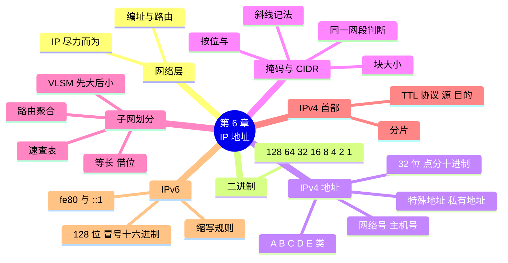

# 第 6 章 IP 地址：IPv4、子网划分与 IPv6

!!! abstract "本章学时"
    理论 5 学时（线上 3 + 线下 2）· 实验 1 学时（本章共 3 个实验，★ 必做 2 个）

!!! warning "本章是闭卷考试的重点"
    子网划分是本课程计算题的主要来源。建议线下课用 2 学时集中练习 6.4 和 6.5 节的“算一算”，课后把 6.5.4 节的速查表背熟。

## 学习目标

学完本章，你应该能够：

1. **说出**网络层的任务，以及 IPv4 地址的长度、写法和组成（记忆）；
2. **完成**二进制与十进制的互换（应用）；
3. **识别** A、B、C 类地址、私有地址和特殊地址（理解）；
4. 根据 IP 地址和子网掩码**算出**网络地址、广播地址和可用地址范围，**判断**两台电脑是否在同一网段（应用）；
5. 根据各部门人数**完成**子网划分和地址规划，并用 Python **验算**（应用、分析）；
6. **说出** IPv6 地址的长度和缩写规则，**查看**本机的 IPv6 地址（理解、应用）。

!!! info "先修要求"
    学习本章前，你需要掌握：

    - [2.4.2 五层模型](../02-architecture/index.md#242)：网络层在数据链路层之上，数据单位是 IP 数据报（分组）；
    - [4.2.2 MAC 地址](../04-datalink/index.md#422)：MAC 地址像身份证号，IP 地址像收件地址；
    - [实验 5-1](../05-vlan-wlan/index.md#5-1)：会在 Packet Tracer 中配置 PC 的 IP 地址和子网掩码。

??? abstract "本章概念清单（23 个，点击查看定义和例子）"
    1. [IP 地址](../../appendix/glossary.md#g-IP-地址)
    2. [IP 协议](../../appendix/glossary.md#g-IP-协议)
    3. [尽力而为](../../appendix/glossary.md#g-尽力而为)
    4. [IPv4 地址](../../appendix/glossary.md#g-IPv4-地址)
    5. [点分十进制](../../appendix/glossary.md#g-点分十进制)
    6. [网络号](../../appendix/glossary.md#g-网络号)
    7. [主机号](../../appendix/glossary.md#g-主机号)
    8. [网络地址](../../appendix/glossary.md#g-网络地址)
    9. [环回地址](../../appendix/glossary.md#g-环回地址)
    10. [链路本地地址](../../appendix/glossary.md#g-链路本地地址)
    11. [私有地址](../../appendix/glossary.md#g-私有地址)
    12. [子网掩码](../../appendix/glossary.md#g-子网掩码)
    13. [CIDR](../../appendix/glossary.md#g-CIDR)
    14. [前缀长度](../../appendix/glossary.md#g-前缀长度)
    15. [块大小](../../appendix/glossary.md#g-块大小)
    16. [子网划分](../../appendix/glossary.md#g-子网划分)
    17. [变长子网掩码](../../appendix/glossary.md#g-变长子网掩码)
    18. [路由聚合](../../appendix/glossary.md#g-路由聚合)
    19. [生存时间](../../appendix/glossary.md#g-生存时间)
    20. [协议](../../appendix/glossary.md#g-协议)
    21. [分片](../../appendix/glossary.md#g-分片)
    22. [IPv6](../../appendix/glossary.md#g-IPv6)
    23. [冒号十六进制](../../appendix/glossary.md#g-冒号十六进制)

## 情景导入

工作室搬进了一个创意园区。园区统一管理网络，网管小郑给小禾工作室分配了一个网段：`192.168.8.0/24`，并叮嘱小林：“你们有设计部、财务部、访客区，还有几台服务器，要分开管理。设计部人多，给它一个 /26；财务部给一个 /27；访客区也给一个 /27；服务器给一个 /29 就够了。地址规划表做好了发给我。”

小林拿着纸条犯了难：“/26、/27 是什么意思？为什么人多的部门数字反而小？”他上网查了一下，满屏都是二进制和“借位”，越看越糊涂。

老周拿过纸条，在背面画了一排 8 个小格子：“IP 地址说到底就是 32 个 0 和 1。/26 就是前 26 位固定不动，剩下的位数给电脑编号。剩下的位数越多，能编号的电脑就越多。今天先学会‘数格子’，你自己就能把这张表做出来。”

这一章，我们从二进制讲起，弄懂 IP 地址的结构、子网掩码和子网划分，最后为工作室做一份经得起检查的地址规划，并认识下一代的 IPv6 地址。

## 6.1 网络层与 IP 协议 { #61 }

### 6.1.1 网络层要做什么 { #611 }

前面几章学的数据链路层，只负责把帧送到**同一个网络**里相邻的下一站。可是你访问的网站，服务器可能在千里之外，中间要跨过几十个不同的网络。**网络层**的任务，就是把数据从一个网络送到另一个网络，最终到达目的主机<sup class="cite">[[1]](#ref6-1)</sup>。

网络层要解决两个问题：

- **编址**：给全世界每台联网的主机一个独一无二的地址，就是本章要学的 [**IP 地址**](../../appendix/glossary.md#g-IP-地址 "网络层给主机或路由器接口分配的地址，IPv4 为 32 位，IPv6 为 128 位"){ .term }；
- **路由**：决定数据走哪条路，这是第 7 章的内容。

!!! note "比喻：快递的收件地址"
    MAC 地址像身份证号，只在“最后一段路”核对；IP 地址像收件地址“广东省广州市××区××路××号”，快递在全国转运时，分拣中心只看地址就知道往哪里送。而且地址有层次：先看省、再看市、最后看门牌号。IP 地址也有层次：先看“网络号”找到网络，再看“主机号”找到主机。

### 6.1.2 IP 协议：尽力而为 { #612 }

互联网的网络层使用 [**IP 协议**](../../appendix/glossary.md#g-IP-协议 "网际协议，互联网网络层的核心协议，提供尽力而为的数据报服务"){ .term }（网际协议）<sup class="cite">[[2]](#ref6-2)</sup>。IP 协议提供的是一种简单的服务：[**尽力而为**](../../appendix/glossary.md#g-尽力而为 "尽最大努力交付，但不保证可靠、不保证顺序、不保证不重复的服务方式"){ .term }。它尽最大努力把每个数据报送到目的地，但**不保证**一定送到、不保证按顺序送到、也不保证不重复。

为什么这么“不负责”？因为简单才能高效，网络中的路由器只管快速转发，不需要记住每个连接的状态。需要可靠传输的应用，由主机上的运输层（第 9 章的 TCP）负责检查和重传。这正是互联网“网络核心简单、智能放在边缘”的设计思想。

## 6.2 二进制与十进制 { #62 }

IP 地址在计算机里是 32 位二进制数。子网划分的所有计算都基于二进制，所以先把这项基本功练好。

### 6.2.1 八位二进制：记住八个数 { #621 }

IP 地址每 8 位为一组，每组叫一个“八位组”。一个八位组从左到右各位代表的值是（考点）：

| 位置 | 第 1 位 | 第 2 位 | 第 3 位 | 第 4 位 | 第 5 位 | 第 6 位 | 第 7 位 | 第 8 位 |
|---|---|---|---|---|---|---|---|---|
| 代表的值 | **128** | **64** | **32** | **16** | **8** | **4** | **2** | **1** |

把这八个数背下来：**128、64、32、16、8、4、2、1**。每个位是 1 就加上它的值，是 0 就不加。8 位全是 1，就是 128 + 64 + 32 + 16 + 8 + 4 + 2 + 1 = **255**，所以每组的范围是 0～255。

### 6.2.2 二进制转十进制 { #622 }

!!! example "算一算：11000000 是多少？"
    | 128 | 64 | 32 | 16 | 8 | 4 | 2 | 1 |
    |---|---|---|---|---|---|---|---|
    | 1 | 1 | 0 | 0 | 0 | 0 | 0 | 0 |

    是 1 的位：128 + 64 = **192**。

    再试一个：`10101000` = 128 + 32 + 8 = **168**。所以 192.168 的二进制是 `11000000.10101000`。

### 6.2.3 十进制转二进制 { #623 }

方法：从 128 开始，**能减就减、写 1，不够减写 0**，依次往下。

!!! example "算一算：100 的二进制是多少？"
    | 值 | 128 | 64 | 32 | 16 | 8 | 4 | 2 | 1 |
    |---|---|---|---|---|---|---|---|---|
    | 够不够减 | 100 < 128，不够 | 100 − 64 = 36 | 36 − 32 = 4 | 4 < 16，不够 | 4 < 8，不够 | 4 − 4 = 0 | 不够 | 不够 |
    | 写 | 0 | 1 | 1 | 0 | 0 | 1 | 0 | 0 |

    所以 100 = `01100100`。验算：64 + 32 + 4 = 100 ✓。

几个子网掩码里常出现的数，最好直接记住：

| 十进制 | 二进制 | 记法 |
|---|---|---|
| 128 | 10000000 | 1 个 1 |
| 192 | 11000000 | 2 个 1 |
| 224 | 11100000 | 3 个 1 |
| 240 | 11110000 | 4 个 1 |
| 248 | 11111000 | 5 个 1 |
| 252 | 11111100 | 6 个 1 |
| 254 | 11111110 | 7 个 1 |
| 255 | 11111111 | 8 个 1 |

<iframe class="sim-frame" src="../../sims/binary-converter/main.html" height="520" loading="lazy" title="二进制转换器"></iframe>

动画：点亮或熄灭 8 个小灯，看十进制数字怎样变化；也可以输入一个十进制数，看它对应哪几个灯亮；“练一练”模式随机出题。
{ .sim-caption }

## 6.3 IPv4 地址 { #63 }

### 6.3.1 点分十进制与两级结构 { #631 }

[**IPv4 地址**](../../appendix/glossary.md#g-IPv4-地址 "32 位的 IP 地址，用点分十进制书写"){ .term }长 **32 位**。为了方便人读写，把 32 位分成 4 个八位组，每组换成十进制，中间用点隔开，叫[**点分十进制**](../../appendix/glossary.md#g-点分十进制 "把 32 位地址分成 4 组、每组写成十进制、用点隔开的写法"){ .term }写法：

```text
二进制：  11000000 10101000 00001000 01100100
十进制：     192   .  168   .   8    .  100
```

IP 地址由两部分组成（考点）：

- [**网络号**](../../appendix/glossary.md#g-网络号 "IP 地址中标识主机所在网络的部分"){ .term }：标识主机所在的网络，同一个网络里所有主机的网络号相同；
- [**主机号**](../../appendix/glossary.md#g-主机号 "IP 地址中标识网络中某一台主机的部分"){ .term }：标识这个网络里的某一台主机。

就像“××路 18 号”，“××路”是网络号，“18 号”是主机号。路由器转发时只看网络号，到了目的网络，再按主机号找到具体的主机。

!!! info "IP 地址标识的是接口"
    严格地说，IP 地址分配给的是主机或路由器的**接口**。一台电脑同时插网线、连 WiFi，就有两个 IP 地址；一台路由器连着几个网络，每个接口都有一个 IP 地址。

### 6.3.2 分类的 IP 地址（考点） { #632 }

互联网早期，按第一个八位组的大小，把 IP 地址分成五类<sup class="cite">[[2]](#ref6-2)</sup>：

| 类别 | 第一个八位组的范围 | 开头的二进制位 | 网络号 / 主机号 | 默认子网掩码 | 每个网络可用主机数 |
|---|---|---|---|---|---|
| **A 类** | 1～126 | 0 | 8 位 / 24 位 | 255.0.0.0 | 2²⁴ − 2 = 16 777 214 |
| **B 类** | 128～191 | 10 | 16 位 / 16 位 | 255.255.0.0 | 2¹⁶ − 2 = 65 534 |
| **C 类** | 192～223 | 110 | 24 位 / 8 位 | 255.255.255.0 | 2⁸ − 2 = 254 |
| D 类 | 224～239 | 1110 | — | — | 多播地址 |
| E 类 | 240～255 | 1111 | — | — | 保留 |

（127 开头的地址留作环回测试用，不属于 A 类可分配的网络。）

为什么每个网络的主机数要减 2？因为主机号**全 0** 和**全 1** 的两个地址有特殊用途，不能分配给主机（见下一节）。

分类地址很好记，但太死板：一个 C 类网络只有 254 个地址，不够的单位只能申请 B 类，而一个 B 类网络有 6 万多个地址，大部分被浪费。所以今天已经改用 6.4 节的无分类编址（[CIDR](../../appendix/glossary.md#g-CIDR "无分类域间路由：取消 A、B、C 类，网络前缀可为任意长度，用斜线记法表示"){ .term }），分类地址主要作为历史知识和考点。

### 6.3.3 特殊地址（考点） { #633 }

| 地址 | 含义 | 能否分配给主机 | 例子 |
|---|---|---|---|
| 主机号全 0 | [**网络地址**](../../appendix/glossary.md#g-网络地址 "主机号全 0 的地址，代表网络本身，不能分配给主机"){ .term }，代表这个网络本身 | 不能 | 192.168.8.0（/24） |
| 主机号全 1 | **广播地址**，发给本网络所有主机 | 不能 | 192.168.8.255（/24） |
| 127.x.x.x | [**环回地址**](../../appendix/glossary.md#g-环回地址 "发给本机自己的地址，IPv4 为 127 开头，IPv6 为 ::1"){ .term }，发给本机自己，用来测试本机的网络软件 | 不能用于网络通信 | `ping 127.0.0.1` |
| 0.0.0.0 | 表示“本机”或“任意地址”；在路由表中表示默认路由（第 7 章） | — | 电脑刚开机、还没获得地址时用它作源地址 |
| 255.255.255.255 | 受限广播，发给本网络所有主机，路由器不转发 | — | DHCP 请求（第 8 章） |
| 169.254.x.x | [**链路本地地址**](../../appendix/glossary.md#g-链路本地地址 "只在本链路有效的地址：IPv4 为 169.254.x.x，IPv6 为 fe80:: 开头"){ .term }，电脑获取不到地址时自己给自己配的 | 只能在本网段临时用 | 看到它说明 DHCP 失败了（第 8 章） |

### 6.3.4 私有地址 { #634 }

IPv4 地址只有 2³² ≈ 43 亿个，早就不够全世界用了。为此，专门划出三段[**私有地址**](../../appendix/glossary.md#g-私有地址 "可在内部网络自由使用、不能直接在互联网上使用的地址：10.0.0.0/8、172.16.0.0/12、192.168.0.0/16"){ .term }<sup class="cite">[[3]](#ref6-3)</sup>，任何单位和家庭都可以在内部随便使用，不用申请；但私有地址**不能直接在互联网上使用**，要通过 NAT（第 8 章）转换成公网地址才能上网（考点）：

| 私有地址范围 | 写成 CIDR | 属于哪类 |
|---|---|---|
| 10.0.0.0～10.255.255.255 | 10.0.0.0/8 | 1 个 A 类网络 |
| 172.16.0.0～172.31.255.255 | 172.16.0.0/12 | 16 个 B 类网络 |
| 192.168.0.0～192.168.255.255 | 192.168.0.0/16 | 256 个 C 类网络 |

你家路由器分给手机的 192.168.1.x、192.168.0.x，园区分给工作室的 192.168.8.0/24，都是私有地址。所以你家的 192.168.1.10 和邻居家的 192.168.1.10 并不冲突，它们在两个不同的内部网络里。

!!! tip "动手查：你的电脑地址是公网还是私有？"
    在命令提示符中输入 `ipconfig`，看“IPv4 地址”一行。以 10.、172.16～172.31.、192.168. 开头的都是私有地址。再用浏览器搜索“我的 IP”，网页显示的是你出门上网时用的公网地址，两者通常不一样。

## 6.4 子网掩码与 CIDR { #64 }

### 6.4.1 子网掩码：哪几位是网络号 { #641 }

给你一个地址 192.168.8.100，怎么知道前面多少位是网络号？靠[**子网掩码**](../../appendix/glossary.md#g-子网掩码 "与 IP 地址配合、用 1 标出网络号、0 标出主机号的 32 位数"){ .term }。子网掩码也是 32 位，规则很简单：

> 对应网络号的位写 1，对应主机号的位写 0。1 一定连续地排在前面。

比如 255.255.255.0 写成二进制是 24 个 1 加 8 个 0，表示前 24 位是网络号、后 8 位是主机号。

### 6.4.2 CIDR 与斜线记法 { #642 }

**无分类域间路由**（CIDR）取消了 A、B、C 类的固定划分，网络号可以是任意长度。它用**斜线记法**表示：在地址后面写上“/网络号的位数”，这个位数叫[**前缀长度**](../../appendix/glossary.md#g-前缀长度 "斜线记法中斜线后的数字，即网络号的位数"){ .term }。

| 斜线记法 | 子网掩码 | 网络号位数 | 主机号位数 |
|---|---|---|---|
| /8 | 255.0.0.0 | 8 | 24 |
| /16 | 255.255.0.0 | 16 | 16 |
| /24 | 255.255.255.0 | 24 | 8 |
| /26 | 255.255.255.192 | 26 | 6 |
| /27 | 255.255.255.224 | 27 | 5 |

所以 `192.168.8.0/24` 的意思是：网络号 24 位，主机号 8 位。现在可以回答小林的问题了：**斜线后面的数越大，网络号越长，主机号越短，能容纳的电脑越少**。设计部人多，所以分到的是 /26 而不是 /27。

### 6.4.3 求网络地址：按位“与” { #643 }

已知一个 IP 地址和它的子网掩码，求它所在网络的网络地址，方法是把两者**按位做“与”运算**：两个都是 1 才得 1，否则得 0。效果就是：掩码为 1 的位原样保留，掩码为 0 的位全部变 0。

!!! example "算一算：192.168.8.100/27 在哪个网络？"
    前三组掩码是 255，原样保留：192.168.8。只需要算第四组：

    ```text
    IP 地址第 4 组：   100 = 0 1 1 | 0 0 1 0 0
    掩码第 4 组：      224 = 1 1 1 | 0 0 0 0 0
    按位与：                 0 1 1 | 0 0 0 0 0 = 96
    ```

    - **网络地址**：主机位全变 0 → 192.168.8.**96**
    - **广播地址**：主机位全变 1 → `011 11111` = 127 → 192.168.8.**127**
    - **可用地址范围**：网络地址 + 1 到广播地址 − 1 → 192.168.8.**97**～192.168.8.**126**
    - **可用主机数**：主机号 5 位，2⁵ − 2 = **30**

!!! tip "快速算法：块大小"
    手算二进制太慢？用“[块大小](../../appendix/glossary.md#g-块大小 "一个子网包含的地址数，在最后一个非 255 的八位组上等于 256 减去掩码值"){ .term }”：最后一个不是 255 的掩码值是 224，**块大小 = 256 − 224 = 32**。网络地址一定是 32 的整数倍：0、32、64、96、128……100 落在 96～127 这一块里，所以网络地址是 96、广播地址是 127。考试时用这个方法又快又准。

### 6.4.4 判断两台电脑是否在同一网段 { #644 }

两台电脑能不能直接通信（不经过路由器），要看它们是不是在同一个网段：**分别求出网络地址，相同就是同一网段**。

!!! example "算一算：两台电脑在同一网段吗？"
    阿美的电脑 192.168.8.70/27，陈姐的电脑 192.168.8.100/27。

    块大小 32：70 落在 64～95，网络地址 192.168.8.64；100 落在 96～127，网络地址 192.168.8.96。**不同**，不在同一网段，要经过路由器才能通信。

    如果掩码都是 /24，网络地址都是 192.168.8.0，就在同一网段。可见同样两个地址，掩码不同，结论就不同。

这也解释了实验 4-2 第二档第 3 步：PC4 的地址改成 192.168.2.15 后，和 192.168.1.x 的电脑不在同一网段，又没有路由器，所以 ping 不通。

## 6.5 子网划分 { #65 }

### 6.5.1 为什么要划分子网 { #651 }

园区给了工作室一个 /24 的网段，256 个地址。如果整个工作室共用这一个网段，所有电脑在一个广播域里，部门之间也不好隔离。[**子网划分**](../../appendix/glossary.md#g-子网划分 "从主机号中借位作为子网号，把一个网络分成多个子网"){ .term }就是把一个大网络再分成几个小网络（子网），每个部门一个，配合第 5 章的 VLAN 使用。

### 6.5.2 等长子网划分：借位 { #652 }

子网划分的方法是：从主机号中“借”出几位当作子网号。借 n 位，就能分出 2ⁿ 个子网；主机号剩下 m 位，每个子网有 2ᵐ − 2 个可用地址。

!!! example "算一算：把 192.168.8.0/24 平均分成 4 个子网"
    **第 1 步：借几位？** 2² = 4，借 2 位。前缀从 /24 变成 **/26**，掩码 255.255.255.**192**。

    **第 2 步：块大小。** 256 − 192 = **64**，每个子网 64 个地址，可用 64 − 2 = **62** 个。

    **第 3 步：列出每个子网。** 从 0 开始，每次加 64：

    | 子网 | 网络地址 | 可用地址范围 | 广播地址 |
    |---|---|---|---|
    | 1 | 192.168.8.0/26 | 192.168.8.1～192.168.8.62 | 192.168.8.63 |
    | 2 | 192.168.8.64/26 | 192.168.8.65～192.168.8.126 | 192.168.8.127 |
    | 3 | 192.168.8.128/26 | 192.168.8.129～192.168.8.190 | 192.168.8.191 |
    | 4 | 192.168.8.192/26 | 192.168.8.193～192.168.8.254 | 192.168.8.255 |

    这张表和实验 6-1 中 Python 程序的运行结果完全一致。

!!! tip "反过来：每个子网要容纳 N 台主机，掩码是多少？"
    找最小的 m，使 2ᵐ − 2 ≥ N，主机号就留 m 位，前缀长度 = 32 − m。例如每个子网要 25 台：2⁵ − 2 = 30 ≥ 25，m = 5，前缀 /27，掩码 255.255.255.224。注意“台数”要把路由器的网关地址也算进去。

### 6.5.3 变长子网划分：按需分配 { #653 }

等长划分有个问题：每个子网一样大，可各部门人数不一样。设计部 50 人，服务器只有 4 台，都分 62 个地址太浪费。[**变长子网掩码**](../../appendix/glossary.md#g-变长子网掩码 "同一网络中的各子网使用不同长度的前缀、按需分配，简称 VLSM"){ .term }（VLSM）允许同一个网络中的各个子网使用不同长度的前缀，按需分配。

方法（考点）：**先给最大的部门分配，再依次分给小的部门；每个子网的网络地址必须是它自己块大小的整数倍**。

!!! example "算一算：为工作室划分 192.168.8.0/24"
    各部门需要的地址数（含网关）：设计部 50、财务部 20、访客区 20、服务器 5。

    | 部门（从大到小） | 需要 | 主机位 m（2ᵐ − 2 ≥ 需要） | 前缀 | 块大小 | 分配的子网 | 可用地址范围 | 广播地址 |
    |---|---|---|---|---|---|---|---|
    | 设计部 | 50 | 6（62） | /26 | 64 | 192.168.8.0/26 | .1～.62 | .63 |
    | 财务部 | 20 | 5（30） | /27 | 32 | 192.168.8.64/27 | .65～.94 | .95 |
    | 访客区 | 20 | 5（30） | /27 | 32 | 192.168.8.96/27 | .97～.126 | .127 |
    | 服务器 | 5 | 3（6） | /29 | 8 | 192.168.8.128/29 | .129～.134 | .135 |

    剩下 192.168.8.136～192.168.8.255 留作以后扩展。这正是园区网管小郑纸条上的 /26、/27、/27、/29。习惯上把每个子网的第一个可用地址（.1、.65、.97、.129）留给网关（路由器接口）。

<iframe class="sim-frame" src="../../sims/subnet-calculator/main.html" height="640" loading="lazy" title="子网划分计算器"></iframe>

动画：输入一个 IP 地址和前缀长度，逐步显示二进制、按位与、网络地址、广播地址和可用范围；切换到“划分”页，输入要分成几个子网，看每个子网的范围逐行算出来。
{ .sim-caption }

### 6.5.4 速查表：背熟这张表 { #654 }

子网划分大多发生在最后一个八位组。下面这张表请背熟，考试时能省很多时间：

| 前缀 | 掩码最后一组 | 块大小 | 可用主机数 | 一个 /24 能分几个 |
|---|---|---|---|---|
| /24 | 0 | 256 | 254 | 1 |
| /25 | 128 | 128 | 126 | 2 |
| /26 | 192 | 64 | 62 | 4 |
| /27 | 224 | 32 | 30 | 8 |
| /28 | 240 | 16 | 14 | 16 |
| /29 | 248 | 8 | 6 | 32 |
| /30 | 252 | 4 | 2 | 64 |

/30 只有 2 个可用地址，正好给两台路由器之间的连线用（第 7 章）。

### 6.5.5 路由聚合（了解） { #655 }

子网划分是把大网络“拆小”，[**路由聚合**](../../appendix/glossary.md#g-路由聚合 "把多个连续的网络合并成一个更大的网络来表示，减少路由表项"){ .term }则是反过来，把几个连续的小网络“合并”成一个大网络来表示，以减少路由表的条目。比如 192.168.8.0/24 和 192.168.9.0/24 两个网络可以合并写成 192.168.8.0/23。工作室在第 7 章开了分店，总部和分店的地址如果规划得连续，园区的路由器上只要写一条路由就够了。

## 6.6 IPv4 数据报的格式 { #66 }

### 6.6.1 首部的关键字段 { #661 }

IP 数据报由首部和数据两部分组成。首部固定部分 **20 字节**，常考的字段有（考点）：

| 字段 | 长度 | 作用 |
|---|---|---|
| 版本 | 4 位 | IPv4 是 4，IPv6 是 6 |
| 首部长度 | 4 位 | 首部有多长，通常 20 字节 |
| 总长度 | 16 位 | 首部加数据的总长度，最大 65 535 字节 |
| 标识、标志、片偏移 | 共 32 位 | 用于分片（见下） |
| [**生存时间**](../../appendix/glossary.md#g-生存时间 "IP 首部中限制数据报最多经过多少个路由器的字段，简称 TTL，每过一个路由器减 1"){ .term }（TTL） | 8 位 | 数据报最多能经过多少个路由器。每经过一个路由器减 1，减到 0 就丢弃，防止数据报在网络中无限兜圈子 |
| [**协议**](../../appendix/glossary.md#g-协议 "IP 首部中指出数据部分交给哪个上层协议的字段：1 ICMP、6 TCP、17 UDP"){ .term } | 8 位 | 数据部分交给哪个上层协议：1 = ICMP，6 = TCP，17 = UDP |
| 首部检验和 | 16 位 | 只检验首部，发现出错就丢弃 |
| **源地址** | 32 位 | 发送方的 IP 地址 |
| **目的地址** | 32 位 | 接收方的 IP 地址 |

用 Wireshark 打开 `web_visit.pcap`，点第 10 帧（`GET / HTTP/1.1`），展开 “Internet Protocol Version 4”，能看到（编者打开的结果，节选）：

```text
Internet Protocol Version 4, Src: 192.168.1.10, Dst: 203.0.113.10
    0100 .... = Version: 4
    .... 0101 = Header Length: 20 bytes (5)
    Total Length: 206
    Time to Live: 64
    Protocol: TCP (6)
    Source Address: 192.168.1.10
    Destination Address: 203.0.113.10
```

总长度 206 字节，加上 14 字节的以太网首部，正好是这一帧的 220 字节。协议字段是 6，说明里面装的是 TCP，和第 2 章看到的分层一致。TTL 为 64，这是 Linux 系统发出数据报时的默认值；Windows 默认是 128。

!!! note "TTL 与 ping"
    ping 命令的回复里也有 TTL。如果收到的 TTL 是 62，而对方系统的初始值是 64，说明数据报经过了 64 − 62 = 2 个路由器。第 8 章的抓包实验会用到这个规律。

### 6.6.2 分片（了解） { #662 }

第 4 章讲过，以太网帧的数据部分最多 1500 字节（MTU）。如果 IP 数据报比下一段链路的 MTU 还大，就要切成几片分别传送，到目的主机再拼起来，这叫[**分片**](../../appendix/glossary.md#g-分片 "IP 数据报大于链路 MTU 时被切成几片分别传送、到目的主机再重组"){ .term }。首部中的标识、标志和片偏移就是用来拼装的。分片会降低效率，所以现在的系统都尽量避免分片，上面抓包里的 “Don't fragment”（不要分片）标志就是这个意思。

## 6.7 IPv6 { #67 }

### 6.7.1 为什么需要 IPv6 { #671 }

IPv4 只有约 43 亿个地址。2011 年，管理全球 IP 地址的机构分配完了最后的 IPv4 地址块。私有地址加 NAT 可以缓解，但会让网络变复杂，也不利于物联网中海量设备的直接通信。根本的解决办法是 [**IPv6**](../../appendix/glossary.md#g-IPv6 "下一代 IP 协议，地址 128 位，首部固定 40 字节"){ .term }<sup class="cite">[[4]](#ref6-4)</sup>。

### 6.7.2 IPv6 地址的写法 { #672 }

IPv6 地址长 **128 位**，是 IPv4 的 4 倍。写法是把 128 位分成 8 组，每组 16 位写成 4 个十六进制数，中间用冒号隔开，叫[**冒号十六进制**](../../appendix/glossary.md#g-冒号十六进制 "IPv6 地址的写法：8 组、每组 4 个十六进制数，用冒号隔开"){ .term }：

```text
2001:0db8:0000:0000:0000:ff00:0042:8329
```

这么长不好写，有两条缩写规则（考点）：

1. **每组开头的 0 可以省略**：`0db8` 写成 `db8`，`0042` 写成 `42`，`0000` 写成 `0`；
2. **连续几组全 0，可以用两个冒号 `::` 代替，但一个地址里只能用一次**（否则就不知道每个 `::` 代表几组了）。

上面的地址缩写为：`2001:db8::ff00:42:8329`。

常见的 IPv6 地址类型：

| 类型 | 写法 | 相当于 IPv4 的 |
|---|---|---|
| 全球单播地址 | 一般以 2 或 3 开头，如 `240e:...`（我国运营商常见） | 公网地址 |
| **链路本地地址** | 以 `fe80::` 开头，每个启用 IPv6 的接口自动生成，只在本链路有效 | 169.254.x.x |
| 环回地址 | `::1` | 127.0.0.1 |
| 文档专用地址 | `2001:db8::/32`，专门用于书籍和示例，不会出现在真实网络 | 203.0.113.0/24 等 |

本书示例中的 `2001:db8::...` 地址和 203.0.113.10 都属于文档专用地址，所以你在真实网络中不会碰到它们。

### 6.7.3 IPv6 的好处与我国的部署 { #673 }

IPv6 不只是地址变长了：

- **地址极其充足**：2¹²⁸ 个地址，可以给地球上的每一粒沙子都分配地址，物联网设备可以都有自己的公网地址；
- **首部更简洁**：固定 40 字节，去掉了检验和等字段，路由器处理更快；
- **自动配置**：主机可以根据路由器发布的信息自己生成地址，即插即用；
- **更好的安全和服务质量支持**。

我国高度重视 IPv6。2017 年，中共中央办公厅、国务院办公厅印发《推进互联网协议第六版（IPv6）规模部署行动计划》<sup class="cite">[[5]](#ref6-5)</sup>，此后三大运营商的移动网络和家庭宽带普遍支持 IPv6，主要网站和手机应用也陆续支持。你的手机很可能已经在使用 IPv6 了。

!!! tip "动手查：你的电脑有 IPv6 地址吗？"
    在命令提示符中输入 `ipconfig`，看有没有“IPv6 地址”一行（全球单播地址），以及“本地链接 IPv6 地址”（`fe80::` 开头）。实验 6-3 中详细操作。

## 6.8 本章常见问题对照 { #68 }

| 现象 | 用大白话说 | 怎么查、怎么改 |
|---|---|---|
| 两台电脑接在同一台交换机上却 ping 不通 | 两台电脑不在同一网段（地址或掩码填错） | 分别算网络地址，看是否相同；检查掩码是否一致 |
| `ipconfig` 显示 169.254.x.x | 没获取到地址，电脑自己给自己配了一个临时地址 | 检查网线、WiFi 连接和路由器的 DHCP（第 8 章） |
| 设置 IP 时提示“地址无效” | 把网络地址或广播地址分配给了主机 | 改用可用范围内的地址 |
| 提示“IP 地址冲突” | 两台设备用了同一个地址 | 改掉其中一台；用 DHCP 自动分配（第 8 章） |
| 划分子网后某部门地址不够用 | 前缀选大了 | 按 2ᵐ − 2 ≥ 需要的台数（含网关）重新算 |
| Python 报 `has host bits set` | 写的不是网络地址，主机位不全为 0 | 先算出正确的网络地址，如 192.168.8.70/27 应写成 192.168.8.64/27 |

## 6.9 AI 与网络：大模型帮你算子网，靠得住吗？ { #69 }

子网划分很繁琐，能不能交给大模型？你可以试着对一个大模型说：“把 192.168.8.0/24 划分给设计部 50 人、财务部 20 人、访客 20 人、服务器 5 台，列出每个子网。”多数时候它能给出看起来很专业的表格，但也常出一些“似是而非”的错：把网络地址写成不是块大小整数倍的数、子网之间互相重叠、忘了减去网络地址和广播地址……而且语气一样自信。

正确的做法是“**AI 起草，工具验算，人来把关**”：

1. 让大模型起草地址规划表，节省时间；
2. 用确定性的工具验算，比如 Python 自带的 `ipaddress` 模块（实验 6-2），它不会“算错”：网络地址写错直接报错，子网重叠一查便知；
3. 你自己用本章学的方法抽查几个关键数字，最后对结果负责。

这条原则不只适用于子网划分。以后用 AI 写网络配置、写防火墙规则时也一样：AI 可以帮你提速，但每一条规则上线前都要验证，因为配错一个地址，可能让整个部门断网。

## 本章实验

!!! abstract "实验总览"
    | 实验 | 类型 | 建议时长 | 内容 |
    |---|---|---|---|
    | 实验 6-1 | ★ 必做 | 25 分钟 | 子网划分练习：手算后用计算器和 Python 核对 |
    | 实验 6-2 | ★ 必做 | 25 分钟 | 为工作室规划 IP 地址并在 Packet Tracer 中验证 |
    | 实验 6-3 | ☆ 选做 | 25 分钟 | 认识 IPv6 |

    Python 程序在 `labs/ch06/`，只用 Python 自带的 `ipaddress` 模块，结果都是编者实际运行得到的。Packet Tracer 和 Windows 命令的输出为**输出格式示意**。

### 实验 6-1 ★ 子网划分练习 { #6-1 }

**实验目的**

1. 熟练完成二进制换算、求网络地址和广播地址、等长子网划分；
2. 学会用子网划分计算器和 Python `ipaddress` 模块核对答案。

**实验环境**：纸和笔；浏览器（本书动画）；Python（Thonny）。

**实验数据**：无。

**实验步骤**

第一档 · 跑通：

1. **先手算**，把答案写在纸上（不要先看计算器）：
    - ① 把 172 和 240 换成二进制；把 `11111000` 换成十进制。
    - ② 192.168.8.150/26 的网络地址、广播地址、可用地址范围各是什么？
    - ③ 10.1.1.200/28 的网络地址和广播地址是什么？
    - ④ 192.168.8.33/27 和 192.168.8.60/27 在不在同一网段？
    - ⑤ 把 192.168.8.0/24 平均分成 8 个子网，写出前缀长度、掩码和前 3 个子网的范围。
2. 用 [6.5.3 节](#653)的子网划分计算器动画逐题核对。
3. 运行 `labs/ch06/lab6_1_subnet.py`，用 Python 核对 6.5.2 节的“平均分成 4 个子网”：

```python
import ipaddress

net = ipaddress.ip_network("192.168.8.0/24")       # ← 改这里：要划分的网段
for sub in net.subnets(new_prefix=26):              # ← 改这里：划分后的前缀长度
    hosts = list(sub.hosts())                       # 所有可用的主机地址
    print(sub, "掩码", sub.netmask,
          "可用", hosts[0], "～", hosts[-1],
          "广播", sub.broadcast_address, "共", len(hosts), "台")
```

`hosts[0]` 是列表的第一个元素，`hosts[-1]` 是最后一个，详见《Python 编程》中讲列表的一章。

**运行结果**（编者运行）

```text
192.168.8.0/26 掩码 255.255.255.192 可用 192.168.8.1 ～ 192.168.8.62 广播 192.168.8.63 共 62 台
192.168.8.64/26 掩码 255.255.255.192 可用 192.168.8.65 ～ 192.168.8.126 广播 192.168.8.127 共 62 台
192.168.8.128/26 掩码 255.255.255.192 可用 192.168.8.129 ～ 192.168.8.190 广播 192.168.8.191 共 62 台
192.168.8.192/26 掩码 255.255.255.192 可用 192.168.8.193 ～ 192.168.8.254 广播 192.168.8.255 共 62 台
```

第二档 · 改一改：

1. 把 `new_prefix=26` 改成 `27`，运行后核对第 ⑤ 题。
2. 把网段改成 `"10.1.1.192/28"`，`new_prefix` 改成 `30`，看能分出几个子网、每个子网几个可用地址。

第三档 · 挑战（选做）：`ipaddress.ip_interface("192.168.8.150/26").network` 可以直接求出某个地址所在的网络。用它写两行代码核对第 ② 题和第 ④ 题。

**实验记录表**

| 题号 | 我的手算答案 | 核对结果（对 / 错） | 错在哪里 |
|---|---|---|---|
| ① | | | |
| ② | | | |
| ③ | | | |
| ④ | | | |
| ⑤ | | | |

**常见问题排查**

| 现象 | 原因 | 解决 |
|---|---|---|
| `ValueError: ... has host bits set` | `ip_network` 里写的不是网络地址 | 改成网络地址；或者写成 `ip_network("...", strict=False)` 让它自动换算 |
| `ValueError: new prefix must be longer` | `new_prefix` 比原来的前缀还小 | 划分子网时新前缀要比原前缀大 |
| 手算的广播地址总差 1 | 混淆了“广播地址”和“最后一个可用地址” | 广播地址 = 下一个子网的网络地址 − 1 |

**思考与练习**

1. 为什么子网的网络地址一定是块大小的整数倍？
2. 第二档第 2 步中，/30 的子网只有 2 个可用地址，这样的子网用在什么地方？

**实验报告要求**：提交手算过程（拍照）、核对截图和记录表。

### 实验 6-2 ★ 为工作室规划 IP 地址 { #6-2 }

**实验目的**

1. 按各部门人数用 VLSM 完成地址规划表；
2. 用 Python 程序检查规划表有没有重叠、越界、不够用；
3. 在 Packet Tracer 中按规划表配置电脑，验证同网段能通、跨网段不通。

**实验环境**：Python（Thonny）；Cisco Packet Tracer，使用实验 5-1 保存的 `xiaohe-ch05-1.pkt`（没有的话按实验 5-1 重新搭建并划分 VLAN）。

**实验数据**：无。

**实验步骤**

第一档 · 跑通：

1. 对照 [6.5.3 节](#653)，自己重新算一遍工作室的地址规划表（不看答案先算）。
2. 运行 `labs/ch06/lab6_2_check_plan.py` 检查规划表：

```python
import ipaddress, itertools

total = ipaddress.ip_network("192.168.8.0/24")
plan = {"设计部": ("192.168.8.0/26", 50), "财务部": ("192.168.8.64/27", 20),     # ← 改这里
        "访客区": ("192.168.8.96/27", 20), "服务器": ("192.168.8.128/29", 5)}   # 部门: (网段, 需要的地址数)
nets = {k: ipaddress.ip_network(v[0]) for k, v in plan.items()}   # 网络地址写错会在这里报错
for name, n in nets.items():
    need = plan[name][1]
    ok = n.subnet_of(total) and n.num_addresses - 2 >= need       # 在总网段内，且够用
    print(f"{name}: {n}  可用 {n.num_addresses - 2}，需要 {need}", "✓" if ok else "✗ 不够或越界")
for a, b in itertools.combinations(nets, 2):                      # 两两比较
    if nets[a].overlaps(nets[b]):
        print("✗ 重叠：", a, b)
```

`{k: ... for k, v in plan.items()}` 叫字典推导式，`itertools.combinations` 用来列出所有两两组合，看不懂可以先跳过，详见《Python 编程》中讲字典和常用模块的章节。

**运行结果**（编者运行）

```text
设计部: 192.168.8.0/26  可用 62，需要 50 ✓
财务部: 192.168.8.64/27  可用 30，需要 20 ✓
访客区: 192.168.8.96/27  可用 30，需要 20 ✓
服务器: 192.168.8.128/29  可用 6，需要 5 ✓
```

3. 在 Packet Tracer 中打开文件，按下表修改 5 台 PC 的 IP 地址、子网掩码和默认网关（网关暂时还没有路由器，第 7 章再配，现在先填上）：

| 电脑 | VLAN | IP 地址 | 子网掩码 | 默认网关 |
|---|---|---|---|---|
| PC0 | 10 设计部 | 192.168.8.11 | 255.255.255.192 | 192.168.8.1 |
| PC1 | 10 设计部 | 192.168.8.12 | 255.255.255.192 | 192.168.8.1 |
| PC2 | 20 财务部 | 192.168.8.71 | 255.255.255.224 | 192.168.8.65 |
| PC3 | 20 财务部 | 192.168.8.72 | 255.255.255.224 | 192.168.8.65 |
| PC4 | 30 访客区 | 192.168.8.101 | 255.255.255.224 | 192.168.8.97 |

   如果你在实验 5-1“改一改”中把 Fa0/4 划进了 VLAN 10，先在交换机上把它改回 VLAN 20（`interface fa0/4` → `switchport access vlan 20`）。

4. 测试：PC0 ping PC1（应该通）、PC2 ping PC3（应该通）、PC0 ping PC2（不通：不同 VLAN、不同网段，要等第 7 章配了路由器才能通）。

第二档 · 改一改：

1. 在程序中把财务部改成 `"192.168.8.32/27"`、服务器需要的数量改成 `8`，再运行。编者运行的结果是：

```text
设计部: 192.168.8.0/26  可用 62，需要 50 ✓
财务部: 192.168.8.32/27  可用 30，需要 20 ✓
访客区: 192.168.8.96/27  可用 30，需要 20 ✓
服务器: 192.168.8.128/29  可用 6，需要 8 ✗ 不够或越界
✗ 重叠： 设计部 财务部
```

   程序发现了两个错误：192.168.8.32/27 落在设计部的 192.168.8.0/26 里面，两个子网重叠了；服务器要 8 个地址，/29 只有 6 个。请改正规划，直到全部显示 ✓。

2. 把财务部写成 `"192.168.8.70/27"` 再运行，程序会报 `ValueError: 192.168.8.70/27 has host bits set`，说明 70 不是 /27 的网络地址。

第三档 · 挑战（选做）：工作室新增一个 12 人的市场部。在剩余的 192.168.8.136～192.168.8.255 中为它分配一个子网（注意网络地址要是块大小的整数倍），写进程序验证，并在 Packet Tracer 中新建 VLAN 50、加一台电脑测试。

**实验记录表**

| 部门 | 需要 | 前缀 | 网络地址 | 可用范围 | 广播地址 | 网关 |
|---|---|---|---|---|---|---|
| 设计部 | 50 | | | | | |
| 财务部 | 20 | | | | | |
| 访客区 | 20 | | | | | |
| 服务器 | 5 | | | | | |
| （挑战）市场部 | 12 | | | | | |

**常见问题排查**

| 现象 | 原因 | 解决 |
|---|---|---|
| Packet Tracer 提示 “Invalid IP address” | 填了网络地址或广播地址 | 改用可用范围内的地址 |
| 同一部门两台电脑不通 | 掩码填错，两台算出的网络地址不同 | 同一子网的掩码必须一致 |
| 程序报 `SyntaxError` | 中文引号、少了逗号或括号 | 对照书中代码检查标点，用英文半角符号 |

**思考与练习**

1. 为什么做 VLSM 要先分配最大的部门？如果先给服务器分配 192.168.8.0/29，再给设计部分配，会出现什么问题？
2. 默认网关的作用是什么？现在 PC0 ping PC2 不通，是因为网关地址填错了吗？

**实验报告要求**：提交手算的规划表、程序运行截图（含改正后的全 ✓ 结果）、Packet Tracer 中三组 ping 测试的截图和记录表。

### 实验 6-3 ☆ 认识 IPv6 { #6-3 }

**实验目的**

1. 查看本机的 IPv6 地址，区分全球单播地址和链路本地地址；
2. 练习 IPv6 地址的缩写；
3. 在 Packet Tracer 中给两台电脑配置 IPv6 地址并 ping 通。

**实验环境**：Windows 电脑；Python（Thonny）；Cisco Packet Tracer。

**实验数据**：无。

**实验步骤**

第一档 · 跑通：

1. 在命令提示符中输入 `ipconfig`，找到正在使用的网卡，输出格式示意如下（你的地址不同；如果没有“IPv6 地址”一行，说明你的网络没有开通 IPv6，只有链路本地地址）：

```text
无线局域网适配器 WLAN:

   连接特定的 DNS 后缀 . . . . . . . :
   IPv6 地址 . . . . . . . . . . . . : 240e:xxxx:xxxx:xxxx:xxxx:xxxx:xxxx:xxxx
   本地链接 IPv6 地址. . . . . . . . : fe80::xxxx:xxxx:xxxx:xxxx%12
   IPv4 地址 . . . . . . . . . . . . : 192.168.1.10
   子网掩码  . . . . . . . . . . . . : 255.255.255.0
```

   本地链接地址后面的 `%12` 是网卡编号，不属于地址本身。

2. 运行 `labs/ch06/lab6_3_ipv6.py`，看 IPv6 地址的完整写法和缩写：

```python
import ipaddress

for s in ["2001:0db8:0000:0000:0000:ff00:0042:8329",    # ← 改这里：换成你电脑上的 IPv6 地址
          "fe80:0000:0000:0000:02e0:4cff:fe68:010a",
          "0000:0000:0000:0000:0000:0000:0000:0001"]:
    a = ipaddress.ip_address(s)
    print("完整：", a.exploded)
    tag = "（链路本地地址）" if a.is_link_local else "（环回地址）" if a.is_loopback else ""
    print("缩写：", a.compressed, tag)
```

**运行结果**（编者运行）

```text
完整： 2001:0db8:0000:0000:0000:ff00:0042:8329
缩写： 2001:db8::ff00:42:8329
完整： fe80:0000:0000:0000:02e0:4cff:fe68:010a
缩写： fe80::2e0:4cff:fe68:10a （链路本地地址）
完整： 0000:0000:0000:0000:0000:0000:0000:0001
缩写： ::1 （环回地址）
```

   第二个地址的后半段 `02e0:4cff:fe68:010a` 很眼熟：它是由第 4 章小林电脑的 MAC 地址 `00:e0:4c:68:01:0a` 按规则变换来的（中间插入 `ff:fe`，并把第一个字节的一位取反），这是早期 IPv6 自动生成地址的一种方法。

3. 在 Packet Tracer 中新建文件，用一台 2960 交换机连两台 PC。点 PC0 → Desktop → IP Configuration，在下方 IPv6 Configuration 中选 Static，IPv6 Address 填 `2001:db8:8::11`，前缀长度填 `64`；PC1 填 `2001:db8:8::12`、`64`。
4. 在 PC0 的命令提示符中 `ping 2001:db8:8::12`，应该能收到回复。再输入 `ipconfig`，看看 PC0 有没有自动生成 `fe80::` 开头的链路本地地址。

第二档 · 改一改：

1. 把程序中的第一个地址换成你电脑 `ipconfig` 显示的 IPv6 地址（或链路本地地址，去掉 `%` 及后面的数字），看它的完整写法。
2. 手工缩写 `2001:0db8:0000:0001:0000:0000:0000:0010`，再用程序核对。注意：有两段连续的 0 时，`::` 应该代替较长的那一段。

第三档 · 挑战（选做）：在浏览器中访问支持 IPv6 测试的网站（搜索“IPv6 测试”），看看你所在的网络是否支持 IPv6 访问，把结果截图。

**实验记录表**

| 项目 | 结果 |
|---|---|
| 本机是否有全球单播 IPv6 地址 | |
| 本机链路本地地址（缩写） | |
| `2001:0db8:0000:0001:0000:0000:0000:0010` 的缩写 | |
| Packet Tracer 中 IPv6 ping 结果 | |

**常见问题排查**

| 现象 | 原因 | 解决 |
|---|---|---|
| `ipconfig` 里只有 `fe80::` 地址 | 网络没有开通 IPv6 | 正常，用 Packet Tracer 完成后面的步骤 |
| Python 报 `does not appear to be an IPv4 or IPv6 address` | 地址里带了 `%12` 或有拼写错误 | 去掉 `%` 及后面的部分 |
| Packet Tracer 中 IPv6 ping 不通 | 前缀长度不一致，或地址写错 | 两台都用 /64，检查冒号和数字 |

**思考与练习**

1. 为什么一个 IPv6 地址里 `::` 只能出现一次？
2. IPv6 地址这么多，是不是就不需要私有地址和 NAT 了？说说你的看法。

**实验报告要求**：提交 `ipconfig` 截图（可遮挡地址后半部分）、程序运行截图、Packet Tracer 中 IPv6 ping 的截图和记录表。

## 本章小结

- **网络层**负责把数据从一个网络送到另一个网络，核心是编址和路由。**IP 协议**提供**尽力而为**的服务，不保证可靠，可靠性交给运输层。
- 二进制八位：128、64、32、16、8、4、2、1。**IPv4 地址** 32 位，**点分十进制**书写，由**网络号**和**主机号**组成。
- 分类地址：A 类 1～126（/8）、B 类 128～191（/16）、C 类 192～223（/24）、D 类多播、E 类保留。主机号全 0 是**网络地址**、全 1 是**广播地址**，不能分配给主机；127 开头是**环回地址**。**私有地址**：10.0.0.0/8、172.16.0.0/12、192.168.0.0/16。
- **子网掩码**中 1 对应网络号、0 对应主机号；**CIDR** 用**前缀长度**表示，如 /27。IP 地址与掩码按位与得网络地址；**块大小** = 256 − 掩码值；可用主机数 = 2ᵐ − 2。
- **子网划分**从主机号借位；**变长子网掩码**按需分配，先大后小，网络地址必须是块大小的整数倍。
- IPv4 首部固定 20 字节，关键字段：**生存时间**、**协议**（1 ICMP、6 TCP、17 UDP）、源地址、目的地址。
- **IPv6** 地址 128 位，**冒号十六进制**书写，开头的 0 可省、连续全 0 组用 `::` 代替且只能用一次；`fe80::` 是链路本地地址，`::1` 是环回地址。



**下一章预告**

现在工作室的每个部门都有了自己的网段，可是设计部的电脑 ping 不通财务部的电脑：不同网段之间需要一个“指路人”。更远的地方，工作室还要在城市另一头开一家分店。下一章学习**路由**：路由器怎样根据路由表把数据报一站站送到目的网络，怎样配置静态路由和 OSPF，让总部和分店连通。

## 参考文献

正文中的上标编号（如<sup class="cite">[[1]](#ref6-1)</sup>）对应下面的文献。带链接的可以直接打开；书籍可在图书馆或电子书平台查阅。

<div class="refs" markdown>

**教材与专著**

- <span id="ref6-1"></span>[1] 谢希仁. 计算机网络[M]. 8 版. 北京: 电子工业出版社, 2021.
    <span class="ref-note">第 4 章“网络层”：网络层提供的服务、分类 IP 地址、子网划分与 CIDR、IP 数据报格式、IPv6，对应本章 6.1～6.7 节。</span>

**标准**

- <span id="ref6-2"></span>[2] POSTEL J. RFC 791: Internet Protocol[S/OL]. IETF, 1981[2026-11-01]. <https://www.rfc-editor.org/rfc/rfc791>.
    <span class="ref-note">IPv4 协议的原始标准，定义了 IP 数据报首部各字段和分类地址，对应 6.1.2、6.3.2 和 6.6 节。</span>
- <span id="ref6-3"></span>[3] REKHTER Y, MOSKOWITZ B, KARRENBERG D, et al. RFC 1918: Address Allocation for Private Internets[S/OL]. IETF, 1996[2026-11-01]. <https://www.rfc-editor.org/rfc/rfc1918>.
    <span class="ref-note">规定了三段私有地址，对应 6.3.4 节。</span>
- <span id="ref6-4"></span>[4] DEERING S, HINDEN R. RFC 8200: Internet Protocol, Version 6 (IPv6) Specification[S/OL]. IETF, 2017[2026-11-01]. <https://www.rfc-editor.org/rfc/rfc8200>.
    <span class="ref-note">IPv6 协议的现行标准，对应 6.7 节。</span>

**政策文件**

- <span id="ref6-5"></span>[5] 中共中央办公厅, 国务院办公厅. 推进互联网协议第六版（IPv6）规模部署行动计划[EB/OL]. (2017-11-26)[2026-11-01]. <https://www.gov.cn/zhengce/2017-11/26/content_5242389.htm>.
    <span class="ref-note">我国推进 IPv6 规模部署的纲领性文件，对应 6.7.3 节。</span>

</div>

## 课后练习

选择题和判断题可以直接点击选项作答，系统会马上告诉你对错，并展开答案与解析；多选题选好后点“提交答案”。简答和实操题请先自己作答，再点开“答案与解析”核对。每道题的解析下方都有“回看”链接，做错了可以直接跳回正文复习。

**一、单项选择题**

<div class="quiz" data-answer="B" markdown>

**1.** 二进制数 `11100000` 换算成十进制是（　　）。

- A. 192
- B. 224
- C. 240
- D. 248

</div>

??? tip "答案与解析"
    **答案：B**

    128 + 64 + 32 = 224。192 是 2 个 1，240 是 4 个 1，248 是 5 个 1。

    考查：二进制转十进制 · 认知层次：应用 · [回看 6.2.2](#622)
    { .quiz-meta }

<div class="quiz" data-answer="C" markdown>

**2.** IP 地址 150.20.30.40 属于（　　）。

- A. A 类
- B. C 类
- C. B 类
- D. D 类

</div>

??? tip "答案与解析"
    **答案：C**

    第一个八位组 150 在 128～191 之间，是 B 类地址。

    考查：分类 IP 地址 · 认知层次：理解 · [回看 6.3.2](#632)
    { .quiz-meta }

<div class="quiz" data-answer="D" markdown>

**3.** 下列地址中，属于私有地址的是（　　）。

- A. 172.32.1.1
- B. 192.169.1.1
- C. 11.0.0.1
- D. 172.20.5.8

</div>

??? tip "答案与解析"
    **答案：D**

    私有地址是 10.0.0.0/8、172.16.0.0～172.31.255.255、192.168.0.0/16。172.32 超出了 172.16～172.31 的范围；192.169 不是 192.168；11 开头不是 10 开头。

    考查：私有地址 · 认知层次：理解 · [回看 6.3.4](#634)
    { .quiz-meta }

<div class="quiz" data-answer="A" markdown>

**4.** 子网掩码 255.255.255.240 对应的前缀长度是（　　）。

- A. /28
- B. /26
- C. /27
- D. /29

</div>

??? tip "答案与解析"
    **答案：A**

    240 = `11110000`，4 个 1，24 + 4 = 28。

    考查：子网掩码与 CIDR · 认知层次：应用 · [回看 6.4.2](#642)
    { .quiz-meta }

<div class="quiz" data-answer="B" markdown>

**5.** 主机 192.168.8.150/26 所在网络的网络地址是（　　）。

- A. 192.168.8.0
- B. 192.168.8.128
- C. 192.168.8.150
- D. 192.168.8.192

</div>

??? tip "答案与解析"
    **答案：B**

    /26 的掩码最后一组为 192，块大小 64。150 落在 128～191 这一块，网络地址为 192.168.8.128，广播地址为 192.168.8.191。

    考查：求网络地址 · 认知层次：应用 · [回看 6.4.3](#643)
    { .quiz-meta }

<div class="quiz" data-answer="C" markdown>

**6.** 一个子网需要容纳 25 台主机（含网关），最合适的子网掩码是（　　）。

- A. 255.255.255.192
- B. 255.255.255.240
- C. 255.255.255.224
- D. 255.255.255.248

</div>

??? tip "答案与解析"
    **答案：C**

    2⁵ − 2 = 30 ≥ 25，主机号 5 位，前缀 /27，掩码 255.255.255.224。/26 也够但浪费；/28 只有 14 个可用地址，不够。

    考查：按主机数选掩码 · 认知层次：应用 · [回看 6.5.2](#652)
    { .quiz-meta }

<div class="quiz" data-answer="D" markdown>

**7.** IPv4 首部中的生存时间（TTL）字段的作用是（　　）。

- A. 记录数据报发出的时刻
- B. 表示数据报在目的主机可保存的时间
- C. 指出上层使用的协议
- D. 限制数据报经过的路由器数量，防止其在网络中无限循环

</div>

??? tip "答案与解析"
    **答案：D**

    TTL 每经过一个路由器减 1，减到 0 就丢弃。指出上层协议的是“协议”字段。

    考查：IPv4 首部 · 认知层次：理解 · [回看 6.6.1](#661)
    { .quiz-meta }

<div class="quiz" data-answer="A" markdown>

**8.** IPv6 地址的长度是（　　）。

- A. 128 位
- B. 32 位
- C. 48 位
- D. 64 位

</div>

??? tip "答案与解析"
    **答案：A**

    IPv6 地址 128 位，IPv4 地址 32 位，MAC 地址 48 位。

    考查：IPv6 地址 · 认知层次：记忆 · [回看 6.7.2](#672)
    { .quiz-meta }

**二、多项选择题**

<div class="quiz quiz-multi" data-answer="ACD" markdown>

**9.** 网络 192.168.8.96/27 中，下列地址可以分配给主机使用的有（　　）。

- A. 192.168.8.97
- B. 192.168.8.127
- C. 192.168.8.110
- D. 192.168.8.126

</div>

??? tip "答案与解析"
    **答案：ACD**

    这个子网的网络地址是 .96，广播地址是 .127，可用地址 .97～.126。B 是广播地址，不能分配。

    考查：可用地址范围 · 认知层次：应用 · [回看 6.4.3](#643)
    { .quiz-meta }

<div class="quiz quiz-multi" data-answer="BC" markdown>

**10.** 下列关于 IP 地址的说法，正确的有（　　）。

- A. 127.0.0.1 可以分配给局域网中的一台服务器
- B. 私有地址不能直接在互联网上使用
- C. 电脑自动配置了 169.254.x.x 的地址，通常说明没有获取到 DHCP 分配的地址
- D. 斜线后面的前缀长度越大，子网能容纳的主机越多

</div>

??? tip "答案与解析"
    **答案：BC**

    127 开头是环回地址，不能分配给主机用于通信；前缀越大，主机号越短，能容纳的主机越少。

    考查：特殊地址与 CIDR · 认知层次：理解 · [回看 6.3.3](#633)
    { .quiz-meta }

<div class="quiz quiz-multi" data-answer="AB" markdown>

**11.** 下列 IPv6 地址的缩写中，正确的有（　　）。（原地址：`2001:0db8:0000:0000:0000:0000:1428:57ab`）

- A. `2001:db8::1428:57ab`
- B. `2001:db8:0:0:0:0:1428:57ab`
- C. `2001:db8::0::1428:57ab`
- D. `2001:db8:1428:57ab`

</div>

??? tip "答案与解析"
    **答案：AB**

    C 用了两次 `::`，无法确定每处代表几组；D 直接丢掉了全 0 的组，变成了另一个地址。

    考查：IPv6 缩写规则 · 认知层次：应用 · [回看 6.7.2](#672)
    { .quiz-meta }

**三、判断题**

<div class="quiz quiz-judge" data-answer="√" markdown>

**12.** 同一个 IP 地址，配合不同的子网掩码，得到的网络地址可能不同。（　　）

</div>

??? tip "答案与解析"
    **答案：√**

    例如 192.168.8.100 配 /24 时网络地址是 192.168.8.0，配 /27 时是 192.168.8.96。

    考查：子网掩码 · 认知层次：理解 · [回看 6.4.4](#644)
    { .quiz-meta }

<div class="quiz quiz-judge" data-answer="×" markdown>

**13.** IP 协议能够保证数据报可靠、按顺序地到达目的主机。（　　）

</div>

??? tip "答案与解析"
    **答案：×**

    IP 提供尽力而为的服务，不保证可靠和顺序，可靠性由运输层的 TCP 负责。

    考查：IP 协议的服务 · 认知层次：理解 · [回看 6.1.2](#612)
    { .quiz-meta }

<div class="quiz quiz-judge" data-answer="√" markdown>

**14.** 做变长子网划分时，应该先给需要地址最多的部门分配子网。（　　）

</div>

??? tip "答案与解析"
    **答案：√**

    先分大的，可以保证大子网的网络地址落在其块大小的整数倍上，避免地址空间被小子网切碎。

    考查：VLSM · 认知层次：理解 · [回看 6.5.3](#653)
    { .quiz-meta }

<div class="quiz quiz-judge" data-answer="×" markdown>

**15.** 一个 /30 的子网有 4 个可用的主机地址。（　　）

</div>

??? tip "答案与解析"
    **答案：×**

    /30 有 4 个地址，去掉网络地址和广播地址，只有 2 个可用，常用于两台路由器之间的连线。

    考查：子网速查表 · 认知层次：记忆 · [回看 6.5.4](#654)
    { .quiz-meta }

<div class="quiz quiz-judge" data-answer="√" markdown>

**16.** IPv4 首部中协议字段的值为 17，表示数据部分是 UDP 报文。（　　）

</div>

??? tip "答案与解析"
    **答案：√**

    协议字段：1 = ICMP，6 = TCP，17 = UDP。

    考查：IPv4 首部 · 认知层次：记忆 · [回看 6.6.1](#661)
    { .quiz-meta }

**四、简答与计算题**

**17.** 某主机的 IP 地址为 10.1.1.200，子网掩码为 255.255.255.240。求：① 网络地址；② 广播地址；③ 可用地址范围；④ 这个子网最多能容纳几台主机。写出计算过程。

??? tip "答案与解析"
    **参考答案：** 掩码最后一组 240，块大小 256 − 240 = 16。200 ÷ 16 = 12 余 8，12 × 16 = 192，所以 200 落在 192～207 这一块。① 网络地址 10.1.1.192；② 广播地址 10.1.1.207；③ 可用地址 10.1.1.193～10.1.1.206；④ 主机号 4 位，2⁴ − 2 = 14 台。

    考查：求网络地址与广播地址 · 认知层次：应用 · [回看 6.4.3](#643)
    { .quiz-meta }

**18.** 某公司分得网段 192.168.50.0/24，有三个部门：销售部 100 台、技术部 50 台、行政部 20 台（均含网关）。请用变长子网划分为三个部门分配子网，写出每个子网的网络地址、前缀长度、可用地址范围和广播地址。

??? tip "答案与解析"
    **参考答案：** 先大后小。销售部 100 台：2⁷ − 2 = 126 ≥ 100，/25，块大小 128，分配 192.168.50.0/25，可用 .1～.126，广播 .127。技术部 50 台：2⁶ − 2 = 62 ≥ 50，/26，块大小 64，分配 192.168.50.128/26，可用 .129～.190，广播 .191。行政部 20 台：2⁵ − 2 = 30 ≥ 20，/27，块大小 32，分配 192.168.50.192/27，可用 .193～.222，广播 .223。剩余 192.168.50.224/27 预留。

    考查：VLSM · 认知层次：应用 · [回看 6.5.3](#653)
    { .quiz-meta }

**19.** 下面是 Wireshark 中一个 IP 数据报首部的部分信息：`Time to Live: 128`、`Protocol: UDP (17)`、`Source Address: 192.168.8.71`、`Destination Address: 192.168.8.101`。请回答：① 数据部分交给哪个上层协议？② 如果两台主机的掩码都是 /27，它们在不在同一网段？③ 发送方可能是什么操作系统？说明理由。

??? tip "答案与解析"
    **参考答案：** ① 协议字段为 17，交给 UDP。② /27 块大小 32：71 落在 64～95，网络地址 192.168.8.64；101 落在 96～127，网络地址 192.168.8.96，不在同一网段。③ 可能是 Windows：Windows 发出数据报时 TTL 的初始值通常是 128，而这个数据报 TTL 为 128，说明还没有经过路由器（同时也说明它是在发送方所在的网段抓到的）。

    考查：IPv4 首部与同一网段判断 · 认知层次：分析 · [回看 6.6.1](#661)
    { .quiz-meta }

**五、实操题**

**20.** 小林在 Packet Tracer 中给财务部的 PC2 配置了 IP 地址 192.168.8.71、子网掩码 255.255.255.192，给 PC3 配置了 192.168.8.72、子网掩码 255.255.255.224，两台在同一个 VLAN。结果发现部分通信异常。请指出问题，并按实验 6-2 的规划给出正确配置，以及验证的方法。

??? tip "答案与解析"
    **参考答案：** 问题：同一子网的两台主机掩码不一致。PC2 用 /26 认为自己在 192.168.8.64/26（.64～.127），PC3 用 /27 认为自己在 192.168.8.64/27（.64～.95），两台对“谁和自己在同一网段”的判断不同，访问某些地址时会出错。按规划，财务部是 192.168.8.64/27，两台都应配置掩码 255.255.255.224，默认网关 192.168.8.65。验证：在 PC2 和 PC3 上用 `ipconfig` 确认地址、掩码、网关，再互相 ping，并用 `lab6_2_check_plan.py` 检查整份规划。

    考查：子网掩码配置 · 认知层次：分析 · [回看实验 6-2](#6-2)
    { .quiz-meta }
