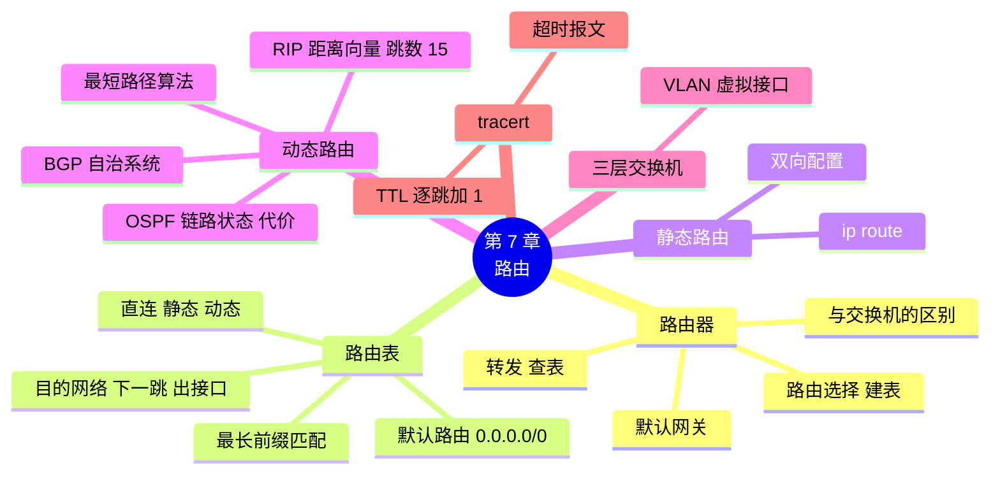

# 第 7 章 路由：数据包怎么找路

!!! abstract "本章学时"
    理论 5 学时（线上 4 + 线下 1）· 实验 1 学时（本章共 3 个实验，★ 必做 2 个）

## 学习目标

学完本章，你应该能够：

1. **说出**路由器“转发”和“路由”两项工作的区别，以及路由器与交换机的区别（记忆、理解）；
2. **看懂**路由表，用**最长前缀匹配**判断数据报从哪里转发（理解、应用）；
3. 在 Packet Tracer 中**配置**路由器接口、静态路由和默认路由，让两个网络互通（应用）；
4. **比较** RIP 和 OSPF 的工作思路，用最短路径算法**算出**一个小网络的最短路径（理解、应用）；
5. **配置** OSPF，**观察**链路断开后路由自动切换（应用）；
6. 用 `tracert` **追踪**数据包经过的路由器，**分析**哪一跳最慢（应用、分析）。

!!! info "先修要求"
    学习本章前，你需要掌握：

    - [6.4 子网掩码与 CIDR](../06-ip-address/index.md#64)：会求网络地址、判断是否同一网段；
    - [6.5.4 子网速查表](../06-ip-address/index.md#654)：/30 子网有 2 个可用地址；
    - [5.3 节](../05-vlan-wlan/index.md#53)：不同 VLAN 之间通信需要网络层设备。

??? abstract "本章概念清单（22 个，点击查看定义和例子）"
    1. [路由器](../../appendix/glossary.md#g-路由器)
    2. [转发](../../appendix/glossary.md#g-转发)
    3. [路由选择](../../appendix/glossary.md#g-路由选择)
    4. [默认网关](../../appendix/glossary.md#g-默认网关)
    5. [路由表](../../appendix/glossary.md#g-路由表)
    6. [下一跳](../../appendix/glossary.md#g-下一跳)
    7. [直接交付](../../appendix/glossary.md#g-直接交付)
    8. [默认路由](../../appendix/glossary.md#g-默认路由)
    9. [最长前缀匹配](../../appendix/glossary.md#g-最长前缀匹配)
    10. [静态路由](../../appendix/glossary.md#g-静态路由)
    11. [动态路由](../../appendix/glossary.md#g-动态路由)
    12. [距离向量](../../appendix/glossary.md#g-距离向量)
    13. [RIP](../../appendix/glossary.md#g-RIP)
    14. [跳数](../../appendix/glossary.md#g-跳数)
    15. [链路状态](../../appendix/glossary.md#g-链路状态)
    16. [OSPF](../../appendix/glossary.md#g-OSPF)
    17. [代价](../../appendix/glossary.md#g-代价)
    18. [最短路径算法](../../appendix/glossary.md#g-最短路径算法)
    19. [自治系统](../../appendix/glossary.md#g-自治系统)
    20. [BGP](../../appendix/glossary.md#g-BGP)
    21. [管理距离](../../appendix/glossary.md#g-管理距离)
    22. [通配符掩码](../../appendix/glossary.md#g-通配符掩码)

## 情景导入

小禾工作室的生意越来越好，禾姐在城市另一头开了一家分店。分店有十来个人，用的是 192.168.9.0/24 网段；总部设计部用的是上一章规划的 192.168.8.0/26。运营商在两边之间拉了一条专线。

专线开通那天，小林兴冲冲地在总部 ping 分店的电脑，结果一个回复都没有。他检查了一遍：两边的电脑地址都没错，专线指示灯也亮着。

老周问他：“总部的电脑要把数据发给 192.168.9.20，它知道该交给谁吗？总部的路由器知道 192.168.9.0 这个网络在专线那头吗？”小林愣住了。

“交换机靠 MAC 地址表转发帧，路由器靠路由表转发数据报。”老周说，“路由表里没写的网络，路由器就不知道怎么走。你可以手工给它写一条路，也可以让路由器们自己互相打听。今天两种都学。”

这一章，我们弄清路由器怎样查表转发、路由表从哪里来，在 Packet Tracer 中把总部和分店连通，再让三台路由器自动找出最短的路，最后用 `tracert` 看看你的数据包到底经过了哪些路由器。

## 7.1 路由器做什么 { #71 }

### 7.1.1 转发与路由 { #711 }

[**路由器**](../../appendix/glossary.md#g-路由器 "连接不同网络、根据目的 IP 地址查路由表转发数据报的设备，工作在网络层"){ .term }是连接不同网络的设备，工作在**网络层**。它的工作可以分成两部分（考点）<sup class="cite">[[1]](#ref7-1)</sup>：

| 工作 | 做什么 | 比喻 | 快慢 |
|---|---|---|---|
| [**转发**](../../appendix/glossary.md#g-转发 "路由器收到数据报后查路由表、从合适接口送出的过程（交换机按 MAC 地址表转发帧也叫转发）"){ .term } | 收到一个数据报，看目的 IP 地址，查路由表，从合适的接口送出去 | 快递分拣员看一眼地址，把包裹丢进对应的传送带 | 每个数据报都要做，必须非常快 |
| [**路由选择**](../../appendix/glossary.md#g-路由选择 "决定到各网络的路径、建立和更新路由表的过程"){ .term } | 决定到每个网络该怎么走，建立和更新路由表 | 公司规划分拣规则：“发往北京的走 3 号线” | 网络变化时才需要做 |

简单说：**路由选择负责“建表”，转发负责“查表”**。

!!! note "比喻：快递分拣中心"
    交换机像楼里的收发室，只在一栋楼里送信；路由器像快递分拣中心，连着多条运输线路，看收件地址的“省、市”（网络号），决定包裹下一站发往哪个分拣中心。分拣中心不需要知道包裹最终送到哪个门牌号，只要知道下一站交给谁。

### 7.1.2 路由器与交换机的区别 { #712 }

| 比较项 | 交换机（二层） | 路由器 |
|---|---|---|
| 工作层次 | 数据链路层 | 网络层 |
| 根据什么转发 | 目的 MAC 地址 | 目的 IP 地址 |
| 查的表 | MAC 地址表（自学习） | 路由表（手工配置或路由协议生成） |
| 广播 | 转发广播，不隔离广播域 | 不转发广播，每个接口一个广播域 |
| 连接什么 | 同一网络内的设备 | 不同的网络 |
| 接口 | 不需要 IP 地址 | 每个接口都要配置 IP 地址，属于不同网段 |

### 7.1.3 跨网络时，地址怎么变 { #713 }

回顾第 4 章实验 4-1 的思考题：小林的电脑访问 203.0.113.10 的网站时，帧的目的 MAC 地址却是路由器的。现在可以完整解释了：

1. 电脑发现 203.0.113.10 和自己（192.168.1.10/24）**不在同一网段**，于是把数据报交给[**默认网关**](../../appendix/glossary.md#g-默认网关 "主机上配置的本网段路由器接口地址，发往其他网段的数据都交给它"){ .term }，也就是路由器 192.168.1.1；
2. 帧的目的 MAC 是路由器的 MAC，目的 IP 仍然是 203.0.113.10；
3. 路由器收到后，拆掉旧的帧，查路由表找到下一站，重新封装一个新的帧发出去，源 MAC 换成路由器出接口的 MAC，目的 MAC 换成下一站的 MAC；
4. 每过一个路由器，**MAC 地址换一次，IP 地址始终不变**（不考虑第 8 章的 NAT），TTL 减 1。

!!! warning "考点：一路上什么变、什么不变"
    数据报从源主机到目的主机的过程中，源 IP 和目的 IP 不变；每经过一段链路，源 MAC 和目的 MAC 都会改变。这正是“MAC 地址管一段路、IP 地址管全程”。

**默认网关**就是电脑上配置的“本网段路由器接口的地址”。电脑要发往其他网段的数据，一律交给它。实验 6-2 中你填的 192.168.8.1、192.168.8.65 就是默认网关，只是当时还没有路由器。

## 7.2 路由表 { #72 }

### 7.2.1 路由表长什么样 { #721 }

[**路由表**](../../appendix/glossary.md#g-路由表 "路由器中记录“去往某网络从哪里走”的表，核心是目的网络、下一跳和出接口"){ .term }的每一行告诉路由器：去往某个网络，该从哪里走。核心内容有三项（考点）：

| 目的网络 | 下一跳 | 出接口 |
|---|---|---|
| 192.168.8.0/26 | —（直接交付） | Gi0/0 |
| 10.0.12.0/30 | —（直接交付） | Gi0/1 |
| 192.168.9.0/24 | 10.0.12.2 | Gi0/1 |
| 0.0.0.0/0 | 203.0.113.1 | Gi0/2 |

- **目的网络**：用网络地址和前缀长度表示；
- [**下一跳**](../../appendix/glossary.md#g-下一跳 "去往目的网络时，下一个路由器的接口地址"){ .term }：下一个路由器的接口地址。目的网络就连在本路由器上时，不需要下一跳，叫[**直接交付**](../../appendix/glossary.md#g-直接交付 "目的网络就连在本路由器上，不经其他路由器直接送达"){ .term }；
- **出接口**：从本路由器的哪个接口送出去。

路由表中的路由有三个来源：

1. **直连路由**：给接口配置了 IP 地址并启用后，路由器自动知道这个接口所在的网络，不用配置；
2. [**静态路由**](../../appendix/glossary.md#g-静态路由 "管理员手工配置的路由"){ .term }：管理员手工写进去的（7.3 节）；
3. [**动态路由**](../../appendix/glossary.md#g-动态路由 "路由器之间运行路由协议自动交换信息、计算和更新的路由"){ .term }：路由器之间通过路由协议互相学习得到的（7.4 节）。

### 7.2.2 默认路由：不知道就往这里送 { #722 }

互联网上有上百万个网络，路由器不可能每个都写一行。[**默认路由**](../../appendix/glossary.md#g-默认路由 "目的网络为 0.0.0.0/0、匹配所有地址的路由，查不到更具体路由时使用"){ .term }用 `0.0.0.0/0` 表示，意思是“**所有其他网络**”：查遍路由表都找不到匹配的网络时，就按默认路由转发。

家里和小办公室的路由器，通常只有几条直连路由加一条指向运营商的默认路由。电脑上配置的默认网关，本质上就是电脑的默认路由。

### 7.2.3 最长前缀匹配（考点） { #723 }

如果一个目的地址同时匹配路由表中的好几行，选哪一行？规则是：**选前缀最长的那一行**，也就是最“具体”的那一条。这叫[**最长前缀匹配**](../../appendix/glossary.md#g-最长前缀匹配 "多条路由都匹配时选前缀最长（最具体）的一条"){ .term }。

!!! note "比喻：越具体的地址越优先"
    分拣中心有两条规则：“广州的包裹走 2 号线”“广州天河区的包裹走 5 号线”。一个寄往广州天河区的包裹两条都符合，当然按更具体的那条走 5 号线。默认路由 0.0.0.0/0 前缀长度为 0，是最不具体的“其他所有地方”，所以永远排在最后。

!!! example "算一算：查路由表"
    总部路由器的路由表中有：

    | 目的网络 | 怎么走 |
    |---|---|
    | 192.168.8.0/26 | 直接交付，接口 Gi0/0 |
    | 192.168.9.0/24 | 下一跳 10.0.12.2 |
    | 192.168.9.128/25 | 下一跳 10.0.13.2 |
    | 0.0.0.0/0 | 下一跳 203.0.113.1（默认路由） |

    目的地址 **192.168.9.200**：它在 192.168.9.0/24 里（9.0～9.255），也在 192.168.9.128/25 里（9.128～9.255），还匹配默认路由。三条中 /25 最长，所以走**下一跳 10.0.13.2**。

    目的地址 **192.168.9.20**：不在 192.168.9.128/25 里（20 < 128），匹配 /24 和默认路由，选 /24，走**下一跳 10.0.12.2**。

    目的地址 **114.114.114.114**：只匹配默认路由，交给运营商 203.0.113.1。

下面的程序用 Python 自带的 `ipaddress` 模块重做一遍（`labs/ch07/longest_match.py`）：

```python
import ipaddress

table = [("192.168.8.0/26", "直接交付，接口 Gi0/0"),      # (目的网络, 怎么走)
         ("192.168.9.0/24", "下一跳 10.0.12.2"),
         ("192.168.9.128/25", "下一跳 10.0.13.2"),
         ("0.0.0.0/0", "下一跳 203.0.113.1（默认路由）")]
for dst in ["192.168.9.20", "192.168.9.200", "192.168.8.30", "114.114.114.114"]:   # ← 改这里
    ip = ipaddress.ip_address(dst)
    hits = [(ipaddress.ip_network(n), how) for n, how in table if ip in ipaddress.ip_network(n)]
    best = max(hits, key=lambda h: h[0].prefixlen)    # 前缀最长的那一条
    print(f"{dst:<16} 匹配 {len(hits)} 条，选 {best[0]}：{best[1]}")
```

**运行结果**（编者运行）

```text
192.168.9.20     匹配 2 条，选 192.168.9.0/24：下一跳 10.0.12.2
192.168.9.200    匹配 3 条，选 192.168.9.128/25：下一跳 10.0.13.2
192.168.8.30     匹配 2 条，选 192.168.8.0/26：直接交付，接口 Gi0/0
114.114.114.114  匹配 1 条，选 0.0.0.0/0：下一跳 203.0.113.1（默认路由）
```

<iframe class="sim-frame" src="../../sims/route-lookup/main.html" height="560" loading="lazy" title="查路由表"></iframe>

动画：输入一个目的 IP 地址，看路由表中哪几行匹配（变黄），最终选中前缀最长的那一行（变绿）；也可以自己增删路由表的行。
{ .sim-caption }

## 7.3 静态路由 { #73 }

### 7.3.1 手工写一条路 { #731 }

**静态路由**是管理员手工配置的路由。在思科路由器上，命令格式是（华为命令见[附录 C](../../appendix/c-huawei.md)）：

```text
ip route 目的网络 子网掩码 下一跳地址
```

例如，在总部路由器 R1 上告诉它“去分店 192.168.9.0/24，交给 10.0.12.2”：

```text
R1(config)#ip route 192.168.9.0 255.255.255.0 10.0.12.2
```

默认路由就是目的网络和掩码都写 0 的静态路由：

```text
R2(config)#ip route 0.0.0.0 0.0.0.0 10.0.12.1
```

!!! warning "考点：路由要“来回”都有"
    通信是双向的。R1 上写了去分店的路由，数据能过去；但分店回复时，R2 也要知道怎么回总部。所以**两边的路由器都要配置**，缺一边就 ping 不通。这是初学者最常犯的错误。

### 7.3.2 静态路由的优缺点 { #732 }

| 优点 | 缺点 |
|---|---|
| 简单、可控，不占用路由器的计算资源和带宽 | 网络变化时不会自动调整：某条线路断了，管理员不改，数据就一直往断的路上送 |
| 安全，不会学到错误的路由 | 网络一大，要配置的条目太多，容易出错 |

所以静态路由适合**小型网络**、**只有一个出口的网络**（如分店只有一条线连到总部，直接写一条默认路由）。大型网络要靠动态路由。

## 7.4 动态路由：路由器之间互相“打听路” { #74 }

**动态路由**让路由器之间运行**路由协议**，自动交换路由信息、计算最佳路径；网络变化时自动更新。主要有两类思路<sup class="cite">[[1]](#ref7-1)</sup>。

### 7.4.1 距离向量与 RIP：听邻居说的 { #741 }

[**距离向量**](../../appendix/glossary.md#g-距离向量 "路由器只和邻居交换“到各网络的距离”的路由方式"){ .term }路由的思路像问路：每台路由器只和**相邻**的路由器交换信息，告诉邻居“我到各个网络有多远”。邻居听了，加上到自己的距离，更新自己的表。

[**RIP**](../../appendix/glossary.md#g-RIP "路由信息协议，距离向量协议，以跳数为度量，最大 15 跳"){ .term }（路由信息协议）<sup class="cite">[[2]](#ref7-2)</sup>是最典型的距离向量协议（考点）：

- 用[**跳数**](../../appendix/glossary.md#g-跳数 "数据报经过的路由器个数，RIP 用它衡量距离"){ .term }作为距离：每经过一个路由器算一跳；
- 跳数最大 15，**16 表示不可达**，所以 RIP 只适合小型网络；
- 每 30 秒把自己的整张路由表发给邻居。

RIP 的缺点是“**好消息传得快，坏消息传得慢**”：一条线路断了，路由器之间可能互相以为对方还有路，跳数一点点往上加，要过很久才发现网络不可达。

!!! note "比喻：听邻居说的"
    你想去火车站，问邻居老王，老王说“我家到火车站 3 站路”，你就认为自己到火车站是 4 站，经过老王家。你不知道全城的地图，只信邻居说的。如果火车站临时关闭，消息要一个邻居一个邻居地传开，难免有人还在按老消息指路。

### 7.4.2 链路状态与 OSPF：每人一张全城地图 { #742 }

[**链路状态**](../../appendix/glossary.md#g-链路状态 "每台路由器向全网通告自己的链路信息、建立全网拓扑后计算路由的方式"){ .term }路由的思路完全不同：每台路由器把“我和哪些邻居相连、每条链路的代价是多少”告诉**全网所有路由器**。这样每台路由器都拥有一张完整的“全网地图”（链路状态数据库），然后各自用[**最短路径算法**](../../appendix/glossary.md#g-最短路径算法 "由近及远逐个确定节点最短距离的算法，即迪杰斯特拉算法"){ .term }算出到每个网络的最佳路径。

[**OSPF**](../../appendix/glossary.md#g-OSPF "开放最短路径优先，链路状态协议，用代价度量，收敛快，可分区域"){ .term }（开放最短路径优先）<sup class="cite">[[3]](#ref7-3)</sup>是最常用的链路状态协议（考点）：

- 用[**代价**](../../appendix/glossary.md#g-代价 "OSPF 衡量路径好坏的数值，通常由接口带宽算出，越小越好"){ .term }（开销）衡量路径的好坏，通常根据接口带宽计算，带宽越高代价越小；
- 只在网络变化时才通告变化的部分（平时用很小的 Hello 报文确认邻居还在），**收敛快**、开销小；
- 没有跳数限制，可以把大网络分成多个**区域**分级管理，适合大中型网络。

| 比较项 | RIP | OSPF |
|---|---|---|
| 类型 | 距离向量 | 链路状态 |
| 和谁交换信息 | 只和相邻路由器 | 链路信息通告给全网 |
| 交换什么 | 自己的整张路由表 | 自己和邻居的链路状态 |
| 度量 | 跳数（最大 15） | 代价（根据带宽） |
| 收敛速度 | 慢，坏消息传得慢 | 快 |
| 适用 | 小型网络 | 大中型网络 |

### 7.4.3 最短路径算法 { #743 }

OSPF 中每台路由器用**最短路径算法**（迪杰斯特拉算法，Dijkstra）计算到各处的最短路径<sup class="cite">[[5]](#ref7-5)</sup>。思路是“由近及远、一圈圈确定”：

1. 从自己出发，自己到自己的距离是 0，到其他路由器的距离先记为“无穷大”；
2. 看和自己直接相连的路由器，记下距离；
3. 在还没确定的路由器中，**选距离最小的一个，把它确定下来**；
4. 从刚确定的路由器出发，看经过它到别的路由器是不是更近，更近就更新距离；
5. 重复第 3、4 步，直到所有路由器都确定。

!!! example "算一算：从 R1 出发的最短路径"
    网络中 5 台路由器，链路和代价如下：R1–R2 代价 2，R1–R3 代价 5，R2–R3 代价 1，R2–R4 代价 7，R3–R4 代价 2，R3–R5 代价 8，R4–R5 代价 3。

    | 步骤 | 确定的路由器 | R2 | R3 | R4 | R5 |
    |---|---|---|---|---|---|
    | 开始 | R1（0） | 2（经 R1） | 5（经 R1） | ∞ | ∞ |
    | 1 | R2（2） | ✓ | **3**（经 R2，2 + 1 < 5） | 9（经 R2） | ∞ |
    | 2 | R3（3） | ✓ | ✓ | **5**（经 R3，3 + 2 < 9） | 11（经 R3） |
    | 3 | R4（5） | ✓ | ✓ | ✓ | **8**（经 R4，5 + 3 < 11） |
    | 4 | R5（8） | ✓ | ✓ | ✓ | ✓ |

    结果：R1 到 R3 的最短路径是 R1→R2→R3（代价 3），比直连的 R1→R3（代价 5）还短；到 R5 是 R1→R2→R3→R4→R5（代价 8）。所以 R1 的路由表中，去往各处的下一跳全都是 R2。

    闭卷考试只要求按表格一步步算出结果，不要求写算法代码。

<iframe class="sim-frame" src="../../sims/dijkstra/main.html" height="600" loading="lazy" title="最短路径"></iframe>

动画：选一个起点路由器，点“下一步”，看最短路径算法每一步确定哪台路由器、更新哪些距离，最后画出最短路径树；可以修改链路代价或断开链路再算一次。
{ .sim-caption }

### 7.4.4 自治系统与 BGP（了解） { #744 }

互联网由成千上万个运营商、大企业、高校的网络组成。每个由一个机构独立管理的网络叫一个[**自治系统**](../../appendix/glossary.md#g-自治系统 "由一个机构独立管理的网络，有自己的编号，简称 AS"){ .term }（AS），有自己的编号，例如中国电信的骨干网 ChinaNet 是 AS4134。

- 自治系统**内部**用 OSPF、RIP 等**内部网关协议**，追求“路最短”；
- 自治系统**之间**用 [**BGP**](../../appendix/glossary.md#g-BGP "边界网关协议，自治系统之间交换路由信息的协议"){ .term }（边界网关协议），各运营商之间交换“我能到达哪些网络”<sup class="cite">[[4]](#ref7-4)</sup>，除了路径长短，还要考虑商业合同、政策等因素，追求“路能走通、走得合规”。

BGP 被称为“互联网的胶水”。历史上曾多次发生某个运营商的 BGP 配置错误，导致大片网站在全球范围内无法访问的事件，可见路由配置的重要。

### 7.4.5 多种路由来源时听谁的（了解） { #745 }

同一个目的网络，可能既有静态路由，又通过 OSPF 学到了路由。路由器按“可信度”选择：直连路由最可信，其次是静态路由，再次是 OSPF，然后是 RIP。思科设备用[**管理距离**](../../appendix/glossary.md#g-管理距离 "思科设备表示路由来源可信度的数值，越小越可信"){ .term }表示可信度，数字越小越可信：直连 0、静态 1、OSPF 110、RIP 120。在 `show ip route` 输出中，路由后面方括号里的第一个数字就是管理距离。

## 7.5 三层交换机与 VLAN 间路由 { #75 }

第 5 章说过，不同 VLAN 之间通信需要网络层设备。现在学了路由，就能理解**三层交换机**是怎么做的：它在交换机内部为每个 VLAN 建一个**虚拟接口**（SVI），给这个接口配上 IP 地址，作为这个 VLAN 的默认网关；开启路由功能后，交换机就能在 VLAN 之间转发数据报，相当于把一台路由器装进了交换机。

```text
Switch(config)#ip routing                                    ← 开启路由功能
Switch(config)#interface vlan 10
Switch(config-if)#ip address 192.168.8.1 255.255.255.192      ← 设计部的网关
Switch(config-if)#interface vlan 20
Switch(config-if)#ip address 192.168.8.65 255.255.255.224     ← 财务部的网关
```

配置后，设计部和财务部的电脑把各自的网关指向 192.168.8.1 和 192.168.8.65，就可以互相通信了。这正是第 6 章地址规划中“每个子网第一个可用地址留给网关”的用处。实验 7-1 的挑战部分会用 Packet Tracer 的三层交换机做一遍。

## 7.6 用 tracert 看数据包走过的路 { #76 }

`tracert`（Windows）或 `traceroute`（Linux、macOS）可以列出从本机到目的主机经过的每一个路由器。它的原理利用了 IP 首部的 TTL（第 6 章）：

1. 先发一个 TTL = 1 的数据报，第一个路由器把 TTL 减为 0，丢弃它并回一个“超时”报文，于是知道了第 1 跳是谁；
2. 再发 TTL = 2 的，第二个路由器回“超时”，知道了第 2 跳；
3. 依次增加 TTL，直到收到目的主机的回复。

（回“超时”的报文属于 ICMP 协议，第 8 章详细讲。）

本书的抓包文件 `ping_trace.pcap` 记录了编者在实验网络中对 203.0.113.10 做 traceroute 的过程。用 Wireshark 打开，第 9～14 帧是（编者打开的结果，节选）：

```text
帧   源地址          目的地址        TTL  信息
9    192.168.1.10    203.0.113.10    1    Echo (ping) request  seq=1
10   192.168.1.1     192.168.1.10    64   Time-to-live exceeded
11   192.168.1.10    203.0.113.10    2    Echo (ping) request  seq=2
12   10.0.12.2       192.168.1.10    63   Time-to-live exceeded
13   192.168.1.10    203.0.113.10    3    Echo (ping) request  seq=3
14   203.0.113.10    192.168.1.10    62   Echo (ping) reply    seq=3
```

可以读出：第 1 跳是 192.168.1.1（工作室路由器），第 2 跳是 10.0.12.2（运营商路由器），第 3 跳就到达了服务器 203.0.113.10。

在真实网络中，`tracert` 的输出格式如下（**输出格式示意**，你看到的地址和时间不同）：

```text
C:\>tracert -d www.example.com

通过最多 30 个跃点跟踪到 www.example.com [x.x.x.x] 的路由:

  1     1 ms    <1 ms    <1 ms  192.168.1.1
  2     4 ms     3 ms     3 ms  100.64.x.x
  3     5 ms     4 ms     5 ms  x.x.x.x
  4     *        *        *     请求超时。
  5    28 ms    27 ms    29 ms  x.x.x.x
  ……
跟踪完成。
```

- 每一行是一跳，三个时间是三次测量的往返时延；
- `-d` 表示不把地址翻译成域名，速度更快；
- 某一跳显示 `*` 和“请求超时”，往往是那台路由器设置了不回复超时报文，不一定是故障，只要后面的跳能继续往下走就没问题；
- 时延从某一跳开始突然变大并保持下去，说明那一段线路比较远或者比较拥挤。

## 7.7 本章常见问题对照 { #77 }

| 现象 | 用大白话说 | 怎么查、怎么改 |
|---|---|---|
| 两个网段 ping 不通，单向配了路由 | 去得了、回不来 | 两边路由器都要配置到对方网络的路由 |
| 电脑能 ping 通网关，ping 不通其他网段 | 电脑没配网关，或路由器缺路由 | 检查电脑的默认网关；`show ip route` 看路由表 |
| 路由器接口配了 IP，状态还是 down | 思科路由器接口默认是关闭的 | 进入接口输入 `no shutdown` |
| Packet Tracer 中第一次 ping 跨网段，前一两个超时 | 路由器和电脑在用 ARP 问 MAC 地址（第 8 章） | 正常现象，再 ping 一次 |
| 配了 OSPF 却学不到路由 | `network` 命令的网段或通配符掩码写错，或区域号不一致 | `show ip ospf neighbor` 看邻居；核对 network 命令 |
| tracert 中间几跳是 `*` | 那些路由器不回复超时报文 | 只要最后能到达就不是问题 |

## 7.8 AI 与网络：让 AI 帮网络“看路况” { #78 }

导航软件会根据实时路况避开拥堵路段。大型网络也有类似需求：运营商骨干网、云服务商的数据中心之间，流量随时间剧烈变化，白天办公、晚上看视频、节假日直播，单靠 OSPF 的“最短路径”可能让某些线路拥挤不堪，另一些线路却空着。

越来越多的大型网络开始采用“集中控制”的方式：有一个控制器掌握全网的拓扑和流量情况，统一计算每条流量该怎么走，再把结果下发给各台路由器（这类技术常称为软件定义网络，SDN）。在此基础上，AI 可以：

- **预测流量**：根据历史数据预测下一小时哪些线路会拥挤，提前把部分流量调到空闲线路上；
- **发现异常**：从海量路由和流量数据中找出“这条路由刚刚异常变化了”“这台路由器的丢包率在上升”，比人工巡检快得多；
- **辅助配置**：管理员用自然语言说出意图（如“分店访问总部的服务器优先走专线”），由 AI 生成配置草稿，再经过验证后下发。

但正如第 6 章所说，AI 生成的配置必须经过验证再上线。BGP 配置错误曾让大片网站瘫痪，路由出错的代价很大。

## 本章实验

!!! abstract "实验总览"
    | 实验 | 类型 | 建议时长 | 内容 |
    |---|---|---|---|
    | 实验 7-1 | ★ 必做 | 25 分钟 | 静态路由连通分店 |
    | 实验 7-2 | ★ 必做 | 25 分钟 | 用 OSPF 自动找路 |
    | 实验 7-3 | ☆ 选做 | 25 分钟 | 用 tracert 追踪路径 |

    实验 7-1、7-2 使用 Cisco Packet Tracer，配置命令按思科 IOS 标准写法给出，命令输出为**输出格式示意**；实验 7-3 使用本书的抓包文件 `ping_trace.pcap`（真实录制）和 Windows 的 `tracert` 命令（输出因网络而异）。

### 实验 7-1 ★ 静态路由连通分店 { #7-1 }

**实验目的**

1. 配置路由器接口的 IP 地址并启用接口；
2. 配置静态路由和默认路由，让总部和分店互通；
3. 用 `show ip route` 查看路由表，认出直连路由和静态路由。

**实验环境**：Cisco Packet Tracer。

**实验数据**：无。

**拓扑与地址规划**

```text
   总部 PC0                  R1（2911）                 R2（2911）                分店 PC1
 192.168.8.11/26 ── Gi0/0 192.168.8.1     Gi0/1 10.0.12.1 ── 10.0.12.2 Gi0/1     Gi0/0 192.168.9.1 ── 192.168.9.20/24
 网关 192.168.8.1         （总部路由器）       专线 10.0.12.0/30      （分店路由器）         网关 192.168.9.1
```

两台路由器之间的专线用 /30 子网，正好两个可用地址。PC 和路由器之间可以直接连，也可以中间加一台交换机。

**实验步骤**

第一档 · 跑通：

1. 放两台 **2911** 路由器、两台 PC，用“自动选择连接类型”连线，连线时手动选择接口：PC0—R1 的 Gi0/0，R1 的 Gi0/1—R2 的 Gi0/1，R2 的 Gi0/0—PC1。
2. 按地址规划配置两台 PC 的 IP 地址、子网掩码和**默认网关**。
3. 配置 R1 的接口（R2 照此配置，地址换成 R2 的）：

```text
Router>enable
Router#configure terminal
Router(config)#hostname R1
R1(config)#interface gig0/0
R1(config-if)#ip address 192.168.8.1 255.255.255.192
R1(config-if)#no shutdown                         ← 路由器接口默认关闭，必须启用
R1(config-if)#interface gig0/1
R1(config-if)#ip address 10.0.12.1 255.255.255.252
R1(config-if)#no shutdown
R1(config-if)#end
```

4. 现在从 PC0 ping 192.168.9.20，**不通**。在 R1 上执行 `show ip route`，输出格式示意（只保留路由部分）：

```text
     10.0.0.0/8 is variably subnetted, 2 subnets, 2 masks
C       10.0.12.0/30 is directly connected, GigabitEthernet0/1
L       10.0.12.1/32 is directly connected, GigabitEthernet0/1
     192.168.8.0/24 is variably subnetted, 2 subnets, 2 masks
C       192.168.8.0/26 is directly connected, GigabitEthernet0/0
L       192.168.8.1/32 is directly connected, GigabitEthernet0/0
```

   `C` 表示直连网络，`L` 表示接口自己的地址。表里没有 192.168.9.0，R1 不知道分店在哪。

5. 配置静态路由：

```text
R1(config)#ip route 192.168.9.0 255.255.255.0 10.0.12.2       ← 在 R1 上：去分店交给 R2
R2(config)#ip route 192.168.8.0 255.255.255.192 10.0.12.1     ← 在 R2 上：回总部交给 R1
```

6. 再从 PC0 ping 192.168.9.20。第一次可能有一两个超时（路由器在做 ARP），之后应全部收到回复。再看 R1 的路由表，多了一行（输出格式示意）：

```text
S    192.168.9.0/24 [1/0] via 10.0.12.2
```

   `S` 表示静态路由，`[1/0]` 中的 1 是管理距离、0 是度量值。

第二档 · 改一改：

1. 删掉 R2 上的静态路由（`no ip route 192.168.8.0 255.255.255.192 10.0.12.1`），再 ping，记录结果并解释原因。
2. 分店只有一条线路通往总部，改用默认路由：`ip route 0.0.0.0 0.0.0.0 10.0.12.1`，再测试。用 `show ip route` 找到 `S*` 那一行和 “Gateway of last resort” 一行。
3. 用 `copy running-config startup-config` 保存两台路由器的配置，把文件另存为 `xiaohe-ch07-1.pkt`。

第三档 · 挑战（选做）：用三层交换机实现 VLAN 间路由。新建文件，放一台 **3560** 三层交换机和 3 台 PC，创建 VLAN 10、20 并划分接口（命令同实验 5-1），再按 [7.5 节](#75)配置 `ip routing` 和两个 VLAN 接口的地址。PC 按实验 6-2 的规划配置地址和网关，测试设计部和财务部能否互通。

**实验记录表**

| 测试 | 结果 | 说明 |
|---|---|---|
| 配置静态路由前，PC0 ping PC1 | | |
| 配置静态路由后，PC0 ping PC1 | | |
| 删掉 R2 的路由后 | | |
| R2 改用默认路由后 | | |
| R1 路由表中 S 开头的行 | | |

**常见问题排查**

| 现象 | 原因 | 解决 |
|---|---|---|
| 接口连线是红色 | 没有 `no shutdown` | 进入接口执行 `no shutdown` |
| PC0 能 ping 通 192.168.8.1，ping 不通 10.0.12.2 | R2 没有回总部的路由；或 PC0 没配网关 | 检查 PC0 的网关和 R2 的路由表 |
| `ip route` 提示 `% Inconsistent address and mask` | 目的网络写成了主机地址 | 写网络地址，如 192.168.8.0 而不是 192.168.8.11 |
| 提示 `% Invalid input` | 不在全局配置模式 | 提示符应为 `R1(config)#` |

**思考与练习**

1. PC0 ping PC1 时，ICMP 数据报从 PC0 到 R1、R1 到 R2、R2 到 PC1 三段链路上，源 IP、目的 IP、源 MAC、目的 MAC 各是谁的？哪些变了、哪些没变？
2. 如果总部还有财务部 192.168.8.64/27，分店要访问它，R2 上需要再加路由吗？用默认路由时呢？

**实验报告要求**：提交拓扑截图、两台路由器的 `show ip route` 截图、ping 测试截图和记录表。

### 实验 7-2 ★ 用 OSPF 自动找路 { #7-2 }

**实验目的**

1. 在三台路由器上配置 OSPF，让它们自动学习路由；
2. 理解通配符掩码和 `network` 命令的写法；
3. 断开一条链路，观察路由自动切换。

**实验环境**：Cisco Packet Tracer。

**实验数据**：无。

**拓扑与地址规划**

```text
                  R1 总部（2911）
                 Gi0/0 192.168.8.1/26 ── PC0 192.168.8.11
               Gi0/1 /        \ Gi0/2
       10.0.12.1/30            10.0.13.1/30
               /                  \
  10.0.12.2/30                     10.0.13.2/30
       Gi0/1 /                       \ Gi0/1
    R2 分店 ── Gi0/2 10.0.23.1/30 ─── 10.0.23.2/30 Gi0/2 ── R3 仓库
    Gi0/0 192.168.9.1/24                         Gi0/0 192.168.11.1/24
      │                                              │
    PC1 192.168.9.20                              PC2 192.168.11.20
```

**实验步骤**

第一档 · 跑通：

1. 放三台 2911 路由器和三台 PC，按拓扑连线，配置所有接口地址并 `no shutdown`，配置 PC 的地址和网关。
2. 在每台路由器上启用 OSPF，把自己所有直连的网络“宣告”出去。R1 的配置：

```text
R1(config)#router ospf 1
R1(config-router)#network 192.168.8.0 0.0.0.63 area 0
R1(config-router)#network 10.0.12.0 0.0.0.3 area 0
R1(config-router)#network 10.0.13.0 0.0.0.3 area 0
R1(config-router)#end
```

   `network` 后面是网络地址和[**通配符掩码**](../../appendix/glossary.md#g-通配符掩码 "子网掩码按位取反的结果，用于 OSPF 的 network 命令等"){ .term }。通配符掩码是子网掩码“反过来”：用 255.255.255.255 减去子网掩码。/26 的掩码 255.255.255.192，通配符就是 0.0.0.63；/30 的掩码 255.255.255.252，通配符是 0.0.0.3。`area 0` 表示骨干区域，小网络都用 0。

3. R2 宣告 192.168.9.0 0.0.0.255、10.0.12.0 0.0.0.3、10.0.23.0 0.0.0.3；R3 宣告 192.168.11.0 0.0.0.255、10.0.13.0 0.0.0.3、10.0.23.0 0.0.0.3，都用 area 0。
4. 配完后等十几秒，在 R1 上执行 `show ip ospf neighbor`，应该能看到两个邻居（R2、R3），状态为 FULL。
5. 执行 `show ip route`，以 `O` 开头的就是 OSPF 学到的路由，输出格式示意（节选）：

```text
O    192.168.9.0/24 [110/2] via 10.0.12.2, 00:00:35, GigabitEthernet0/1
O    192.168.11.0/24 [110/2] via 10.0.13.2, 00:00:35, GigabitEthernet0/2
O       10.0.23.0/30 [110/2] via 10.0.12.2, 00:00:35, GigabitEthernet0/1
                     [110/2] via 10.0.13.2, 00:00:35, GigabitEthernet0/2
```

   `[110/2]` 中 110 是 OSPF 的管理距离，2 是代价（千兆链路每段代价 1）。去往 10.0.23.0 有两条代价相同的路，OSPF 会同时使用。

6. 从 PC0 ping 192.168.9.20 和 192.168.11.20，都应该通。

第二档 · 改一改：

1. 在 PC0 上执行 `tracert 192.168.9.20`，记下经过的路由器。
2. 模拟专线故障：在 R1 上关闭通往 R2 的接口（`interface gig0/1` → `shutdown`）。马上再看 R1 的 `show ip route`，去往 192.168.9.0 的路由变成了经过哪个下一跳？代价变成多少？
3. 再执行一次 `tracert 192.168.9.20`，和第 1 步比较。最后 `no shutdown` 恢复接口。

第三档 · 挑战（选做）：在 R1 的 Gi0/1 接口下用 `ip ospf cost 10` 把这条链路的代价改大，不断开链路，观察 R1 去往分店的路由是否改走 R3。思考：为什么网络管理员有时要手工调整代价？

**实验记录表**

| 项目 | 结果 |
|---|---|
| R1 的 OSPF 邻居个数和状态 | |
| R1 去往 192.168.9.0/24 的下一跳和代价（正常时） | |
| 关闭 R1 Gi0/1 后的下一跳和代价 | |
| 两次 tracert 经过的路由器 | |
| （挑战）改代价后的下一跳 | |

**常见问题排查**

| 现象 | 原因 | 解决 |
|---|---|---|
| `show ip ospf neighbor` 没有邻居 | 接口没启用；两端不在同一网段；area 号不一致 | 检查接口状态和地址；所有路由器都用 area 0 |
| 学不到某个网络 | 那台路由器没有宣告这个网络，或通配符掩码写错 | 核对每台路由器的 `network` 命令 |
| 通配符掩码写成了 255.255.255.0 | 把子网掩码直接抄过来了 | 用 255.255.255.255 减子网掩码 |
| 关闭接口后很久才切换 | 关闭的是对端接口，本端要等邻居超时（约 40 秒） | 正常，耐心等待；或关闭本端接口 |

**思考与练习**

1. 用 OSPF 和用静态路由相比，关闭一条链路后的表现有什么不同？
2. 如果把三台路由器的 OSPF 都换成 RIP，R1 到分店的路由会怎么选？（提示：RIP 只看跳数。）

**实验报告要求**：提交 `show ip ospf neighbor`、链路断开前后 `show ip route` 和 `tracert` 的截图，以及记录表。

### 实验 7-3 ☆ 用 tracert 追踪路径 { #7-3 }

**实验目的**

1. 理解 traceroute 利用 TTL 逐跳探测的原理；
2. 在抓包中找到每一跳的“超时”报文；
3. 用 `tracert` 追踪到真实网站的路径，分析跳数和时延。

**实验环境**：Windows 电脑（能上网）；Wireshark。

**实验数据**：`labs/data/pcap/ping_trace.pcap`（编者在隔离的实验网络中录制）。

**实验步骤**

第一档 · 跑通：

1. 用 Wireshark 打开 `ping_trace.pcap`。在列标题上右击 → “列首选项”，添加一列 `ip.ttl`（或在显示过滤器旁用“应用为列”），方便看每帧的 TTL。
2. 找到第 9～14 帧，和 [7.6 节](#76)的表格对照：TTL 为 1、2、3 的请求分别得到了谁的回复？
3. 点第 10 帧，展开 ICMP 部分，可以看到里面还“夹带”着被丢弃的那个数据报的首部（目的地址 203.0.113.10、TTL 1），这就是发送方知道“这是对哪一次探测的回复”的依据。
4. 在命令提示符中执行 `tracert -d www.baidu.com`（或任意国内网站），记录总跳数，以及从第几跳开始时延明显变大。

第二档 · 改一改：

1. 再追踪一个境外网站（如 `tracert -d www.wikipedia.org`），比较跳数和时延的区别。境外网站时延明显更大，主要原因是什么？（提示：第 1 章的传播时延。）
2. 加上 `-h 5` 参数（最多追踪 5 跳）再执行一次，看输出有什么不同。

第三档 · 挑战（选做）：前 8 帧是普通 ping，回复的 TTL 都是 62。结合 traceroute 的结果和第 6 章“Linux 默认 TTL 为 64”的知识，推算服务器和小林电脑之间隔了几个路由器，与 traceroute 的结果是否一致。

**实验记录表**

| 项目 | 结果 |
|---|---|
| 抓包中第 1、2 跳的路由器地址 | |
| 到国内网站的跳数 | |
| 时延明显变大的那一跳 | |
| 到境外网站的跳数和最后一跳时延 | |
| （挑战）推算的路由器个数 | |

**常见问题排查**

| 现象 | 原因 | 解决 |
|---|---|---|
| tracert 很慢，每一跳都要等很久 | 在把地址翻译成域名 | 加 `-d` 参数 |
| 有几跳全是 `*` | 那些路由器不回复超时报文，或防火墙拦截 | 正常现象，看后面的跳能否继续 |
| 最后几跳一直是 `*`，跟踪不完 | 目的网站不回复 ping | 换一个网站，或接受“只能追踪到中途” |

**思考与练习**

1. 为什么 traceroute 每一跳通常测 3 次？
2. tracert 显示的路径，回来时一定走同一条路吗？

**实验报告要求**：提交 Wireshark 中第 9～14 帧的截图、两次 `tracert` 的截图（可遮挡第 1 跳以外的私有地址）和记录表。

## 本章小结

- **路由器**工作在网络层，连接不同的网络。**转发**是查表送出数据报，**路由选择**是建立路由表。交换机看 MAC 地址、不隔离广播；路由器看 IP 地址、隔离广播域。跨网络时 IP 地址不变，MAC 地址每段都换；电脑把发往其他网段的数据交给**默认网关**。
- **路由表**的核心是目的网络、**下一跳**、出接口；路由来自直连、静态和动态三种途径。**默认路由** 0.0.0.0/0 匹配所有网络。多条匹配时按**最长前缀匹配**选最具体的一条。
- **静态路由**用 `ip route 网络 掩码 下一跳` 配置，简单可控但不能自动适应变化；路由要来回双向配置。
- **动态路由**：**RIP** 是**距离向量**协议，只听邻居的，用**跳数**度量，最大 15 跳，坏消息传得慢；**OSPF** 是**链路状态**协议，每台路由器有全网地图，用**最短路径算法**计算，以**代价**度量，收敛快，适合大中型网络。自治系统之间用 **BGP**。
- **三层交换机**用 VLAN 虚拟接口作网关，实现 VLAN 间路由。
- `tracert` 依次发送 TTL 为 1、2、3……的数据报，根据各路由器返回的超时报文找出每一跳。



**下一章预告**

路由解决了“数据报往哪走”，但还有几个小问题没有说清：电脑只知道网关的 IP 地址，怎么知道它的 MAC 地址？tracert 收到的“超时”报文是什么协议？新同事的笔记本插上网线就有了地址，是谁分的？工作室几十台电脑用私有地址，又怎么上互联网？下一章学习网络层的四个“好帮手”：**ARP、ICMP、DHCP 和 NAT**。

## 参考文献

正文中的上标编号（如<sup class="cite">[[1]](#ref7-1)</sup>）对应下面的文献。带链接的可以直接打开；书籍可在图书馆或电子书平台查阅。

<div class="refs" markdown>

**教材与专著**

- <span id="ref7-1"></span>[1] 谢希仁. 计算机网络[M]. 8 版. 北京: 电子工业出版社, 2021.
    <span class="ref-note">第 4 章“网络层”：分组转发与路由选择、路由表与最长前缀匹配、内部网关协议 RIP 和 OSPF、外部网关协议 BGP，对应本章 7.1～7.4 节。</span>

**标准**

- <span id="ref7-2"></span>[2] MALKIN G. RFC 2453: RIP Version 2[S/OL]. IETF, 1998[2026-11-01]. <https://www.rfc-editor.org/rfc/rfc2453>.
    <span class="ref-note">RIP 第 2 版标准，规定了跳数上限 15、30 秒更新周期等，对应 7.4.1 节。</span>
- <span id="ref7-3"></span>[3] MOY J. RFC 2328: OSPF Version 2[S/OL]. IETF, 1998[2026-11-01]. <https://www.rfc-editor.org/rfc/rfc2328>.
    <span class="ref-note">OSPF 第 2 版标准，规定了链路状态通告、最短路径计算和区域划分，对应 7.4.2 节和实验 7-2。</span>
- <span id="ref7-4"></span>[4] REKHTER Y, LI T, HARES S. RFC 4271: A Border Gateway Protocol 4 (BGP-4)[S/OL]. IETF, 2006[2026-11-01]. <https://www.rfc-editor.org/rfc/rfc4271>.
    <span class="ref-note">BGP 第 4 版标准，自治系统之间交换路由信息的协议，对应 7.4.4 节。</span>

**经典论文**

- <span id="ref7-5"></span>[5] DIJKSTRA E W. A Note on Two Problems in Connexion with Graphs[J]. Numerische Mathematik, 1959, 1(1): 269-271.
    <span class="ref-note">提出最短路径算法的原始论文，OSPF 计算路由所用的就是这一算法，对应 7.4.3 节。</span>

</div>

## 课后练习

选择题和判断题可以直接点击选项作答，系统会马上告诉你对错，并展开答案与解析；多选题选好后点“提交答案”。简答和实操题请先自己作答，再点开“答案与解析”核对。每道题的解析下方都有“回看”链接，做错了可以直接跳回正文复习。

**一、单项选择题**

<div class="quiz" data-answer="B" markdown>

**1.** 路由器转发数据报的依据是（　　）。

- A. 目的 MAC 地址
- B. 目的 IP 地址
- C. 源 IP 地址
- D. 端口号

</div>

??? tip "答案与解析"
    **答案：B**

    路由器工作在网络层，根据目的 IP 地址查路由表转发；交换机根据目的 MAC 地址转发。

    考查：路由器的工作 · 认知层次：记忆 · [回看 7.1.1](#711)
    { .quiz-meta }

<div class="quiz" data-answer="D" markdown>

**2.** 数据报从源主机经过两台路由器到达目的主机，下列说法正确的是（　　）。

- A. 源 IP 地址每经过一台路由器改变一次
- B. 目的 MAC 地址始终是目的主机的 MAC 地址
- C. TTL 保持不变
- D. 源 IP 地址和目的 IP 地址始终不变

</div>

??? tip "答案与解析"
    **答案：D**

    不考虑 NAT 时，IP 地址全程不变；MAC 地址每一段链路都会改变；TTL 每经过一个路由器减 1。

    考查：跨网络时地址的变化 · 认知层次：理解 · [回看 7.1.3](#713)
    { .quiz-meta }

<div class="quiz" data-answer="A" markdown>

**3.** 默认路由的目的网络写作（　　）。

- A. 0.0.0.0/0
- B. 255.255.255.255/32
- C. 127.0.0.0/8
- D. 192.168.0.0/16

</div>

??? tip "答案与解析"
    **答案：A**

    0.0.0.0/0 前缀长度为 0，匹配所有地址，在没有更具体的路由时使用。

    考查：默认路由 · 认知层次：记忆 · [回看 7.2.2](#722)
    { .quiz-meta }

<div class="quiz" data-answer="C" markdown>

**4.** 路由表中有以下三条路由：① 172.16.0.0/16 下一跳 A；② 172.16.4.0/22 下一跳 B；③ 0.0.0.0/0 下一跳 C。目的地址为 172.16.5.9 的数据报会被转发给（　　）。

- A. A
- B. C
- C. B
- D. 丢弃

</div>

??? tip "答案与解析"
    **答案：C**

    172.16.4.0/22 的范围是 172.16.4.0～172.16.7.255，包含 172.16.5.9；它同时匹配 /16 和默认路由。按最长前缀匹配，选 /22，下一跳 B。

    考查：最长前缀匹配 · 认知层次：应用 · [回看 7.2.3](#723)
    { .quiz-meta }

<div class="quiz" data-answer="B" markdown>

**5.** RIP 协议认为不可达的跳数是（　　）。

- A. 15
- B. 16
- C. 255
- D. 30

</div>

??? tip "答案与解析"
    **答案：B**

    RIP 跳数最大 15，16 表示不可达；30 是 RIP 的更新周期（秒）。

    考查：RIP · 认知层次：记忆 · [回看 7.4.1](#741)
    { .quiz-meta }

<div class="quiz" data-answer="D" markdown>

**6.** 关于 OSPF，下列说法错误的是（　　）。

- A. 属于链路状态路由协议
- B. 每台路由器用最短路径算法计算路由
- C. 用代价衡量路径好坏
- D. 每 30 秒把整张路由表发给相邻路由器

</div>

??? tip "答案与解析"
    **答案：D**

    D 描述的是 RIP。OSPF 只在网络变化时通告变化的链路状态，平时用 Hello 报文维持邻居关系。

    考查：OSPF · 认知层次：理解 · [回看 7.4.2](#742)
    { .quiz-meta }

<div class="quiz" data-answer="A" markdown>

**7.** 在思科路由器上配置“去往 192.168.9.0/24 的数据交给 10.0.12.2”，正确的命令是（　　）。

- A. `ip route 192.168.9.0 255.255.255.0 10.0.12.2`
- B. `ip route 10.0.12.2 255.255.255.0 192.168.9.0`
- C. `route add 192.168.9.0 10.0.12.2`
- D. `ip route 192.168.9.0 0.0.0.255 10.0.12.2`

</div>

??? tip "答案与解析"
    **答案：A**

    格式为 `ip route 目的网络 子网掩码 下一跳`。D 把子网掩码写成了通配符掩码，通配符掩码用在 OSPF 的 network 命令中。

    考查：静态路由配置 · 认知层次：应用 · [回看 7.3.1](#731)
    { .quiz-meta }

<div class="quiz" data-answer="C" markdown>

**8.** 不同运营商的自治系统之间交换路由信息使用的协议是（　　）。

- A. RIP
- B. OSPF
- C. BGP
- D. ARP

</div>

??? tip "答案与解析"
    **答案：C**

    自治系统内部用 RIP、OSPF 等内部网关协议，自治系统之间用 BGP。ARP 是第 8 章学的地址解析协议。

    考查：BGP · 认知层次：记忆 · [回看 7.4.4](#744)
    { .quiz-meta }

**二、多项选择题**

<div class="quiz quiz-multi" data-answer="ACD" markdown>

**9.** 与交换机相比，路由器的特点有（　　）。

- A. 工作在网络层
- B. 转发所有广播帧
- C. 每个接口都要配置 IP 地址
- D. 能连接不同的网络

</div>

??? tip "答案与解析"
    **答案：ACD**

    路由器不转发广播，每个接口是一个独立的广播域。

    考查：路由器与交换机的区别 · 认知层次：理解 · [回看 7.1.2](#712)
    { .quiz-meta }

<div class="quiz quiz-multi" data-answer="AB" markdown>

**10.** 路由表中的路由可能来自（　　）。

- A. 接口配置 IP 地址并启用后自动产生的直连路由
- B. 管理员手工配置的静态路由
- C. 交换机自学习得到的 MAC 地址表
- D. ARP 缓存

</div>

??? tip "答案与解析"
    **答案：AB**

    另外还有路由协议学到的动态路由。MAC 地址表和 ARP 缓存都不是路由表的来源。

    考查：路由的来源 · 认知层次：理解 · [回看 7.2.1](#721)
    { .quiz-meta }

<div class="quiz quiz-multi" data-answer="BD" markdown>

**11.** 下列关于静态路由的说法，正确的有（　　）。

- A. 网络拓扑变化时会自动调整
- B. 适合只有一个出口的小型网络
- C. 只需在通信的一端配置即可
- D. 不占用路由器之间的带宽来交换路由信息

</div>

??? tip "答案与解析"
    **答案：BD**

    静态路由不会自动调整；通信是双向的，两端都要有到达对方的路由。

    考查：静态路由的优缺点 · 认知层次：理解 · [回看 7.3.2](#732)
    { .quiz-meta }

**三、判断题**

<div class="quiz quiz-judge" data-answer="√" markdown>

**12.** 路由器在查路由表时，如果有多条路由都匹配目的地址，会选择前缀最长的一条。（　　）

</div>

??? tip "答案与解析"
    **答案：√**

    这就是最长前缀匹配，前缀越长，路由越具体。

    考查：最长前缀匹配 · 认知层次：理解 · [回看 7.2.3](#723)
    { .quiz-meta }

<div class="quiz quiz-judge" data-answer="×" markdown>

**13.** 距离向量路由协议中，每台路由器都掌握整个网络的拓扑结构。（　　）

</div>

??? tip "答案与解析"
    **答案：×**

    距离向量协议只和邻居交换“到各网络的距离”，不知道全网拓扑；掌握全网地图的是链路状态协议。

    考查：距离向量与链路状态 · 认知层次：理解 · [回看 7.4.1](#741)
    { .quiz-meta }

<div class="quiz quiz-judge" data-answer="×" markdown>

**14.** 思科路由器的接口配置好 IP 地址后就会自动启用，不需要其他命令。（　　）

</div>

??? tip "答案与解析"
    **答案：×**

    思科路由器接口默认是关闭的，需要执行 `no shutdown` 才能启用。

    考查：路由器接口配置 · 认知层次：应用 · [回看实验 7-1](#7-1)
    { .quiz-meta }

<div class="quiz quiz-judge" data-answer="√" markdown>

**15.** tracert 通过依次增大 TTL，让沿途的路由器返回超时报文，从而找出每一跳。（　　）

</div>

??? tip "答案与解析"
    **答案：√**

    TTL 为 n 的数据报在第 n 个路由器处减到 0 被丢弃，该路由器返回 ICMP 超时报文。

    考查：tracert 原理 · 认知层次：理解 · [回看 7.6](#76)
    { .quiz-meta }

<div class="quiz quiz-judge" data-answer="√" markdown>

**16.** 三层交换机可以通过为 VLAN 配置虚拟接口来实现不同 VLAN 之间的通信。（　　）

</div>

??? tip "答案与解析"
    **答案：√**

    每个 VLAN 的虚拟接口地址就是这个 VLAN 的默认网关，开启 `ip routing` 后即可在 VLAN 间转发。

    考查：三层交换机 · 认知层次：理解 · [回看 7.5](#75)
    { .quiz-meta }

**四、简答与计算题**

**17.** 网络中有 4 台路由器 A、B、C、D，链路代价为：A–B 1，A–C 4，B–C 2，B–D 6，C–D 1。用最短路径算法求 A 到其他路由器的最短路径和代价，写出每一步。

??? tip "答案与解析"
    **参考答案：** 开始：A 为 0；B 1（经 A），C 4（经 A），D ∞。第 1 步确定 B（1）：经 B 到 C 为 1 + 2 = 3 < 4，C 更新为 3（经 B）；经 B 到 D 为 1 + 6 = 7，D 更新为 7（经 B）。第 2 步确定 C（3）：经 C 到 D 为 3 + 1 = 4 < 7，D 更新为 4（经 C）。第 3 步确定 D（4）。结果：A→B 代价 1；A→B→C 代价 3；A→B→C→D 代价 4。A 去往 B、C、D 的下一跳都是 B。

    考查：最短路径算法 · 认知层次：应用 · [回看 7.4.3](#743)
    { .quiz-meta }

**18.** 比较 RIP 和 OSPF：分别属于哪类路由协议？用什么衡量路径？和谁交换什么信息？各适合多大的网络？

??? tip "答案与解析"
    **参考答案：** RIP 属于距离向量协议，用跳数衡量（最大 15 跳，16 不可达），只和相邻路由器交换自己的整张路由表，每 30 秒一次，收敛慢、坏消息传得慢，适合小型网络。OSPF 属于链路状态协议，用代价衡量（根据带宽），把自己与邻居的链路状态通告给全网，每台路由器建立全网拓扑后用最短路径算法计算，变化时才更新，收敛快，可以分区域，适合大中型网络。

    考查：RIP 与 OSPF · 认知层次：分析 · [回看 7.4.2](#742)
    { .quiz-meta }

**19.** 某路由器的路由表如下：① 192.168.1.0/24 直连 Gi0/0；② 10.0.0.0/8 下一跳 10.1.1.2；③ 10.20.0.0/16 下一跳 10.1.1.6；④ 0.0.0.0/0 下一跳 203.0.113.1。分别说明目的地址为 10.20.3.4、10.30.3.4、192.168.1.77、8.8.8.8 的数据报如何转发。

??? tip "答案与解析"
    **参考答案：** 10.20.3.4 匹配 ②、③、④，选最长的 /16，交给 10.1.1.6；10.30.3.4 匹配 ② 和 ④，选 /8，交给 10.1.1.2；192.168.1.77 匹配 ① 和 ④，选 /24，从 Gi0/0 直接交付；8.8.8.8 只匹配默认路由，交给 203.0.113.1。

    考查：最长前缀匹配 · 认知层次：应用 · [回看 7.2.3](#723)
    { .quiz-meta }

**五、实操题**

**20.** 实验 7-1 中，小林在 R1 上配置了 `ip route 192.168.9.0 255.255.255.0 10.0.12.2`，PC0 和 PC1 的地址、网关都正确，但 PC0 仍然 ping 不通 PC1。R1 的 `show ip route` 中已经有 `S 192.168.9.0/24` 这一行。请分析最可能的原因，写出排查用的命令和解决命令。

??? tip "答案与解析"
    **参考答案：** 最可能是 R2 上没有回总部 192.168.8.0/26 的路由：请求能到达 PC1，但 PC1 的回复交给 R2 后，R2 不知道怎么回总部。排查：在 R2 上执行 `show ip route`，看有没有 192.168.8.0 的路由；也可以在 R2 上 `ping 192.168.8.11` 检验。解决：在 R2 的全局配置模式下执行 `ip route 192.168.8.0 255.255.255.192 10.0.12.1`，或者配置默认路由 `ip route 0.0.0.0 0.0.0.0 10.0.12.1`。另外也要确认 R2 两个接口都已 `no shutdown`。

    考查：静态路由排错 · 认知层次：分析 · [回看 7.3.1](#731)
    { .quiz-meta }
