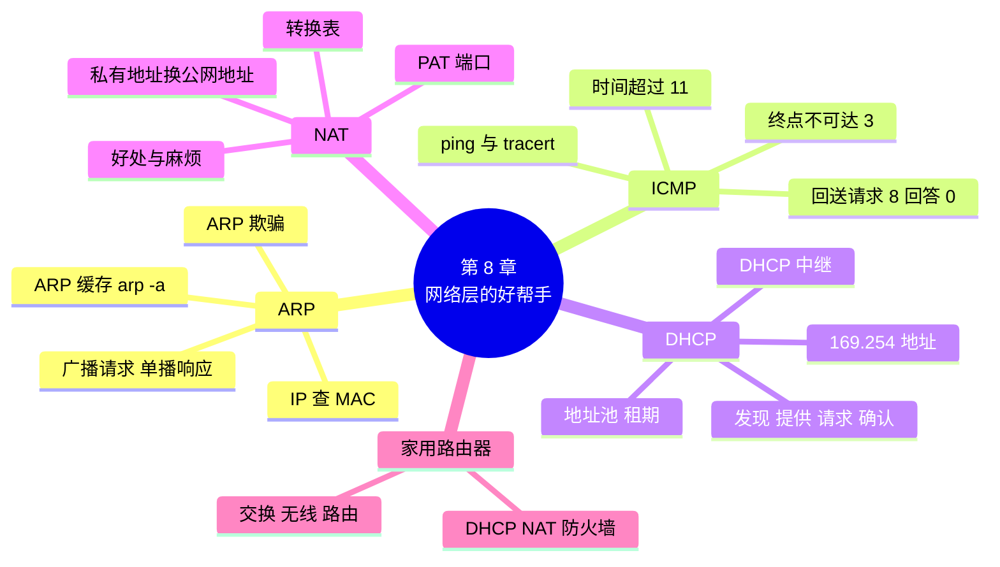

# 第 8 章 网络层的好帮手：ARP、ICMP、DHCP 与 NAT

!!! abstract "本章学时"
    理论 5 学时（线上 4 + 线下 1）· 实验 1 学时（本章共 3 个实验，★ 必做 2 个）

## 学习目标

学完本章，你应该能够：

1. **解释** ARP 的工作过程，**查看**本机的 ARP 缓存，说出 ARP 欺骗的危害（理解、应用）；
2. **说出** ICMP 的作用和常见报文类型，**解释** ping 和 tracert 的原理（理解）；
3. **说出** DHCP 分配地址的四个步骤，在抓包中**找出**这四个报文（记忆、应用）；
4. **解释** NAT 和端口地址转换的原理，**分析** NAT 转换表（理解、分析）；
5. 在 Packet Tracer 中**配置**路由器的 DHCP 和 NAT，让各部门自动获取地址并共享公网地址上网（应用）。

!!! info "先修要求"
    学习本章前，你需要掌握：

    - [4.2 以太网与 MAC 地址](../04-datalink/index.md#42)：广播地址、单播；
    - [6.3.3 特殊地址](../06-ip-address/index.md#633)与 [6.3.4 私有地址](../06-ip-address/index.md#634)；
    - [7.1.3 跨网络时，地址怎么变](../07-routing/index.md#713)与 [7.6 tracert](../07-routing/index.md#76)。

??? abstract "本章概念清单（16 个，点击查看定义和例子）"
    1. [ARP](../../appendix/glossary.md#g-ARP)
    2. [ARP 缓存](../../appendix/glossary.md#g-ARP-缓存)
    3. [ARP 欺骗](../../appendix/glossary.md#g-ARP-欺骗)
    4. [ICMP](../../appendix/glossary.md#g-ICMP)
    5. [回送请求](../../appendix/glossary.md#g-回送请求)
    6. [回送回答](../../appendix/glossary.md#g-回送回答)
    7. [终点不可达](../../appendix/glossary.md#g-终点不可达)
    8. [时间超过](../../appendix/glossary.md#g-时间超过)
    9. [DHCP](../../appendix/glossary.md#g-DHCP)
    10. [地址池](../../appendix/glossary.md#g-地址池)
    11. [租期](../../appendix/glossary.md#g-租期)
    12. [DHCP 中继](../../appendix/glossary.md#g-DHCP-中继)
    13. [NAT](../../appendix/glossary.md#g-NAT)
    14. [端口地址转换](../../appendix/glossary.md#g-端口地址转换)
    15. [NAT 转换表](../../appendix/glossary.md#g-NAT-转换表)
    16. [运营商级 NAT](../../appendix/glossary.md#g-运营商级-NAT)

## 情景导入

周一早上，设计部来了一位新同事小周。他把自己的笔记本插上网线，几秒钟后就打开了网页。小林有点奇怪：“我还没给他分配地址呢，他的电脑怎么就有了 192.168.8.23？”

中午，陈姐又来问：“咱们工作室三十多台电脑，运营商只给了一个公网地址，怎么大家都能同时上网？网上说 192.168 开头的地址是私有地址，不能上互联网，那我们是怎么上去的？”

下午，小林在 Wireshark 里看到一个奇怪的包，内容是“谁是 192.168.8.1？请告诉 192.168.8.11”，这个包是发给所有人的。

老周说：“这三件事背后是网络层的几个‘好帮手’：地址是 DHCP 自动分的，三十台电脑靠 NAT 共享一个公网地址，那个‘谁是 192.168.8.1’是 ARP 在问 MAC 地址。再加上 ping 和 tracert 背后的 ICMP，这四个协议撑起了日常上网的大部分‘杂活’。”

这一章，我们逐一认识 ARP、ICMP、DHCP 和 NAT，在真实抓包中找到它们的身影，最后在 Packet Tracer 里让路由器自动分配地址、共享上网。

## 8.1 ARP：由 IP 地址问出 MAC 地址 { #81 }

### 8.1.1 为什么需要 ARP { #811 }

第 7 章讲过：电脑要把数据报发给网关 192.168.8.1 时，要把它装进一个以太网帧，帧的目的地址必须是网关的 **MAC 地址**。可是电脑上配置的只有网关的 IP 地址，它怎么知道网关的 MAC 地址呢？<sup class="cite">[[1]](#ref8-1)</sup>

[**ARP**](../../appendix/glossary.md#g-ARP "地址解析协议：已知同一网段内主机的 IP 地址，查出它的 MAC 地址"){ .term }（地址解析协议）<sup class="cite">[[2]](#ref8-2)</sup>就是干这个的：**已知同一网段内某台主机的 IP 地址，查出它的 MAC 地址**（考点）。

### 8.1.2 ARP 的工作过程 { #812 }

以小林的电脑（192.168.1.181）要和网关 192.168.1.1 通信为例：

1. **先查缓存**：电脑先看自己的 [**ARP 缓存**](../../appendix/glossary.md#g-ARP-缓存 "主机保存的 IP 地址与 MAC 地址对照表，条目过几分钟自动删除"){ .term }（一张 IP 地址和 MAC 地址的对照表），有就直接用；
2. **广播询问**：没有，就发一个 **ARP 请求**，目的 MAC 是**广播地址** `ff:ff:ff:ff:ff:ff`，内容是“谁是 192.168.1.1？请告诉 192.168.1.181（我的 MAC 是 00:e0:4c:68:01:0a）”。同一网段的所有主机都会收到；
3. **单播回答**：只有 192.168.1.1 发现问的是自己，于是发一个 **ARP 响应**，**单播**给提问者：“192.168.1.1 的 MAC 是 00:e0:fc:12:34:01”。其他主机不回答；
4. **记入缓存**：电脑把这一对地址记入 ARP 缓存，一段时间（一般几分钟）内再通信就不用问了。网关收到请求时，顺便也会把提问者的地址记下来。

!!! note "比喻：在办公室里喊一嗓子"
    你要把文件交给“工号 1 号”的同事，但不认识他。于是你在办公室里喊一声：“工号 1 号是哪位？请到我这里来。”所有人都听见了，只有 1 号站起来走到你面前（不会再对全办公室喊一遍）。之后你记住了他长什么样，下次直接找他。

本书的抓包文件 `dhcp_arp.pcap` 中，第 5、6 帧正好是一次 ARP 问答（编者用 Wireshark 打开的结果）：

```text
帧  源 MAC              目的 MAC            信息
5   00:e0:4c:68:01:0a   ff:ff:ff:ff:ff:ff   Who has 192.168.1.1? Tell 192.168.1.181
6   00:e0:fc:12:34:01   00:e0:4c:68:01:0a   192.168.1.1 is at 00:e0:fc:12:34:01
```

展开第 5 帧的 ARP 部分，可以看到请求中 “Target MAC address” 填的是全 0，因为这正是要问的内容：

```text
Address Resolution Protocol (request)
    Opcode: request (1)
    Sender MAC address: RealtekSemic_68:01:0a (00:e0:4c:68:01:0a)
    Sender IP address: 192.168.1.181
    Target MAC address: 00:00:00_00:00:00 (00:00:00:00:00:00)
    Target IP address: 192.168.1.1
```

!!! warning "考点：ARP 只在同一网段内使用"
    ARP 请求是广播，路由器不转发广播，所以 ARP 只能问到**同一网段**内的 MAC 地址。要访问其他网段的主机，电脑问的是**网关**的 MAC 地址，而不是远方那台主机的。每过一个路由器，路由器再在下一段链路上用 ARP 问下一站的 MAC 地址。

<iframe class="sim-frame" src="../../sims/arp/main.html" height="560" loading="lazy" title="ARP 问路"></iframe>

动画：选一台电脑去问另一台的 MAC 地址，看 ARP 请求怎样广播、响应怎样单播、双方的 ARP 缓存怎样更新；打开“ARP 欺骗”开关，看攻击者怎样冒充网关。
{ .sim-caption }

### 8.1.3 ARP 缓存与 ARP 欺骗 { #813 }

在 Windows 命令提示符中输入 `arp -a` 可以查看本机的 ARP 缓存（**输出格式示意**）：

```text
接口: 192.168.1.10 --- 0xc
  Internet 地址         物理地址              类型
  192.168.1.1           00-e0-fc-12-34-01     动态
  192.168.1.255         ff-ff-ff-ff-ff-ff     静态
```

“动态”表示是通过 ARP 问答学到的，过一段时间会自动删除；“静态”是固定的条目。

ARP 有一个先天的弱点：**它相信收到的任何 ARP 响应**，不核实真假。攻击者可以在局域网里不停地发送伪造的 ARP 响应，声称“192.168.1.1 的 MAC 是我的 MAC”。受骗的电脑就会把本该发给网关的数据全部发给攻击者，攻击者可以偷看、篡改后再转发出去，这叫 [**ARP 欺骗**](../../appendix/glossary.md#g-ARP-欺骗 "攻击者发送伪造的 ARP 响应冒充他人，截获或篡改通信的攻击"){ .term }，是一种典型的“中间人攻击”（第 11 章）。

防范办法：交换机开启 ARP 检测等安全功能；重要设备绑定静态 ARP；访问网站使用 HTTPS（第 11 章），即使数据被截获也看不懂。

## 8.2 ICMP：网络里的“回执与报错” { #82 }

### 8.2.1 ICMP 是做什么的 { #821 }

IP 协议尽力而为，出了问题也不吭声。[**ICMP**](../../appendix/glossary.md#g-ICMP "网际控制报文协议：报告 IP 传输中的差错或询问情况，装在 IP 数据报中传送"){ .term }（网际控制报文协议）<sup class="cite">[[3]](#ref8-3)</sup>就是给 IP 配的“报告员”：数据报在路上出了问题，路由器或目的主机用 ICMP 报文告诉发送方；ICMP 也可以用来主动询问“你在吗”。ICMP 报文装在 IP 数据报里传送（IP 首部的协议字段为 1），所以它属于网络层。

常见的 ICMP 报文（考点）：

| 类型值 | 名称 | 什么时候发 | 例子 |
|---|---|---|---|
| 8 | [**回送请求**](../../appendix/glossary.md#g-回送请求 "ICMP 类型 8，询问对方是否可达"){ .term } | 主动询问对方是否可达 | ping 发出的请求 |
| 0 | [**回送回答**](../../appendix/glossary.md#g-回送回答 "ICMP 类型 0，对回送请求的回复"){ .term } | 收到回送请求后回复 | ping 收到的 Reply |
| 3 | [**终点不可达**](../../appendix/glossary.md#g-终点不可达 "ICMP 类型 3，路由器找不到路或目的主机无对应服务时发出"){ .term } | 路由器找不到路，或目的主机没有对应的服务 | 路由表里没有匹配的路由、也没有默认路由 |
| 11 | [**时间超过**](../../appendix/glossary.md#g-时间超过 "ICMP 类型 11，数据报 TTL 减到 0 被丢弃时发出"){ .term } | 数据报的 TTL 减到 0 被丢弃 | tracert 每一跳收到的回复 |
| 5 | 改变路由（重定向） | 路由器告诉主机有更好的下一跳 | 较少见 |

### 8.2.2 ping 的原理 { #822 }

`ping` 向目的主机发送 ICMP **回送请求**，目的主机收到后回一个**回送回答**。根据有没有回复、往返用了多长时间，就能判断对方是否可达、网络时延有多大。

`ping_trace.pcap` 的前 8 帧是 4 次 ping（编者用 Wireshark 打开的结果，节选）：

```text
帧  源地址          目的地址        TTL  信息
1   192.168.1.10    203.0.113.10    64   Echo (ping) request  seq=1
2   203.0.113.10    192.168.1.10    62   Echo (ping) reply    seq=1
3   192.168.1.10    203.0.113.10    64   Echo (ping) request  seq=2
4   203.0.113.10    192.168.1.10    62   Echo (ping) reply    seq=2
```

请求发出时 TTL 是 64，回答到达时 TTL 是 62。服务器发出回答时 TTL 也是 64（Linux 默认值），减少了 2，说明中间经过了 2 个路由器，与第 7 章 traceroute 的结果一致。

!!! info "ping 不通不一定是网络断了"
    很多服务器和 Windows 电脑的防火墙默认不回复 ping（不回送回答），所以“ping 不通”可能只是对方不理你，网页照样能打开。判断网络是否正常，还要结合其他方法（第 12 章的分层排查法）。

### 8.2.3 tracert 的原理 { #823 }

第 7 章已经用过 tracert，现在可以把原理说完整：tracert 依次发送 TTL 为 1、2、3……的回送请求。TTL 为 n 的数据报在第 n 个路由器处 TTL 减到 0 被丢弃，这个路由器返回一个 ICMP **时间超过**报文，发送方从报文的源地址得知第 n 跳是谁；直到目的主机返回**回送回答**，追踪结束。

展开 `ping_trace.pcap` 第 10 帧（第 1 跳路由器返回的超时报文），可以看到：

```text
Internet Control Message Protocol
    Type: 11 (Time-to-live exceeded)
    Code: 0 (Time to live exceeded in transit)
    Internet Protocol Version 4, Src: 192.168.1.10, Dst: 203.0.113.10
        Time to Live: 1
        Protocol: ICMP (1)
```

超时报文里夹带了被丢弃的那个数据报的首部（TTL 为 1，目的地址 203.0.113.10），发送方就是靠它对上号的。

## 8.3 DHCP：自动分配地址 { #83 }

### 8.3.1 为什么需要 DHCP { #831 }

一台电脑要上网，至少要配置四项：**IP 地址、子网掩码、默认网关、DNS 服务器**（第 10 章）。几十台电脑一台台手工配置，费时费力还容易出错（比如两台配了同一个地址）；笔记本、手机在家里、单位、咖啡馆之间移动，每到一处都要改设置，更不现实。

[**DHCP**](../../appendix/glossary.md#g-DHCP "动态主机配置协议：自动为主机分配 IP 地址、掩码、网关和 DNS 服务器"){ .term }（动态主机配置协议）<sup class="cite">[[4]](#ref8-4)</sup>让电脑开机或接入网络时**自动获得**这些配置。网络里有一台 **DHCP 服务器**（家用和小办公室一般由路由器兼任），它管理着一个[**地址池**](../../appendix/glossary.md#g-地址池 "DHCP 服务器可以分配出去的一组地址"){ .term }，按需把地址“出租”给客户机，每次出租有一个期限，叫[**租期**](../../appendix/glossary.md#g-租期 "DHCP 分配的地址可以使用的期限，过半时客户机申请续租"){ .term }。

### 8.3.2 DHCP 的四个步骤（考点） { #832 }

新电脑刚接入时还没有 IP 地址，也不知道 DHCP 服务器在哪，所以前两步都要靠广播：

| 步骤 | 报文 | 谁发给谁 | 内容 | 比喻 |
|---|---|---|---|---|
| ① | **DHCP 发现**（Discover） | 客户机 → 广播 | “有 DHCP 服务器吗？我需要一个地址” | 新员工进门喊：“谁管分座位？” |
| ② | **DHCP 提供**（Offer） | 服务器 → 客户机 | “我可以给你 192.168.1.181，租期 12 小时” | 行政说：“3 号桌空着，给你” |
| ③ | **DHCP 请求**（Request） | 客户机 → 广播 | “我要服务器 192.168.1.1 给的 192.168.1.181” | 新员工：“好，我就要 3 号桌”（让其他可能也提供了座位的人知道） |
| ④ | **DHCP 确认**（ACK） | 服务器 → 客户机 | “确认，192.168.1.181 归你了，网关、DNS 如下” | 行政登记：“3 号桌归你了” |

记法：**发现—提供—请求—确认**，英文首字母 **DORA**。

第 ③ 步为什么还要广播？因为网络里可能有多台 DHCP 服务器都发来了“提供”，客户机用广播告诉所有服务器“我选了这一家”，没被选中的服务器就把地址收回去。

`dhcp_arp.pcap` 的第 1～4 帧就是一次完整的 DHCP 过程（编者用 Wireshark 打开的结果）：

```text
帧  源地址          目的地址           信息
1   0.0.0.0         255.255.255.255    DHCP Discover - Transaction ID 0xe860871f
2   192.168.1.1     192.168.1.181      DHCP Offer    - Transaction ID 0xe860871f
3   0.0.0.0         255.255.255.255    DHCP Request  - Transaction ID 0xe860871f
4   192.168.1.1     192.168.1.181      DHCP ACK      - Transaction ID 0xe860871f
```

- 客户机还没有地址，所以第 1、3 帧的源地址是 `0.0.0.0`，目的地址是受限广播 `255.255.255.255`（第 6 章的特殊地址）；
- 四个报文的 Transaction ID 相同，表示属于同一次申请；
- 展开第 2 帧可以看到服务器提供的内容：分配的地址 192.168.1.181、子网掩码 255.255.255.0、网关（Router）192.168.1.1、DNS 服务器、租期 12 小时（43 200 秒）。

拿到地址后，电脑做的第一件事就是第 5、6 帧的 ARP：问出网关的 MAC 地址，然后才能 ping 网关（第 7～12 帧）。一个抓包文件，把本章的三个协议串起来了。

<iframe class="sim-frame" src="../../sims/dhcp/main.html" height="560" loading="lazy" title="DHCP 四步"></iframe>

动画：新电脑接入网络，逐步演示发现、提供、请求、确认四个报文的源地址、目的地址和内容，以及服务器地址池的变化；试试“两台 DHCP 服务器”和“服务器关机”两种情况。
{ .sim-caption }

### 8.3.3 租期与续租 { #833 }

DHCP 分配的地址是“租”的，不是永久的。租期过半时，客户机会主动向服务器申请**续租**；如果一直联系不上服务器，租期到了就必须放弃这个地址。这样，离开的设备占用的地址最终会被收回，地址池可以循环使用。

在 Windows 中可以用命令手动操作：`ipconfig /release`（释放当前地址）、`ipconfig /renew`（重新申请）、`ipconfig /all`（查看租约获得和过期的时间）。

!!! tip "看到 169.254.x.x 说明什么"
    如果电脑设置为自动获取地址，却联系不上任何 DHCP 服务器，Windows 会自己给自己配一个 169.254.x.x 的**链路本地地址**（第 6 章）。它只能和同一网段里同样“没拿到地址”的电脑通信，不能上网。看到它，就要检查网线、WiFi 连接和 DHCP 服务器（路由器）是否正常。

### 8.3.4 跨网段的 DHCP：中继（了解） { #834 }

DHCP 的发现报文是广播，路由器不转发。如果工作室每个 VLAN 一个网段，难道每个网段都要放一台 DHCP 服务器？不必。在路由器或三层交换机上开启 [**DHCP 中继**](../../appendix/glossary.md#g-DHCP-中继 "路由器把 DHCP 广播转发给其他网段的 DHCP 服务器，使一台服务器服务多个网段"){ .term }，它会把收到的 DHCP 广播转成单播，转发给位于其他网段的 DHCP 服务器，再把回复转回来。这样一台服务器就能为多个网段分配地址。

## 8.4 NAT：私有地址怎样上互联网 { #84 }

### 8.4.1 为什么需要 NAT { #841 }

第 6 章说过，私有地址（10.x、172.16～31.x、192.168.x）**不能直接在互联网上使用**：互联网上的路由器没有去往私有地址的路由，服务器的回复送不回来。可是 IPv4 公网地址早已不够分，一个家庭或小单位通常只有一个公网地址。

[**NAT**](../../appendix/glossary.md#g-NAT "网络地址转换：在出口路由器把私有地址替换为公网地址"){ .term }（网络地址转换）<sup class="cite">[[5]](#ref8-5)</sup>的做法是：在内部网络连接互联网的出口路由器上，把内部主机发出的数据报的**源地址**（私有地址）替换成路由器的**公网地址**；回复回来时，再把目的地址换回内部主机的私有地址，转发给它。

### 8.4.2 端口地址转换 PAT（考点） { #842 }

只有一个公网地址，三十台电脑同时上网，回复回来时路由器怎么知道该交给谁？答案是**同时转换端口号**。端口号是第 9 章要学的运输层概念，可以先理解为“一台电脑上不同程序通信时用的分机号”。

这种同时转换 IP 地址和端口号的 NAT 叫[**端口地址转换**](../../appendix/glossary.md#g-端口地址转换 "同时转换 IP 地址和端口号的 NAT，一个公网地址可供多台主机使用，简称 PAT 或 NAPT"){ .term }（PAT，也叫 NAPT），是今天家庭和单位最常用的方式。路由器里维护一张 [**NAT 转换表**](../../appendix/glossary.md#g-NAT-转换表 "NAT 路由器记录内部地址端口与公网地址端口对应关系的表"){ .term }：

| 内部地址:端口 | 转换后的公网地址:端口 | 访问的外部地址:端口 |
|---|---|---|
| 192.168.8.11:51001 | 198.51.100.2:51001 | 203.0.113.10:80 |
| 192.168.8.12:51001 | 198.51.100.2:51002 | 203.0.113.10:80 |
| 192.168.8.71:50523 | 198.51.100.2:50523 | 114.114.114.114:53 |

- 去的时候：192.168.8.12 用端口 51001 访问网站，但这个端口号已被 192.168.8.11 的转换占用了，路由器就把它换成 198.51.100.2:51002 发出去，并记入转换表；
- 回的时候：网站回复发往 198.51.100.2:51002，路由器查表，知道这是 192.168.8.12:51001 的，把目的地址和端口换回去，交给它。

!!! note "比喻：公司总机"
    公司只有一个对外的总机号码（公网地址），每个员工有自己的分机（私有地址加端口）。员工往外打电话，对方来电显示的都是总机号码；对方回电时，总机根据记录转接到对应的分机。

<iframe class="sim-frame" src="../../sims/nat-table/main.html" height="580" loading="lazy" title="NAT 转换表"></iframe>

动画：让内网几台电脑分别访问外网服务器，看 NAT 转换表一行行出现，数据报经过路由器时源地址和端口怎样改写；再看外网回复时怎样查表换回；试试“外网主动访问内网”会发生什么。
{ .sim-caption }

### 8.4.3 NAT 的好处与麻烦 { #843 }

| 好处 | 麻烦 |
|---|---|
| 节省公网地址，一个地址供很多台电脑上网 | 外网不能主动访问内网的主机（没有转换表项），想在家里搭网站、远程访问家里的电脑都要额外设置“端口映射” |
| 隐藏内部网络的结构，外界看不到内部地址，有一定的安全作用 | 违背了“每台主机都有唯一地址、端到端直接通信”的设计，给视频通话、联机游戏等应用带来麻烦 |
| 内部地址可以随意规划，换运营商不用改内部地址 | 路由器要改写每个数据报，有一定性能开销 |

NAT 只是缓解 IPv4 地址不足的权宜之计，根本出路是第 6 章的 IPv6。

!!! info "NAT 不是防火墙"
    NAT 让外部无法主动连接内部主机，客观上起到了一点保护作用，但它不是专门的安全设备。内部电脑访问了恶意网站、下载了病毒，NAT 是拦不住的。安全防护要靠第 11 章的防火墙和访问控制。

## 8.5 家用路由器其实做了很多事 { #85 }

学完前几章，再看看家里那台几十到几百元的无线路由器，它其实是好几种设备的合体：

| 功能 | 对应的知识 | 在哪一章 |
|---|---|---|
| 几个 LAN 口之间互通 | 交换机 | 第 4 章 |
| 发出 WiFi 信号 | 无线接入点 | 第 5 章 |
| 连接家里的网络和运营商的网络 | 路由器、默认路由 | 第 7 章 |
| 给手机、电脑自动分配 192.168.x.x 地址 | DHCP 服务器 | 本章 |
| 全家设备共享一个公网地址上网 | NAT（PAT） | 本章 |
| 宽带拨号 | PPPoE | 第 4 章 |
| 拦截外部的主动连接、家长控制 | 防火墙 | 第 11 章 |

所以，家里“上不了网”时，可以按这几个功能逐一排查：WiFi 连上了吗（无线）？拿到地址了吗（DHCP）？能 ping 通路由器吗（局域网）？路由器拨号成功了吗（PPPoE）？

## 8.6 本章常见问题对照 { #86 }

| 现象 | 用大白话说 | 怎么查、怎么改 |
|---|---|---|
| 电脑地址是 169.254.x.x | 没联系上 DHCP 服务器 | 检查网线 / WiFi；`ipconfig /renew` 重新申请；检查路由器 DHCP 是否开启 |
| 提示“IP 地址冲突” | 手工配置的地址和 DHCP 分出去的撞了 | 改成自动获取；DHCP 中把手工使用的地址排除掉 |
| 突然整个网段上不了网，`arp -a` 中网关的 MAC 变了 | 可能遭遇 ARP 欺骗 | 断开可疑设备；交换机开启 ARP 防护；联系网管 |
| ping 网站不通，但网页能打开 | 对方不回复 ICMP | 正常，用浏览器或其他方法判断 |
| 在家里搭的网站，外网访问不了 | NAT 后面的主机不能被外网主动访问 | 在路由器上设置端口映射；或使用云服务器（《云计算及应用》） |
| 新加了一个 VLAN，里面的电脑拿不到地址 | DHCP 广播过不了路由器，或没为新网段建地址池 | 建对应的地址池；或在网关上配置 DHCP 中继 |

## 8.7 AI 与网络：为什么手机上网拿不到公网地址 { #87 }

在手机上用 4G/5G 上网时，打开设置看看自己的 IPv4 地址，往往是 10.x.x.x 或 100.64～100.127 开头的地址（后者是专门为运营商 NAT 保留的地址段）。这说明手机连自己的“私有地址”都是运营商分配的，运营商在它的网络出口做了一次大规模的 NAT，成千上万部手机共享一批公网地址，这叫[**运营商级 NAT**](../../appendix/glossary.md#g-运营商级-NAT "运营商在其网络出口为大量用户统一做的 NAT"){ .term }。

这对普通上网影响不大，但对一些新应用不太友好。比如越来越多的 AI 应用需要设备之间直接通信：家里的 AI 摄像头要把画面直接传到你的手机，车载 AI 要和路边设备实时交换数据，多个 AI 智能体之间要互相调用……经过两三层 NAT，设备之间很难直接建立连接，只能绕道云端服务器中转，增加了时延和费用。

这也是我国大力推进 IPv6 的原因之一：每台设备都有自己的公网 IPv6 地址，就可以直接通信，不必层层转换。你可以在手机设置里找找看，你的手机是不是已经有了以 2 或 3 开头的 IPv6 地址。

## 本章实验

!!! abstract "实验总览"
    | 实验 | 类型 | 建议时长 | 内容 |
    |---|---|---|---|
    | 实验 8-1 | ★ 必做 | 25 分钟 | 看 ARP 和 DHCP 的包 |
    | 实验 8-2 | ★ 必做 | 25 分钟 | 在 Packet Tracer 中配置 DHCP 和 NAT |
    | 实验 8-3 | ☆ 选做 | 25 分钟 | 动手验证 TTL |

    实验 8-1 使用本书的抓包文件 `dhcp_arp.pcap` 和一个 Python 小程序，结果是编者实际运行得到的；`arp -a`、`ipconfig`、`ping` 等 Windows 命令和 Packet Tracer 命令的输出为**输出格式示意**。

### 实验 8-1 ★ 看 ARP 和 DHCP 的包 { #8-1 }

**实验目的**

1. 查看本机的 ARP 缓存和 DHCP 租约信息；
2. 在抓包文件中找到 DHCP 四个报文和 ARP 请求、响应，读出关键字段；
3. 用 Python 程序从抓包文件中自动找出 DHCP 报文。

**实验环境**：Windows 电脑；Wireshark；Python（Thonny）。

**实验数据**：`labs/data/pcap/dhcp_arp.pcap`（编者在隔离的实验网络中录制，12 帧：DHCP 获取地址 → ARP 问网关 → ping 网关 3 次）。

**实验步骤**

第一档 · 跑通：

1. 在命令提示符中执行 `ipconfig /all`，找到正在使用的网卡，记下“DHCP 已启用”“DHCP 服务器”“获得租约的时间”“租约过期的时间”。
2. 执行 `arp -a`，找到默认网关那一行，记下它的物理地址和类型。
3. 用 Wireshark 打开 `dhcp_arp.pcap`，在显示过滤器中输入 `dhcp`，只看 DHCP 报文。依次点第 1～4 帧，填写记录表中的源地址、目的地址。
4. 展开第 2 帧（Offer）的 “Dynamic Host Configuration Protocol”，找到 “Your (client) IP address”、“Subnet Mask”、“Router”、“IP Address Lease Time”。
5. 把过滤器改成 `arp`，看第 5、6 帧，和 [8.1.2 节](#812)对照。
6. 运行 `labs/ch08/lab8_1_dhcp_steps.py`：

```python
import struct

NAMES = {1: "Discover 发现", 2: "Offer 提供", 3: "Request 请求", 5: "ACK 确认"}
data = open("../data/pcap/dhcp_arp.pcap", "rb").read()
pos, no = 24, 0
while pos < len(data):
    caplen = struct.unpack("<I", data[pos + 8:pos + 12])[0]
    f = data[pos + 16:pos + 16 + caplen]
    no += 1
    if f[12:14] == b"\x08\x00" and f[23] == 17 and f[36:38] in (b"\x00\x43", b"\x00\x44"):   # IPv4、UDP、端口 67/68
        your_ip = ".".join(str(b) for b in f[58:62])         # DHCP 报文里“分给你的地址”
        mtype = f[f.index(b"\x35\x01", 282) + 2]              # 选项 53：DHCP 报文类型
        print(f"第 {no} 帧  {NAMES.get(mtype, mtype)}  分配地址 {your_ip}")
    pos += 16 + caplen
```

程序按固定位置读字段：第 24 个字节是 IP 首部的协议字段（17 表示 UDP），第 37、38 个字节是 UDP 目的端口（67 或 68 是 DHCP 专用端口，第 9 章讲端口），第 59～62 个字节是 DHCP 报文中“分给你的地址”。不必记住这些数字，体会“协议就是约定好的字节位置”即可。

**运行结果**（编者运行）

```text
第 1 帧  Discover 发现  分配地址 0.0.0.0
第 2 帧  Offer 提供  分配地址 192.168.1.181
第 3 帧  Request 请求  分配地址 0.0.0.0
第 4 帧  ACK 确认  分配地址 192.168.1.181
```

第二档 · 改一改：

1. 在 Wireshark 中点第 3 帧（Request），找到选项 “Requested IP Address” 和 “DHCP Server Identifier”，说说客户机在这一步告诉了大家什么。
2. 在自己电脑上执行 `ipconfig /release`，再执行 `ipconfig /renew`，观察地址是否变化。（注意：执行 release 后会暂时断网，在机房请听从老师安排。）

第三档 · 挑战（选做）：在**自己的电脑**上打开 Wireshark，选择正在使用的网卡开始抓包，过滤器输入 `arp or dhcp`，然后执行 `ipconfig /release` 和 `ipconfig /renew`，看能否抓到自己电脑的 DHCP 四步和 ARP。只能在自己的电脑、自己有权使用的网络上抓包。

**实验记录表**

| 帧 | 报文 | 源 IP | 目的 IP | 关键内容 |
|---|---|---|---|---|
| 1 | | | | |
| 2 | | | | 分配地址：　　租期： |
| 3 | | | | |
| 4 | | | | |
| 5 | | （源 MAC） | （目的 MAC） | |
| 6 | | | | |
| 本机 | DHCP 服务器： | 网关 MAC： | | 租约过期时间： |

**常见问题排查**

| 现象 | 原因 | 解决 |
|---|---|---|
| 过滤器输入 `dhcp` 没有结果 | Wireshark 版本较老 | 改用 `bootp` |
| `ipconfig /all` 显示“DHCP 已启用：否” | 本机是手工配置的地址 | 正常，记录手工配置的地址即可 |
| Python 报 `ValueError: subsequence not found` | 读到的不是 DHCP 报文 | 确认文件名是 `dhcp_arp.pcap`，没有改动程序中的位置数字 |

**思考与练习**

1. 第 1、3 帧的源 IP 为什么是 0.0.0.0？目的 IP 为什么是 255.255.255.255？
2. 第 5 帧（ARP 请求）的目的 MAC 是广播地址，而第 6 帧（ARP 响应）是单播，为什么不都用广播？

**实验报告要求**：提交 `ipconfig /all` 和 `arp -a` 截图（可遮挡 MAC 地址后半部分）、Wireshark 第 2 帧展开的截图、程序运行截图和记录表。

### 实验 8-2 ★ 在 Packet Tracer 中配置 DHCP 和 NAT { #8-2 }

**实验目的**

1. 在路由器上配置 DHCP 地址池，让电脑自动获取地址；
2. 配置 PAT，让内网电脑共享一个公网地址访问“外网服务器”；
3. 用 `show ip nat translations` 查看 NAT 转换表。

**实验环境**：Cisco Packet Tracer。

**实验数据**：无。

**拓扑与地址规划**

```text
  PC0、PC1（自动获取）                R1 工作室出口（2911）                  ISP 运营商路由器（2911）
      Switch0 ─── Gi0/0 192.168.8.1/26      Gi0/1 198.51.100.2/30 ─── 198.51.100.1/30 Gi0/1     Gi0/0 203.0.113.1/24 ─── Server0
      （设计部 192.168.8.0/26）            （内部 inside）    （外部 outside，唯一公网地址）                      203.0.113.10/24
                                                                                                                网关 203.0.113.1
```

198.51.100.0/24 和 203.0.113.0/24 都是专供教学和文档使用的地址段，扮演“公网地址”。运营商路由器上**不配置**去往 192.168.8.0 的路由，正如真实的互联网。

**实验步骤**

第一档 · 跑通：

1. 按拓扑放设备、连线。Server0 在“终端设备”中选 Server，配置静态地址 203.0.113.10/24、网关 203.0.113.1。PC0、PC1 在 IP Configuration 中选 **DHCP**（暂时拿不到地址）。
2. 配置 ISP 路由器两个接口的地址并 `no shutdown`。配置 R1 两个接口的地址并 `no shutdown`，再加一条默认路由：`ip route 0.0.0.0 0.0.0.0 198.51.100.1`。
3. 在 R1 上配置 DHCP：

```text
R1(config)#ip dhcp excluded-address 192.168.8.1 192.168.8.10     ← 前 10 个地址留给网关和打印机等，不分配
R1(config)#ip dhcp pool DESIGN                                   ← 地址池名字
R1(dhcp-config)#network 192.168.8.0 255.255.255.192              ← 分配哪个网段
R1(dhcp-config)#default-router 192.168.8.1                       ← 告诉客户机网关
R1(dhcp-config)#dns-server 203.0.113.10                          ← 告诉客户机 DNS 服务器
R1(dhcp-config)#exit
```

4. 回到 PC0 的 IP Configuration，重新点一下 DHCP，几秒后应显示 “DHCP request successful”，地址为 192.168.8.11 或附近。PC1 同样操作。在 R1 上执行 `show ip dhcp binding` 查看分出去的地址（**输出格式示意**）：

```text
IP address       Client-ID/              Lease expiration        Type
                 Hardware address
192.168.8.11     0001.6432.A1B2           --                     Automatic
192.168.8.12     0060.3E7C.15D4           --                     Automatic
```

5. 从 PC0 ping 203.0.113.10，**不通**：数据报能到服务器，但服务器的回复发往 192.168.8.11，ISP 路由器没有去往私有网段的路由，回复被丢弃。
6. 在 R1 上配置 PAT：

```text
R1(config)#access-list 1 permit 192.168.8.0 0.0.0.63            ← 哪些内部地址需要转换
R1(config)#ip nat inside source list 1 interface gig0/1 overload ← 转换成 Gi0/1 的地址，overload 表示 PAT
R1(config)#interface gig0/0
R1(config-if)#ip nat inside                                      ← 标明内部接口
R1(config-if)#interface gig0/1
R1(config-if)#ip nat outside                                     ← 标明外部接口
R1(config-if)#end
```

7. 再从 PC0、PC1 分别 ping 203.0.113.10，应该能通了。马上在 R1 上执行 `show ip nat translations`（**输出格式示意**）：

```text
Pro  Inside global        Inside local         Outside local        Outside global
icmp 198.51.100.2:1       192.168.8.11:1       203.0.113.10:1       203.0.113.10:1
icmp 198.51.100.2:1024    192.168.8.12:1       203.0.113.10:1       203.0.113.10:1024
```

   “Inside local” 是内部主机的私有地址，“Inside global” 是转换后的公网地址。两台电脑都被换成了同一个公网地址 198.51.100.2，靠后面的编号区分。

第二档 · 改一改：

1. 在 Server0 的 Services 选项卡中确认 HTTP 服务已开启，然后在 PC0 的 Desktop → Web Browser 中访问 `http://203.0.113.10`，再看 NAT 转换表，多出的一行协议是什么、端口号是多少？
2. 在 R1 上用 `show ip dhcp pool` 查看地址池的使用情况。再加一台 PC2 设为 DHCP，看它分到了哪个地址。

第三档 · 挑战（选做）：在 R1 上再为财务部建一个地址池（网段 192.168.8.64/27，网关 192.168.8.65），并为 R1 再连一个网段测试；或者在 ISP 路由器一侧放一台 PC（203.0.113.20），尝试 ping 192.168.8.11，验证“外网不能主动访问内网”。

**实验记录表**

| 项目 | 结果 |
|---|---|
| PC0、PC1 自动获取的地址、网关、DNS | |
| 配置 NAT 前 PC0 ping 服务器 | |
| 配置 NAT 后 PC0 ping 服务器 | |
| NAT 转换表中的 Inside local 和 Inside global | |
| 访问网页后新增的转换表项 | |

**常见问题排查**

| 现象 | 原因 | 解决 |
|---|---|---|
| PC 显示 “DHCP failed”，地址变成 169.254.x.x | 地址池网段和接口地址不一致；接口没启用 | 核对 `network` 命令和 Gi0/0 的地址；`no shutdown` |
| 配了 NAT 还是 ping 不通 | 没标明 inside / outside；访问控制列表的网段写错 | 用 `show running-config` 检查；通配符掩码 /26 是 0.0.0.63 |
| `show ip nat translations` 是空的 | 表项超时被删除了 | ping 之后马上看 |
| 分到的地址是 192.168.8.1 | 没有排除网关地址 | 用 `ip dhcp excluded-address` 排除 |

**思考与练习**

1. 第 5 步中，PC0 的数据报到达了服务器吗？请说明你的判断依据。
2. 为什么要用 `ip dhcp excluded-address` 排除一些地址？

**实验报告要求**：提交拓扑截图、`show ip dhcp binding` 截图、NAT 配置前后的 ping 截图、`show ip nat translations` 截图和记录表。

### 实验 8-3 ☆ 动手验证 TTL { #8-3 }

**实验目的**

1. 用 ping 的 TTL 参数手工完成一次“tracert”；
2. 从回复的 TTL 推算经过的路由器个数。

**实验环境**：Windows 电脑（能上网）。

**实验数据**：无。

**实验步骤**

第一档 · 跑通：

1. 执行 `ping -n 1 -i 1 www.baidu.com`：`-n 1` 表示只发 1 次，`-i 1` 表示 TTL 设为 1。你会看到类似下面的结果（**输出格式示意**）：

```text
正在 Ping www.a.shifen.com [x.x.x.x] 具有 32 字节的数据:
来自 192.168.1.1 的回复: TTL 传输中过期。
```

   “TTL 传输中过期”就是 ICMP 的时间超过报文，回复它的是第 1 跳路由器（通常是你家或机房的网关）。

2. 依次把 `-i` 改成 2、3、4……每次记下回复者的地址，直到收到正常的“来自 x.x.x.x 的回复: 字节=32 时间=…ms TTL=…”。
3. 对同一个网站执行 `tracert -d www.baidu.com`，和你手工得到的结果对照。

第二档 · 改一改：

1. 正常 ping 一次（不加 `-i`），记下回复中的 TTL 值。服务器发出回复时的 TTL 初始值通常是 64、128 或 255 中比你看到的值大、且最接近的一个，据此推算回复经过了多少个路由器。
2. 把这个数字和第一档中你手工数出的跳数比较，一样吗？如果不一样，可能是什么原因？（提示：去程和回程的路径不一定相同。）

第三档 · 挑战（选做）：用 `ping -n 1 -i 1` 分别测试连接手机热点和连接 WiFi 时的第 1 跳地址，结合 8.7 节，判断哪一种网络中你的电脑处在运营商级 NAT 之后。

**实验记录表**

| TTL（-i 的值） | 回复者地址 | 回复内容 |
|---|---|---|
| 1 | | |
| 2 | | |
| 3 | | |
| …… | | |
| 正常 ping 的回复 TTL | | 推算的路由器个数： |

**常见问题排查**

| 现象 | 原因 | 解决 |
|---|---|---|
| 某个 TTL 显示“请求超时” | 那一跳的路由器不回复超时报文 | 正常，继续加大 TTL |
| 一直到 TTL 很大都没有正常回复 | 目的网站不回复 ping | 换一个网站 |
| 提示“选项 -i 的值错误” | `-i` 后面的数字超出范围 | 取 1～255 |

**思考与练习**

1. 用自己的话说明 tracert 是怎样利用 TTL 和 ICMP 找出每一跳的。
2. 如果某个网络中所有路由器都不回复 ICMP 超时报文，tracert 会显示什么？

**实验报告要求**：提交手工逐跳的截图（至少 3 跳）、tracert 截图（可遮挡私有地址以外的信息）和记录表。

## 本章小结

- **ARP** 在同一网段内由 IP 地址查出 MAC 地址：先查 **ARP 缓存**，没有就**广播** ARP 请求，目标主机**单播**响应，结果记入缓存。ARP 不核实响应的真假，存在 **ARP 欺骗**风险。
- **ICMP** 是 IP 的“报告员”，装在 IP 数据报中传送。常见类型：8 **回送请求**、0 **回送回答**、3 **终点不可达**、11 **时间超过**。ping 用回送请求和回答；tracert 依次增大 TTL，利用时间超过报文找出每一跳。
- **DHCP** 自动分配 IP 地址、子网掩码、默认网关和 DNS 服务器。四步：**发现**（广播）、**提供**、**请求**（广播）、**确认**，简记 DORA。地址按**租期**出租，过半续租；跨网段用 DHCP 中继。获取失败时 Windows 自配 169.254.x.x。
- **NAT** 在出口路由器把私有地址换成公网地址；**端口地址转换**（PAT）同时转换端口号，一个公网地址供多台主机使用，路由器靠 **NAT 转换表**把回复送回。NAT 节省地址、隐藏内网，但外网不能主动访问内网，也不能代替防火墙。
- 家用路由器集交换机、无线接入点、路由器、DHCP 服务器、NAT、防火墙于一身。



**下一章预告**

到这里，网络层的工作告一段落：数据报能从一台主机送到另一台主机了。可是一台电脑上同时开着浏览器、微信、网盘，数据到了电脑之后交给哪个程序？IP 尽力而为会丢包，网页和文件又是怎样保证一个字节都不错的？下一章学习**运输层**：端口号、UDP 和 TCP，在抓包中找到著名的“三次握手”。

## 参考文献

正文中的上标编号（如<sup class="cite">[[1]](#ref8-1)</sup>）对应下面的文献。带链接的可以直接打开；书籍可在图书馆或电子书平台查阅。

<div class="refs" markdown>

**教材与专著**

- <span id="ref8-1"></span>[1] 谢希仁. 计算机网络[M]. 8 版. 北京: 电子工业出版社, 2021.
    <span class="ref-note">第 4 章“网络层”中的地址解析协议 ARP、网际控制报文协议 ICMP、网络地址转换 NAT，第 6 章“应用层”中的动态主机配置协议 DHCP，对应本章各节。</span>

**标准**

- <span id="ref8-2"></span>[2] PLUMMER D C. RFC 826: An Ethernet Address Resolution Protocol[S/OL]. IETF, 1982[2026-11-01]. <https://www.rfc-editor.org/rfc/rfc826>.
    <span class="ref-note">ARP 的原始标准，对应 8.1 节。</span>
- <span id="ref8-3"></span>[3] POSTEL J. RFC 792: Internet Control Message Protocol[S/OL]. IETF, 1981[2026-11-01]. <https://www.rfc-editor.org/rfc/rfc792>.
    <span class="ref-note">ICMP 的原始标准，定义了回送请求与回答、终点不可达、时间超过等报文类型，对应 8.2 节。</span>
- <span id="ref8-4"></span>[4] DROMS R. RFC 2131: Dynamic Host Configuration Protocol[S/OL]. IETF, 1997[2026-11-01]. <https://www.rfc-editor.org/rfc/rfc2131>.
    <span class="ref-note">DHCP 的标准，规定了发现、提供、请求、确认等报文和租期机制，对应 8.3 节和实验 8-1。</span>
- <span id="ref8-5"></span>[5] SRISURESH P, EGEVANG K. RFC 3022: Traditional IP Network Address Translator (Traditional NAT)[S/OL]. IETF, 2001[2026-11-01]. <https://www.rfc-editor.org/rfc/rfc3022>.
    <span class="ref-note">传统 NAT 与端口地址转换（NAPT）的标准，对应 8.4 节和实验 8-2。</span>

</div>

## 课后练习

选择题和判断题可以直接点击选项作答，系统会马上告诉你对错，并展开答案与解析；多选题选好后点“提交答案”。简答和实操题请先自己作答，再点开“答案与解析”核对。每道题的解析下方都有“回看”链接，做错了可以直接跳回正文复习。

**一、单项选择题**

<div class="quiz" data-answer="A" markdown>

**1.** ARP 协议的作用是（　　）。

- A. 由 IP 地址查找 MAC 地址
- B. 由 MAC 地址查找 IP 地址
- C. 由域名查找 IP 地址
- D. 自动分配 IP 地址

</div>

??? tip "答案与解析"
    **答案：A**

    ARP 已知同一网段内主机的 IP 地址，查出它的 MAC 地址。C 是 DNS（第 10 章），D 是 DHCP。

    考查：ARP 的作用 · 认知层次：记忆 · [回看 8.1.1](#811)
    { .quiz-meta }

<div class="quiz" data-answer="C" markdown>

**2.** ARP 请求和 ARP 响应分别采用（　　）方式发送。

- A. 单播、单播
- B. 广播、广播
- C. 广播、单播
- D. 单播、广播

</div>

??? tip "答案与解析"
    **答案：C**

    请求不知道对方的 MAC，只能广播；响应者已从请求中知道提问者的 MAC，直接单播回复。

    考查：ARP 的工作过程 · 认知层次：理解 · [回看 8.1.2](#812)
    { .quiz-meta }

<div class="quiz" data-answer="B" markdown>

**3.** 主机 A（192.168.8.11/26）要给另一网段的主机 B（192.168.9.20）发数据，A 用 ARP 询问的是（　　）。

- A. 主机 B 的 MAC 地址
- B. 默认网关的 MAC 地址
- C. DNS 服务器的 MAC 地址
- D. 不需要 ARP

</div>

??? tip "答案与解析"
    **答案：B**

    ARP 只能在同一网段使用。B 在其他网段，A 要把数据交给默认网关，所以询问网关的 MAC 地址。

    考查：ARP 的使用范围 · 认知层次：应用 · [回看 8.1.2](#812)
    { .quiz-meta }

<div class="quiz" data-answer="D" markdown>

**4.** tracert 收到的中间路由器的回复属于 ICMP 的（　　）报文。

- A. 回送回答
- B. 终点不可达
- C. 改变路由
- D. 时间超过

</div>

??? tip "答案与解析"
    **答案：D**

    TTL 减到 0 时路由器丢弃数据报并返回时间超过报文（类型 11）。最后一跳由目的主机返回回送回答。

    考查：ICMP 报文类型 · 认知层次：理解 · [回看 8.2.3](#823)
    { .quiz-meta }

<div class="quiz" data-answer="A" markdown>

**5.** DHCP 分配地址的四个步骤，正确的顺序是（　　）。

- A. 发现、提供、请求、确认
- B. 请求、提供、发现、确认
- C. 发现、请求、提供、确认
- D. 提供、发现、确认、请求

</div>

??? tip "答案与解析"
    **答案：A**

    Discover、Offer、Request、ACK，简记 DORA。

    考查：DHCP 四步 · 认知层次：记忆 · [回看 8.3.2](#832)
    { .quiz-meta }

<div class="quiz" data-answer="C" markdown>

**6.** 客户机发出 DHCP 发现报文时，IP 首部的源地址和目的地址分别是（　　）。

- A. 192.168.1.1 和 255.255.255.255
- B. 0.0.0.0 和 192.168.1.1
- C. 0.0.0.0 和 255.255.255.255
- D. 127.0.0.1 和 255.255.255.255

</div>

??? tip "答案与解析"
    **答案：C**

    客户机还没有地址，源地址用 0.0.0.0；不知道服务器在哪，目的地址用受限广播 255.255.255.255。

    考查：DHCP 报文的地址 · 认知层次：理解 · [回看 8.3.2](#832)
    { .quiz-meta }

<div class="quiz" data-answer="B" markdown>

**7.** 一台设置为“自动获得 IP 地址”的 Windows 电脑，显示地址为 169.254.37.5，最可能的原因是（　　）。

- A. 遭遇了 ARP 欺骗
- B. 没有联系上 DHCP 服务器
- C. NAT 配置错误
- D. DNS 服务器故障

</div>

??? tip "答案与解析"
    **答案：B**

    联系不上 DHCP 服务器时，Windows 会自动配置 169.254.x.x 的链路本地地址。

    考查：DHCP 故障 · 认知层次：应用 · [回看 8.3.3](#833)
    { .quiz-meta }

<div class="quiz" data-answer="D" markdown>

**8.** 多台内网主机共享一个公网 IP 地址上网时，NAT 路由器区分不同主机的连接所依靠的是（　　）。

- A. MAC 地址
- B. 子网掩码
- C. 默认网关
- D. 端口号

</div>

??? tip "答案与解析"
    **答案：D**

    端口地址转换（PAT）同时转换 IP 地址和端口号，靠转换表中的端口号区分不同主机的连接。

    考查：PAT · 认知层次：理解 · [回看 8.4.2](#842)
    { .quiz-meta }

**二、多项选择题**

<div class="quiz quiz-multi" data-answer="ABC" markdown>

**9.** DHCP 服务器可以为客户机自动配置（　　）。

- A. IP 地址和子网掩码
- B. 默认网关
- C. DNS 服务器地址
- D. 网卡的 MAC 地址

</div>

??? tip "答案与解析"
    **答案：ABC**

    MAC 地址固化在网卡中，不由 DHCP 分配。

    考查：DHCP 的作用 · 认知层次：记忆 · [回看 8.3.1](#831)
    { .quiz-meta }

<div class="quiz quiz-multi" data-answer="AC" markdown>

**10.** 关于 NAT，下列说法正确的有（　　）。

- A. 可以让使用私有地址的主机访问互联网
- B. 外网主机可以随时主动访问内网中的任何主机
- C. 能节省公网 IP 地址
- D. 可以完全代替防火墙

</div>

??? tip "答案与解析"
    **答案：AC**

    外网不能主动访问 NAT 后面的主机（除非设置端口映射）；NAT 不是专门的安全设备，不能代替防火墙。

    考查：NAT 的好处与麻烦 · 认知层次：理解 · [回看 8.4.3](#843)
    { .quiz-meta }

<div class="quiz quiz-multi" data-answer="ABD" markdown>

**11.** 下列属于 ICMP 报文的有（　　）。

- A. 回送请求
- B. 终点不可达
- C. DHCP 发现
- D. 时间超过

</div>

??? tip "答案与解析"
    **答案：ABD**

    DHCP 发现是 DHCP 报文，装在 UDP 中传送，不属于 ICMP。

    考查：ICMP 报文类型 · 认知层次：记忆 · [回看 8.2.1](#821)
    { .quiz-meta }

**三、判断题**

<div class="quiz quiz-judge" data-answer="×" markdown>

**12.** ARP 请求可以经过路由器转发到其他网段。（　　）

</div>

??? tip "答案与解析"
    **答案：×**

    ARP 请求是广播，路由器不转发广播，ARP 只在同一网段内使用。

    考查：ARP 的使用范围 · 认知层次：理解 · [回看 8.1.2](#812)
    { .quiz-meta }

<div class="quiz quiz-judge" data-answer="√" markdown>

**13.** ping 不通某台服务器，并不一定说明网络有故障。（　　）

</div>

??? tip "答案与解析"
    **答案：√**

    很多服务器和电脑的防火墙默认不回复 ICMP 回送请求。

    考查：ping 的原理 · 认知层次：理解 · [回看 8.2.2](#822)
    { .quiz-meta }

<div class="quiz quiz-judge" data-answer="√" markdown>

**14.** DHCP 分配的地址有租期，租期过半时客户机会申请续租。（　　）

</div>

??? tip "答案与解析"
    **答案：√**

    联系不上服务器且租期到了，客户机必须放弃该地址。

    考查：DHCP 租期 · 认知层次：记忆 · [回看 8.3.3](#833)
    { .quiz-meta }

<div class="quiz quiz-judge" data-answer="×" markdown>

**15.** ICMP 报文直接装在以太网帧中传送，不经过 IP。（　　）

</div>

??? tip "答案与解析"
    **答案：×**

    ICMP 报文装在 IP 数据报中传送，IP 首部的协议字段为 1。

    考查：ICMP 的封装 · 认知层次：理解 · [回看 8.2.1](#821)
    { .quiz-meta }

<div class="quiz quiz-judge" data-answer="√" markdown>

**16.** ARP 协议不验证 ARP 响应的真实性，因此存在 ARP 欺骗的风险。（　　）

</div>

??? tip "答案与解析"
    **答案：√**

    攻击者可以伪造 ARP 响应冒充网关，截获他人的数据。

    考查：ARP 欺骗 · 认知层次：理解 · [回看 8.1.3](#813)
    { .quiz-meta }

**四、简答题**

**17.** 新电脑接入工作室网络后，从“没有地址”到能 ping 通网关，会依次发生哪些协议交互？请结合 `dhcp_arp.pcap` 的 12 帧说明。

??? tip "答案与解析"
    **参考答案：** ① 第 1～4 帧是 DHCP：电脑广播 Discover（源 0.0.0.0、目的 255.255.255.255）；服务器 192.168.1.1 回 Offer，提供 192.168.1.181；电脑广播 Request 表示接受；服务器回 ACK 确认，同时告知掩码 255.255.255.0、网关 192.168.1.1、DNS 和租期 12 小时。② 第 5、6 帧是 ARP：电脑广播询问“谁是 192.168.1.1”，网关单播回答自己的 MAC 地址 00:e0:fc:12:34:01。③ 第 7～12 帧是 ICMP：电脑向网关发送 3 次回送请求，网关逐一回送回答。

    考查：DHCP、ARP、ICMP 综合 · 认知层次：分析 · [回看 8.3.2](#832)
    { .quiz-meta }

**18.** 某 NAT 路由器的公网地址为 198.51.100.2，转换表中有一项：内部 192.168.8.12:51001 ↔ 公网 198.51.100.2:51002，访问 203.0.113.10:80。请说明：① 192.168.8.12 发出的数据报经过路由器后，源地址和源端口变成什么？② 服务器的回复到达路由器时，目的地址和端口是什么？路由器怎样处理？

??? tip "答案与解析"
    **参考答案：** ① 源地址由 192.168.8.12 换成 198.51.100.2，源端口由 51001 换成 51002，目的地址和端口仍是 203.0.113.10:80。② 回复的目的地址是 198.51.100.2、目的端口是 51002；路由器查 NAT 转换表，找到对应的内部地址 192.168.8.12:51001，把目的地址和端口改回去，再转发到内网交给这台主机。

    考查：PAT 转换过程 · 认知层次：应用 · [回看 8.4.2](#842)
    { .quiz-meta }

**19.** 什么是 ARP 欺骗？它会造成什么危害？说出两种防范办法。

??? tip "答案与解析"
    **参考答案：** ARP 不验证响应的真假，攻击者在局域网中发送伪造的 ARP 响应，声称网关（或其他主机）的 IP 地址对应自己的 MAC 地址，受骗主机就会把本该发给网关的数据发给攻击者。危害：攻击者可以窃听、篡改通信内容（中间人攻击），也可能导致受骗主机断网。防范：交换机开启 ARP 检测等防护功能；关键设备绑定静态 ARP；使用 HTTPS 等加密通信，即使被截获也无法读懂（答出两种即可）。

    考查：ARP 欺骗 · 认知层次：理解 · [回看 8.1.3](#813)
    { .quiz-meta }

**五、实操题**

**20.** 补全下面的思科路由器配置，使 R1 为 192.168.8.0/26 网段分配地址（排除 192.168.8.1～192.168.8.10，网关 192.168.8.1），并让该网段通过 Gi0/1 的地址以 PAT 方式上网。

```text
R1(config)#ip dhcp excluded-address 192.168.8.1 ____①____
R1(config)#ip dhcp pool DESIGN
R1(dhcp-config)#network 192.168.8.0 ____②____
R1(dhcp-config)#default-router ____③____
R1(dhcp-config)#exit
R1(config)#access-list 1 permit 192.168.8.0 ____④____
R1(config)#ip nat inside source list 1 interface gig0/1 ____⑤____
R1(config)#interface gig0/0
R1(config-if)#ip nat ____⑥____
R1(config-if)#interface gig0/1
R1(config-if)#ip nat ____⑦____
```

??? tip "答案与解析"
    **参考答案：** ① `192.168.8.10`；② `255.255.255.192`；③ `192.168.8.1`；④ `0.0.0.63`（通配符掩码）；⑤ `overload`；⑥ `inside`；⑦ `outside`。

    考查：DHCP 与 NAT 配置 · 认知层次：应用 · [回看实验 8-2](#8-2)
    { .quiz-meta }
