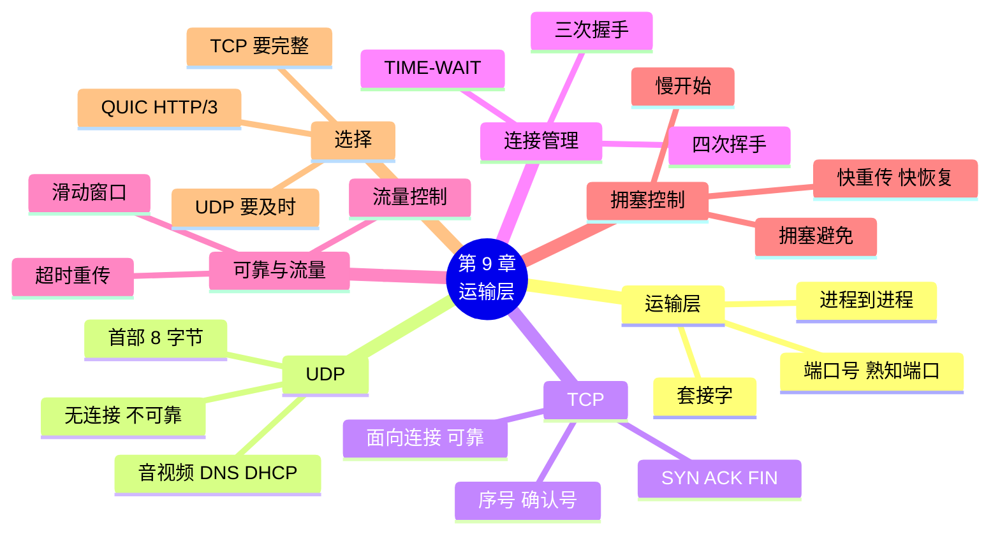

# 第 9 章 传输层：TCP 与 UDP

!!! abstract "本章学时"
    理论 5 学时（线上 3 + 线下 2）· 实验 1 学时（本章共 3 个实验，★ 必做 2 个）

!!! warning "本章是闭卷考试的重点"
    常用端口号、TCP 与 UDP 的区别、三次握手和四次挥手、拥塞控制中窗口的变化，都是闭卷考试的高频考点。线下课 2 学时建议集中讲解 9.4 和 9.6 节，并完成两个“算一算”。

## 学习目标

学完本章，你应该能够：

1. **说出**运输层的作用，以及常用应用对应的端口号（记忆）；
2. **比较** UDP 和 TCP 的特点，为不同的应用**选择**合适的协议（理解、评价）；
3. **描述** TCP 三次握手和四次挥手的过程，在抓包中**找出**相应的报文和序号变化（理解、应用）；
4. **解释** TCP 怎样用序号、确认和超时重传实现可靠传输，用滑动窗口做流量控制（理解）；
5. 根据给定条件**算出**拥塞窗口的变化（应用）；
6. 用 Python **运行**一个 TCP 聊天程序，用 `netstat` **查看**连接状态（应用）。

!!! info "先修要求"
    学习本章前，你需要掌握：

    - [6.1.2 IP 协议：尽力而为](../06-ip-address/index.md#612)：IP 不保证可靠；
    - [6.6.1 IPv4 首部](../06-ip-address/index.md#661)：协议字段 6 是 TCP，17 是 UDP；
    - [8.4.2 端口地址转换](../08-arp-dhcp-nat/index.md#842)：端口号像“分机号”；
    - 《Python 编程》：会运行 `.py` 文件，知道字符串和字节的 `encode()`、`decode()`。

??? abstract "本章概念清单（26 个，点击查看定义和例子）"
    1. [运输层](../../appendix/glossary.md#g-运输层)
    2. [进程](../../appendix/glossary.md#g-进程)
    3. [端口号](../../appendix/glossary.md#g-端口号)
    4. [熟知端口](../../appendix/glossary.md#g-熟知端口)
    5. [套接字](../../appendix/glossary.md#g-套接字)
    6. [UDP](../../appendix/glossary.md#g-UDP)
    7. [TCP](../../appendix/glossary.md#g-TCP)
    8. [面向连接](../../appendix/glossary.md#g-面向连接)
    9. [序号](../../appendix/glossary.md#g-序号)
    10. [确认号](../../appendix/glossary.md#g-确认号)
    11. [SYN](../../appendix/glossary.md#g-SYN)
    12. [ACK](../../appendix/glossary.md#g-ACK)
    13. [FIN](../../appendix/glossary.md#g-FIN)
    14. [三次握手](../../appendix/glossary.md#g-三次握手)
    15. [四次挥手](../../appendix/glossary.md#g-四次挥手)
    16. [捎带确认](../../appendix/glossary.md#g-捎带确认)
    17. [超时重传](../../appendix/glossary.md#g-超时重传)
    18. [滑动窗口](../../appendix/glossary.md#g-滑动窗口)
    19. [流量控制](../../appendix/glossary.md#g-流量控制)
    20. [拥塞控制](../../appendix/glossary.md#g-拥塞控制)
    21. [拥塞窗口](../../appendix/glossary.md#g-拥塞窗口)
    22. [慢开始](../../appendix/glossary.md#g-慢开始)
    23. [拥塞避免](../../appendix/glossary.md#g-拥塞避免)
    24. [快重传](../../appendix/glossary.md#g-快重传)
    25. [快恢复](../../appendix/glossary.md#g-快恢复)
    26. [QUIC](../../appendix/glossary.md#g-QUIC)

## 情景导入

周五下午，小林的电脑上同时开着好几样东西：和分店的视频会议、网盘正在下载上周的设计稿、微信不停地弹出消息、浏览器里还开着工作室的网站后台。

阿美凑过来问了一个问题：“这么多数据从同一根网线进来，你的电脑是怎么知道哪些是视频会议的、哪些是网盘的、哪些是微信的？会不会把设计稿的数据塞进了微信？”

小林一时答不上来。他又想到另一个问题：上一章说 IP 是“尽力而为”的，路上可能丢包。可网盘下载的几百兆设计稿，从来没有出现过“少了一块”的情况，视频会议里偶尔卡一下倒是常有的事。

老周解释道：“IP 地址只能把数据送到电脑，再往下送到哪个程序，靠的是运输层的端口号，就像公司的分机号。至于丢不丢，运输层有两种选择：UDP 只管发，快但不保证送到，适合视频会议这种‘宁可卡一下也不能慢’的应用；TCP 先打招呼建立连接，丢了就重发，保证一个字节都不少，网盘下载用的就是它。”

这一章，我们学习运输层的端口号、UDP 和 TCP，在抓包中找到著名的“三次握手”，再用十几行 Python 写一个两人聊天程序。

## 9.1 运输层做什么 { #91 }

### 9.1.1 从主机到进程 { #911 }

网络层的 IP 协议把数据报从一台**主机**送到另一台**主机**。但真正通信的是主机上运行的**程序**，确切地说是[**进程**](../../appendix/glossary.md#g-进程 "正在运行的程序，是运输层通信的真正双方"){ .term }（正在运行的程序）。[**运输层**](../../appendix/glossary.md#g-运输层 "也叫传输层，在两台主机的进程之间提供端到端的通信服务，主要协议是 TCP 和 UDP"){ .term }（也叫传输层）的任务，就是在两台主机的**进程之间**提供通信服务<sup class="cite">[[1]](#ref9-1)</sup>（考点）。

| 层次 | 负责把数据送到 | 用什么标识 | 比喻 |
|---|---|---|---|
| 网络层 | 哪台主机 | IP 地址 | 公司的地址 |
| 运输层 | 主机上的哪个进程 | 端口号 | 公司里的分机号 |

运输层还要解决一个问题：网络层不可靠，但很多应用需要可靠的传输。为此运输层提供了两种协议：[**UDP**](../../appendix/glossary.md#g-UDP "用户数据报协议，无连接、不保证可靠交付、首部只有 8 字节，简单快速"){ .term }（用户数据报协议）和 [**TCP**](../../appendix/glossary.md#g-TCP "传输控制协议，面向连接、可靠、面向字节流，提供流量控制和拥塞控制"){ .term }（传输控制协议），应用程序根据需要二选一。

!!! note "运输层只在主机上"
    路由器只看到网络层为止，不管端口号（NAT 是例外）。运输层的协议只运行在通信两端的主机上，这叫“端到端”的通信。

### 9.1.2 端口号：程序的“分机号” { #912 }

[**端口号**](../../appendix/glossary.md#g-端口号 "16 位的编号（0～65535），用来区分同一台主机上的不同进程，相当于公司的分机号"){ .term }是 16 位的数字，范围 0～65 535，用来标识主机上的进程。数据到达主机后，操作系统根据运输层首部中的**目的端口号**，把数据交给对应的程序。

端口号分为三类：

| 类别 | 范围 | 用途 |
|---|---|---|
| [**熟知端口**](../../appendix/glossary.md#g-熟知端口 "0～1023 号端口，固定分配给常用的服务器程序"){ .term } | 0～1023 | 分配给最常用的服务，全世界统一 |
| 登记端口 | 1024～49151 | 供各种软件登记使用，如 MySQL 用 3306 |
| 临时端口（客户端端口） | 49152～65535 | 客户端程序临时使用，通信结束就释放 |

服务器上的程序使用固定的端口（比如网站固定用 80），这样客户端才知道往哪里发；客户端程序由操作系统临时分配一个端口，用完就还。Windows 一般从 49152 起分配，Linux 默认从 32768 起分配，所以本书抓包文件中小林电脑（Linux）的端口是 35070、43108 这样的数字。

### 9.1.3 常用端口号（考点） { #913 }

下面这张表请背熟：

| 应用 | 端口号 | 运输层协议 | 在哪一章 |
|---|---|---|---|
| FTP（文件传输） | 21（控制）、20（数据） | TCP | 第 10 章 |
| SSH（安全远程登录） | 22 | TCP | 第 10 章 |
| Telnet（远程登录，明文） | 23 | TCP | 第 10 章 |
| SMTP（发送邮件） | 25 | TCP | 第 10 章 |
| DNS（域名解析） | 53 | UDP（主要）、TCP | 第 10 章 |
| DHCP | 67（服务器）、68（客户端） | UDP | 第 8 章 |
| HTTP（网页） | 80 | TCP | 第 10 章 |
| POP3（接收邮件） | 110 | TCP | 第 10 章 |
| IMAP（接收邮件） | 143 | TCP | 第 10 章 |
| HTTPS（加密网页） | 443 | TCP（HTTP/3 用 UDP） | 第 11 章 |
| 远程桌面（Windows） | 3389 | TCP | 第 10 章 |

### 9.1.4 套接字 { #914 }

一台主机上的一个进程，用“IP 地址 + 端口号”就能唯一确定，这个组合叫[**套接字**](../../appendix/glossary.md#g-套接字 "IP 地址加端口号，唯一标识网络中的一个通信端点；也指程序进行网络通信的编程接口"){ .term }（socket），写作 `192.168.1.10:35070`。一条 TCP 连接由两端的套接字共同确定：

```text
（192.168.1.10:35070，203.0.113.10:80）
```

这就是 `web_visit.pcap` 中小林的浏览器和工作室网站之间的那条连接。编程时，程序也是通过“套接字”来收发网络数据的，实验 9-2 的 Python 程序里你会看到 `socket` 这个词。

## 9.2 UDP：简单、快、不保证送到 { #92 }

### 9.2.1 UDP 的特点 { #921 }

**UDP**（用户数据报协议）<sup class="cite">[[2]](#ref9-2)</sup>非常简单，它在 IP 的基础上只增加了端口号和一个检验和（考点）：

- **无连接**：发送之前不用打招呼，有数据就直接发；
- **不可靠**：不确认、不重传、不保证顺序，丢了就丢了；
- **面向报文**：应用交下来一条报文，UDP 就原样加个首部发出去，不拆分也不合并；
- **首部只有 8 字节**，开销小；
- 没有拥塞控制，网络拥挤时也照样按原速发送。

UDP 首部的四个字段，每个 2 字节：

```text
 ┌──────────────┬──────────────┐
 │ 源端口 2 字节  │ 目的端口 2 字节 │
 ├──────────────┼──────────────┤
 │ 长度 2 字节    │ 检验和 2 字节   │
 └──────────────┴──────────────┘
```

本书的抓包文件 `tcp_udp_chat.pcap` 第 15～18 帧是一次 UDP 聊天。展开第 15 帧（编者用 Wireshark 打开的结果，节选）：

```text
User Datagram Protocol, Src Port: 56270, Dst Port: 9001
    Source Port: 56270
    Destination Port: 9001
    Length: 29
    Checksum: 0xfdeb [unverified]
    UDP payload (21 bytes)
```

长度 29 = 首部 8 + 数据 21 字节。21 字节的数据是“你好，我是小林”这 7 个汉字（UTF-8 编码每个汉字 3 字节）。

### 9.2.2 UDP 适合什么应用 { #922 }

不可靠的 UDP 有什么用？它适合这些场合：

- **实时音视频**：视频会议、网络电话、直播。丢一点数据只是画面卡一下，但如果像 TCP 那样等重传，画面会延迟好几秒，更难接受；
- **一问一答的简单查询**：DNS 查询只有一来一回两个小报文，丢了重问一次就行，没必要先建立连接；
- **网络游戏**：位置信息每秒更新几十次，旧的丢了就丢了，要的是最新的；
- **DHCP**：客户机还没有地址，无法建立连接，只能用 UDP 广播。

## 9.3 TCP：面向连接、可靠 { #93 }

### 9.3.1 TCP 的特点 { #931 }

**TCP**（传输控制协议）<sup class="cite">[[3]](#ref9-3)</sup>提供的服务和 UDP 截然相反（考点）：

- [**面向连接**](../../appendix/glossary.md#g-面向连接 "通信前先建立连接、通信后释放连接的工作方式"){ .term }：通信前先建立连接（三次握手），结束后释放连接（四次挥手）；
- **可靠传输**：保证数据无差错、不丢失、不重复、按顺序到达；
- **面向字节流**：把应用交下来的数据看成一连串字节，根据网络情况切成合适大小的报文段发送；
- **全双工**：连接建立后，双方可以同时发送数据；
- **一对一**：每条连接只有两个端点，不支持广播和多播；
- 有[**流量控制**](../../appendix/glossary.md#g-流量控制 "接收方通过窗口字段限制发送方的速率，防止接收缓存溢出"){ .term }和[**拥塞控制**](../../appendix/glossary.md#g-拥塞控制 "发送方根据网络拥堵情况调整发送速率，防止过多数据注入网络"){ .term }。

| 比较项 | UDP | TCP |
|---|---|---|
| 连接 | 无连接 | 面向连接 |
| 可靠性 | 不可靠 | 可靠 |
| 数据单位 | 用户数据报（面向报文） | 报文段（面向字节流） |
| 首部长度 | 8 字节 | 20～60 字节 |
| 速度、开销 | 快、小 | 较慢、较大 |
| 流量控制、拥塞控制 | 无 | 有 |
| 通信方式 | 一对一、一对多、多对多 | 只能一对一 |
| 典型应用 | 视频会议、直播、DNS、DHCP、游戏 | 网页、文件下载、邮件、远程登录 |

### 9.3.2 TCP 首部的关键字段 { #932 }

TCP 首部固定部分 20 字节，常考的字段有：

| 字段 | 长度 | 作用 |
|---|---|---|
| 源端口、目的端口 | 各 2 字节 | 同 UDP |
| [**序号**](../../appendix/glossary.md#g-序号 "TCP 首部字段，表示本报文段数据第一个字节的编号；TCP 对每个字节编号"){ .term } | 4 字节 | 本报文段所发送数据的**第一个字节**的编号 |
| [**确认号**](../../appendix/glossary.md#g-确认号 "TCP 首部字段，表示期望收到对方下一个字节的编号，即之前的数据都已收到"){ .term } | 4 字节 | 期望收到对方下一个报文段的第一个字节的编号，表示“这之前的我都收到了” |
| 首部长度 | 4 位 | 首部有多长，常见 20 字节或带选项的 32 字节 |
| **标志位** | 6 位 | [**SYN**](../../appendix/glossary.md#g-SYN "TCP 标志位，置 1 表示请求建立连接"){ .term }（请求建立连接）、[**ACK**](../../appendix/glossary.md#g-ACK "TCP 标志位，置 1 表示确认号字段有效；连接建立后的报文段 ACK 都为 1"){ .term }（确认号有效）、[**FIN**](../../appendix/glossary.md#g-FIN "TCP 标志位，置 1 表示本方数据已发送完毕，请求释放这个方向的连接"){ .term }（请求释放连接）、RST（连接出错，强行断开）、PSH（尽快交给应用）、URG（紧急） |
| **窗口** | 2 字节 | 告诉对方“我现在还能接收多少字节”，用于流量控制 |
| 检验和 | 2 字节 | 检验首部和数据是否出错 |

## 9.4 三次握手与四次挥手（考点） { #94 }

### 9.4.1 三次握手：建立连接 { #941 }

TCP 建立连接要交换三个报文段，叫[**三次握手**](../../appendix/glossary.md#g-三次握手 "TCP 建立连接的过程：SYN、SYN+ACK、ACK 三个报文段"){ .term }：

| 步骤 | 谁发给谁 | 标志位 | 序号与确认号 | 打电话的比喻 |
|---|---|---|---|---|
| ① | 客户端 → 服务器 | **SYN** | seq = x（随机选一个初始序号） | “喂，听得到吗？” |
| ② | 服务器 → 客户端 | **SYN + ACK** | seq = y，ack = x + 1 | “听得到，你听得到我吗？” |
| ③ | 客户端 → 服务器 | **ACK** | seq = x + 1，ack = y + 1 | “听得到，那我们开始说吧。” |

为什么是三次而不是两次？两次的话，服务器只知道“我能收到客户端的”，却不知道“客户端能不能收到我的”；第三次确认后，双方都确认了自己和对方的收发都正常。另外，三次握手还能防止网络中滞留的旧连接请求突然到达服务器，让服务器白白建立连接、浪费资源。

!!! example "在抓包里看三次握手"
    `tcp_udp_chat.pcap` 的第 1～3 帧是小林的电脑（192.168.1.10）连接服务器 9000 端口的三次握手。Wireshark 默认显示**相对序号**（从 0 开始，便于阅读），括号里是真实的序号（编者用 tshark 读出）：

    ```text
    帧  方向                  标志       序号                       确认号
    1   43108 → 9000          SYN        0（真实 1314535487）        —
    2   9000 → 43108          SYN, ACK   0（真实 1250116542）        1（真实 1314535488）
    3   43108 → 9000          ACK        1（真实 1314535488）        1（真实 1250116543）
    ```

    第 2 帧的确认号 1314535488 正好是第 1 帧序号加 1；第 3 帧的确认号 1250116543 正好是第 2 帧序号加 1。SYN 报文虽然不带数据，也要消耗一个序号。

<iframe class="sim-frame" src="../../sims/handshake/main.html" height="600" loading="lazy" title="三次握手与四次挥手"></iframe>

动画：逐步观看三次握手、数据传输和四次挥手，每一步显示报文的标志位、序号、确认号，以及双方的连接状态（LISTEN、SYN-SENT、ESTABLISHED、TIME-WAIT 等）。
{ .sim-caption }

### 9.4.2 数据传输：序号和确认号怎么变 { #942 }

连接建立后开始传数据。继续看 `tcp_udp_chat.pcap`（相对序号）：

```text
帧  方向           标志       序号  确认号  数据长度  内容
4   43108 → 9000   PSH, ACK   1     1       21       你好，我是小林
5   9000 → 43108   ACK        1     22      0
6   9000 → 43108   PSH, ACK   1     22      30       收到：你好，我是小林
7   43108 → 9000   ACK        22    31      0
8   43108 → 9000   PSH, ACK   22    31      18       今晚六点开会
9   9000 → 43108   PSH, ACK   31    40      27       收到：今晚六点开会
10  43108 → 9000   ACK        40    58      0
```

规律很简单：**确认号 = 对方的序号 + 对方这次发来的数据长度**。第 4 帧从第 1 个字节开始发了 21 个字节（第 1～21 字节），所以第 5 帧确认号是 22，意思是“前 21 个字节都收到了，下次请从第 22 个字节发”。

注意第 9 帧：服务器没有单独回一个确认，而是在发送“收到：今晚六点开会”的同时，把确认号 40 捎带上了。这种“搭顺风车”的确认叫[**捎带确认**](../../appendix/glossary.md#g-捎带确认 "在发送数据的同时把确认号一起带上，不单独发确认报文"){ .term }，可以减少报文数量。

### 9.4.3 四次挥手：释放连接 { #943 }

TCP 是全双工的，两个方向要**分别关闭**，所以释放连接需要四个报文段，叫[**四次挥手**](../../appendix/glossary.md#g-四次挥手 "TCP 释放连接的过程：两个方向各发一个 FIN 并各得到一个确认"){ .term }：

| 步骤 | 谁发给谁 | 标志位 | 意思 | 打电话的比喻 |
|---|---|---|---|---|
| ① | A → B | **FIN** + ACK | 我的数据发完了，要关闭我这个方向 | “我说完了。” |
| ② | B → A | **ACK** | 知道了。（但我可能还有话要说） | “好的，我知道了，我再说两句……” |
| ③ | B → A | **FIN** + ACK | 我的数据也发完了 | “我也说完了。” |
| ④ | A → B | **ACK** | 知道了，连接释放 | “好，再见。” |

先发 FIN 的一方（A）发出最后的确认后，还要等待一段时间（2 倍的报文最长寿命，叫 TIME-WAIT 状态）才真正关闭，以确保最后这个确认对方能收到；如果丢了，对方会重发 FIN，A 还能再确认一次。

在 `tcp_udp_chat.pcap` 中，是服务器先关闭的（服务器程序收完两句话就关闭连接）：第 11 帧服务器发 FIN，第 12 帧客户端确认，第 13 帧客户端发 FIN，第 14 帧服务器确认。任何一方都可以先发起挥手。

## 9.5 可靠传输与流量控制 { #95 }

### 9.5.1 可靠传输：序号、确认和超时重传 { #951 }

TCP 在不可靠的 IP 之上实现可靠传输，靠的是三样东西（考点）：

1. **序号**：给每个字节编号，接收方据此把乱序到达的数据排好、把重复的丢掉；
2. **确认**：接收方收到数据后发回确认，告诉发送方“哪些已经收到了”；
3. [**超时重传**](../../appendix/glossary.md#g-超时重传 "发送方在规定时间内没有收到确认，就重新发送该报文段"){ .term }：发送方每发出一个报文段就启动一个计时器，如果在规定时间内没有收到确认，就认为它丢了，重新发送。

!!! note "比喻：寄挂号信"
    寄一批编了号的挂号信，对方每收到一封就寄回一张回执。你在本子上记下每封信的寄出日期，过了一段时间还没收到回执，就再寄一封同样的。对方如果收到两封一样的，按编号丢掉重复的那封。

超时时间设多长？设短了会白白重传，设长了丢包后要等很久。TCP 会根据测量到的往返时间（RTT）动态调整，网络时延大，超时时间就长一些。

### 9.5.2 滑动窗口：不必一个一个等 { #952 }

如果每发一个报文段都要停下来等确认，效率太低：从北京发到广州，往返几十毫秒，大部分时间都在等。TCP 的做法是：**允许连续发送多个报文段，而不必每发一个就停下来等确认**。可以连续发送的数据范围叫**发送窗口**。

```text
字节编号：  1  2  3  4  5  6  7  8  9  10 11 12 13 14 …
           └已确认┘ └──── 发送窗口（可以连续发送）────┘ └不能发┘
                    └ 已发送、等确认 ┘└ 还没发，可以发 ┘
```

每收到一个确认，窗口就向前“滑动”，新的数据进入窗口可以发送，所以叫[**滑动窗口**](../../appendix/glossary.md#g-滑动窗口 "允许连续发送窗口内的多个报文段而不必逐个等待确认，收到确认后窗口向前滑动"){ .term }。

### 9.5.3 流量控制：别发得比对方收得快 { #953 }

如果发送方发得太快，接收方的程序来不及处理，接收缓存满了，后面的数据就只能丢掉。**流量控制**就是让发送方的速度和接收方的处理能力匹配：接收方在每个确认中通过**窗口**字段告诉发送方“我现在还能收多少字节”（接收窗口），发送方的发送窗口不能超过这个值。

接收方处理不过来时，可以把窗口减小，甚至减为 0，让发送方暂停；处理完了再把窗口放大。这就像对方对你说“慢点说，我记不过来了”。

在 `tcp_udp_chat.pcap` 第 1 帧中，小林的电脑通告的窗口是 64 240 字节，表示它最多能接收这么多还没处理的数据。

## 9.6 拥塞控制：别把路堵死 { #96 }

### 9.6.1 什么是拥塞 { #961 }

流量控制考虑的是**接收方**来不来得及，**拥塞控制**考虑的是**网络**来不来得及。如果大家都拼命发，路由器的队列排满，开始大量丢包；丢包后大家又都重传，网络更堵，最后谁都传不过去，这叫**拥塞**。就像节假日的高速公路，车越多越慢，最后谁也走不动。

TCP 的办法是：发送方维护一个[**拥塞窗口**](../../appendix/glossary.md#g-拥塞窗口 "发送方根据网络情况维护的变量，实际发送窗口取它和接收窗口中较小的一个"){ .term }（cwnd），根据网络情况动态调整，实际的发送窗口取拥塞窗口和接收窗口中较小的一个。没发现拥塞就逐渐增大，发现拥塞（丢包）就减小<sup class="cite">[[5]](#ref9-5)</sup>。

### 9.6.2 四种算法（考点） { #962 }

| 算法 | 什么时候用 | 拥塞窗口怎么变 | 比喻 |
|---|---|---|---|
| [**慢开始**](../../appendix/glossary.md#g-慢开始 "拥塞窗口从 1 开始、每个往返时间翻倍增长，直到达到慢开始门限"){ .term } | 刚开始发送，或发生超时后 | 从 1 开始，每经过一个往返时间**翻倍**（1、2、4、8……），直到达到**慢开始门限**（ssthresh） | 新司机上路，先慢后快，试探路况 |
| [**拥塞避免**](../../appendix/glossary.md#g-拥塞避免 "拥塞窗口达到门限后每个往返时间只加 1，缓慢增长"){ .term } | 拥塞窗口达到门限后 | 每经过一个往返时间**加 1**，缓慢增长 | 车速上来后，小心地一点点加速 |
| [**快重传**](../../appendix/glossary.md#g-快重传 "连续收到 3 个重复确认时立即重传丢失的报文段，不等计时器超时"){ .term } | 连续收到 **3 个重复的确认** | 不等计时器超时，立即重传丢失的报文段 | 后面的车连按三次喇叭，说明前面出事了，马上处理 |
| [**快恢复**](../../appendix/glossary.md#g-快恢复 "快重传后把门限减为当前拥塞窗口的一半，拥塞窗口直接设为新门限，进入拥塞避免"){ .term } | 快重传之后 | 门限减为当前窗口的一半，拥塞窗口**直接设为新的门限**，然后进入拥塞避免（不必从 1 开始） | 只是轻微堵车，减半速度继续走 |

发生**超时**时，说明网络可能很堵，处理更严厉：门限减为当前拥塞窗口的一半，拥塞窗口**重置为 1**，重新慢开始。

“慢开始”其实并不慢：每轮翻倍是指数增长，“慢”是指一开始从 1 起步。

!!! example "算一算：拥塞窗口怎么变"
    TCP 连接开始时拥塞窗口为 1，慢开始门限为 16。第 9 轮发送后发生**超时**；之后在拥塞窗口为 12 的那一轮发送后收到 **3 个重复确认**。写出每一轮的拥塞窗口。

    **解：**

    | 轮次 | 1 | 2 | 3 | 4 | 5 | 6 | 7 | 8 | 9 |
    |---|---|---|---|---|---|---|---|---|---|
    | 拥塞窗口 | 1 | 2 | 4 | 8 | **16** | 17 | 18 | 19 | **20** |
    | 阶段 | 慢开始 | | | | 到门限 | 拥塞避免 | | | 超时 |

    超时：新门限 = 20 ÷ 2 = **10**，拥塞窗口重置为 1，重新慢开始。

    | 轮次 | 10 | 11 | 12 | 13 | 14 | 15 | 16 |
    |---|---|---|---|---|---|---|---|
    | 拥塞窗口 | 1 | 2 | 4 | 8 | **10** | 11 | **12** |
    | 阶段 | 慢开始 | | | | 到门限（8 翻倍为 16 超过门限，只能到 10） | 拥塞避免 | 3 个重复确认 |

    快重传、快恢复：新门限 = 12 ÷ 2 = **6**，拥塞窗口直接设为 **6**，进入拥塞避免。

    | 轮次 | 17 | 18 | 19 |
    |---|---|---|---|
    | 拥塞窗口 | 6 | 7 | 8 |

    注意第 14 轮：慢开始阶段翻倍时，如果会超过门限，就只增长到门限为止。

<iframe class="sim-frame" src="../../sims/sliding-window/main.html" height="640" loading="lazy" title="滑动窗口与拥塞控制"></iframe>

动画：“滑动窗口”页中，调整窗口大小，发送报文段、让某个报文段丢失，看窗口怎样滑动、怎样超时重传；“拥塞控制”页中，设置门限，点“下一轮”“超时”“3 个重复确认”，看拥塞窗口曲线怎样变化，可用来核对上面的例题。
{ .sim-caption }

## 9.7 TCP 与 UDP 怎么选 { #97 }

### 9.7.1 选择的原则 { #971 }

| 应用的需求 | 选择 | 例子 |
|---|---|---|
| 数据必须完整、一个字节都不能错 | TCP | 网页、文件下载、网盘、邮件、远程登录、在线支付 |
| 实时性比完整性重要，丢一点可以接受 | UDP | 视频会议、语音通话、直播、在线游戏 |
| 一问一答、报文很小 | UDP | DNS 查询、DHCP |
| 需要广播或多播 | UDP | DHCP 发现、局域网设备发现 |

### 9.7.2 QUIC 与 HTTP/3（了解） { #972 }

TCP 可靠，但建立连接要握手，加上第 11 章的加密握手，打开一个网页前要来回好几次；而且一旦丢包，后面的数据都要排队等着（队头阻塞）。为此，业界开发了 [**QUIC**](../../appendix/glossary.md#g-QUIC "基于 UDP、在应用层实现可靠传输和加密的新型运输协议，是 HTTP/3 的基础"){ .term } 协议<sup class="cite">[[4]](#ref9-4)</sup>：它运行在 **UDP** 之上，在应用程序里自己实现可靠传输、拥塞控制和加密，握手更快，丢包时互不影响。基于 QUIC 的 HTTP/3 已被主流浏览器和大型网站广泛使用。

这说明：UDP 的“简单”也是一种优势，它给了应用层按自己的需求“定制”传输方式的自由。

## 9.8 本章常见问题对照 { #98 }

| 现象 | 用大白话说 | 怎么查、怎么改 |
|---|---|---|
| 程序报 `ConnectionRefusedError`（连接被拒绝） | 对方那个端口上没有程序在等连接 | 先启动服务器程序；检查端口号是否写对 |
| 程序报 `OSError: [Errno 98]` 或 `[WinError 10048]`（地址已被使用） | 这个端口已被别的程序占用，或上次的程序还没完全退出 | 换一个端口；等一会儿再运行；关掉占用的程序 |
| 能 ping 通服务器，网页却打不开 | ICMP 通了不代表 TCP 80/443 端口通 | 检查服务器的网页服务是否开启、防火墙是否放行该端口 |
| 视频会议卡顿、画面马赛克，但不会断 | UDP 丢包，不重传 | 改善网络（换有线、换 5 GHz、关掉其他下载） |
| 大文件下载开始慢、后来快 | TCP 慢开始，拥塞窗口逐渐增大 | 正常现象 |
| `netstat` 中有大量 TIME_WAIT | 刚刚关闭的连接在等待 | 正常现象，过一会儿自动消失 |

## 9.9 AI 与网络：大模型的回答为什么一个字一个字“蹦”出来 { #99 }

和大模型对话时，回答不是一下子全部出现，而是一个字一个字往外“蹦”。这是因为大模型本身就是逐个生成文字的，生成一段完整的回答可能要十几秒，如果等全部生成完再发给你，你会对着空白屏幕干等。所以大模型服务普遍采用**流式输出**：生成一点，发一点。

从网络的角度看，这一过程是这样的：

1. 你的浏览器或 App 和大模型服务器之间建立一条 **TCP 连接**（再加上第 11 章的 TLS 加密），发送一个 HTTP 请求，里面是你的问题；
2. 服务器**不关闭连接**，每生成几个字，就通过这条连接推送一小段数据；
3. 你的电脑每收到一段，就显示出来；全部生成完后，连接才结束（或留给下一次提问复用）。

为什么用 TCP 而不是 UDP？因为文字一个都不能丢、顺序不能乱，否则句子就乱了。TCP 的可靠、按序交付正好满足这一点。而你和 AI 进行实时语音对话时，语音数据往往走的是专门为实时音视频设计、基于 UDP 的传输方式，因为对语音来说，“及时”比“一点不丢”更重要。同一个 AI 产品，不同功能会根据需求选择不同的运输层协议。

## 本章实验

!!! abstract "实验总览"
    | 实验 | 类型 | 建议时长 | 内容 |
    |---|---|---|---|
    | 实验 9-1 | ★ 必做 | 25 分钟 | 在抓包里找三次握手和四次挥手 |
    | 实验 9-2 | ★ 必做 | 25 分钟 | 两人聊天程序 |
    | 实验 9-3 | ☆ 选做 | 25 分钟 | TCP 与 UDP 对比 |

    实验 9-1、9-3 使用本书的抓包文件 `tcp_udp_chat.pcap`（编者在隔离的实验网络中录制）；实验 9-2 的 Python 程序在 `labs/ch09/`，书中的运行结果是编者实际运行得到的。`netstat` 命令的输出为**输出格式示意**。

### 实验 9-1 ★ 在抓包里找三次握手和四次挥手 { #9-1 }

**实验目的**

1. 在抓包中找到三次握手和四次挥手的报文，读出标志位、序号和确认号；
2. 验证“确认号 = 对方序号 + 数据长度”的规律；
3. 用 Wireshark 的“追踪流”功能查看整段对话。

**实验环境**：Wireshark 4.x。

**实验数据**：`labs/data/pcap/tcp_udp_chat.pcap`（18 帧：第 1～14 帧是一次 TCP 聊天，第 15～18 帧是一次 UDP 聊天）；`labs/data/pcap/web_visit.pcap`。

**实验步骤**

第一档 · 跑通：

1. 用 Wireshark 打开 `tcp_udp_chat.pcap`，在显示过滤器中输入 `tcp`。
2. 点第 1 帧，展开 “Transmission Control Protocol”，找到 Source Port、Destination Port、Sequence Number、Flags 中的 SYN。再看第 2、3 帧，填写记录表。
3. 找到第 11～14 帧，看哪一方先发 FIN，填写记录表。
4. 右击第 4 帧 → “追踪” → “TCP 流”，弹出的窗口会把这条连接中双方的数据按对话形式显示出来（红色是客户端发的，蓝色是服务器发的）。你能看到“你好，我是小林”和“收到：你好，我是小林”。
5. 打开 `web_visit.pcap`，用过滤器 `tcp.flags.syn == 1` 只显示带 SYN 标志的报文，找到浏览器访问网站时的三次握手（第 7～9 帧），记下客户端端口号。

第二档 · 改一改：

1. 在 Wireshark 菜单“编辑 → 首选项 → Protocols → TCP”中，取消勾选 “Relative sequence numbers”（相对序号），再看第 1～3 帧，序号变成了真实的大数字。验证第 2 帧的确认号是否等于第 1 帧的序号加 1。完成后改回勾选。
2. 根据第 8 帧的序号（22）和数据长度（18），算出第 9 帧的确认号应该是多少，再到第 9 帧核对。

第三档 · 挑战（选做）：用过滤器 `tcp.len > 0` 只显示带数据的报文段，再用菜单“统计 → 流图”（Flow Graph）查看这条连接的时序图，把它和 [9.4 节](#94)的表格对照，截图标注出三次握手、数据传输、四次挥手三个阶段。

**实验记录表**

| 帧 | 方向（端口 → 端口） | 标志位 | 序号（相对） | 确认号（相对） | 数据长度 |
|---|---|---|---|---|---|
| 1 | | | | | |
| 2 | | | | | |
| 3 | | | | | |
| 11 | | | | | |
| 12 | | | | | |
| 13 | | | | | |
| 14 | | | | | |
| web_visit 第 7 帧 | 客户端端口： | | | | |

**常见问题排查**

| 现象 | 原因 | 解决 |
|---|---|---|
| 序号显示的是很大的数字 | 关闭了相对序号 | 首选项中勾选 Relative sequence numbers |
| “追踪 TCP 流”中文字是乱码 | 显示编码不对 | 在窗口下方把“显示为”改成 UTF-8 |
| 找不到 Flags 中的 SYN | 没有展开 Flags 一行 | 点 Flags 前面的三角展开 |

**思考与练习**

1. 第 5 帧没有携带数据，它的作用是什么？
2. 为什么第 9 帧不需要服务器先单独发一个确认？这样做有什么好处？

**实验报告要求**：提交第 1～3 帧、第 11～14 帧的截图，“追踪 TCP 流”窗口截图和记录表。

### 实验 9-2 ★ 两人聊天程序 { #9-2 }

**实验目的**

1. 运行一个基于 TCP 的服务器和客户端程序，体会“监听、连接、收发、关闭”的过程；
2. 用 `netstat` 查看 TCP 连接的状态；
3. 理解端口号在通信中的作用。

**实验环境**：Python（Thonny 或命令提示符）；有条件的可以用同一局域网中的两台电脑。

**实验数据**：无。

**实验步骤**

第一档 · 跑通：

1. 打开 `labs/ch09/lab9_2_tcp_server.py`（服务器端），先运行它：

```python
import socket

srv = socket.socket(socket.AF_INET, socket.SOCK_STREAM)   # SOCK_STREAM 表示 TCP
srv.bind(("127.0.0.1", 9000))                             # ← 改这里：端口号
srv.listen()                                              # 开始等待连接
print("服务器在 9000 端口等待连接……")
conn, addr = srv.accept()                                 # 三次握手在这里完成
print("有人连上来了：", addr)
while True:
    msg = conn.recv(1024)                                 # 收数据，最多 1024 字节
    if not msg:                                           # 对方关闭了连接
        break
    print("收到：", msg.decode())
    conn.sendall(("收到：" + msg.decode()).encode())       # 回复对方
conn.close()
print("连接已关闭")
```

2. **另开一个窗口**（再开一个 Thonny，或打开命令提示符进入 `labs/ch09` 目录执行 `python lab9_2_tcp_client.py`），运行客户端：

```python
import socket

c = socket.socket(socket.AF_INET, socket.SOCK_STREAM)
c.connect(("127.0.0.1", 9000))                            # 发起三次握手
print("已连接，本机地址和端口：", c.getsockname())
for text in ["你好，我是小林", "今晚六点开会"]:            # ← 改这里：要说的话
    c.sendall(text.encode())                              # 文字变成字节再发送
    print(c.recv(1024).decode())                          # 等服务器回复
c.close()                                                 # 发起四次挥手
```

`127.0.0.1` 是第 6 章学的环回地址，表示“本机”，所以两个程序在同一台电脑上就能互相通信。`encode()` 把文字变成字节，`decode()` 把字节变回文字，详见《Python 编程》中讲字符串的一章。`while True` 循环和 `break` 的用法同样参见该课程。

**运行结果**（编者运行，客户端端口号由系统临时分配，你的会不同）

客户端窗口：

```text
已连接，本机地址和端口： ('127.0.0.1', 34368)
收到：你好，我是小林
收到：今晚六点开会
```

服务器窗口：

```text
服务器在 9000 端口等待连接……
有人连上来了： ('127.0.0.1', 34368)
收到： 你好，我是小林
收到： 今晚六点开会
连接已关闭
```

3. 再运行一次服务器，**不要**运行客户端，在命令提示符中执行 `netstat -an | findstr 9000`，可以看到服务器在“监听”（**输出格式示意**）：

```text
  TCP    127.0.0.1:9000         0.0.0.0:0              LISTENING
```

第二档 · 改一改：

1. 把客户端最后一行 `c.close()` 前面加一行 `input("按回车断开")`，让连接保持住。重新运行服务器和客户端，在客户端等待时执行 `netstat -an | findstr 9000`，应该能看到两行 `ESTABLISHED`（一行是服务器端的套接字，一行是客户端的套接字），记下客户端的端口号。按回车断开后再查一次，看看有没有 `TIME_WAIT`。
2. 关掉服务器，只运行客户端，会出现什么错误？编者在 Linux 下运行得到的最后一行是 `ConnectionRefusedError: [Errno 111] Connection refused`；Windows 下显示为 `ConnectionRefusedError: [WinError 10061]`，意思相同：对方的这个端口上没有程序在等待连接。
3. 把两个程序中的端口号都改成 9100，再运行一次。

第三档 · 挑战（选做）：两台电脑在同一局域网（或同一 WiFi）中聊天。把服务器程序的 `"127.0.0.1"` 改成 `"0.0.0.0"`（表示接受来自任何地址的连接），客户端程序中的地址改成服务器电脑的 IP 地址（用 `ipconfig` 查）。如果连接不上，可能需要在服务器电脑的 Windows 防火墙中允许 Python 通过（完成后记得恢复）。再进一步，修改程序让双方可以轮流输入任意文字（提示：用 `input()` 代替固定的两句话）。

**实验记录表**

| 项目 | 结果 |
|---|---|
| 客户端的端口号 | |
| 只运行服务器时 netstat 看到的状态 | |
| 连接保持时 netstat 看到的两行 | |
| 断开后看到的状态 | |
| 不运行服务器时客户端的错误 | |

**常见问题排查**

| 现象 | 原因 | 解决 |
|---|---|---|
| 客户端报 `ConnectionRefusedError` | 服务器没运行，或端口号不一致 | 先运行服务器；两边端口号一致 |
| 服务器报“地址已被使用”（`[WinError 10048]` 或 `[Errno 98]`） | 上一次运行的服务器还没退出，或端口被占用 | 关闭之前的窗口；换个端口；等一会儿再运行 |
| 服务器窗口一直停在“等待连接” | 正常，它在等客户端 | 运行客户端 |
| 两台电脑之间连不上 | 防火墙拦截；地址写错；不在同一网络 | 检查 IP；先互相 ping；临时允许 Python 通过防火墙 |

**思考与练习**

1. 程序中哪一行代码执行时发生了三次握手？哪一行发起了四次挥手？
2. 服务器端口固定为 9000，而客户端端口每次都不一样，为什么要这样设计？

**实验报告要求**：提交两个窗口的运行截图、`netstat` 的截图（LISTENING 和 ESTABLISHED）和记录表。

### 实验 9-3 ☆ TCP 与 UDP 对比 { #9-3 }

**实验目的**

1. 运行 UDP 版的聊天程序，比较它和 TCP 版在写法上的区别；
2. 在抓包中比较 TCP 和 UDP 完成同样对话所用的报文数和首部长度。

**实验环境**：Python（Thonny）；Wireshark。

**实验数据**：`labs/data/pcap/tcp_udp_chat.pcap`。

**实验步骤**

第一档 · 跑通：

1. 先运行 `labs/ch09/lab9_2_udp_server.py`，再在另一个窗口运行 `labs/ch09/lab9_2_udp_client.py`。两个程序的关键区别：

```python
srv = socket.socket(socket.AF_INET, socket.SOCK_DGRAM)    # SOCK_DGRAM 表示 UDP
msg, addr = srv.recvfrom(1024)                            # 不用 listen、accept，没有连接
c.sendto(text.encode(), ("127.0.0.1", 9001))              # 不用 connect，每次发送都写上对方地址
```

**运行结果**（编者运行）

客户端窗口：

```text
收到：你好，我是小林
收到：今晚六点开会
```

服务器窗口：

```text
UDP 服务器在 9001 端口等待……
收到 ('127.0.0.1', 40964) ： 你好，我是小林
收到 ('127.0.0.1', 40964) ： 今晚六点开会
```

2. 用 Wireshark 打开 `tcp_udp_chat.pcap`，这是编者在实验网络中运行同样的两句对话录下的。数一数：TCP 版（第 1～14 帧）和 UDP 版（第 15～18 帧）分别用了多少个报文？
3. 比较第 4 帧（TCP，87 字节）和第 15 帧（UDP，63 字节）：同样携带 21 字节的“你好，我是小林”，为什么帧长度不一样？（提示：以太网首部 14 + IP 首部 20 + 运输层首部 + 数据 21。）

第二档 · 改一改：

1. 关掉 UDP 服务器，只运行 UDP 客户端，会发生什么？和 TCP 版不运行服务器时的现象比较。（提示：UDP 发送时不检查对方在不在，客户端的 `sendto` 不会报错，接下来 `recvfrom` 会一直等回复；在 Windows 上则可能报 `ConnectionResetError`。按 Ctrl+C 或 Thonny 的停止按钮结束。）
2. 在记录表中总结两种程序在写法上的三点区别。

第三档 · 挑战（选做）：在本机打开 Wireshark，选择“Adapter for loopback traffic capture”（环回接口，安装 Wireshark 时需勾选 Npcap 的环回支持），过滤器输入 `tcp.port == 9000 or udp.port == 9001`，再分别运行 TCP 版和 UDP 版的程序，看能否抓到自己程序的报文。只能在自己的电脑上抓包。

**实验记录表**

| 比较项 | TCP | UDP |
|---|---|---|
| 完成两句对话的报文数 | | |
| 运输层首部长度（字节） | | |
| 程序中建立连接的语句 | | |
| 不运行服务器时客户端的表现 | | |
| 写法上的区别（三点） | | |

**常见问题排查**

| 现象 | 原因 | 解决 |
|---|---|---|
| UDP 客户端一直卡住不动 | 服务器没运行，`recvfrom` 在等回复 | 先运行服务器；或者停止程序 |
| 看不到环回接口 | 安装 Npcap 时没勾选环回支持 | 重新安装 Npcap 并勾选，或只用书中的抓包文件 |
| 第 4 帧长度算不对 | TCP 首部带了 12 字节的选项，共 32 字节 | 14 + 20 + 32 + 21 = 87 |

**思考与练习**

1. TCP 版多出来的那些报文分别是做什么的？
2. 如果要做一个“局域网内找打印机”的功能（向所有设备喊一声），应该用 TCP 还是 UDP？为什么？

**实验报告要求**：提交 UDP 程序运行截图、记录表，以及对第一档第 3 步的计算过程。

## 本章小结

- **运输层**为两台主机上的**进程**之间提供端到端的通信，用 16 位的**端口号**标识进程。**熟知端口** 0～1023：FTP 21、SSH 22、Telnet 23、SMTP 25、DNS 53、DHCP 67/68、HTTP 80、POP3 110、IMAP 143、HTTPS 443。“IP 地址 + 端口号”叫**套接字**。
- **UDP**：无连接、不可靠、面向报文、首部 8 字节、无拥塞控制，适合实时音视频、DNS、DHCP、游戏。
- **TCP**：面向连接、可靠、面向字节流、全双工、一对一，首部 20 字节起。关键字段：**序号**、**确认号**、标志位 **SYN**、**ACK**、**FIN**、窗口。
- **三次握手**：SYN → SYN+ACK → ACK。**四次挥手**：FIN → ACK → FIN → ACK，先关闭的一方进入 TIME-WAIT。确认号 = 对方序号 + 数据长度。
- 可靠传输靠序号、确认、**超时重传**；**滑动窗口**允许连续发送；**流量控制**由接收方通过窗口字段限制发送方。
- **拥塞控制**：**慢开始**（翻倍至门限）、**拥塞避免**（每轮加 1）、超时后门限减半、窗口重置为 1；收到 3 个重复确认时**快重传**，**快恢复**把窗口设为减半后的门限。
- QUIC 在 UDP 之上实现可靠传输和加密，HTTP/3 基于 QUIC。



**下一章预告**

运输层把数据可靠地交给了程序，终于轮到我们每天直接打交道的**应用层**了。在浏览器里输入 `www.xiaohe.com` 按下回车，电脑怎么知道这个名字对应哪个 IP 地址？浏览器和网站之间说的“HTTP 语言”长什么样？404 是什么意思？邮件又是怎么送到对方邮箱的？下一章我们把全书的知识串起来，完整走一遍“输入网址之后发生了什么”。

## 参考文献

正文中的上标编号（如<sup class="cite">[[1]](#ref9-1)</sup>）对应下面的文献。带链接的可以直接打开；书籍可在图书馆或电子书平台查阅。

<div class="refs" markdown>

**教材与专著**

- <span id="ref9-1"></span>[1] 谢希仁. 计算机网络[M]. 8 版. 北京: 电子工业出版社, 2021.
    <span class="ref-note">第 5 章“运输层”：端口、UDP、TCP 报文段首部、可靠传输、滑动窗口、流量控制、拥塞控制、连接管理，对应本章各节。</span>

**标准**

- <span id="ref9-2"></span>[2] POSTEL J. RFC 768: User Datagram Protocol[S/OL]. IETF, 1980[2026-11-01]. <https://www.rfc-editor.org/rfc/rfc768>.
    <span class="ref-note">UDP 的标准，全文只有三页，规定了 8 字节首部的四个字段，对应 9.2 节。</span>
- <span id="ref9-3"></span>[3] EDDY W. RFC 9293: Transmission Control Protocol (TCP)[S/OL]. IETF, 2022[2026-11-01]. <https://www.rfc-editor.org/rfc/rfc9293>.
    <span class="ref-note">TCP 的现行标准（取代 1981 年的 RFC 793），规定了首部格式、三次握手、四次挥手和状态变化，对应 9.3～9.5 节。</span>
- <span id="ref9-4"></span>[4] IYENGAR J, THOMSON M. RFC 9000: QUIC: A UDP-Based Multiplexed and Secure Transport[S/OL]. IETF, 2021[2026-11-01]. <https://www.rfc-editor.org/rfc/rfc9000>.
    <span class="ref-note">QUIC 协议的标准，对应 9.7.2 节。</span>
- <span id="ref9-5"></span>[5] ALLMAN M, PAXSON V, BLANTON E. RFC 5681: TCP Congestion Control[S/OL]. IETF, 2009[2026-11-01]. <https://www.rfc-editor.org/rfc/rfc5681>.
    <span class="ref-note">TCP 拥塞控制的标准，规定了慢开始、拥塞避免、快重传和快恢复，对应 9.6 节。</span>

</div>

## 课后练习

选择题和判断题可以直接点击选项作答，系统会马上告诉你对错，并展开答案与解析；多选题选好后点“提交答案”。简答和实操题请先自己作答，再点开“答案与解析”核对。每道题的解析下方都有“回看”链接，做错了可以直接跳回正文复习。

**一、单项选择题**

<div class="quiz" data-answer="C" markdown>

**1.** 运输层为（　　）之间提供通信服务。

- A. 相邻的两个节点
- B. 两台主机
- C. 两台主机上的进程
- D. 两个路由器

</div>

??? tip "答案与解析"
    **答案：C**

    数据链路层管相邻节点，网络层管主机到主机，运输层管进程到进程。

    考查：运输层的作用 · 认知层次：理解 · [回看 9.1.1](#911)
    { .quiz-meta }

<div class="quiz" data-answer="B" markdown>

**2.** HTTPS 默认使用的端口号是（　　）。

- A. 80
- B. 443
- C. 53
- D. 25

</div>

??? tip "答案与解析"
    **答案：B**

    HTTP 80、HTTPS 443、DNS 53、SMTP 25。

    考查：常用端口号 · 认知层次：记忆 · [回看 9.1.3](#913)
    { .quiz-meta }

<div class="quiz" data-answer="D" markdown>

**3.** UDP 首部的长度是（　　）。

- A. 20 字节
- B. 4 字节
- C. 16 字节
- D. 8 字节

</div>

??? tip "答案与解析"
    **答案：D**

    UDP 首部 4 个字段，每个 2 字节，共 8 字节；TCP 首部固定部分 20 字节。

    考查：UDP 首部 · 认知层次：记忆 · [回看 9.2.1](#921)
    { .quiz-meta }

<div class="quiz" data-answer="A" markdown>

**4.** TCP 三次握手中，第二个报文段设置的标志位是（　　）。

- A. SYN 和 ACK
- B. 只有 SYN
- C. 只有 ACK
- D. FIN 和 ACK

</div>

??? tip "答案与解析"
    **答案：A**

    第一次 SYN，第二次 SYN + ACK，第三次 ACK。

    考查：三次握手 · 认知层次：记忆 · [回看 9.4.1](#941)
    { .quiz-meta }

<div class="quiz" data-answer="C" markdown>

**5.** 主机 A 向主机 B 发送了一个 TCP 报文段，序号为 200，携带 100 字节数据。B 正确收到后，发回的确认号是（　　）。

- A. 200
- B. 299
- C. 300
- D. 301

</div>

??? tip "答案与解析"
    **答案：C**

    数据是第 200～299 字节，确认号 = 200 + 100 = 300，表示期望下一次从第 300 字节开始。

    考查：序号与确认号 · 认知层次：应用 · [回看 9.4.2](#942)
    { .quiz-meta }

<div class="quiz" data-answer="B" markdown>

**6.** TCP 的流量控制是通过（　　）实现的。

- A. 拥塞窗口
- B. 接收方在确认中通告的窗口大小
- C. 三次握手
- D. 校验和

</div>

??? tip "答案与解析"
    **答案：B**

    流量控制由接收方通过窗口字段告诉发送方自己还能接收多少；拥塞窗口用于拥塞控制。

    考查：流量控制 · 认知层次：理解 · [回看 9.5.3](#953)
    { .quiz-meta }

<div class="quiz" data-answer="D" markdown>

**7.** TCP 拥塞控制中，慢开始门限为 8，拥塞窗口从 1 开始，在不发生拥塞的情况下，第 5 轮的拥塞窗口是（　　）。

- A. 16
- B. 5
- C. 8
- D. 9

</div>

??? tip "答案与解析"
    **答案：D**

    1、2、4、8（第 4 轮达到门限），第 5 轮进入拥塞避免，加 1 为 9。

    考查：慢开始与拥塞避免 · 认知层次：应用 · [回看 9.6.2](#962)
    { .quiz-meta }

<div class="quiz" data-answer="A" markdown>

**8.** 下列应用中，最适合使用 UDP 的是（　　）。

- A. 视频会议
- B. 网盘下载文件
- C. 收发电子邮件
- D. 网上银行转账

</div>

??? tip "答案与解析"
    **答案：A**

    视频会议实时性比完整性重要，丢少量数据只会短暂卡顿；其余三项必须保证数据完整，用 TCP。

    考查：TCP 与 UDP 的选择 · 认知层次：评价 · [回看 9.7.1](#971)
    { .quiz-meta }

**二、多项选择题**

<div class="quiz quiz-multi" data-answer="ABD" markdown>

**9.** 与 UDP 相比，TCP 的特点有（　　）。

- A. 面向连接
- B. 提供可靠传输
- C. 支持广播和多播
- D. 有流量控制和拥塞控制

</div>

??? tip "答案与解析"
    **答案：ABD**

    TCP 只能一对一通信，不支持广播和多播；需要广播的 DHCP 用的是 UDP。

    考查：TCP 与 UDP 的区别 · 认知层次：理解 · [回看 9.3.1](#931)
    { .quiz-meta }

<div class="quiz quiz-multi" data-answer="ACD" markdown>

**10.** TCP 实现可靠传输用到的机制有（　　）。

- A. 序号
- B. 广播
- C. 确认
- D. 超时重传

</div>

??? tip "答案与解析"
    **答案：ACD**

    序号、确认、超时重传是可靠传输的三样基本工具。

    考查：可靠传输 · 认知层次：理解 · [回看 9.5.1](#951)
    { .quiz-meta }

<div class="quiz quiz-multi" data-answer="BC" markdown>

**11.** 下列端口号与应用的对应关系，正确的有（　　）。

- A. 21—SSH
- B. 53—DNS
- C. 80—HTTP
- D. 110—SMTP

</div>

??? tip "答案与解析"
    **答案：BC**

    21 是 FTP，22 是 SSH；110 是 POP3，25 是 SMTP。

    考查：常用端口号 · 认知层次：记忆 · [回看 9.1.3](#913)
    { .quiz-meta }

**三、判断题**

<div class="quiz quiz-judge" data-answer="×" markdown>

**12.** 路由器转发数据报时要查看 TCP 首部中的端口号。（　　）

</div>

??? tip "答案与解析"
    **答案：×**

    运输层只在通信两端的主机上运行，路由器只处理到网络层（做 NAT 时例外）。

    考查：运输层的端到端特性 · 认知层次：理解 · [回看 9.1.1](#911)
    { .quiz-meta }

<div class="quiz quiz-judge" data-answer="√" markdown>

**13.** TCP 释放连接需要四次挥手，是因为 TCP 是全双工的，两个方向要分别关闭。（　　）

</div>

??? tip "答案与解析"
    **答案：√**

    一方发完数据只关闭自己的发送方向，另一方可能还有数据要发，所以 FIN 和 ACK 要在两个方向上各来一次。

    考查：四次挥手 · 认知层次：理解 · [回看 9.4.3](#943)
    { .quiz-meta }

<div class="quiz quiz-judge" data-answer="×" markdown>

**14.** TCP 发生超时后，拥塞窗口减半，然后进入拥塞避免阶段。（　　）

</div>

??? tip "答案与解析"
    **答案：×**

    超时后门限减为拥塞窗口的一半，拥塞窗口重置为 1，重新慢开始。窗口直接减半后进入拥塞避免的是快恢复（收到 3 个重复确认时）。

    考查：拥塞控制 · 认知层次：理解 · [回看 9.6.2](#962)
    { .quiz-meta }

<div class="quiz quiz-judge" data-answer="√" markdown>

**15.** 一条 TCP 连接可以由两端的“IP 地址 + 端口号”唯一确定。（　　）

</div>

??? tip "答案与解析"
    **答案：√**

    “IP 地址 + 端口号”叫套接字，一条 TCP 连接由两端的套接字确定。

    考查：套接字 · 认知层次：理解 · [回看 9.1.4](#914)
    { .quiz-meta }

<div class="quiz quiz-judge" data-answer="×" markdown>

**16.** QUIC 协议运行在 TCP 之上。（　　）

</div>

??? tip "答案与解析"
    **答案：×**

    QUIC 运行在 UDP 之上，在应用程序中自己实现可靠传输和加密。

    考查：QUIC · 认知层次：记忆 · [回看 9.7.2](#972)
    { .quiz-meta }

**四、简答与计算题**

**17.** 用“打电话”的比喻描述 TCP 三次握手的过程，写出每个报文段的标志位，以及序号和确认号的关系（设客户端初始序号为 x，服务器初始序号为 y）。为什么不能只握手两次？

??? tip "答案与解析"
    **参考答案：** ① 客户端发 SYN，seq = x（“喂，听得到吗？”）；② 服务器回 SYN + ACK，seq = y，ack = x + 1（“听得到，你听得到我吗？”）；③ 客户端发 ACK，seq = x + 1，ack = y + 1（“听得到，开始吧”）。只握手两次，服务器无法确认客户端能收到自己的报文；同时，网络中滞留的旧连接请求到达服务器时，服务器会误以为是新连接而白白分配资源。第三次握手让双方都确认了收发能力，也能识别过期的请求。

    考查：三次握手 · 认知层次：理解 · [回看 9.4.1](#941)
    { .quiz-meta }

**18.** 某 TCP 连接的慢开始门限初始为 12，拥塞窗口从 1 开始。在拥塞窗口为 16 的那一轮发送后发生超时；超时后重新开始，在拥塞窗口为 10 的那一轮发送后收到 3 个重复确认。写出各轮的拥塞窗口，直到收到 3 个重复确认后的第 2 轮。

??? tip "答案与解析"
    **参考答案：** 1、2、4、8、12（到门限）、13、14、15、16（超时）。新门限 = 16 ÷ 2 = 8，窗口重置为 1：1、2、4、8（到门限）、9、10（3 个重复确认）。快恢复：新门限 = 10 ÷ 2 = 5，窗口设为 5，进入拥塞避免：5、6。所以完整序列为 1、2、4、8、12、13、14、15、16、1、2、4、8、9、10、5、6。

    考查：拥塞控制 · 认知层次：应用 · [回看 9.6.2](#962)
    { .quiz-meta }

**19.** 下面是某 TCP 连接中的三个报文段（相对序号）：① A→B，序号 1，确认号 1，数据 50 字节；② B→A，序号 1，确认号 ____，数据 80 字节；③ A→B，序号 ____，确认号 ____，数据 0 字节。请填空，并说明报文段 ② 体现了什么机制。

??? tip "答案与解析"
    **参考答案：** ② 的确认号 = 1 + 50 = 51；③ 的序号 = 51（A 已发送 1～50 字节，下一个是 51），确认号 = 1 + 80 = 81。报文段 ② 在发送 B 自己的数据的同时确认了 A 的数据，体现了捎带确认。

    考查：序号与确认号 · 认知层次：应用 · [回看 9.4.2](#942)
    { .quiz-meta }

**五、实操题**

**20.** 小林运行实验 9-2 的客户端程序时，看到 `ConnectionRefusedError: [WinError 10061]`；他确认服务器程序已经运行，窗口显示“服务器在 9000 端口等待连接……”。请列出至少三种可能的原因和对应的检查方法。

??? tip "答案与解析"
    **参考答案：** ① 客户端和服务器的端口号不一致（如服务器改成了 9100）：对照两个程序中的端口号。② 客户端连接的地址和服务器绑定的地址不匹配（如服务器绑定 127.0.0.1，客户端却用了本机的局域网地址；或两台电脑时服务器仍绑定 127.0.0.1）：两台电脑时服务器应绑定 0.0.0.0，客户端用服务器的实际 IP。③ 服务器其实运行在另一台电脑或另一个 Python 环境中已退出：在服务器电脑上用 `netstat -an | findstr 9000` 确认有 LISTENING。④ 两台电脑之间被防火墙拦截（这时更常见的是超时而不是拒绝）：临时允许 Python 通过防火墙测试。（答出三种即可）

    考查：TCP 连接排错 · 认知层次：分析 · [回看实验 9-2](#9-2)
    { .quiz-meta }
