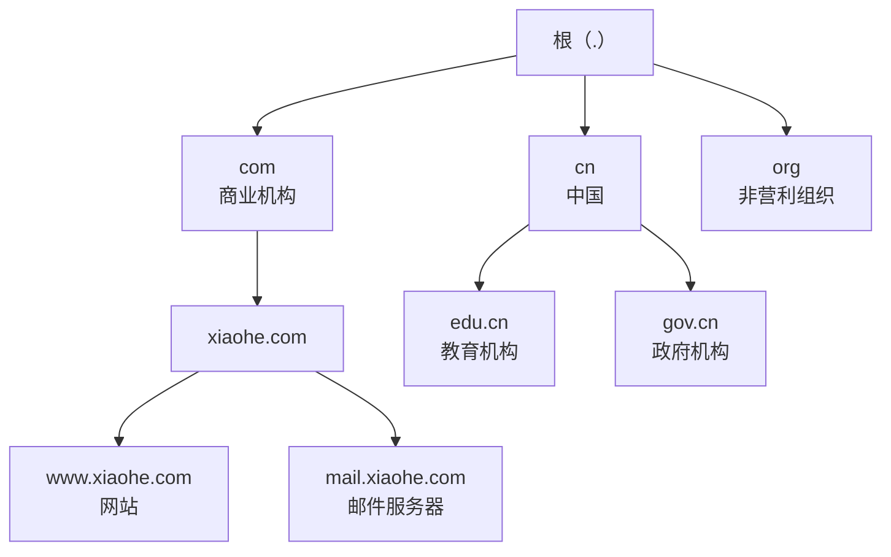
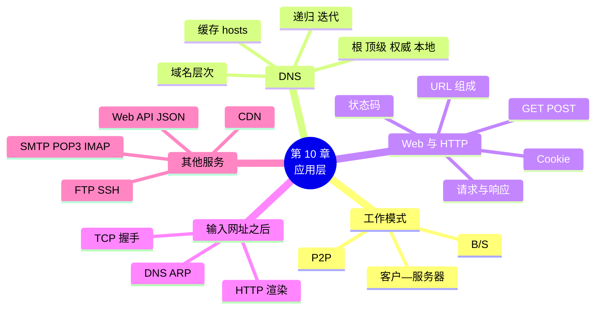

# 第 10 章 应用层：域名、网页与常用服务

!!! abstract "本章学时"
    理论 5 学时（线上 4 + 线下 1）· 实验 1 学时（本章共 3 个实验，★ 必做 2 个）

## 学习目标

学完本章，你应该能够：

1. **说出**客户—服务器模式和 P2P 模式的区别，以及常用应用层协议的作用和端口号（记忆）；
2. **描述**域名的层次结构，**区分**递归查询和迭代查询（理解）；
3. **拆分**一个 URL 的各个部分，**读懂** HTTP 请求和响应，**说出**常见状态码的含义（理解、应用）；
4. **说出**发送和接收电子邮件分别用什么协议（记忆）；
5. 按顺序**描述**“在浏览器中输入网址到看到网页”经过的步骤，说出每一步用到的协议（分析）；
6. 用 `nslookup` 和浏览器开发者工具**查看**域名解析和网页请求，在 Packet Tracer 中**配置** Web、DNS 和邮件服务器（应用）。

!!! info "先修要求"
    学习本章前，你需要掌握：

    - [8.3 DHCP](../08-arp-dhcp-nat/index.md#83)：电脑开机时自动获得 DNS 服务器的地址；
    - [9.1.3 常用端口号](../09-transport/index.md#913)：HTTP 80、HTTPS 443、DNS 53；
    - [9.4 三次握手与四次挥手](../09-transport/index.md#94)：HTTP 请求在 TCP 连接上传送；
    - 《Python 编程》：会运行 `.py` 文件，知道什么是字典。

??? abstract "本章概念清单（28 个，点击查看定义和例子）"
    1. [客户—服务器模式](../../appendix/glossary.md#g-客户—服务器模式)
    2. [对等网络](../../appendix/glossary.md#g-对等网络)
    3. [域名](../../appendix/glossary.md#g-域名)
    4. [域名系统](../../appendix/glossary.md#g-域名系统)
    5. [顶级域名](../../appendix/glossary.md#g-顶级域名)
    6. [根域名服务器](../../appendix/glossary.md#g-根域名服务器)
    7. [顶级域名服务器](../../appendix/glossary.md#g-顶级域名服务器)
    8. [权威域名服务器](../../appendix/glossary.md#g-权威域名服务器)
    9. [本地域名服务器](../../appendix/glossary.md#g-本地域名服务器)
    10. [递归查询](../../appendix/glossary.md#g-递归查询)
    11. [迭代查询](../../appendix/glossary.md#g-迭代查询)
    12. [hosts 文件](../../appendix/glossary.md#g-hosts-文件)
    13. [DNS 劫持](../../appendix/glossary.md#g-DNS-劫持)
    14. [万维网](../../appendix/glossary.md#g-万维网)
    15. [URL](../../appendix/glossary.md#g-URL)
    16. [HTTP](../../appendix/glossary.md#g-HTTP)
    17. [HTTPS](../../appendix/glossary.md#g-HTTPS)
    18. [请求方法](../../appendix/glossary.md#g-请求方法)
    19. [状态码](../../appendix/glossary.md#g-状态码)
    20. [Cookie](../../appendix/glossary.md#g-Cookie)
    21. [Web API](../../appendix/glossary.md#g-Web-API)
    22. [JSON](../../appendix/glossary.md#g-JSON)
    23. [SMTP](../../appendix/glossary.md#g-SMTP)
    24. [POP3](../../appendix/glossary.md#g-POP3)
    25. [IMAP](../../appendix/glossary.md#g-IMAP)
    26. [FTP](../../appendix/glossary.md#g-FTP)
    27. [SSH](../../appendix/glossary.md#g-SSH)
    28. [CDN](../../appendix/glossary.md#g-CDN)

## 情景导入

工作室的网络连通了，地址也能自动分配，禾姐想更进一步：“我们自己做一个内部网站，把例会时间、项目进度、请假表格都放上去，大家打开浏览器就能看。”

小林自告奋勇，在一台旧电脑上搭了个网站。第二天他得意地在群里发消息：“网站好了，请访问 http://192.168.8.130 。”

阿美回了一个捂脸的表情：“这串数字谁记得住啊？我们平时上网，输入的不都是 www 开头的名字吗？”

老周笑着说：“你说到点子上了。电脑之间通信只认 IP 地址，可人只记得住名字，中间需要一本通讯录，把名字翻译成地址，这本通讯录就是 DNS。我们给网站起个名字 www.xiaohe.com，在工作室的 DNS 服务器里登记一下，以后大家输入名字就行了。”

陈姐也凑过来：“我一直好奇，在浏览器里输入网址、按下回车，不到一秒网页就出来了，这中间到底发生了什么？”

老周说：“这个问题问得好，它正好能把我们这学期学过的东西全部串起来：先查 DNS，再 ARP 找网关，然后 TCP 三次握手，接着发 HTTP 请求，服务器回网页，最后浏览器把网页画出来。这一章我们就把这个过程一步一步拆开来看。”

本章我们学习每天都在用的应用层：域名系统怎样把名字变成地址，浏览器和网站之间说的 HTTP “语言”长什么样，邮件怎样送到对方的邮箱，最后在 Packet Tracer 中为工作室搭一个内部网站、一台 DNS 服务器和一台邮件服务器。

## 10.1 应用层与两种工作模式 { #101 }

### 10.1.1 应用层做什么 { #1011 }

前面各层解决的都是“怎么把数据送到”的问题：物理层传比特，数据链路层在一段链路上传帧，网络层把数据报送到目的主机，运输层把数据交给正确的进程。[**应用层**](../../appendix/glossary.md#g-应用层 "五层模型的最上层，规定应用程序之间通信的格式和规则，如 DNS、HTTP、SMTP"){ .term }是五层模型的最上面一层，它规定的是**应用程序之间怎样对话**：说什么格式的话、按什么顺序说、对方回答是什么意思<sup class="cite">[[1]](#ref10-1)</sup>。

不同的应用有不同的应用层协议（考点）：

| 应用 | 应用层协议 | 运输层 | 默认端口 |
|---|---|---|---|
| 域名解析 | DNS | UDP（大的应答用 TCP） | 53 |
| 网页浏览 | HTTP / HTTPS | TCP（HTTP/3 用 UDP 上的 QUIC） | 80 / 443 |
| 发送邮件 | SMTP | TCP | 25 |
| 接收邮件 | POP3 / IMAP | TCP | 110 / 143 |
| 文件传输 | FTP | TCP | 21（控制）、20（数据） |
| 远程登录 | SSH / Telnet | TCP | 22 / 23 |
| 远程桌面 | RDP | TCP（也可用 UDP） | 3389 |
| 自动分配地址 | DHCP | UDP | 67 / 68 |

### 10.1.2 客户—服务器模式 { #1012 }

大多数网络应用采用[**客户—服务器模式**](../../appendix/glossary.md#g-客户—服务器模式 "服务器一直运行等待请求，客户在需要时主动发出请求的工作方式；客户端为浏览器时叫 B/S 模式"){ .term }（Client/Server，简称 C/S）：

- **服务器**一直运行，在固定的端口上等待请求，有固定的地址或域名，比如网站服务器、邮件服务器；
- **客户**在需要时主动向服务器发出请求，收到响应后显示给用户，比如浏览器、邮件程序、手机 App。

这就像餐馆：厨房（服务器）一直开着等点单，顾客（客户）来了点菜，厨房做好端上来。顾客之间不直接打交道。

如果客户端就是浏览器，不需要另外安装软件，这种方式叫**浏览器—服务器模式**（Browser/Server，简称 B/S）。工作室的内部网站就是 B/S 模式：员工打开浏览器就能用。B/S 的好处是不用给每台电脑装软件，系统升级只改服务器；C/S 的好处是可以做更复杂、响应更快的功能，比如大型游戏、专业设计软件。

### 10.1.3 对等网络 P2P { #1013 }

[**对等网络**](../../appendix/glossary.md#g-对等网络 "没有固定服务器，每台电脑既是客户也是服务器，互相提供资源的工作方式"){ .term }（Peer-to-Peer，简称 P2P）中没有固定的服务器，每台电脑既是客户也是服务器：既从别人那里下载，也给别人上传。

| 比较项 | 客户—服务器 | P2P |
|---|---|---|
| 服务器 | 需要，一直运行 | 不需要专门的服务器（往往只需一个“牵线”的服务器帮大家找到彼此） |
| 用户越多时 | 服务器压力越大，要买更多服务器和带宽 | 参与的人越多，可用的上传能力越多，反而越快 |
| 管理 | 集中管理，容易控制 | 分散，不容易管理 |
| 例子 | 网站、邮件、网盘 | 文件分享下载、部分视频直播和软件更新的加速 |

P2P 像大家互相借书：你有的书借给我，我有的书借给他，不需要图书馆。下载软件中“下载的人越多越快”，就是 P2P 的效果。

## 10.2 域名系统 DNS（考点） { #102 }

### 10.2.1 为什么需要域名 { #1021 }

IP 地址是一串数字，不好记，而且网站换了服务器，地址可能会变。于是人们给主机起一个好记的名字，叫[**域名**](../../appendix/glossary.md#g-域名 "用点分隔的、便于人记忆的主机名字，从右往左级别降低"){ .term }，比如 `www.xiaohe.com`。把域名翻译成 IP 地址的系统叫[**域名系统**](../../appendix/glossary.md#g-域名系统 "把域名转换成 IP 地址的分布式系统，查询一般用 UDP 53 端口"){ .term }（DNS，Domain Name System）<sup class="cite">[[2]](#ref10-2)</sup>。

DNS 就像手机里的通讯录：你只记得“妈妈”，手机替你查出电话号码。区别在于，全世界的域名有几亿个，不可能放在一台电脑里，所以 DNS 是一个**分布式**的系统，由全世界大量的域名服务器分工合作。

### 10.2.2 域名的层次结构 { #1022 }

域名是分层的，从右往左，级别越来越低，各级之间用点隔开：

```text
        www   .   xiaohe   .   com   .
        └三级┘    └─二级─┘    └顶级┘  └根（通常省略不写）
```



- [**顶级域名**](../../appendix/glossary.md#g-顶级域名 "域名最右边的一级，分国家和地区顶级域名与通用顶级域名"){ .term }：分两类，一类是国家和地区顶级域名，如 `.cn`（中国）、`.jp`（日本）；另一类是通用顶级域名，如 `.com`（公司企业）、`.org`（非营利组织）、`.net`（网络服务机构），以及后来新增的很多，如 `.top`、`.xyz`；
- **二级域名**：在顶级域名下注册，如 `xiaohe.com`；在 `.cn` 下，`edu.cn`、`gov.cn`、`com.cn` 等是二级域名；
- 再往下由域名的拥有者自己分配，如 `www.xiaohe.com`、`mail.xiaohe.com`。

域名不区分大小写，`WWW.XiaoHe.COM` 和 `www.xiaohe.com` 是同一个。

### 10.2.3 域名服务器 { #1023 }

和域名的层次对应，域名服务器也分层（考点）：

| 类型 | 负责什么 | 比喻 |
|---|---|---|
| [**根域名服务器**](../../appendix/glossary.md#g-根域名服务器 "DNS 最高层的服务器，知道所有顶级域名服务器的地址，全世界共 13 组"){ .term } | 最高层，知道所有顶级域名服务器的地址 | 全国总服务台：“查 .com 去找那边” |
| [**顶级域名服务器**](../../appendix/glossary.md#g-顶级域名服务器 "管理某个顶级域名，知道其下各二级域名的权威服务器"){ .term } | 管理一个顶级域名，知道它下面各二级域名的权威服务器 | .com 分台：“查 xiaohe.com 去找它自己的服务器” |
| [**权威域名服务器**](../../appendix/glossary.md#g-权威域名服务器 "保存某个域名下主机名与 IP 地址的对应关系，给出最终答案"){ .term } | 保存某个域名下各主机名和 IP 地址的对应关系，给出最终答案 | 小禾工作室的前台：“www 在 192.168.8.130” |
| [**本地域名服务器**](../../appendix/glossary.md#g-本地域名服务器 "电脑网络设置中的 DNS 服务器，替主机完成查询并缓存结果"){ .term } | 离用户最近，替用户去查询，并把结果缓存起来 | 你的私人秘书：替你跑腿打听 |

本地域名服务器就是电脑网络设置里填的“DNS 服务器”，通常由 DHCP 自动告诉电脑（[8.3 节](../08-arp-dhcp-nat/index.md#83)），一般是运营商的服务器或家里的路由器。

根域名服务器在全世界共有 13 组，名字从 a.root-servers.net 到 m.root-servers.net，每组都在世界各地设有大量镜像站点，用户访问时会被引导到离自己近的站点<sup class="cite">[[2]](#ref10-2)</sup>。

### 10.2.4 递归查询与迭代查询（考点） { #1024 }

小林的电脑要查 `www.xiaohe.com`，假设各级服务器都没有缓存，过程如下：

```text
  小林的电脑                本地域名服务器               根服务器 / .com 服务器 / xiaohe.com 权威服务器
      │ ① www.xiaohe.com 的地址？ │                                │
      │ ─────────────────────────→│ ② 问根：www.xiaohe.com？        │
      │                           │ ──────────────────────────────→│ 根：我不知道，去问 .com 服务器
      │                           │ ③ 问 .com：www.xiaohe.com？      │
      │                           │ ──────────────────────────────→│ .com：去问 xiaohe.com 的权威服务器
      │                           │ ④ 问权威：www.xiaohe.com？       │
      │                           │ ──────────────────────────────→│ 权威：192.168.8.130
      │ ⑤ 答：192.168.8.130        │                                │
      │ ←─────────────────────────│                                │
```

这里有两种查询方式：

- [**递归查询**](../../appendix/glossary.md#g-递归查询 "被询问的服务器必须给出最终答案，自己不知道就替询问者去查"){ .term }：被问的服务器必须给出最终答案，查不到就自己去替你问。第 ① 步主机问本地域名服务器，一般用递归查询：主机只问一次，等最终结果；
- [**迭代查询**](../../appendix/glossary.md#g-迭代查询 "被询问的服务器不知道答案时，只告诉询问者下一步该去问谁"){ .term }：被问的服务器如果不知道答案，就告诉你“下一步该去问谁”，由你自己接着去问。第 ②～④ 步本地域名服务器问根、顶级、权威服务器，一般用迭代查询。

!!! note "比喻：打听一家店"
    递归：你问秘书“小禾工作室怎么走”，秘书说“我去帮你问”，回来直接告诉你地址。

    迭代：秘书去问总服务台，总服务台说“我不清楚，你去问商业区服务台”；秘书去问商业区服务台，对方说“你去问小禾工作室的前台”；秘书再去问前台，才得到地址。每一站都只是“指路”。

为什么根服务器不做递归？因为全世界的查询都会经过根服务器，如果它还要替每个人跑腿，负担太重。所以根服务器和顶级域名服务器只“指路”，跑腿的活儿交给离用户近的本地域名服务器。

<iframe class="sim-frame" src="../../sims/dns-journey/main.html" height="560" loading="lazy" title="DNS 查询之旅"></iframe>

动画：选择“递归 + 迭代”（常见方式）或“全部递归”，逐步看一次域名查询问了哪些服务器、每台服务器怎样回答；再查一次，看缓存怎样让查询一步完成。
{ .sim-caption }

### 10.2.5 缓存与 hosts 文件 { #1025 }

如果每次访问网站都要从根服务器问起，就太慢了。所以 DNS 大量使用**缓存**：本地域名服务器查到一个结果后会记住一段时间（这个时间由权威服务器在应答中给出，叫生存时间 TTL），期间再有人问就直接回答。你的电脑和浏览器也会缓存最近查过的结果。缓存让绝大多数查询在本地就能完成。

缓存的副作用是：网站换了 IP 地址后，有些用户要等缓存过期才能访问到新地址。在 Windows 中可以用下面的命令查看和清除本机的 DNS 缓存：

```text
ipconfig /displaydns      ← 查看本机缓存了哪些域名
ipconfig /flushdns        ← 清除本机 DNS 缓存
```

电脑在查询 DNS 之前，会先看一个叫 [**hosts 文件**](../../appendix/glossary.md#g-hosts-文件 "本机保存“IP 地址 域名”对应关系的文本文件，优先于 DNS 查询"){ .term }的本地文本文件（Windows 中位于 `C:\Windows\System32\drivers\etc\hosts`），里面每行写一个“IP 地址 域名”的对应关系。在 hosts 中写的对应关系优先于 DNS。早期互联网没有 DNS 时，就是靠大家维护同一份 hosts 文件。现在它常用于测试，比如网站上线前，在自己电脑的 hosts 中把域名指向新服务器先看看效果。

!!! warning "DNS 劫持：通讯录被人改了"
    如果有人篡改了 hosts 文件、路由器里的 DNS 设置或者 DNS 的应答，你输入正确的网址，却被带到一个假网站，这叫 [**DNS 劫持**](../../appendix/glossary.md#g-DNS-劫持 "篡改域名解析结果，把用户引向错误或虚假网站的攻击"){ .term }。假网站可能长得和真网站一模一样，骗你输入账号密码。防范方法：路由器管理密码不要用默认值；不要随便修改 hosts 文件；网站优先使用 HTTPS，浏览器会检查网站证书，假网站拿不到真网站的证书（第 11 章详讲）。

### 10.2.6 在抓包中看 DNS { #1026 }

本书的抓包文件 `web_visit.pcap` 记录了在实验网络中用浏览器访问 `www.xiaohe.com` 的全过程（录制环境中 DNS 服务器和网站在同一台机器 203.0.113.10 上）。第 3～6 帧是 DNS：

```text
帧  源 → 目的                        协议  内容
3   192.168.1.10 → 203.0.113.10     DNS   查询 0x85d7  A     www.xiaohe.com
4   192.168.1.10 → 203.0.113.10     DNS   查询 0xdbd4  AAAA  www.xiaohe.com
5   203.0.113.10 → 192.168.1.10     DNS   应答 0x85d7  A     www.xiaohe.com  A 203.0.113.10
6   203.0.113.10 → 192.168.1.10     DNS   应答 0xdbd4  AAAA  www.xiaohe.com  （没有 IPv6 地址）
```

可以看出：

- DNS 用的是 **UDP**，客户端端口 47003，服务器端口 **53**；
- 电脑同时问了两个问题：A 记录（IPv4 地址）和 AAAA 记录（IPv6 地址，[6.7 节](../06-ip-address/index.md#67)）。这个网站只有 IPv4 地址，所以 AAAA 的应答里没有答案；
- 每个查询有一个编号（0x85d7、0xdbd4），应答带着同样的编号，电脑据此知道哪个应答对应哪个问题；
- 第 5 帧的标志中 “Recursion desired” 为 1，表示电脑请求的是递归查询。

## 10.3 万维网与 HTTP { #103 }

[**万维网**](../../appendix/glossary.md#g-万维网 "互联网上大量网页通过超链接互相连接形成的信息网络"){ .term }（World Wide Web，简称 Web）是互联网上无数网页互相链接组成的信息网络。浏览器从网站取网页，用的协议是 [**HTTP**](../../appendix/glossary.md#g-HTTP "超文本传输协议，浏览器和网站之间一问一答、无状态的文本协议，默认端口 80"){ .term }（超文本传输协议）<sup class="cite">[[3]](#ref10-3)</sup>。

### 10.3.1 URL：网页的地址 { #1031 }

在浏览器地址栏中输入的网址，正式名称叫 [**URL**](../../appendix/glossary.md#g-URL "统一资源定位符，即网址，由协议、主机、端口、路径、查询参数、片段组成"){ .term }（统一资源定位符），它告诉浏览器“用什么协议、到哪台主机、取哪个资源”（考点）：

```text
https :// www.xiaohe.com : 443 /news/list.html ? page=2&type=design # top
└协议┘    └─── 主机 ───┘   └端口┘└──── 路径 ───┘  └──── 查询参数 ───┘   └片段┘
```

| 部分 | 含义 | 说明 |
|---|---|---|
| 协议 | 用什么协议访问 | `http`、`https`、`ftp` 等 |
| 主机 | 服务器的域名或 IP 地址 | 浏览器先用 DNS 把域名换成 IP 地址 |
| 端口 | 服务器的端口号 | 可省略，省略时 http 用 80、https 用 443 |
| 路径 | 服务器上的哪个资源 | 只写 `/` 时，一般返回网站首页 |
| 查询参数 | 传给服务器的额外信息 | `?` 开头，多个参数用 `&` 连接 |
| 片段 | 页面中的某个位置 | `#` 开头，只在浏览器中使用，**不发给服务器** |

用 Python 自带的 `urllib.parse` 可以把网址拆开（`labs/ch10/lab10_1_url_parts.py`），**运行结果**：

```text
协议   ： https
主机名 ： www.xiaohe.com
端口   ： 443
路径   ： /news/list.html
查询   ： {'page': ['2'], 'type': ['design']}
片段   ： top
```

### 10.3.2 HTTP 请求与响应 { #1032 }

HTTP 是“一问一答”的协议：浏览器发一个**请求**，服务器回一个**响应**。HTTP 运行在 TCP 之上，所以发请求之前要先完成三次握手。

`web_visit.pcap` 第 10 帧是浏览器发出的请求（用 Wireshark 的“追踪 TCP 流”看到的原文）：

```text
GET / HTTP/1.1                          ← 请求行：方法  路径  版本
Accept-Encoding: identity               ← 以下是请求头，每行“名字: 值”
Host: www.xiaohe.com                    ← 要访问哪个网站（一台服务器上可以有多个网站）
User-Agent: Mozilla/5.0 (Windows NT 10.0; Win64; x64) Chrome/141.0   ← 浏览器的类型和版本
Connection: close                       ← 收到响应后就关闭连接
                                        ← 一个空行，表示请求头结束
```

第 12、14 帧是服务器的响应：

```text
HTTP/1.1 200 OK                         ← 状态行：版本  状态码  原因短语
Server: XiaoheWeb/1.0                   ← 以下是响应头
Date: Sun, 01 Nov 2026 01:16:11 GMT
Content-type: text/html                 ← 正文是网页（HTML）
Content-Length: 286                     ← 正文长 286 字节
Last-Modified: Sun, 01 Nov 2026 01:16:04 GMT
                                        ← 空行
<!DOCTYPE html>                         ← 以下是正文：网页的 HTML 代码
<html lang="zh-CN">
<head><meta charset="utf-8"><title>小禾设计工作室</title></head>
<body>
<h1>小禾设计工作室 · 内部网站</h1>
……
```

请求和响应的结构是一样的（考点）：

| 部分 | 请求 | 响应 |
|---|---|---|
| 第一行 | 请求行：方法、路径、版本 | 状态行：版本、状态码、原因短语 |
| 首部（头） | Host、User-Agent、Cookie 等 | Content-Type、Content-Length、Set-Cookie 等 |
| 空行 | 表示首部结束 | 表示首部结束 |
| 正文 | GET 一般没有；POST 放提交的数据 | 网页、图片、JSON 等 |

HTTP 的请求和响应都是**文本**，人能直接读懂。这也意味着，如果用 HTTP 传账号密码，路上任何能抓包的人都能看到，这就是第 11 章要讲 HTTPS 的原因。

### 10.3.3 请求方法：GET 与 POST { #1033 }

请求行中的第一个词是[**请求方法**](../../appendix/glossary.md#g-请求方法 "HTTP 请求行中的第一个词，表示要服务器做什么"){ .term }，表示想让服务器做什么：

| 方法 | 作用 | 例子 |
|---|---|---|
| **GET** | 获取资源，参数放在 URL 的 `?` 后面 | 打开网页、搜索 |
| **POST** | 向服务器提交数据，数据放在正文中 | 登录、提交表单、上传文件 |
| PUT / DELETE | 修改 / 删除资源 | 多用于 Web API |
| HEAD | 只要响应头，不要正文 | 检查网页是否更新 |

GET 的参数会出现在地址栏、浏览记录和服务器日志中，所以密码之类的数据不能用 GET 传。用 POST 也只是“不显示在地址栏”，在 HTTP 中照样是明文，必须配合 HTTPS 才安全。

### 10.3.4 状态码（考点） { #1034 }

响应状态行中的三位数字叫[**状态码**](../../appendix/glossary.md#g-状态码 "HTTP 响应中的三位数字，第一位表示类别：2 成功、3 重定向、4 客户端错误、5 服务器错误"){ .term }，第一位数字表示类别<sup class="cite">[[3]](#ref10-3)</sup>：

| 类别 | 含义 | 常见状态码 |
|---|---|---|
| 1xx | 信息：请求已收到，继续处理 | 101 切换协议 |
| 2xx | **成功** | **200 OK**：请求成功 |
| 3xx | **重定向**：要到别处去取 | **301** 永久移走（网站换了地址）；302 临时移走；304 没有修改（用浏览器缓存的就行） |
| 4xx | **客户端错误**：请求有问题 | 400 请求格式错误；401 需要登录；**403** 禁止访问；**404** 找不到资源 |
| 5xx | **服务器错误**：服务器出了问题 | **500** 服务器内部错误；502 网关错误；503 服务暂不可用 |

记忆口诀：**2 成功，3 跳转，4 怪你，5 怪我**。看到 404，先检查网址有没有打错；看到 500、503，是网站自己的问题，等一会儿再试或联系网站管理员。

### 10.3.5 Cookie 与会话 { #1035 }

HTTP 本身是**无状态**的：服务器处理完一个请求就“忘了”，下一个请求来时，它并不知道是不是同一个人。可是登录网站后，翻到下一页还要保持登录，购物车里的东西也不能丢，怎么办？

办法是 [**Cookie**](../../appendix/glossary.md#g-Cookie "服务器通过 Set-Cookie 让浏览器保存、浏览器以后每次请求都带上的一小段数据，用于识别用户"){ .term }：

1. 你登录成功后，服务器在响应头里加一行 `Set-Cookie: session=abc123`，相当于发给你一张“会员卡”；
2. 浏览器把它存起来，以后每次访问这个网站，都在请求头里带上 `Cookie: session=abc123`；
3. 服务器看到会员卡号，就知道“是刚才登录的小林”。

服务器那边记录“卡号 abc123 是小林、购物车里有什么”的信息，叫**会话**（Session）。Cookie 很方便，但也要注意：别人拿到你的 Cookie，就可能冒充你登录，所以不要在公共电脑上勾选“记住我”，用完要退出登录。

### 10.3.6 HTTP 的版本（了解） { #1036 }

| 版本 | 年份 | 主要变化 |
|---|---|---|
| HTTP/1.0 | 1996 | 每个请求建立一个 TCP 连接，用完就关 |
| HTTP/1.1 | 1997 | 默认持久连接，一个 TCP 连接可以连续发多个请求；必须带 Host 头，一台服务器可以放多个网站 |
| HTTP/2 | 2015 | 二进制格式；一个连接上同时传多个请求和响应（多路复用）；压缩首部 |
| HTTP/3 | 2022 | 改用基于 UDP 的 QUIC（[9.7.2 节](../09-transport/index.md#972)），连接建立更快，丢包时互不影响 |

一个网页通常包含几十个文件（HTML、图片、样式、脚本），HTTP 每一次升级，都是为了让这些文件更快地传完。

[**HTTPS**](../../appendix/glossary.md#g-HTTPS "在 HTTP 和 TCP 之间加上 TLS 加密的 HTTP，默认端口 443"){ .term } 就是“HTTP + 加密”：在 HTTP 和 TCP 之间加一层 TLS 加密，默认端口 443。浏览器地址栏显示锁形图标的网站就在用 HTTPS。现在绝大多数网站都已使用 HTTPS，它为什么安全，第 11 章详细讲。

## 10.4 输入网址之后发生了什么 { #104 }

现在我们可以回答陈姐的问题了。小林的电脑刚开机（各种缓存都是空的），在浏览器中输入 `http://www.xiaohe.com` 并按回车。对照 `web_visit.pcap` 的 18 帧，完整过程如下：

| 步骤 | 帧 | 发生了什么 | 用到的协议 | 本书章节 |
|---|---|---|---|---|
| 0 | — | 电脑开机时已用 DHCP 获得 IP 地址、网关和 DNS 服务器地址 | DHCP | [8.3](../08-arp-dhcp-nat/index.md#83) |
| 1 | — | 浏览器解析 URL：协议 http、主机 www.xiaohe.com、端口 80、路径 / | URL | 10.3.1 |
| 2 | 1～2 | DNS 服务器不在本网段，要先发给网关；用 ARP 问出网关 192.168.1.1 的 MAC 地址 | ARP | [8.1](../08-arp-dhcp-nat/index.md#81) |
| 3 | 3～6 | 向 DNS 服务器查询 www.xiaohe.com，得到 203.0.113.10 | DNS（UDP 53） | 10.2 |
| 4 | 7～9 | 与 203.0.113.10 的 80 端口三次握手，建立 TCP 连接 | TCP | [9.4](../09-transport/index.md#94) |
| 5 | 10～11 | 发送 HTTP 请求 `GET / HTTP/1.1`，服务器确认 | HTTP | 10.3.2 |
| 6 | 12～15 | 服务器返回 `200 OK` 和 286 字节的网页，浏览器确认 | HTTP | 10.3.2 |
| 7 | 16～18 | 请求头里写了 `Connection: close`，服务器发完就发起四次挥手（这里第 2、3 步合并成了一个报文段，所以只看到 3 帧） | TCP | [9.4.3](../09-transport/index.md#943) |
| 8 | — | 浏览器解析 HTML，把网页画出来；如果网页里还有图片、样式等，再继续发请求 | — | — |

在这期间，每一个数据都要经过五层封装（[2.4 节](../02-architecture/index.md#24)）：HTTP 请求交给 TCP 加上端口号，交给 IP 加上地址，交给以太网加上 MAC 地址，最后变成网线上的电信号；每经过一台路由器，以太网帧的 MAC 地址都会换一次，而 IP 地址不变（[7.1 节](../07-routing/index.md#71)）。

在录制环境中，从第 3 帧发出 DNS 查询到第 14 帧收到网页，只用了约 6 毫秒。真实的互联网中，服务器远在千里之外，还要经过很多台路由器，时间会长得多，但步骤完全一样。

<iframe class="sim-frame" src="../../sims/after-url/main.html" height="620" loading="lazy" title="输入网址之后"></iframe>

动画：逐步回放“输入网址之后”的全过程，每一步显示数据在哪两台设备之间传送、用的是哪一层的什么协议、对应抓包中的第几帧。
{ .sim-caption }

!!! tip "经典面试题"
    “在浏览器中输入网址按回车后发生了什么”是网络方面最经典的面试题之一，也是本课期末简答题的常客。按“DHCP（已完成）→ 解析 URL → DNS → ARP → TCP 三次握手 → HTTP 请求 → HTTP 响应 → 渲染页面 → 断开连接”的顺序答，每一步说出协议，就是一个合格的答案。

## 10.5 Web API 与 JSON { #105 }

手机上的天气 App 并不需要一个完整的网页，它只要“今天多少度、下不下雨”这样的数据。App 向服务器要数据时用的仍然是 HTTP，只是服务器返回的不是 HTML 网页，而是一段结构化的数据。这种供程序调用的 HTTP 接口叫 [**Web API**](../../appendix/glossary.md#g-Web-API "供程序调用的 HTTP 接口，返回数据而不是网页"){ .term }。

Web API 返回的数据最常用的格式是 [**JSON**](../../appendix/glossary.md#g-JSON "一种轻量的数据格式，写法类似 Python 的字典和列表"){ .term }，它的写法和 Python 的字典、列表非常像。比如工作室内部网站提供一个查询例会的接口（**示意**）：

```text
请求：GET http://www.xiaohe.com/api/meeting

响应：HTTP/1.1 200 OK
      Content-Type: application/json

      {"title": "本周例会", "time": "周三 15:00", "room": "二楼会议室", "attendees": ["小林", "阿美", "陈姐"]}
```

手机 App、微信小程序、网站中“不刷新页面就更新内容”的功能，以及调用大模型（10.10 节），背后几乎都是这样的 Web API。用 Python 程序批量获取网页和数据，是《网络爬虫技术》课的内容，本书不展开。

## 10.6 电子邮件 { #106 }

### 10.6.1 邮件地址和邮件系统的组成 { #1061 }

电子邮件地址的格式是 `用户名@邮件服务器的域名`，比如 `xiaolin@xiaohe.com`：`@` 后面告诉邮件系统“送到哪个邮局”，前面告诉邮局“放进哪个信箱”。

电子邮件系统由三部分组成：

- **用户代理**：用户用来写信、读信的程序，如 Outlook、手机上的邮件 App，或者网页邮箱；
- **邮件服务器**：相当于邮局，负责发送和接收邮件，为每个用户保管一个信箱；
- **邮件协议**：发信用 SMTP，收信用 POP3 或 IMAP。

### 10.6.2 SMTP、POP3 与 IMAP（考点） { #1062 }

小林（xiaolin@xiaohe.com）给客户（kehu@example.com）发一封邮件，过程如下：

```text
 小林的邮件程序 ──SMTP──→ xiaohe.com 邮件服务器 ──SMTP──→ example.com 邮件服务器 ──POP3/IMAP──→ 客户的邮件程序
   （写信）       推送        （发信邮局）          推送        （收信邮局，放进信箱）        拉取        （读信）
```

| 协议 | 作用 | 端口 | 说明 |
|---|---|---|---|
| [**SMTP**](../../appendix/glossary.md#g-SMTP "简单邮件传送协议，用于发送邮件和在邮件服务器之间传递邮件，端口 25"){ .term } | 发送邮件：用户代理 → 发件服务器，服务器 → 服务器 | 25（服务器之间）；587 / 465（用户提交，加密） | 简单邮件传送协议，“推”<sup class="cite">[[4]](#ref10-4)</sup> |
| [**POP3**](../../appendix/glossary.md#g-POP3 "邮局协议第 3 版，把邮件从服务器信箱下载到本机，端口 110"){ .term } | 接收邮件：从信箱下载到本机 | 110（加密 995） | 默认下载后从服务器删除，适合只在一台电脑上看邮件 |
| [**IMAP**](../../appendix/glossary.md#g-IMAP "互联网报文存取协议，邮件保留在服务器上，多设备同步，端口 143"){ .term } | 接收邮件：在服务器上管理邮件 | 143（加密 993） | 邮件留在服务器上，手机、电脑看到的一样，已读、文件夹同步<sup class="cite">[[5]](#ref10-5)</sup> |

记忆方法：SMTP 负责“发”（推出去），POP3 和 IMAP 负责“收”（拉回来）。为什么收信不能也用 SMTP？因为收件人的电脑不会一直开着，邮件只能先放在邮件服务器的信箱里，等收件人上线时自己去取。

**网页邮箱**（在浏览器中收发邮件）中，浏览器和邮件服务器之间用的是 HTTP（HTTPS），邮件服务器之间仍然用 SMTP。

## 10.7 文件传输与远程登录 { #107 }

### 10.7.1 FTP 与 SFTP { #1071 }

[**FTP**](../../appendix/glossary.md#g-FTP "文件传输协议，使用控制连接（21）和数据连接两个 TCP 连接，明文传送"){ .term }（文件传输协议）是专门用来上传、下载文件的老协议。它的特别之处是使用**两个连接**：

- **控制连接**：服务器端口 21，传送命令（登录、切换目录、列文件）；
- **数据连接**：每传一个文件或一次目录列表，就建立一个数据连接。

数据连接有两种建立方式（了解）：**主动模式**下，服务器用 20 端口主动连接客户端；**被动模式**下，服务器告诉客户端一个端口，由客户端去连接。客户端在 NAT 或防火墙后面时，外面主动连进来的连接会被挡住（[8.4 节](../08-arp-dhcp-nat/index.md#84)），所以现在一般用被动模式。

FTP 的账号密码和文件内容都是明文传送的，不安全。现在更推荐用 **SFTP**（基于 SSH 的文件传输，端口 22），或者用网盘、带 HTTPS 的网页上传文件。

### 10.7.2 远程登录：Telnet、SSH 与远程桌面 { #1072 }

网络管理员经常需要在自己的电脑上操作远处的服务器或网络设备：

| 方式 | 端口 | 特点 |
|---|---|---|
| Telnet | 23 | 命令行，明文传送，包括密码，已不建议使用 |
| [**SSH**](../../appendix/glossary.md#g-SSH "加密的远程登录协议，端口 22"){ .term } | 22 | 命令行，全程加密，登录 Linux 服务器和交换机、路由器的标准方式 |
| 远程桌面（RDP） | 3389 | 图形界面，像坐在那台电脑前一样操作，Windows 自带 |

在 Packet Tracer 中，可以给路由器配置 SSH，再从 PC 的命令提示符用 `ssh -l 用户名 地址` 登录，第 12 章的综合项目中会用到。

## 10.8 其他常用服务 { #108 }

**内容分发网络 CDN**：热门视频的服务器如果只放在北京，全国的观众都要连到北京，又慢又挤。[**CDN**](../../appendix/glossary.md#g-CDN "内容分发网络，在各地部署缓存服务器，让用户就近获取内容"){ .term } 的做法是在全国各地放很多缓存服务器，把热门内容提前复制过去，用户访问时，DNS 把域名解析到离用户最近的缓存服务器。所以，同一个域名在广州和哈尔滨查出来的 IP 地址可能不一样。CDN 就像连锁超市在各地设仓库，你下单后从最近的仓库发货。

**网盘**：把文件存在服务商的服务器上，通过客户端或网页上传下载，背后一般是 HTTPS。网盘的“秒传”其实是服务器发现已经有一模一样的文件，就不再真的上传。

**即时通信**：微信、QQ 等聊天软件采用客户—服务器模式，消息先发到服务器，再由服务器转给对方，对方不在线时服务器暂存。语音、视频通话往往对实时性要求高，常用基于 UDP 的传输方式（[9.7 节](../09-transport/index.md#97)）。

## 10.9 本章常见问题对照 { #109 }

| 现象 | 用大白话说 | 怎么查、怎么改 |
|---|---|---|
| 能 ping 通 IP 地址，用域名打不开网页 | DNS 出了问题，名字翻译不成地址 | `nslookup 域名` 看能否解析；检查网卡的 DNS 服务器设置；临时换一个公共 DNS 试试 |
| 能上微信、QQ，打不开网页 | 聊天软件可能直接用内置的服务器 IP 地址，不依赖 DNS；网页则需要先查 DNS | 同上，重点查 DNS |
| 网页显示 404 | 服务器上找不到这个路径 | 检查网址拼写、大小写；回到网站首页重新点 |
| 网页显示 500、502、503 | 网站服务器自己出了问题 | 不是你的网络问题，等一会儿再试，或联系网站管理员 |
| 网站换了服务器，有人能打开新网站，有人还是旧的 | DNS 缓存还没过期 | `ipconfig /flushdns` 清除本机缓存；等待缓存过期 |
| 输入正确网址，却打开了奇怪的网站 | 可能被 DNS 劫持，或 hosts 文件被改 | 检查 hosts 文件和路由器的 DNS 设置；修改路由器管理密码 |
| 邮件程序能收信不能发信 | 发信服务器（SMTP）的地址、端口或加密设置不对 | 按邮箱服务商说明设置 SMTP 服务器和端口 |
| Packet Tracer 中用域名打不开网站 | PC 没有设置 DNS 服务器，或 DNS 服务器里没登记这个名字 | 检查 PC 的 DNS Server；检查服务器 DNS 服务是否开启（On）、记录是否添加 |

## 10.10 AI 与网络：大模型 API 的一次请求长什么样 { #1010 }

很多应用里的“AI 助手”，背后是程序通过 Web API 调用大模型服务。学完本章，你已经能看懂这样一次请求了。下面是一个典型的大模型 API 调用（**示意**，服务地址和密钥都是虚构的，各家服务的具体字段以官方文档为准）：

```text
POST https://api.example.com/v1/chat HTTP/1.1          ← 方法 POST：要提交数据；HTTPS 加密
Host: api.example.com
Authorization: Bearer <你的 API 密钥>                    ← 身份凭证，相当于“会员卡”，绝不能泄露
Content-Type: application/json                         ← 正文是 JSON

{"model": "某个模型名", "messages": [{"role": "user", "content": "用一句话解释什么是 DNS"}], "stream": true}
```

服务器的响应：

```text
HTTP/1.1 200 OK
Content-Type: text/event-stream                        ← 流式输出：生成一点发一点（第 9 章 9.9 节）

（随后陆续推送一段段包含生成文字的 JSON 数据）
```

把这些字段和本章的知识对照一下：

- 用的是 **HTTPS**，端口 443，先查 DNS，再 TCP 三次握手、TLS 加密，然后发 HTTP 请求；
- 用 **POST** 方法，问题放在 JSON 正文里；
- `Authorization` 请求头里放 API 密钥，服务器靠它识别你是谁、扣谁的费用。密钥写进代码后上传到公开网站，等于把会员卡丢在大街上；
- 常见的状态码：**200** 成功；**401** 密钥错误或缺失；**429** 请求太频繁，被限流了；**500**、**503** 服务端出问题。

所以，“AI 调用”并没有什么神秘的，它就是一次普通的 HTTPS 请求。

## 本章实验

!!! abstract "实验总览"
    | 实验 | 类型 | 建议时长 | 内容 |
    |---|---|---|---|
    | 实验 10-1 | ★ 必做 | 25 分钟 | 查域名、看网页请求 |
    | 实验 10-2 | ★ 必做 | 25 分钟 | 在 Packet Tracer 中搭工作室内部网站、DNS 和邮件服务器 |
    | 实验 10-3 | ☆ 选做 | 25 分钟 | 用 Python 搭一个网页 |

    实验 10-1 的 Python 程序和实验 10-3 的程序、网页在 `labs/ch10/`，书中的运行结果是编者实际运行得到的；`nslookup`、浏览器开发者工具和 Packet Tracer 的显示为**输出格式示意**，具体数值以你自己看到的为准。

### 实验 10-1 ★ 查域名、看网页请求 { #10-1 }

**实验目的**

1. 用 `nslookup` 查询域名对应的 IP 地址；
2. 用浏览器开发者工具查看一个网页包含的请求、状态码和耗时；
3. 理解 URL 的组成。

**实验环境**：Windows 命令提示符；Chrome 或 Edge 浏览器；Python（第三档用）。

**实验数据**：无。需要能上网。

**实验步骤**

第一档 · 跑通：

1. 打开命令提示符，输入 `nslookup www.baidu.com`。**输出格式示意**：

```text
服务器:  UnKnown
Address:  192.168.1.1                ← 你的电脑用的本地域名服务器（常常是家里的路由器）

非权威应答:                            ← 结果来自本地域名服务器的缓存，而不是权威服务器
名称:    （真实主机名，可能和你输入的不同）
Addresses:  （一个或多个 IP 地址）
Aliases:  www.baidu.com               ← 别名：你输入的域名其实是另一个名字的别名
```

   记下“服务器”的地址和查到的 IP 地址。“非权威应答”说明这个结果是本地域名服务器缓存的。

2. 再查两个你常用的网站（如学校官网、一个视频网站），填写记录表。有的网站会查出多个地址，这是为了分担访问压力。
3. 打开浏览器，按 F12 打开开发者工具，切换到“网络”（Network）选项卡，然后在地址栏打开学校官网。列表中每一行是一个请求，看“状态”（Status）、“类型”（Type）、“时间”（Time）几列。
4. 点击列表的第一行（网页本身），在右侧“标头”（Headers）中找到请求方法、状态码、远程地址（Remote Address），以及请求头中的 Host、User-Agent。

第二档 · 改一改：

1. 用 `nslookup -type=AAAA www.baidu.com` 查询 IPv6 地址，看能否查到；再用 `nslookup -type=MX 163.com` 查询 163 邮箱的邮件服务器（MX 记录表示“这个域名的邮件交给哪台服务器”）。
2. 在开发者工具中，在地址栏网址后面随便加一段不存在的路径（如 `/abc123`），回车，看第一行的状态码是多少。再刷新一次正常的页面，看是否出现 304 或“（内存缓存）”“（磁盘缓存）”。

第三档 · 挑战（选做）：运行 `labs/ch10/lab10_1_url_parts.py`，然后把程序中的网址换成你刚才访问的某个网址，看它被拆成了哪几部分。把网址改成 `http://www.xiaohe.com/index.html` 时，**运行结果**：

```text
协议   ： http
主机名 ： www.xiaohe.com
端口   ： None
路径   ： /index.html
查询   ： {}
片段   ：
```

   端口显示 None，是因为网址里没写端口，浏览器会使用 http 的默认端口 80。

**实验记录表**

| 域名 | 本地域名服务器 | 查到的 IP 地址（写一个） | 是否有多个地址 | 是否有别名 |
|---|---|---|---|---|
| www.baidu.com | | | | |
| | | | | |
| | | | | |

| 开发者工具中的项目 | 结果 |
|---|---|
| 网页一共发出了多少个请求 | |
| 第一个请求的方法、状态码、远程地址 | |
| 访问不存在路径时的状态码 | |
| 刷新后是否看到 304 或缓存 | |

**常见问题排查**

| 现象 | 原因 | 解决 |
|---|---|---|
| nslookup 显示 “DNS request timed out” | 本地域名服务器没响应 | 检查网络连接；`ipconfig /all` 看 DNS 服务器设置 |
| 开发者工具的网络列表是空的 | 先打开网页、后打开开发者工具 | 打开开发者工具后刷新页面 |
| 远程地址显示的是 127.0.0.1 之类的地址 | 电脑开了代理软件 | 关闭代理后再看 |

**思考与练习**

1. 为什么有的网站查出的 IP 地址，你和同学查到的不一样？（提示：10.8 节 CDN）
2. 打开一个网页，开发者工具中为什么会有几十个请求？

**实验报告要求**：提交 nslookup 截图 3 张、开发者工具“网络”选项卡和第一个请求“标头”的截图、记录表。

### 实验 10-2 ★ 搭工作室内部网站、DNS 和邮件服务器 { #10-2 }

**实验目的**

1. 在 Packet Tracer 的服务器上配置 Web 服务，修改网站首页；
2. 配置 DNS 服务，让员工用域名访问内部网站；
3. 配置邮件服务，让两名员工互发邮件；
4. 用模拟模式观察 DNS 和 HTTP 报文。

**实验环境**：Cisco Packet Tracer。

**实验数据**：无。

**拓扑与地址规划**

```text
   PC0（小林）、PC1（阿美）                    R1（2911）                         Server0（内部服务器）
   自动获取地址 ─── Switch0 ─── Gi0/0 192.168.8.1/26     Gi0/1 192.168.8.129/29 ─── Switch1 ─── 192.168.8.130/29
   （设计部 192.168.8.0/26）                                                     网关 192.168.8.129
```

地址沿用第 6 章为工作室做的规划：设计部 192.168.8.0/26，服务器区 192.168.8.128/29。`xiaohe.com` 只在本实验的仿真网络中使用。

**实验步骤**

第一档 · 跑通：

1. 按拓扑放设备、连线。配置 R1 两个接口的地址并 `no shutdown`。在 R1 上为设计部配置 DHCP（与实验 8-2 相同），注意 DNS 服务器改为内部服务器：

```text
R1(config)#ip dhcp excluded-address 192.168.8.1 192.168.8.10
R1(config)#ip dhcp pool DESIGN
R1(dhcp-config)#network 192.168.8.0 255.255.255.192
R1(dhcp-config)#default-router 192.168.8.1
R1(dhcp-config)#dns-server 192.168.8.130                      ← 工作室自己的 DNS 服务器
R1(dhcp-config)#end
```

2. 点 Server0 → Desktop → IP Configuration，设置静态地址 192.168.8.130、子网掩码 255.255.255.248、网关 192.168.8.129、DNS Server 192.168.8.130。PC0、PC1 选 DHCP，确认拿到了地址，DNS Server 显示 192.168.8.130。
3. **Web 服务**：Server0 → Services → HTTP，确认 HTTP 为 On。在文件列表中找到 `index.html`，点 Edit，把内容改成：

```html
<html><body>
<h1>小禾设计工作室 · 内部网站</h1>
<p>本周例会：周三下午 3 点，二楼会议室。</p>
</body></html>
```

   点 Save。在 PC0 → Desktop → Web Browser 中输入 `http://192.168.8.130`，应能看到这个页面。

4. **DNS 服务**：Server0 → Services → DNS，把 DNS Service 设为 On。添加两条记录（Type 选 A Record）：

| Name | Type | Address |
|---|---|---|
| www.xiaohe.com | A Record | 192.168.8.130 |
| mail.xiaohe.com | A Record | 192.168.8.130 |

   每填一条点 Add。然后在 PC0 的 Web Browser 中输入 `http://www.xiaohe.com`，应能打开同一个页面。在 PC0 的 Command Prompt 中执行 `nslookup www.xiaohe.com`（**输出格式示意**）：

```text
Server: [192.168.8.130]
Address:  192.168.8.130

Non-authoritative answer:
Name:   www.xiaohe.com
Address:  192.168.8.130
```

5. **邮件服务**：Server0 → Services → EMAIL，确认 SMTP Service 和 POP3 Service 都为 On，Domain Name 填 `xiaohe.com` 并点 Set。在 User Setup 中添加两个用户：xiaolin（密码自定），amei（密码自定）。
6. PC0 → Desktop → Email，填写：

| 项目 | 填写 |
|---|---|
| Your Name | 小林（Packet Tracer 中如显示乱码可写 xiaolin） |
| Email Address | xiaolin@xiaohe.com |
| Incoming Mail Server | mail.xiaohe.com |
| Outgoing Mail Server | mail.xiaohe.com |
| User Name / Password | xiaolin / 你设置的密码 |

   点 Save。PC1 用 amei 的账号同样设置。PC0 点 Compose 给 amei@xiaohe.com 写一封邮件发送；PC1 点 Receive，应能收到。

第二档 · 改一改：

1. 切换到模拟模式（Simulation），在 Edit Filters 中只勾选 DNS 和 HTTP。在 PC0 的浏览器中重新访问 `http://www.xiaohe.com`，点“Capture/Forward”逐步观察：先出现的是 DNS 还是 HTTP？点开报文，看 DNS 报文的 UDP 端口和 HTTP 报文的 TCP 端口。
2. 在 DNS 服务中再加一条记录 `oa.xiaohe.com` → 192.168.8.130，用这个新名字访问网站，看能否打开。说明一个 IP 地址可以对应多个域名。

第三档 · 挑战（选做）：在服务器区再放一台 Server1（192.168.8.131），开启 HTTP，首页写“项目管理系统”，在 DNS 中把 `oa.xiaohe.com` 改为指向 192.168.8.131。然后在模拟模式中观察 SMTP 和 POP3 报文：发信时报文从 PC0 发往服务器的哪个端口？收信时呢？

**实验记录表**

| 项目 | 结果 |
|---|---|
| PC0 获取的 IP 地址和 DNS 服务器 | |
| 用 IP 地址访问网站是否成功 | |
| 用域名访问网站是否成功 | |
| nslookup www.xiaohe.com 的结果 | |
| 小林发给阿美的邮件是否收到 | |
| 模拟模式中 DNS 和 HTTP 出现的先后顺序、端口号 | |

**常见问题排查**

| 现象 | 原因 | 解决 |
|---|---|---|
| 用 IP 能打开，用域名打不开（显示 Host Name Unresolved） | PC 的 DNS Server 不对；DNS 服务没开启；记录名字打错 | 检查 PC 的 IP 配置；DNS Service 设为 On；核对记录 |
| 用 IP 也打不开 | 服务器网关没设；R1 接口没启用；HTTP 服务关闭 | 从 PC ping 服务器逐段排查 |
| 发邮件提示 Send Mail Failed | 邮件服务器的域名没设置，或邮件地址和域名不一致 | EMAIL 服务中 Domain Name 填 xiaohe.com 并点 Set |
| 收邮件提示用户名或密码错误 | User Setup 中的账号密码和 PC 中填的不一致 | 重新核对 |

**思考与练习**

1. 第 4 步之前用域名访问网站为什么打不开？之后为什么就可以了？
2. 本实验中，发信和收信分别用了什么协议？如果改用 IMAP 收信，有什么好处？

**实验报告要求**：提交拓扑截图、DNS 记录截图、PC0 用域名打开网站的截图、nslookup 截图、收到邮件的截图和记录表。

### 实验 10-3 ☆ 用 Python 搭一个网页 { #10-3 }

**实验目的**

1. 用 Python 自带的 `http.server` 在本机开一个网站；
2. 让同一局域网中的手机访问这个网站；
3. 观察 HTTP 请求和 200、404 两种状态码。

**实验环境**：Python；同一 WiFi 下的一部手机（可选）；Wireshark（可选）。

**实验数据**：`labs/ch10/mysite/index.html`（一个简单的网页）。

**实验步骤**

第一档 · 跑通：

1. 打开命令提示符，进入 `labs/ch10/mysite` 目录，执行：

```text
python -m http.server 8000
```

   看到下面这行，说明网站已经启动（**运行结果**）：

```text
Serving HTTP on 0.0.0.0 port 8000 (http://0.0.0.0:8000/) ...
```

   如果 Windows 弹出防火墙提示，选择允许在“专用网络”上访问。

2. 在本机浏览器中打开 `http://127.0.0.1:8000`，应看到“你好，这是小林的网站”。回到命令提示符窗口，每访问一次，服务器就打印一行日志。再访问 `http://127.0.0.1:8000/abc.html`，日志如下（**运行结果**，`/favicon.ico` 等其他请求省略）：

```text
127.0.0.1 - - [01/Nov/2026 02:24:05] "GET /index.html HTTP/1.1" 200 -
127.0.0.1 - - [01/Nov/2026 02:24:05] code 404, message File not found
127.0.0.1 - - [01/Nov/2026 02:24:05] "GET /abc.html HTTP/1.1" 404 -
```

   每行依次是：客户端地址、时间、请求行、状态码。

3. 用 `ipconfig` 查出本机的局域网 IP 地址（如 192.168.1.5），让同一 WiFi 下的手机打开 `http://192.168.1.5:8000`，看能否访问，日志中客户端地址变成了什么。

第二档 · 改一改：

1. 用记事本修改 `mysite/index.html` 中的文字，保存后刷新浏览器，看网页是否变化（服务器不用重启）。在 `mysite` 中再放一张图片 `logo.png`，访问 `http://127.0.0.1:8000/logo.png`。
2. 在 `mysite` 目录之外运行 `python -m http.server 8000`，看浏览器显示什么。（`http.server` 会把当前目录中的文件列出来，所以**千万不要在包含私人文件的目录中运行它**，也不要用于正式网站。）

第三档 · 挑战（选做）：保持服务器运行，另开一个窗口运行 `labs/ch10/lab10_3_client.py`，用程序发请求并打印响应：

```python
import http.client                       # Python 自带的 HTTP 客户端

host = "127.0.0.1"                       # ← 改这里：服务器地址（本机就是 127.0.0.1）
conn = http.client.HTTPConnection(host, 8000, timeout=5)   # 连接服务器的 8000 端口（TCP）
conn.request("GET", "/index.html")       # 发出请求：方法 GET，路径 /index.html  ← 可改成不存在的路径
resp = conn.getresponse()                # 读取响应

print("状态行：", f"HTTP/{resp.version / 10}", resp.status, resp.reason)   # version 10 即 HTTP/1.0
for name, value in resp.getheaders():    # 逐行打印响应头
    print(f"  {name}: {value}")
body = resp.read().decode("utf-8")       # 读出网页内容（字节转成文字）
print("网页内容前 60 个字符：", body[:60].replace("\n", " "))
conn.close()
```

**运行结果**：

```text
状态行： HTTP/1.0 200 OK
  Server: SimpleHTTP/0.6 Python/3.13.18
  Date: Sun, 01 Nov 2026 02:24:05 GMT
  Content-type: text/html
  Content-Length: 233
  Last-Modified: Sun, 01 Nov 2026 02:23:53 GMT
网页内容前 60 个字符： <!DOCTYPE html> <html lang="zh-CN"> <head><meta charset="utf
```

   `http.server` 默认用 HTTP/1.0 回答。把路径改成 `/abc.html` 再运行，状态行变为 `HTTP/1.0 404 File not found`。有 Wireshark 的同学，可以用过滤器 `tcp.port == 8000` 抓本机回环接口（Adapter for loopback traffic capture）上的包，找到三次握手和 HTTP 请求。

**实验记录表**

| 项目 | 结果 |
|---|---|
| 服务器启动时显示的端口 | |
| 访问首页时日志中的请求行和状态码 | |
| 访问不存在的页面时的状态码 | |
| 手机访问时日志中的客户端地址 | |
| 程序打印的 Content-Length | |

**常见问题排查**

| 现象 | 原因 | 解决 |
|---|---|---|
| `OSError: [WinError 10048]` | 8000 端口被占用 | 换一个端口，如 `python -m http.server 8080` |
| 浏览器显示目录列表，而不是网页 | 运行命令时不在 `mysite` 目录 | `cd` 到 `mysite` 再运行 |
| 手机打不开 | 不在同一个网络；Windows 防火墙拦截；用了 127.0.0.1 | 确认同一 WiFi；允许 Python 通过防火墙；用电脑的局域网地址 |
| 网页中文乱码 | 网页没有声明编码 | 在 `<head>` 中加 `<meta charset="utf-8">` |

**思考与练习**

1. 为什么手机要用电脑的局域网地址，而不能用 127.0.0.1？
2. Python 官方文档提醒 `http.server` 不适合用于生产环境<sup class="cite">[[6]](#ref10-6)</sup>。结合第二档第 2 步，说说可能有什么风险。

**实验报告要求**：提交服务器日志截图（含 200 和 404）、浏览器和手机访问的截图、记录表。

## 本章小结

- **应用层**规定应用程序之间怎样对话。常用协议和端口：DNS 53（UDP）、HTTP 80、HTTPS 443、SMTP 25、POP3 110、IMAP 143、FTP 21/20、SSH 22、Telnet 23、RDP 3389。
- 两种工作模式：**客户—服务器模式**（服务器一直运行等请求，B/S 是其中客户端为浏览器的一种）和**对等网络 P2P**（每台电脑既是客户也是服务器）。
- **域名系统 DNS** 把**域名**翻译成 IP 地址。域名从右往左分为根、**顶级域名**、二级域名……；域名服务器分为**根域名服务器**、**顶级域名服务器**、**权威域名服务器**和**本地域名服务器**。
- 主机向本地域名服务器一般用**递归查询**（必须给出最终答案），本地域名服务器向其他服务器一般用**迭代查询**（只告诉下一步问谁）。缓存让大部分查询在本地完成；**hosts 文件**优先于 DNS。
- **URL** 由协议、主机、端口、路径、查询参数、片段组成。**HTTP** 是一问一答、无状态的文本协议，请求由请求行、首部、空行、正文组成，响应把请求行换成状态行。**请求方法** GET 获取、POST 提交。
- **状态码**：2xx 成功（200），3xx 重定向（301、302、304），4xx 客户端错误（403、404），5xx 服务器错误（500、503）。**Cookie** 让无状态的 HTTP 能“记住”用户。
- 输入网址之后：（DHCP）→ 解析 URL → DNS → ARP → TCP 三次握手 → HTTP 请求与响应 → 渲染 → 断开连接。
- **Web API** 用 HTTP 传数据而不是网页，常用 **JSON** 格式。电子邮件用 **SMTP** 发送，用 **POP3** 或 **IMAP** 接收。**FTP** 用控制、数据两个连接，明文不安全；**SSH** 加密远程登录。**CDN** 让用户从最近的缓存服务器获取内容。



**下一章预告**

本章我们多次提到：HTTP 是明文的，抓包就能看到账号密码；DNS 可能被劫持；FTP 和 Telnet 不安全。网络中到底有哪些常见的攻击？HTTPS 是怎样让数据在路上“谁也看不懂”的？那把小锁到底锁住了什么？工作室的网络怎样用防火墙挡住不该进来的访问？下一章我们进入网络安全。

## 参考文献

正文中的上标编号（如<sup class="cite">[[1]](#ref10-1)</sup>）对应下面的文献。带链接的可以直接打开；书籍可在图书馆或电子书平台查阅。

<div class="refs" markdown>

**教材与专著**

- <span id="ref10-1"></span>[1] 谢希仁. 计算机网络[M]. 8 版. 北京: 电子工业出版社, 2021.
    <span class="ref-note">第 6 章“应用层”：域名系统、文件传送协议、远程终端协议、万维网、电子邮件，对应本章各节。</span>

**标准**

- <span id="ref10-2"></span>[2] MOCKAPETRIS P. RFC 1034: Domain Names - Concepts and Facilities[S/OL]. IETF, 1987[2026-11-01]. <https://www.rfc-editor.org/rfc/rfc1034>.
    <span class="ref-note">DNS 的基础标准，说明了域名空间的层次结构、域名服务器和递归、迭代两种查询方式，对应 10.2 节。</span>
- <span id="ref10-3"></span>[3] FIELDING R, NOTTINGHAM M, RESCHKE J. RFC 9110: HTTP Semantics[S/OL]. IETF, 2022[2026-11-01]. <https://www.rfc-editor.org/rfc/rfc9110>.
    <span class="ref-note">HTTP 的现行标准，规定了请求方法、状态码和首部字段的含义，对应 10.3 节。</span>
- <span id="ref10-4"></span>[4] KLENSIN J. RFC 5321: Simple Mail Transfer Protocol[S/OL]. IETF, 2008[2026-11-01]. <https://www.rfc-editor.org/rfc/rfc5321>.
    <span class="ref-note">SMTP 的现行标准，对应 10.6.2 节。</span>
- <span id="ref10-5"></span>[5] MELNIKOV A, LEIBA B. RFC 9051: Internet Message Access Protocol (IMAP) - Version 4rev2[S/OL]. IETF, 2021[2026-11-01]. <https://www.rfc-editor.org/rfc/rfc9051>.
    <span class="ref-note">IMAP 的现行标准，对应 10.6.2 节。</span>

**软件文档**

- <span id="ref10-6"></span>[6] Python Software Foundation. http.server — HTTP 服务器[EB/OL]. [2026-11-01]. <https://docs.python.org/zh-cn/3/library/http.server.html>.
    <span class="ref-note">Python 官方文档，说明了 `python -m http.server` 的用法，并警告它只实现了基本的安全检查、不建议用于生产环境，对应实验 10-3。</span>

</div>

## 课后练习

选择题和判断题可以直接点击选项作答，系统会马上告诉你对错，并展开答案与解析；多选题选好后点“提交答案”。简答和实操题请先自己作答，再点开“答案与解析”核对。每道题的解析下方都有“回看”链接，做错了可以直接跳回正文复习。

**一、单项选择题**

<div class="quiz" data-answer="B" markdown>

**1.** DNS 的主要作用是（　　）。

- A. 为主机自动分配 IP 地址
- B. 把域名转换为 IP 地址
- C. 把 IP 地址转换为 MAC 地址
- D. 把私有地址转换为公网地址

</div>

??? tip "答案与解析"
    **答案：B**

    A 是 DHCP，C 是 ARP，D 是 NAT。

    考查：DNS 的作用 · 认知层次：记忆 · [回看 10.2.1](#1021)
    { .quiz-meta }

<div class="quiz" data-answer="C" markdown>

**2.** 在域名 `www.xiaohe.com` 中，顶级域名是（　　）。

- A. www
- B. xiaohe
- C. com
- D. xiaohe.com

</div>

??? tip "答案与解析"
    **答案：C**

    域名从右往左级别降低，最右边的 com 是顶级域名，xiaohe.com 是二级域名。

    考查：域名的层次结构 · 认知层次：理解 · [回看 10.2.2](#1022)
    { .quiz-meta }

<div class="quiz" data-answer="A" markdown>

**3.** 主机向本地域名服务器查询时一般采用（　　）。

- A. 递归查询
- B. 迭代查询
- C. 广播查询
- D. 反向查询

</div>

??? tip "答案与解析"
    **答案：A**

    主机只问本地域名服务器一次，等最终答案，是递归查询；本地域名服务器再去问根、顶级、权威服务器时一般用迭代查询。

    考查：递归与迭代查询 · 认知层次：理解 · [回看 10.2.4](#1024)
    { .quiz-meta }

<div class="quiz" data-answer="D" markdown>

**4.** HTTP 响应的状态码 404 表示（　　）。

- A. 请求成功
- B. 资源已永久移到新地址
- C. 服务器内部错误
- D. 服务器上找不到请求的资源

</div>

??? tip "答案与解析"
    **答案：D**

    200 成功，301 永久移走，404 找不到，500 服务器内部错误。

    考查：状态码 · 认知层次：记忆 · [回看 10.3.4](#1034)
    { .quiz-meta }

<div class="quiz" data-answer="B" markdown>

**5.** 用户在网页上填写登录表单并提交时，通常使用的 HTTP 请求方法是（　　）。

- A. GET
- B. POST
- C. HEAD
- D. DELETE

</div>

??? tip "答案与解析"
    **答案：B**

    POST 用于向服务器提交数据，数据放在正文中；GET 的参数会出现在地址栏中，不适合传密码。

    考查：请求方法 · 认知层次：理解 · [回看 10.3.3](#1033)
    { .quiz-meta }

<div class="quiz" data-answer="C" markdown>

**6.** 用户代理把邮件发送到邮件服务器使用的协议是（　　）。

- A. POP3
- B. IMAP
- C. SMTP
- D. HTTP

</div>

??? tip "答案与解析"
    **答案：C**

    SMTP 负责发送（推），POP3 和 IMAP 负责从信箱接收（拉）。网页邮箱中浏览器和服务器之间用 HTTP，但题目问的是用户代理发送邮件的标准协议。

    考查：电子邮件协议 · 认知层次：记忆 · [回看 10.6.2](#1062)
    { .quiz-meta }

<div class="quiz" data-answer="A" markdown>

**7.** FTP 的控制连接使用的服务器端口号是（　　）。

- A. 21
- B. 22
- C. 23
- D. 25

</div>

??? tip "答案与解析"
    **答案：A**

    FTP 控制 21、数据 20（主动模式），SSH 22，Telnet 23，SMTP 25。

    考查：常用端口号 · 认知层次：记忆 · [回看 10.7.1](#1071)
    { .quiz-meta }

<div class="quiz" data-answer="D" markdown>

**8.** 对于 URL `https://www.xiaohe.com/news/list.html?page=2#top`，下列说法错误的是（　　）。

- A. 协议是 https
- B. 没有写端口，使用默认端口 443
- C. 路径是 /news/list.html
- D. `#top` 会随请求一起发送给服务器

</div>

??? tip "答案与解析"
    **答案：D**

    `#` 后面的片段只在浏览器中用于定位页面中的位置，不会发送给服务器。

    考查：URL 的组成 · 认知层次：理解 · [回看 10.3.1](#1031)
    { .quiz-meta }

**二、多项选择题**

<div class="quiz quiz-multi" data-answer="ABD" markdown>

**9.** 下列关于 DNS 的说法，正确的有（　　）。

- A. DNS 查询通常使用 UDP，服务器端口为 53
- B. 根域名服务器只告诉查询者下一步该去问哪个顶级域名服务器
- C. 全世界所有域名都保存在根域名服务器中
- D. 本地域名服务器会把查询结果缓存一段时间

</div>

??? tip "答案与解析"
    **答案：ABD**

    DNS 是分布式的，根服务器只知道顶级域名服务器在哪里，具体主机的地址保存在各自的权威域名服务器中。

    考查：DNS 的工作方式 · 认知层次：理解 · [回看 10.2.3](#1023)
    { .quiz-meta }

<div class="quiz quiz-multi" data-answer="BC" markdown>

**10.** 下列协议中，用于接收电子邮件的有（　　）。

- A. SMTP
- B. POP3
- C. IMAP
- D. FTP

</div>

??? tip "答案与解析"
    **答案：BC**

    POP3 把邮件下载到本机，IMAP 在服务器上管理邮件、多设备同步。

    考查：电子邮件协议 · 认知层次：记忆 · [回看 10.6.2](#1062)
    { .quiz-meta }

<div class="quiz quiz-multi" data-answer="ACD" markdown>

**11.** 在浏览器中第一次访问 `http://www.xiaohe.com`（网站与电脑不在同一网段，DNS 服务器也不在本网段），会用到的协议有（　　）。

- A. ARP
- B. SMTP
- C. DNS
- D. TCP

</div>

??? tip "答案与解析"
    **答案：ACD**

    先用 ARP 找网关的 MAC 地址，用 DNS 查网站地址，再用 TCP 建立连接并发送 HTTP 请求。SMTP 是发邮件的协议。

    考查：输入网址之后 · 认知层次：分析 · [回看 10.4](#104)
    { .quiz-meta }

**三、判断题**

<div class="quiz quiz-judge" data-answer="×" markdown>

**12.** 在 P2P 模式中，用户越多，服务器的压力越大，下载速度越慢。（　　）

</div>

??? tip "答案与解析"
    **答案：×**

    P2P 中每台电脑既下载也上传，用户越多，可用的上传能力越多，往往越快。用户越多压力越大是客户—服务器模式的特点。

    考查：P2P · 认知层次：理解 · [回看 10.1.3](#1013)
    { .quiz-meta }

<div class="quiz quiz-judge" data-answer="√" markdown>

**13.** 电脑在查询 DNS 之前会先查看 hosts 文件，hosts 文件中的对应关系优先于 DNS。（　　）

</div>

??? tip "答案与解析"
    **答案：√**

    所以 hosts 文件被篡改也可能导致访问到假网站。

    考查：hosts 文件 · 认知层次：记忆 · [回看 10.2.5](#1025)
    { .quiz-meta }

<div class="quiz quiz-judge" data-answer="×" markdown>

**14.** 用 POST 方法提交的密码不会显示在地址栏，所以在 HTTP 中传送是安全的。（　　）

</div>

??? tip "答案与解析"
    **答案：×**

    HTTP 是明文的，POST 的正文在网络中照样能被抓包看到，必须使用 HTTPS 才安全。

    考查：请求方法与安全 · 认知层次：理解 · [回看 10.3.3](#1033)
    { .quiz-meta }

<div class="quiz quiz-judge" data-answer="√" markdown>

**15.** HTTP 是无状态的，网站常用 Cookie 来识别同一个用户的多次请求。（　　）

</div>

??? tip "答案与解析"
    **答案：√**

    服务器用 Set-Cookie 发给浏览器一个标识，浏览器以后每次请求都带上它。

    考查：Cookie · 认知层次：理解 · [回看 10.3.5](#1035)
    { .quiz-meta }

<div class="quiz quiz-judge" data-answer="×" markdown>

**16.** 状态码 500 表示用户输入的网址有误，应检查网址的拼写。（　　）

</div>

??? tip "答案与解析"
    **答案：×**

    5xx 表示服务器错误，500 是服务器内部错误，与用户输入无关；网址拼错通常得到 404。

    考查：状态码 · 认知层次：理解 · [回看 10.3.4](#1034)
    { .quiz-meta }

**四、简答题**

**17.** 用“打听一家店”的比喻说明递归查询和迭代查询的区别，并说明为什么根域名服务器一般不提供递归查询。

??? tip "答案与解析"
    **参考答案：** 递归查询像你问秘书，秘书负责替你问到底，最后直接告诉你答案；迭代查询像秘书去问服务台，服务台不知道就只告诉秘书“下一步去问谁”，由秘书自己一站一站接着问。全世界的查询都可能经过根服务器，如果根服务器还要替每个查询者跑完全程，负担太重，所以根服务器和顶级域名服务器只“指路”（迭代），跑腿由离用户近的本地域名服务器完成。

    考查：递归与迭代查询 · 认知层次：理解 · [回看 10.2.4](#1024)
    { .quiz-meta }

**18.** 小林的电脑刚开机并已通过 DHCP 获得地址，他在浏览器中输入 `http://www.xiaohe.com` 并回车。请按顺序写出直到看到网页的主要步骤，以及每一步用到的协议。

??? tip "答案与解析"
    **参考答案：** ① 浏览器解析 URL，得到协议 http、主机名 www.xiaohe.com、默认端口 80；② DNS 服务器不在本网段，先用 ARP 获取网关的 MAC 地址；③ 向本地域名服务器发送 DNS 查询（UDP 53），得到网站的 IP 地址；④ 与网站的 80 端口进行 TCP 三次握手；⑤ 发送 HTTP 请求（GET / HTTP/1.1）；⑥ 服务器返回 HTTP 响应（200 OK 和网页）；⑦ 浏览器解析 HTML 并显示页面，需要时继续请求图片等资源；⑧ 通过 TCP 四次挥手释放连接（或保持连接复用）。

    考查：输入网址之后 · 认知层次：分析 · [回看 10.4](#104)
    { .quiz-meta }

**19.** 下面是一个 HTTP 响应的开头。请说出第一行三部分的含义，以及 Content-Length 和空行的作用。

    HTTP/1.1 301 Moved Permanently
    Location: https://www.xiaohe.com/
    Content-Length: 0

??? tip "答案与解析"
    **参考答案：** 第一行是状态行：HTTP/1.1 是协议版本；301 是状态码，表示资源已永久移到新地址；Moved Permanently 是原因短语。浏览器会按 Location 头给出的新地址重新请求（这里是从 http 跳转到 https）。Content-Length 表示正文的字节数，这里为 0，表示没有正文。首部之后的空行表示首部结束，空行后面才是正文。

    考查：HTTP 响应与状态码 · 认知层次：应用 · [回看 10.3.2](#1032)
    { .quiz-meta }

**五、实操题**

**20.** 在实验 10-2 中，阿美的电脑（PC1）用 `http://192.168.8.130` 能打开内部网站，用 `http://www.xiaohe.com` 却显示 “Host Name Unresolved”。请写出排查步骤和每一步要检查的内容。

??? tip "答案与解析"
    **参考答案：** 用 IP 能打开，说明网络连通和 Web 服务都正常，问题出在 DNS。① 在 PC1 的 IP Configuration（或命令提示符 `ipconfig /all`）中检查 DNS Server 是否为 192.168.8.130；如果是 DHCP 获取的，检查 R1 地址池中的 `dns-server` 配置，改后在 PC1 上重新获取。② 在 PC1 上执行 `nslookup www.xiaohe.com`，看是否超时或查不到。③ 在 Server0 的 Services → DNS 中检查 DNS Service 是否为 On，记录名字是否正确（如误写成 www.xiahe.com），类型是否为 A Record、地址是否为 192.168.8.130。④ 修改后再用域名访问，确认能打开。

    考查：DNS 故障排查 · 认知层次：分析 · [回看实验 10-2](#10-2)
    { .quiz-meta }
