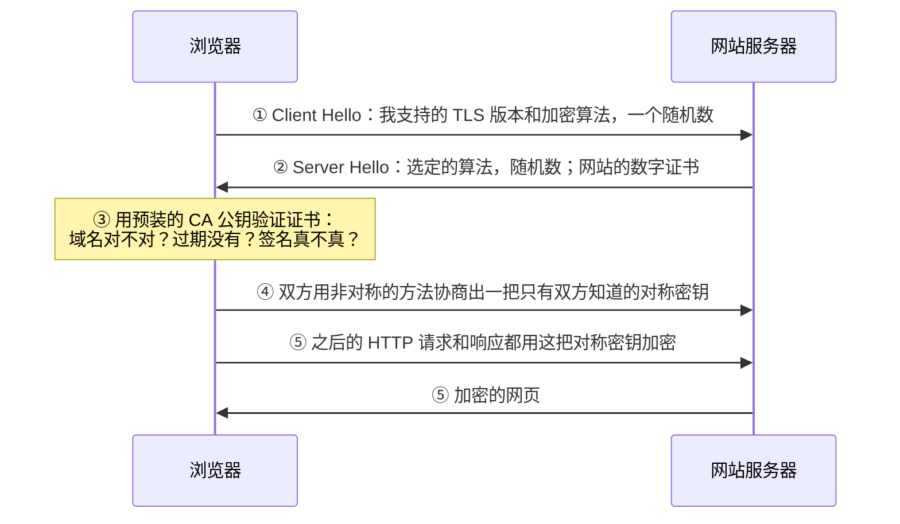
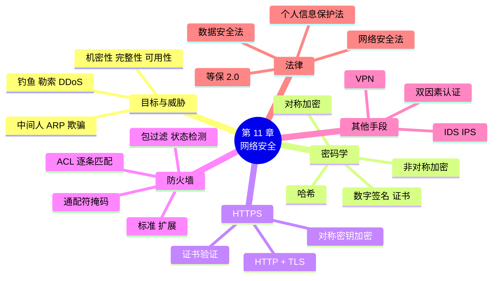

# 第 11 章 网络安全

!!! abstract "本章学时"
    理论 5 学时（线上 4 + 线下 1）· 实验 1 学时（本章共 3 个实验，★ 必做 2 个）

!!! danger "本章的底线"
    本章介绍的抓包、端口扫描、口令测试等方法，**只能在自己的设备、本书的实验文件或得到书面授权的网络中使用**。未经授权侵入、干扰他人网络或窃取数据是违法行为（11.6 节）。学安全是为了防守。

## 学习目标

学完本章，你应该能够：

1. **说出**网络安全的三个基本目标，**识别**钓鱼、勒索软件、DDoS、中间人、ARP 欺骗等常见威胁（记忆、理解）；
2. **区分**对称加密和非对称加密，**解释**哈希、数字签名和数字证书各解决什么问题（理解）；
3. **说清** HTTPS 怎样保护数据，**查看**网站证书的关键信息（理解、应用）；
4. **读懂**访问控制列表的规则，按从上到下的顺序**判断**一个数据包被允许还是拒绝（应用）；
5. 在 Packet Tracer 中**配置**扩展 ACL，实现部门之间的访问控制（应用）；
6. **说出**我国网络安全相关法律的要点，养成良好的个人安全习惯（记忆、评价）。

!!! info "先修要求"
    学习本章前，你需要掌握：

    - [8.1 ARP](../08-arp-dhcp-nat/index.md#81)：ARP 请求和应答没有验证机制；
    - [9.1.3 常用端口号](../09-transport/index.md#913) 和 [10.1.1 应用层协议](../10-application/index.md#1011)：ACL 按端口号区分服务；
    - [10.3 HTTP](../10-application/index.md#103)：HTTP 是明文的；
    - [7.5 三层交换机](../07-routing/index.md#75)：实验 11-2 在三层交换机上配置 ACL；
    - [6.3 子网划分](../06-ip-address/index.md#63)：会根据子网掩码写出网段范围。

??? abstract "本章概念清单（31 个，点击查看定义和例子）"
    1. [机密性](../../appendix/glossary.md#g-机密性)
    2. [完整性](../../appendix/glossary.md#g-完整性)
    3. [可用性](../../appendix/glossary.md#g-可用性)
    4. [钓鱼](../../appendix/glossary.md#g-钓鱼)
    5. [勒索软件](../../appendix/glossary.md#g-勒索软件)
    6. [拒绝服务攻击 DDoS](../../appendix/glossary.md#g-拒绝服务攻击-DDoS)
    7. [中间人攻击](../../appendix/glossary.md#g-中间人攻击)
    8. [社会工程学](../../appendix/glossary.md#g-社会工程学)
    9. [加密](../../appendix/glossary.md#g-加密)
    10. [密钥](../../appendix/glossary.md#g-密钥)
    11. [对称加密](../../appendix/glossary.md#g-对称加密)
    12. [非对称加密](../../appendix/glossary.md#g-非对称加密)
    13. [公钥](../../appendix/glossary.md#g-公钥)
    14. [私钥](../../appendix/glossary.md#g-私钥)
    15. [哈希](../../appendix/glossary.md#g-哈希)
    16. [数字签名](../../appendix/glossary.md#g-数字签名)
    17. [数字证书](../../appendix/glossary.md#g-数字证书)
    18. [证书颁发机构](../../appendix/glossary.md#g-证书颁发机构)
    19. [TLS](../../appendix/glossary.md#g-TLS)
    20. [防火墙](../../appendix/glossary.md#g-防火墙)
    21. [包过滤防火墙](../../appendix/glossary.md#g-包过滤防火墙)
    22. [状态检测防火墙](../../appendix/glossary.md#g-状态检测防火墙)
    23. [访问控制列表](../../appendix/glossary.md#g-访问控制列表)
    24. [隐含拒绝](../../appendix/glossary.md#g-隐含拒绝)
    25. [标准 ACL](../../appendix/glossary.md#g-标准-ACL)
    26. [扩展 ACL](../../appendix/glossary.md#g-扩展-ACL)
    27. [入侵检测系统](../../appendix/glossary.md#g-入侵检测系统)
    28. [入侵防御系统](../../appendix/glossary.md#g-入侵防御系统)
    29. [VPN](../../appendix/glossary.md#g-VPN)
    30. [双因素认证](../../appendix/glossary.md#g-双因素认证)
    31. [网络安全等级保护制度](../../appendix/glossary.md#g-网络安全等级保护制度)

## 情景导入

周一早上，阿美收到一封邮件，发件人显示“小禾设计工作室 财务部”，标题是“【紧急】十月工资调整确认，今日下班前未确认将影响发放”。邮件里有一个按钮“立即登录确认”。阿美点了进去，页面和工作室内部网站长得一模一样，她输入了账号和密码，页面却提示“系统繁忙，请稍后再试”。

中午，陈姐发现阿美的邮箱给全部客户群发了一封“更换收款账号”的通知。幸好有客户打电话来核实，才没有造成损失。

老周查看了那封邮件：“你看，发件人名字写的是财务部，可真实的邮件地址后面是一串奇怪的域名；登录页面的网址也不是 www.xiaohe.com，而是在后面加了一长串。这叫钓鱼，骗你在假网站上交出密码。”

禾姐很着急：“那我们怎么防？财务部的电脑里有全部工资和合同，访客来工作室连 WiFi，会不会也能看到这些？”

老周说：“安全要从人和技术两方面一起做。人这边，学会识别钓鱼、密码别到处用同一个、开启双重验证；技术这边，网站要用 HTTPS 加密，网络里要设好规则，财务服务器只让财务部访问，访客的网络和内网隔开。今天我们一样一样来。”

本章我们先认识网络面临的威胁，再看加密、签名和证书这些安全工具是怎么回事，弄清 HTTPS 那把小锁的含义，最后在 Packet Tracer 中用访问控制列表把工作室的财务服务器保护起来。

## 11.1 网络安全要保护什么 { #111 }

### 11.1.1 三个基本目标（考点） { #1111 }

网络安全的目标常用三个词概括，合称 CIA<sup class="cite">[[1]](#ref11-1)</sup>：

| 目标 | 含义 | 被破坏的例子 | 主要手段 |
|---|---|---|---|
| [**机密性**](../../appendix/glossary.md#g-机密性 "信息只让有权限的人看到，主要靠加密和访问控制保证"){ .term } | 信息只让有权限的人看到 | 用 HTTP 登录，密码被抓包看到 | 加密、访问控制 |
| [**完整性**](../../appendix/glossary.md#g-完整性 "信息在传送和存储中没有被篡改，主要靠哈希和数字签名保证"){ .term } | 信息在传送和存储中没有被篡改 | 有人把邮件里的收款账号改了 | 哈希、数字签名 |
| [**可用性**](../../appendix/glossary.md#g-可用性 "有权限的人在需要时能正常使用信息和服务"){ .term } | 有权限的人需要时能正常使用 | 网站被大量请求冲垮，大家都打不开 | 备份、冗余、防 DDoS |

比喻：寄一封重要的信，机密性是“别人拆不开看不到”，完整性是“没人能偷偷改内容”，可用性是“邮局能正常送到”。除了这三个，还常提到**真实性**（确认对方真的是他声称的人）和**不可否认性**（发过的消息事后不能抵赖），这两点主要靠数字签名和证书实现。

### 11.1.2 常见威胁一览 { #1112 }

| 威胁 | 怎么回事 | 破坏了什么 | 怎么防 |
|---|---|---|---|
| [**钓鱼**](../../appendix/glossary.md#g-钓鱼 "冒充可信的单位或熟人，骗人点链接、输密码或转账的攻击"){ .term } | 冒充可信的单位或熟人，骗你点链接、输密码、转账 | 机密性 | 核对发件地址和网址；不点陌生链接；电话核实 |
| 病毒与木马 | 恶意程序混在软件、附件里，偷数据或远程控制电脑 | 机密性、完整性 | 只从正规渠道下载；安装安全软件；及时更新 |
| [**勒索软件**](../../appendix/glossary.md#g-勒索软件 "把受害者的文件加密，要求付款才给解密的恶意程序"){ .term } | 把你的文件加密，要你付钱才给解密 | 可用性 | 定期离线备份；及时打补丁；不开来路不明的附件 |
| [**拒绝服务攻击 DDoS**](../../appendix/glossary.md#g-拒绝服务攻击-DDoS "控制大量设备同时向目标发送请求，耗尽其资源或带宽，使正常用户无法使用"){ .term } | 控制大量设备同时向目标发请求，把服务器或带宽占满 | 可用性 | 运营商和云服务商的流量清洗、CDN 分担 |
| [**中间人攻击**](../../appendix/glossary.md#g-中间人攻击 "攻击者插在通信双方之间偷看或篡改数据"){ .term } | 攻击者插在通信双方之间，偷看或篡改数据 | 机密性、完整性 | HTTPS 和证书验证；不连可疑 WiFi |
| [**ARP 欺骗**](../../appendix/glossary.md#g-ARP-欺骗 "在局域网中冒充其他主机（常是网关）回答 ARP，使别人的数据先发到攻击者"){ .term } | 在局域网中冒充网关回答 ARP，让别人的数据都先经过自己 | 机密性、完整性 | 交换机上开启 ARP 防护；使用加密协议 |
| 口令破解 | 用常见密码字典或泄露的密码批量尝试登录 | 机密性 | 强口令、不重复使用、双重验证、限制尝试次数 |
| [**社会工程学**](../../appendix/glossary.md#g-社会工程学 "利用人的信任、恐惧、贪便宜等心理骗取信息或钱财的手段"){ .term } | 利用人的信任、恐惧、贪便宜心理骗取信息 | 全部 | 安全意识培训；涉及钱和密码的事一律多方核实 |

!!! note "ARP 欺骗为什么能成功"
    回忆 [8.1 节](../08-arp-dhcp-nat/index.md#81)：电脑收到 ARP 应答后会直接更新 ARP 缓存，并不验证回答者是不是真的网关。攻击者在同一个局域网里不停地发“192.168.8.1 的 MAC 是我”，同事电脑发给网关的数据就都先送到攻击者那里。这也是公共 WiFi 有风险的原因之一。

## 11.2 密码学的直观 { #112 }

### 11.2.1 对称加密：同一把钥匙 { #1121 }

[**加密**](../../appendix/glossary.md#g-加密 "用密钥把明文变成看不懂的密文的过程，反过来叫解密"){ .term }是把能读懂的明文变成看不懂的密文，**解密**是把密文还原成明文，加密和解密时用到的秘密参数叫[**密钥**](../../appendix/glossary.md#g-密钥 "加密和解密时使用的秘密参数"){ .term }。

[**对称加密**](../../appendix/glossary.md#g-对称加密 "加密和解密使用同一把密钥的加密方式，速度快但密钥难分发"){ .term }中，加密和解密用的是**同一把密钥**，就像家门钥匙：锁门和开门用同一把。常见的对称加密算法有 AES，以及我国的 SM4。

- 优点：速度快，适合加密大量数据；
- 缺点：**密钥怎么交给对方？**如果通过网络直接发过去，被人截获，加密就白做了。而且和 100 个人通信，就要管理 100 把不同的钥匙。

### 11.2.2 非对称加密：公钥上锁，私钥开锁 { #1122 }

[**非对称加密**](../../appendix/glossary.md#g-非对称加密 "使用一对密钥，公钥加密、私钥解密的加密方式，速度慢但公钥可公开"){ .term }中，每个人有一对密钥（考点）：

- [**公钥**](../../appendix/glossary.md#g-公钥 "非对称加密中公开给所有人的密钥，用于加密或验证签名"){ .term }：公开给所有人，用来**加密**；
- [**私钥**](../../appendix/glossary.md#g-私钥 "非对称加密中只有自己保管的密钥，用于解密或生成签名"){ .term }：只有自己保管，用来**解密**。

用公钥加密的数据，只有对应的私钥才能解开。这就像禾姐在工作室门口放了一排打开的挂锁（公钥），谁都可以拿一把；你把文件放进箱子，“咔”地锁上，之后连你自己也打不开，只有禾姐手里的钥匙（私钥）能打开。

常见的非对称加密算法有 RSA、椭圆曲线算法，以及我国的 SM2。非对称加密解决了“密钥怎么交给对方”的问题，但计算量大、速度慢，不适合加密大量数据。

| 比较项 | 对称加密 | 非对称加密 |
|---|---|---|
| 密钥 | 加密解密用同一把 | 公钥加密、私钥解密，一对 |
| 速度 | 快 | 慢 |
| 密钥分发 | 困难 | 公钥可以公开发布 |
| 典型算法 | AES、SM4 | RSA、SM2 |
| 主要用途 | 加密大量数据 | 交换对称密钥、数字签名 |

实际中两者**配合使用**：先用非对称加密安全地商定一把对称密钥，之后的大量数据用对称加密。HTTPS 就是这样做的（11.3 节）。

### 11.2.3 哈希：数据的“指纹” { #1123 }

[**哈希**](../../appendix/glossary.md#g-哈希 "把任意长度的数据算成固定长度的值，改动一点结果就完全不同且不能反推"){ .term }（也叫散列、杂凑）把任意长度的数据算成一个固定长度的值，叫哈希值或摘要。好的哈希算法有三个特点：

1. **长度固定**：不管输入一个字还是一部电影，输出长度都一样；
2. **一点不同，面目全非**：输入改动一个字，哈希值完全不同；
3. **不能反推**：从哈希值几乎不可能推算出原文。

哈希就像人的指纹：指纹能确认是不是这个人，但从指纹变不出人来。常见的哈希算法有 SHA-256 和我国的 SM3；MD5、SHA-1 已被发现严重缺陷，不能再用于安全用途。

用 Python 自带的 `hashlib` 计算两段只差一个字的文字的 SHA-256（`labs/ch11/lab11_1_hash.py`），**运行结果**：

```text
原文 A： 本月工资明细：小林 6800 元
指纹 A： ec5176f75a4687b4da73955fbbce51f3df74c682703345355e64fc31ad43267c
原文 B： 本月工资明细：小林 8800 元
指纹 B： 7bdcbfa1dbe962281b794af0b8f257d9e45007b09c42edb93671f5e87ae5b297
指纹长度： 64 个字符；再算一次 A： True
```

只改了一个数字，两个哈希值毫无相似之处。哈希的用途：

- **检查完整性**：软件官网公布安装包的哈希值，下载后算一下，一样就说明没被篡改；
- **保存密码**：网站数据库里不存密码原文，只存哈希值（还要加上随机数据），即使数据库泄露，攻击者也很难得到原始密码；
- [**数字签名**](../../appendix/glossary.md#g-数字签名 "发送方用私钥对数据的哈希值签名，接收方用其公钥验证，证明来源和完整性"){ .term }的基础（下一节）。

### 11.2.4 数字签名与数字证书 { #1124 }

**数字签名**用来证明“这份文件确实是某人发的，而且没有被改过”（考点）：

1. 禾姐对文件算出哈希值，再用**自己的私钥**对哈希值进行加密，得到签名，和文件一起发出；
2. 收到的人用**禾姐的公钥**解开签名，得到一个哈希值；再自己对文件算一遍哈希值；
3. 两个哈希值一样，说明文件确实来自禾姐（只有她有私钥），而且没被改过（改了哈希值就不同）。

注意方向：**加密**时用对方的公钥加密、对方用私钥解密；**签名**时用自己的私钥签名、别人用公钥验证。

新的问题来了：我怎么知道手里的“禾姐的公钥”真是禾姐的，而不是骗子冒充的？这就需要[**数字证书**](../../appendix/glossary.md#g-数字证书 "由 CA 签发、证明某个公钥属于某个主体（如网站域名）的电子文件"){ .term }。证书相当于网络上的“身份证”，由大家都信任的[**证书颁发机构**](../../appendix/glossary.md#g-证书颁发机构 "大家信任的、负责签发和管理数字证书的机构"){ .term }（CA）签发，内容包括：持有者是谁（如网站域名 `www.xiaohe.com`）、持有者的公钥、有效期、颁发机构，以及颁发机构的数字签名。

浏览器和操作系统里预装了一批受信任的 CA 的公钥。浏览器拿到网站的证书后，用 CA 的公钥验证证书上的签名：验证通过，说明证书是真的，里面的公钥确实属于这个域名。这就像公安局签发身份证，大家相信公安局，所以相信身份证上的信息。

<iframe class="sim-frame" src="../../sims/crypto/main.html" height="620" loading="lazy" title="对称与非对称加密"></iframe>

动画：“对称加密”页用同一把密钥加密、解密，试试用错的密钥会怎样；“非对称加密”页用禾姐的公钥加密，只有她的私钥能解开；“数字签名”页用私钥签名、公钥验证，再把文件改一个字，看验证是否通过。动画使用简化的教学算法。
{ .sim-caption }

!!! info "国产商用密码（了解）"
    我国制定了自己的商用密码算法标准：**SM2**（非对称加密和签名，基于椭圆曲线）、**SM3**（哈希，输出 256 位）<sup class="cite">[[7]](#ref11-7)</sup>、**SM4**（对称加密，分组长度 128 位）。金融、政务等重要领域正在推广使用。较新版本的 Python 中，如果底层的 OpenSSL 支持，可以用 `hashlib.new("sm3", 数据)` 计算 SM3 哈希值。

## 11.3 HTTPS 为什么安全 { #113 }

### 11.3.1 HTTPS = HTTP + TLS { #1131 }

[10.3 节](../10-application/index.md#103)说过，HTTP 是明文的。本书的抓包文件 `http_vs_https.pcap` 记录了在实验网络中，同一个登录表单分别用 HTTP 和 HTTPS 提交的过程（用户名 xiaolin，密码 Xh2026!，均为实验专用）。

**用 HTTP 提交**（第 5～18 帧）：在 Wireshark 中追踪第 8 帧所在的 TCP 流，请求原文一览无余：

```text
POST /login HTTP/1.1
Content-Type: application/x-www-form-urlencoded
Content-Length: 29
Host: www.xiaohe.com
……
user=xiaolin&password=Xh2026!          ← 用户名和密码，明文
```

任何能抓到这些数据的人（同一 WiFi 下做 ARP 欺骗的人、路上的某台设备）都能看到密码。

**用 HTTPS 提交**（第 23～37 帧）：

```text
帧  内容
23～25  TCP 三次握手，服务器端口 443
26      Client Hello（SNI=www.xiaohe.com）      ← 浏览器：我要访问这个网站，我支持这些加密方式
28      Server Hello, Change Cipher Spec, Application Data ……   ← 服务器选定 TLS 1.3 和加密算法，后面全部加密
30～34  Application Data                         ← 登录请求和响应，全是密文
35～37  连接释放
```

从第 28 帧起，内容都显示为 “Application Data”，看到的只是一串乱码，找不到密码。唯一能看出的是第 26 帧中的 SNI（要访问的域名 `www.xiaohe.com`），所以 HTTPS 保护的是**内容**，而不能隐藏“你访问了哪个网站”。

**HTTPS** 就是在 HTTP 和 TCP 之间加了一层 [**TLS**](../../appendix/glossary.md#g-TLS "传输层安全协议，在应用层和 TCP 之间提供身份验证、加密和完整性保护，前身是 SSL"){ .term }（传输层安全协议）<sup class="cite">[[2]](#ref11-2)</sup>，默认端口 443。TLS 的早期版本叫 SSL，所以人们也常说“SSL 证书”。

### 11.3.2 TLS 握手的直观 { #1132 }

TLS 握手把 11.2 节的三样工具都用上了，过程可以简化为：



| TLS 用到的工具 | 解决的问题 |
|---|---|
| 数字证书和 CA 签名 | 确认对方真的是 `www.xiaohe.com`，不是冒充的（防中间人） |
| 非对称密钥交换 | 在网上商定一把对称密钥，路上的人算不出来 |
| 对称加密 | 高速加密后面的大量数据（机密性） |
| 哈希、消息认证 | 发现数据在路上被篡改（完整性） |

在 TLS 1.3 中，服务器的证书本身也是加密传送的，所以在第 28 帧中看不到证书的内容。

### 11.3.3 浏览器上的锁和证书 { #1133 }

浏览器地址栏左边的锁形图标（新版 Chrome 改为“调整”图标）表示这个网站用了 HTTPS，并且证书验证通过。点击它，选择“连接是安全的” → “证书有效”，可以查看证书：

- **颁发给**：证书属于哪个域名，应该和地址栏中的域名一致；
- **颁发者**：哪个 CA 签发的；
- **有效期**：从哪天到哪天，过期的证书浏览器会报警。

如果浏览器提示“您的连接不是私密连接”，说明证书有问题：可能过期了、域名对不上，或者是自己做的证书，也可能有人在做中间人攻击。**在这种页面上不要输入账号密码**，更不要随便点“继续前往”。

!!! warning "有锁 ≠ 网站可信"
    锁只说明“你和这个网站之间的通信是加密的，网站确实拥有这个域名”。钓鱼网站也可以申请证书，地址栏同样显示锁。所以判断网站真假，首先要看**域名对不对**：`www.xiaohe.com.login-check.example` 的真正域名是 `login-check.example`，而不是 `xiaohe.com`。

## 11.4 防火墙与访问控制列表 { #114 }

### 11.4.1 防火墙 { #1141 }

[**防火墙**](../../appendix/glossary.md#g-防火墙 "放在网络边界、按规则决定哪些流量可以通过的设备或软件"){ .term }是放在网络边界上、按规则决定哪些流量能通过的设备或软件，就像小区门口的保安：按规定放行业主，拦住可疑的人。防火墙分为几类：

| 类型 | 检查什么 | 特点 |
|---|---|---|
| [**包过滤防火墙**](../../appendix/glossary.md#g-包过滤防火墙 "按每个数据包的地址、协议、端口号决定放行或拒绝的防火墙"){ .term } | 每个数据包的源 / 目的 IP 地址、协议、端口号 | 简单快速，路由器上的 ACL 就是这种 |
| [**状态检测防火墙**](../../appendix/glossary.md#g-状态检测防火墙 "记住连接状态，属于已建立连接的返回流量自动放行的防火墙"){ .term } | 在包过滤的基础上记住连接的状态，回来的包只要属于已建立的连接就放行 | 现在的主流，家用路由器默认也这样工作 |
| 应用层防火墙 | 检查应用层内容，如网址、网页里有没有攻击代码 | 能识别具体应用，如 Web 应用防火墙 WAF |

Windows 自带“Windows Defender 防火墙”，它是装在电脑上的主机防火墙。实验 9-2、10-3 中手机连不上电脑上的程序，就是被它拦住了。

### 11.4.2 访问控制列表 ACL（考点） { #1142 }

[**访问控制列表**](../../appendix/glossary.md#g-访问控制列表 "配置在路由器或三层交换机接口上的一组 permit/deny 规则，从上到下逐条匹配"){ .term }（ACL）是配置在路由器或三层交换机接口上的一组规则，每条规则说明“满足什么条件的数据包，允许（permit）还是拒绝（deny）”。

ACL 的匹配规则（考点）：

1. **从上到下逐条匹配**，一旦匹配到某一条，就按这条处理，后面的不再看；
2. 所有规则都不匹配时，按最后一条看不见的[**隐含拒绝**](../../appendix/glossary.md#g-隐含拒绝 "ACL 末尾看不见的 deny any 规则，前面都不匹配的数据包被拒绝"){ .term }（deny any）处理，所以一个 ACL 里至少要有一条 permit；
3. ACL 要**应用到接口**上才生效，并指明方向：`in`（进入接口时检查）或 `out`（离开接口时检查）。

Cisco 设备上的 ACL 分两种：

| 类型 | 编号 | 能检查什么 | 放在哪里 |
|---|---|---|---|
| [**标准 ACL**](../../appendix/glossary.md#g-标准-ACL "编号 1～99、只按源 IP 地址过滤的 ACL，应放在靠近目的地"){ .term } | 1～99 | 只看**源 IP 地址** | 靠近目的地（否则会把源主机去别处的流量也拦掉） |
| [**扩展 ACL**](../../appendix/glossary.md#g-扩展-ACL "编号 100～199、可按源和目的地址、协议、端口过滤的 ACL，应放在靠近源头"){ .term } | 100～199 | 源和目的 IP 地址、协议、端口号 | 靠近源头（尽早拦掉，节省带宽） |

ACL 中的地址用[**通配符掩码**](../../appendix/glossary.md#g-通配符掩码 "ACL 中表示地址范围的掩码，0 位必须匹配、1 位不管，等于 255.255.255.255 减子网掩码"){ .term }表示范围：通配符掩码中为 0 的位必须匹配，为 1 的位不管。它正好是子网掩码“反过来”（考点）：

| 网段 | 子网掩码 | 通配符掩码 | 写法 |
|---|---|---|---|
| 财务部 192.168.8.64/27 | 255.255.255.224 | 0.0.0.31 | `192.168.8.64 0.0.0.31` |
| 设计部 192.168.8.0/26 | 255.255.255.192 | 0.0.0.63 | `192.168.8.0 0.0.0.63` |
| 一台主机 | 255.255.255.255 | 0.0.0.0 | `host 192.168.8.131` |
| 任意地址 | — | 255.255.255.255 | `any` |

算法：通配符掩码 = 255.255.255.255 − 子网掩码。例如 255.255.255.255 − 255.255.255.224 = 0.0.0.31。[实验 8-2](../08-arp-dhcp-nat/index.md#8-2) 中配置 NAT 时写的 `access-list 1 permit 192.168.8.0 0.0.0.63` 就是一条标准 ACL。

!!! example "算一算：这个包能过吗？"
    工作室在服务器区的入口（三层交换机 VLAN 40 接口的 out 方向）配置了扩展 ACL 110：

    ```text
    access-list 110 permit ip 192.168.8.64 0.0.0.31 host 192.168.8.131      ← ① 财务部可以访问财务服务器
    access-list 110 deny   ip any host 192.168.8.131                         ← ② 其他人都不能访问财务服务器
    access-list 110 deny   ip 192.168.8.96 0.0.0.31 any                      ← ③ 访客不能进服务器区
    access-list 110 permit tcp any host 192.168.8.130 eq 80                  ← ④ 大家都能浏览内部网站
    access-list 110 permit icmp any any                                      ← ⑤ 允许 ping
    （隐含）deny ip any any
    ```

    判断下面的数据包：

    | 数据包 | 逐条匹配 | 结果 |
    |---|---|---|
    | 财务部 192.168.8.70 访问财务服务器 192.168.8.131 | 匹配 ① | 允许 |
    | 设计部 192.168.8.11 访问财务服务器 | ① 源地址不在财务部，不匹配；匹配 ② | 拒绝 |
    | 设计部 192.168.8.11 浏览内部网站 192.168.8.130 的 80 端口 | ①②③ 不匹配；匹配 ④ | 允许 |
    | 访客 192.168.8.100 浏览内部网站 | ①② 不匹配；匹配 ③ | 拒绝 |
    | 设计部 192.168.8.11 远程桌面连接 192.168.8.130（TCP 3389） | ①～⑤ 都不匹配 | 隐含拒绝 |

    如果把 ③ 和 ④ 的顺序对调，访客就能浏览内部网站了。**顺序很重要**：更具体的规则要放在前面。

<iframe class="sim-frame" src="../../sims/firewall-acl/main.html" height="600" loading="lazy" title="防火墙规则匹配"></iframe>

动画：选择源主机、目的主机和服务，看数据包怎样从上到下逐条与 ACL 规则比较，第一条匹配的规则决定放行还是拒绝；用“上移”“下移”调整规则顺序，看结果怎样变化。
{ .sim-caption }

### 11.4.3 入侵检测、入侵防御与 VPN { #1143 }

防火墙按规则“放行或拦截”，可是攻击常常藏在允许通过的流量里（比如访问网站的请求里夹带攻击代码）。

- [**入侵检测系统**](../../appendix/glossary.md#g-入侵检测系统 "分析网络流量，发现可疑行为时报警但不拦截的系统"){ .term }（IDS）：像监控摄像头，分析网络流量，发现可疑行为就报警，但自己不拦截；
- [**入侵防御系统**](../../appendix/glossary.md#g-入侵防御系统 "发现攻击时能当场拦截的系统"){ .term }（IPS）：像带保安的门禁，发现攻击当场拦截。

IDS/IPS 识别攻击的方法有两类：一是和已知攻击的“特征库”比对，像按通缉令认人；二是先学习网络平时的样子，发现明显异常就报警，比如半夜突然有大量数据往外传。

[**VPN**](../../appendix/glossary.md#g-VPN "虚拟专用网，通过公共网络建立加密隧道，让远程用户像在内网一样访问"){ .term }（虚拟专用网）：出差的员工在酒店、高铁上想访问工作室的内部网站，又不能把内部网站直接暴露在互联网上，怎么办？VPN 在员工电脑和工作室的 VPN 网关之间，通过互联网建立一条**加密的隧道**，员工的电脑就像接在工作室的局域网里一样。就像在公共道路上修了一条封闭的专用通道。公司、学校的“远程办公”“校外访问图书馆资源”用的就是 VPN。

!!! warning "注意"
    VPN 是单位为员工远程办公提供的技术手段。个人使用未经电信主管部门批准的方式跨境联网是违法行为，不要因为好奇去下载来路不明的“加速器”。

## 11.5 个人与小单位的安全习惯 { #115 }

技术再强，人这一环出问题也没用。下面这些习惯，每个人都应该做到：

| 习惯 | 怎么做 | 为什么 |
|---|---|---|
| 强口令、不重复 | 至少 12 位，混合大小写字母、数字和符号，或用一句话做密码；重要账号各用各的密码；用密码管理器记 | 一个网站泄露，攻击者会拿同样的密码去试其他网站（撞库） |
| 开启[**双因素认证**](../../appendix/glossary.md#g-双因素认证 "登录时除密码外还需第二种凭证（短信验证码、手机确认、安全密钥）的认证方式"){ .term } | 登录时除了密码，还要短信验证码、手机 App 确认或安全密钥 | 密码被偷了，攻击者也登不上 |
| 及时更新 | 系统、浏览器、路由器固件的安全更新尽快装 | 很多攻击利用的是早已修复的漏洞 |
| 定期备份 | 重要文件按“3-2-1”备份：3 份副本、2 种介质、1 份离线或异地 | 被勒索软件加密后还能恢复 |
| 小心公共 WiFi | 不连没有密码、名字可疑的热点；在公共 WiFi 下不登录网银等重要账号，或改用手机流量 | 可能是攻击者开的假热点，或有人在做 ARP 欺骗 |
| 识别钓鱼 | 看真实发件地址和链接的真实域名；涉及转账、改账号、要密码的消息，一律打电话核实 | 钓鱼是最常见的入侵起点 |
| 管理员账号 | 路由器、摄像头等设备第一时间改掉默认密码 | 默认密码网上都查得到 |

识别钓鱼邮件和短信的“五看”：一看发件人真实地址；二看链接真实域名（鼠标悬停或长按查看）；三看是否制造紧迫感（“今日内”“否则冻结”）；四看是否索要密码、验证码或要求转账；五看附件类型（`.exe`、`.scr`、带宏的文档要特别警惕）。实验 11-3 有 10 道闯关题。

## 11.6 法律与规范 { #116 }

我国网络安全方面的主要法律（考点）：

| 法律 | 施行时间 | 要点 |
|---|---|---|
| 《中华人民共和国网络安全法》<sup class="cite">[[3]](#ref11-3)</sup> | 2017 年 6 月 1 日（2025 年 10 月修正，2026 年 1 月 1 日起施行修正后的版本） | 网络运营者要履行安全保护义务；实行网络安全等级保护制度；网络实名制；关键信息基础设施重点保护；修正后增加了人工智能安全与发展的条款，加大了对违法行为的处罚 |
| 《中华人民共和国数据安全法》<sup class="cite">[[4]](#ref11-4)</sup> | 2021 年 9 月 1 日 | 数据分类分级保护；重要数据的管理；开展数据处理活动要履行安全保护义务 |
| 《中华人民共和国个人信息保护法》<sup class="cite">[[5]](#ref11-5)</sup> | 2021 年 11 月 1 日 | 处理个人信息要“告知—同意”，遵循最小必要原则；敏感个人信息（如人脸、身份证号、行踪）要单独同意；禁止“大数据杀熟” |

[**网络安全等级保护制度**](../../appendix/glossary.md#g-网络安全等级保护制度 "我国按重要程度把信息系统分为五个安全保护等级、分级保护的制度，现行标准称“等保 2.0”"){ .term }（简称“等保”）把信息系统按重要程度分为五个安全保护等级，等级越高要求越严；2019 年发布的国家标准 GB/T 22239—2019 被称为“等保 2.0”<sup class="cite">[[6]](#ref11-6)</sup>，把云计算、移动互联、物联网等也纳入了保护范围。单位的业务系统上线前，通常要按等级完成定级、备案和测评。

作为学习者，最重要的一条是：**只测试自己有权限的网络和设备**。在学校实验室、自己家里的网络或 Packet Tracer 中练习是可以的；未经授权扫描、入侵他人的网站和设备，即使“只是试试”、没有造成损失，也可能构成违法甚至犯罪。参加网络安全竞赛和渗透测试工作，都要在授权的范围内进行。

## 11.7 本章常见问题对照 { #117 }

| 现象 | 用大白话说 | 怎么查、怎么改 |
|---|---|---|
| 浏览器提示“您的连接不是私密连接” | 网站证书有问题：过期、域名不符、不受信任，或有人在中间冒充 | 不要输入密码；检查电脑时间是否正确；换网络再试；联系网站管理员 |
| 配置 ACL 后所有流量都不通了 | 忘了隐含拒绝：规则里只有 deny，没有 permit | 在最后加上需要放行的 permit 规则 |
| ACL 配好了但没有效果 | 没有应用到接口，或方向（in/out）、接口选错了 | `show ip interface` 看接口上应用了哪个 ACL；`show access-lists` 看每条规则的匹配次数 |
| ACL 拦掉了不该拦的流量 | 规则顺序不对，或通配符掩码写错，范围太大 | 更具体的规则放前面；用“255.255.255.255 − 子网掩码”核对通配符掩码 |
| 账号在异地登录、群发了奇怪的消息 | 密码泄露了，很可能是钓鱼或撞库 | 立即改密码（其他用同样密码的账号也改）；开启双因素认证；通知联系人 |
| 文件全部打不开，出现要求付款的说明 | 中了勒索软件 | 立即拔网线，防止扩散；不要付款；报告管理员和公安机关；从备份恢复 |
| 手机连不上电脑上运行的程序 | 电脑的主机防火墙拦截了 | 允许该程序通过“专用网络”；测试完关闭 |

## 11.8 AI 与网络：AI 让攻击和防守都升级了 { #118 }

AI 给网络安全带来了新的挑战：

- **更像真的钓鱼邮件**：过去的钓鱼邮件常有错别字、语句不通，一眼能看出来。现在用大模型可以批量生成语句通顺、针对具体公司和职位“量身定做”的钓鱼邮件，靠“看文笔”已经不够了，必须核对发件地址和链接域名；
- **换脸、变声诈骗**：骗子用 AI 合成熟人或领导的脸和声音，打视频电话要求转账。应对办法是：涉及钱的事，用另一个渠道（比如打对方原来的电话号码）核实；可以问一个只有双方知道的问题，或者要求对方做一些动作；
- **针对 AI 应用本身的攻击**：在网页或文件里藏一段文字，诱导读取它的 AI 助手执行攻击者的指令，叫“提示词注入”。所以 AI 助手读到的网页、邮件内容，不能当成用户的命令执行。

AI 同样是防守方的好帮手：

- **异常流量检测**：用机器学习模型学习网络正常时的流量规律（什么时间、哪些主机、多大流量），发现偏离规律的行为就报警，能发现特征库里还没有的新型攻击；
- **钓鱼和垃圾邮件过滤**：邮箱服务商用 AI 模型综合判断邮件的内容、链接、发件来源，拦截绝大多数钓鱼邮件；
- **安全运营助手**：安全人员面对海量告警，可以让 AI 先归类、总结、给出处置建议，提高效率。

这些检测模型怎样训练，是《机器学习》《深度学习与神经网络》课程的内容。

## 本章实验

!!! abstract "实验总览"
    | 实验 | 类型 | 建议时长 | 内容 |
    |---|---|---|---|
    | 实验 11-1 | ★ 必做 | 25 分钟 | 看懂证书，对比 HTTP 明文和 HTTPS 密文 |
    | 实验 11-2 | ★ 必做 | 25 分钟 | 在 Packet Tracer 中用 ACL 保护财务部 |
    | 实验 11-3 | ☆ 选做 | 20 分钟 | 钓鱼识别闯关（在线练习） |

    实验 11-1 使用本书的抓包文件 `http_vs_https.pcap`（编者在隔离的实验网络中录制，账号密码均为实验专用）；哈希程序在 `labs/ch11/`，书中的运行结果是编者实际运行得到的。浏览器证书窗口和 Packet Tracer 的显示为**输出格式示意**。

### 实验 11-1 ★ 看懂证书，对比 HTTP 明文和 HTTPS 密文 { #11-1 }

**实验目的**

1. 在浏览器中查看网站证书的颁发对象、颁发者和有效期；
2. 在抓包文件中找到 HTTP 明文传送的密码，确认 HTTPS 中看不到；
3. 体会哈希的“指纹”特性。

**实验环境**：Chrome 或 Edge 浏览器；Wireshark 4.x；Python（第三档用）。

**实验数据**：`labs/data/pcap/http_vs_https.pcap`（37 帧：第 1～18 帧用 HTTP 登录，第 19～37 帧用 HTTPS 登录）。

**实验步骤**

第一档 · 跑通：

1. 用浏览器打开学校官网或任意一个常用的 HTTPS 网站，点地址栏左边的图标 → “连接是安全的” → “证书有效”，记录证书的“颁发给”“颁发者”“有效期”。再看一个网站，填写记录表。
2. 用 Wireshark 打开 `http_vs_https.pcap`，输入过滤器 `http.request.method == "POST"`，只剩第 10 帧。展开 “HTML Form URL Encoded”，找到 user 和 password 两个字段的值。
3. 右击第 10 帧 → 追踪 → TCP 流，看到完整的请求和服务器的响应“登录成功”。
4. 输入过滤器 `tls`，查看第 26、28、31 帧。展开第 26 帧的 “Transport Layer Security” → Handshake Protocol: Client Hello → Extension: server_name，找到要访问的域名。再追踪第 31 帧的 TCP 流，看能否找到密码。

第二档 · 改一改：

1. 在第 28 帧中找到 Server Hello 里的 “Cipher Suite”（选定的加密算法）和 “supported_versions” 扩展中的版本号，记下来。
2. 用过滤器 `frame contains "Xh2026"` 搜索整个文件中包含密码的帧，看能找到几帧，分别是 HTTP 还是 HTTPS。

第三档 · 挑战（选做）：运行 `labs/ch11/lab11_1_hash.py`，把变量 `a` 改成你自己的一句话，`b` 改成只差一个标点的句子，比较两个哈希值。再把 `hashlib.sha256` 改成 `hashlib.md5`，看哈希值的长度变成多少（MD5 的输出是 32 个十六进制字符，已不安全，只用于对比）。

**实验记录表**

| 项目 | 结果 |
|---|---|
| 网站 1 的证书：颁发给 / 颁发者 / 有效期 | |
| 网站 2 的证书：颁发给 / 颁发者 / 有效期 | |
| HTTP 登录中看到的用户名和密码 | |
| HTTPS 登录中能看到的域名（SNI） | |
| HTTPS 中能否找到密码 | |
| Cipher Suite 和 TLS 版本 | |
| `frame contains "Xh2026"` 找到的帧号 | |

**常见问题排查**

| 现象 | 原因 | 解决 |
|---|---|---|
| 过滤器输入后变红 | 语法错误，比如引号用了中文引号 | 使用英文双引号 |
| 第 26 帧协议显示为 TLSv1 | Client Hello 的外层版本号为了兼容写成旧版本，真正的版本在 supported_versions 扩展里 | 正常现象，看第 28 帧的选定版本 |
| 浏览器里找不到“证书有效” | 浏览器版本不同，菜单位置不同 | 在网页上按 F12 → “安全”（Security）选项卡 → “查看证书” |

**思考与练习**

1. HTTPS 能隐藏你访问的网站域名吗？从抓包结果说明你的判断。
2. 如果有人在公共 WiFi 下抓到了你用 HTTP 登录的数据包，可能造成什么后果？

**实验报告要求**：提交两个网站的证书截图、第 10 帧表单字段截图、HTTPS 追踪流截图和记录表。

### 实验 11-2 ★ 用 ACL 保护财务部 { #11-2 }

**实验目的**

1. 在三层交换机上配置扩展 ACL 并应用到 VLAN 接口；
2. 实现“只有财务部能访问财务服务器、访客不能进入服务器区”；
3. 用 `show access-lists` 查看规则的匹配次数，体会规则顺序的作用。

**实验环境**：Cisco Packet Tracer。

**实验数据**：无。

**拓扑与地址规划**

```text
                              S1（3560 三层交换机）
     PC0 设计部 ──── Fa0/1  VLAN 10   网关 192.168.8.1/26
     PC1 财务部 ──── Fa0/2  VLAN 20   网关 192.168.8.65/27
     PC2 访客   ──── Fa0/3  VLAN 30   网关 192.168.8.97/27
     Server0 内部网站 ── Fa0/10 ┐
     Server1 财务服务器 ─ Fa0/11 ┘ VLAN 40   网关 192.168.8.129/29
```

| 设备 | IP 地址 | 子网掩码 | 网关 |
|---|---|---|---|
| PC0（设计部） | 192.168.8.11 | 255.255.255.192 | 192.168.8.1 |
| PC1（财务部） | 192.168.8.70 | 255.255.255.224 | 192.168.8.65 |
| PC2（访客） | 192.168.8.100 | 255.255.255.224 | 192.168.8.97 |
| Server0（内部网站） | 192.168.8.130 | 255.255.255.248 | 192.168.8.129 |
| Server1（财务服务器） | 192.168.8.131 | 255.255.255.248 | 192.168.8.129 |

地址沿用第 6 章的规划。

**实验步骤**

第一档 · 跑通：

1. 按拓扑放设备、连线，按表格配置 5 台终端的地址和网关。在 S1 上创建 VLAN、划分接口、配置 VLAN 接口并开启路由（方法同[实验 7-1](../07-routing/index.md#7-1) 的挑战部分）：

```text
S1(config)#vlan 10
S1(config-vlan)#vlan 20
S1(config-vlan)#vlan 30
S1(config-vlan)#vlan 40
S1(config-vlan)#exit
S1(config)#interface fa0/1
S1(config-if)#switchport mode access
S1(config-if)#switchport access vlan 10
S1(config-if)#interface fa0/2
S1(config-if)#switchport mode access
S1(config-if)#switchport access vlan 20
S1(config-if)#interface fa0/3
S1(config-if)#switchport mode access
S1(config-if)#switchport access vlan 30
S1(config-if)#interface range fa0/10 - 11
S1(config-if-range)#switchport mode access
S1(config-if-range)#switchport access vlan 40
S1(config-if-range)#exit
S1(config)#interface vlan 10
S1(config-if)#ip address 192.168.8.1 255.255.255.192
S1(config-if)#interface vlan 20
S1(config-if)#ip address 192.168.8.65 255.255.255.224
S1(config-if)#interface vlan 30
S1(config-if)#ip address 192.168.8.97 255.255.255.224
S1(config-if)#interface vlan 40
S1(config-if)#ip address 192.168.8.129 255.255.255.248
S1(config-if)#exit
S1(config)#ip routing                              ← 开启路由功能
```

2. **配置 ACL 之前**，从 PC0、PC1、PC2 分别 ping 192.168.8.131 和 192.168.8.130，应该**全部能通**。这说明访客也能访问财务服务器，必须加以控制。
3. 在 S1 上配置扩展 ACL 110，并应用到 VLAN 40 接口的 out 方向（数据离开交换机、进入服务器区时检查）：

```text
S1(config)#access-list 110 permit ip 192.168.8.64 0.0.0.31 host 192.168.8.131   ← ① 财务部 → 财务服务器
S1(config)#access-list 110 deny ip any host 192.168.8.131                        ← ② 其他人 → 财务服务器：拒绝
S1(config)#access-list 110 deny ip 192.168.8.96 0.0.0.31 any                     ← ③ 访客 → 服务器区：拒绝
S1(config)#access-list 110 permit tcp any host 192.168.8.130 eq 80               ← ④ 浏览内部网站
S1(config)#access-list 110 permit icmp any any                                   ← ⑤ 允许 ping
S1(config)#interface vlan 40
S1(config-if)#ip access-group 110 out                                            ← 应用到接口，方向 out
S1(config-if)#end
```

4. 再测试，填写记录表：PC1 ping 192.168.8.131 **通**；PC0 ping 192.168.8.131 **不通**（显示 “Destination host unreachable”）；PC2 ping 192.168.8.130 **不通**；PC0 ping 192.168.8.130 通，用 PC0 的 Web Browser 打开 `http://192.168.8.130` 能打开。
5. 在 S1 上执行 `show access-lists`，看每条规则匹配了多少次（**输出格式示意**）：

```text
Extended IP access list 110
    10 permit ip 192.168.8.64 0.0.0.31 host 192.168.8.131 (4 match(es))
    20 deny ip any host 192.168.8.131 (4 match(es))
    30 deny ip 192.168.8.96 0.0.0.31 any (4 match(es))
    40 permit tcp any host 192.168.8.130 eq www (6 match(es))
    50 permit icmp any any (4 match(es))
```

   每条规则前面的 10、20、30……是序号，括号里是匹配次数。

第二档 · 改一改：

1. 用 `no access-list 110` 删除整个 ACL，按 ①②④③⑤ 的顺序（把 ③ 和 ④ 对调）重新输入。再用 PC2 的浏览器访问 `http://192.168.8.130`，能否打开？说明原因，然后改回正确的顺序。
2. 新需求：设计部也不能 ping 服务器区，但仍然能浏览内部网站。应该在哪个位置插入一条什么规则？（提示：`deny icmp 192.168.8.0 0.0.0.63 any`，要放在 ⑤ 之前。）

第三档 · 挑战（选做）：在 Server1 上开启 FTP 服务（Services → FTP），只允许财务部访问；再给 S1 配置一个标准 ACL，限制只有设计部的 PC0 能通过 Telnet 或 SSH 远程登录 S1（提示：标准 ACL 用 `access-class` 命令应用到 `line vty 0 4` 上）。

**实验记录表**

| 测试 | 配置 ACL 前 | 配置 ACL 后 | 是否符合要求 |
|---|---|---|---|
| PC1（财务部）ping 财务服务器 .131 | | | |
| PC0（设计部）ping 财务服务器 .131 | | | |
| PC2（访客）ping 内部网站 .130 | | | |
| PC0 用浏览器打开内部网站 | | | |
| PC2 用浏览器打开内部网站 | | | |
| 对调 ③④ 后 PC2 打开内部网站 | — | | |

**常见问题排查**

| 现象 | 原因 | 解决 |
|---|---|---|
| 配置 ACL 前不同 VLAN 之间也不通 | 没开 `ip routing`；终端网关写错；VLAN 接口没有地址 | `show ip interface brief` 检查 VLAN 接口状态；核对网关 |
| 配置 ACL 后谁都访问不了服务器 | 只写了 deny，缺少 permit；或通配符掩码写成了子网掩码 | `show access-lists` 核对规则 |
| ACL 没有效果，访客还能访问 | 没有 `ip access-group`，或应用到了错误的接口、方向 | `show running-config` 查看 interface vlan 40 下是否有 `ip access-group 110 out` |
| 想修改中间某一条规则 | 编号 ACL 不能直接改中间某一条 | 删除整个 ACL 重新输入；或用 `ip access-list extended 110` 进入后按序号删除、插入 |

**思考与练习**

1. 为什么规则 ② 必须放在规则 ① 之后？如果顺序反过来会怎样？
2. 这个 ACL 应用在 VLAN 40 接口的 out 方向。如果改为应用在 VLAN 30 接口的 in 方向，用来限制访客，规则应该怎样写？

**实验报告要求**：提交拓扑截图、ACL 配置截图、配置前后的 ping 测试截图、`show access-lists` 截图和记录表。

### 实验 11-3 ☆ 钓鱼识别闯关 { #11-3 }

**实验目的**

1. 根据发件地址、链接域名、内容特征判断邮件和短信的真假；
2. 养成“看域名、不慌张、多核实”的习惯。

**实验环境**：浏览器。

**实验数据**：[钓鱼识别闯关](../../sims/phishing-quiz/main.html)（10 道题，邮件和短信都是编者虚构的，其中的单位名称和网址均不对应真实机构）。

**实验步骤**

第一档 · 跑通：打开闯关页面，逐题判断“可信”还是“钓鱼”，每题提交后查看解析，记录自己判断错误的题目和原因。

第二档 · 改一改：对于判断为钓鱼的每一题，写出你识别的依据，按“五看”（11.5 节）归类：属于发件人、链接域名、紧迫感、索要信息、附件中的哪一类。

第三档 · 挑战（选做）：把自己或家人手机里收到过的可疑短信（**先把姓名、手机号等个人信息打码**）整理成一道题，写出判断依据，在小组内交换判断。

**实验记录表**

| 题号 | 我的判断 | 正确答案 | 识别依据（五看中的哪一类） |
|---|---|---|---|
| | | | |
| | | | |
| 总分 | | | |

**思考与练习**

1. 有一封邮件，链接是 HTTPS 的，浏览器也显示了锁，它一定是可信的吗？为什么？
2. 如果你不小心在钓鱼网站上输入了密码，应该马上做哪些事？

**实验报告要求**：提交闯关得分截图和记录表。

## 本章小结

- 网络安全的三个基本目标：**机密性**、**完整性**、**可用性**。常见威胁：**钓鱼**、病毒木马、**勒索软件**、**拒绝服务攻击 DDoS**、**中间人攻击**、**ARP 欺骗**、口令破解、**社会工程学**。
- **对称加密**加密解密用同一把**密钥**，快，但密钥难分发（AES、SM4）；**非对称加密**用**公钥**加密、**私钥**解密，慢，但公钥可以公开（RSA、SM2）。实际中两者配合使用。
- **哈希**把数据算成固定长度的“指纹”，改一点就完全不同、不能反推（SHA-256、SM3），用于检查完整性和保存密码。
- **数字签名**：用自己的私钥签名，别人用公钥验证，证明来源和完整性。**数字证书**由 **CA** 签发，证明公钥属于某个域名。
- **HTTPS** = HTTP + **TLS**，端口 443：用证书验证网站身份，用非对称方法商定对称密钥，再用对称加密传数据。HTTPS 保护内容，不隐藏访问的域名；有锁不等于网站可信。
- **防火墙**分包过滤、状态检测、应用层防火墙。**访问控制列表 ACL** 从上到下逐条匹配，第一条匹配的规则生效，最后有隐含拒绝；要应用到接口并指明 in/out。**标准 ACL**（1～99）只看源地址，放在靠近目的地；**扩展 ACL**（100～199）看源、目的地址、协议和端口，放在靠近源头。**通配符掩码** = 255.255.255.255 − 子网掩码。
- **入侵检测系统**只报警，**入侵防御系统**能拦截；**VPN** 通过加密隧道让出差员工安全访问内网。
- 好习惯：强口令不重复、**双因素认证**、及时更新、3-2-1 备份、慎用公共 WiFi、识别钓鱼。法律：《网络安全法》《数据安全法》《个人信息保护法》，等保 2.0；只测试自己有权限的网络。



**下一章预告**

一年下来，小禾设计工作室的网络从几台电脑发展到了三个部门、一家分店，有交换机、路由器、无线、服务器和防火墙规则。网络越来越大，问题也来了：某天下午设计部突然上不了网，该从哪里查起？几十台设备，管理员怎样知道它们是否正常？软件定义网络、5G、物联网又会怎样改变网络？最后一章，我们学习网络管理和故障排查的方法，并完成一份完整的工作室组网方案。

## 参考文献

正文中的上标编号（如<sup class="cite">[[1]](#ref11-1)</sup>）对应下面的文献。带链接的可以直接打开；书籍、法律和国家标准可在图书馆、国家法律法规数据库和国家标准全文公开系统查阅。

<div class="refs" markdown>

**教材与专著**

- <span id="ref11-1"></span>[1] 谢希仁. 计算机网络[M]. 8 版. 北京: 电子工业出版社, 2021.
    <span class="ref-note">第 7 章“网络安全”：安全威胁、密码体制、数字签名、鉴别、密钥分配、运输层安全协议、防火墙与入侵检测，对应本章 11.1～11.4 节。</span>

**国际标准**

- <span id="ref11-2"></span>[2] RESCORLA E. RFC 8446: The Transport Layer Security (TLS) Protocol Version 1.3[S/OL]. IETF, 2018[2026-11-01]. <https://www.rfc-editor.org/rfc/rfc8446>.
    <span class="ref-note">TLS 1.3 的标准，规定了握手过程、密钥交换和加密传送，对应 11.3 节。</span>
**法律**

- <span id="ref11-3"></span>[3] 中华人民共和国网络安全法[Z]. 2016-11-07 通过, 2025-10-28 修正.
    <span class="ref-note">2017 年 6 月 1 日施行；修正后的版本自 2026 年 1 月 1 日起施行，新增人工智能相关条款并加大处罚力度（据国家互联网信息办公室网站 2026 年 1 月 5 日刊发的解读文章），对应 11.6 节。</span>
- <span id="ref11-4"></span>[4] 中华人民共和国数据安全法[Z]. 2021-06-10 通过.
    <span class="ref-note">2021 年 9 月 1 日施行，对应 11.6 节。</span>
- <span id="ref11-5"></span>[5] 中华人民共和国个人信息保护法[Z]. 2021-08-20 通过.
    <span class="ref-note">2021 年 11 月 1 日施行，对应 11.6 节。</span>

**国家标准**

- <span id="ref11-6"></span>[6] 国家市场监督管理总局, 中国国家标准化管理委员会. 信息安全技术 网络安全等级保护基本要求: GB/T 22239—2019[S]. 北京: 中国标准出版社, 2019.
    <span class="ref-note">即“等保 2.0”的基本要求标准，对应 11.6 节。</span>
- <span id="ref11-7"></span>[7] 国家质量监督检验检疫总局, 中国国家标准化管理委员会. 信息安全技术 SM3 密码杂凑算法: GB/T 32905—2016[S]. 北京: 中国标准出版社, 2016.
    <span class="ref-note">SM3 哈希算法的国家标准，对应 11.2 节“国产商用密码”。</span>

</div>

## 课后练习

选择题和判断题可以直接点击选项作答，系统会马上告诉你对错，并展开答案与解析；多选题选好后点“提交答案”。简答和实操题请先自己作答，再点开“答案与解析”核对。每道题的解析下方都有“回看”链接，做错了可以直接跳回正文复习。

**一、单项选择题**

<div class="quiz" data-answer="C" markdown>

**1.** 黑客控制大量设备同时访问工作室网站，使正常用户无法打开网站。这主要破坏了信息安全的（　　）。

- A. 机密性
- B. 完整性
- C. 可用性
- D. 不可否认性

</div>

??? tip "答案与解析"
    **答案：C**

    这是拒绝服务攻击（DDoS），让有权限的人无法正常使用服务，破坏的是可用性。

    考查：安全目标与威胁 · 认知层次：理解 · [回看 11.1.1](#1111)
    { .quiz-meta }

<div class="quiz" data-answer="B" markdown>

**2.** 下列关于对称加密的说法，正确的是（　　）。

- A. 加密和解密使用一对不同的密钥
- B. 加密和解密使用同一把密钥，速度快
- C. 公钥可以公开发布，解决了密钥分发问题
- D. 典型算法是 RSA 和 SM2

</div>

??? tip "答案与解析"
    **答案：B**

    A、C、D 描述的都是非对称加密。对称加密的典型算法是 AES、SM4。

    考查：对称加密 · 认知层次：理解 · [回看 11.2.1](#1121)
    { .quiz-meta }

<div class="quiz" data-answer="A" markdown>

**3.** 小林要给禾姐发一份机密文件，只希望禾姐能看到，他应该用（　　）加密。

- A. 禾姐的公钥
- B. 禾姐的私钥
- C. 小林的公钥
- D. 小林的私钥

</div>

??? tip "答案与解析"
    **答案：A**

    用对方的公钥加密，只有对方的私钥能解开。小林拿不到禾姐的私钥；用自己的私钥“加密”是签名，所有人都能用小林的公钥解开。

    考查：非对称加密 · 认知层次：应用 · [回看 11.2.2](#1122)
    { .quiz-meta }

<div class="quiz" data-answer="D" markdown>

**4.** 下列不属于哈希算法特点的是（　　）。

- A. 输出长度固定
- B. 输入改动一点，输出完全不同
- C. 很难从哈希值反推出原文
- D. 用密钥可以从哈希值还原出原文

</div>

??? tip "答案与解析"
    **答案：D**

    哈希是单向的，没有“解密”的说法。所以网站保存密码的哈希值，即使数据库泄露也很难得到原始密码。

    考查：哈希 · 认知层次：理解 · [回看 11.2.3](#1123)
    { .quiz-meta }

<div class="quiz" data-answer="C" markdown>

**5.** HTTPS 默认使用的端口号和在 HTTP 下面增加的协议分别是（　　）。

- A. 80，SSH
- B. 8080，TLS
- C. 443，TLS
- D. 443，IPsec

</div>

??? tip "答案与解析"
    **答案：C**

    HTTPS = HTTP + TLS，默认端口 443。

    考查：HTTPS · 认知层次：记忆 · [回看 11.3.1](#1131)
    { .quiz-meta }

<div class="quiz" data-answer="B" markdown>

**6.** 网段 192.168.8.64/27 在 ACL 中对应的通配符掩码是（　　）。

- A. 255.255.255.224
- B. 0.0.0.31
- C. 0.0.0.63
- D. 0.0.0.32

</div>

??? tip "答案与解析"
    **答案：B**

    /27 的子网掩码是 255.255.255.224，通配符掩码 = 255.255.255.255 − 255.255.255.224 = 0.0.0.31。

    考查：通配符掩码 · 认知层次：应用 · [回看 11.4.2](#1142)
    { .quiz-meta }

<div class="quiz" data-answer="A" markdown>

**7.** 编号为 1～99、只能根据源 IP 地址过滤的 ACL 是（　　）。

- A. 标准 ACL
- B. 扩展 ACL
- C. 命名 ACL
- D. 动态 ACL

</div>

??? tip "答案与解析"
    **答案：A**

    标准 ACL 1～99 只看源地址；扩展 ACL 100～199 能看源、目的地址、协议和端口号。

    考查：ACL 的类型 · 认知层次：记忆 · [回看 11.4.2](#1142)
    { .quiz-meta }

<div class="quiz" data-answer="D" markdown>

**8.** 出差员工需要通过互联网安全地访问公司内部网站，最合适的技术是（　　）。

- A. NAT
- B. DHCP
- C. IDS
- D. VPN

</div>

??? tip "答案与解析"
    **答案：D**

    VPN 在员工电脑和公司 VPN 网关之间建立加密隧道，员工就像接在公司局域网里一样。

    考查：VPN · 认知层次：理解 · [回看 11.4.3](#1143)
    { .quiz-meta }

**二、多项选择题**

<div class="quiz quiz-multi" data-answer="ABD" markdown>

**9.** 数字证书中通常包含（　　）。

- A. 持有者的名称（如网站域名）
- B. 持有者的公钥
- C. 持有者的私钥
- D. 有效期和颁发机构的签名

</div>

??? tip "答案与解析"
    **答案：ABD**

    私钥只能由持有者自己保管，绝不会出现在公开的证书里。

    考查：数字证书 · 认知层次：理解 · [回看 11.2.4](#1124)
    { .quiz-meta }

<div class="quiz quiz-multi" data-answer="ACD" markdown>

**10.** 下列做法中，能有效防范钓鱼和账号被盗的有（　　）。

- A. 核对邮件中链接的真实域名
- B. 所有网站使用同一个复杂密码，便于记忆
- C. 开启双因素认证
- D. 涉及转账、修改收款账号的消息，打电话核实

</div>

??? tip "答案与解析"
    **答案：ACD**

    多个网站共用一个密码，一个网站泄露后，攻击者会拿它去“撞库”登录其他网站。

    考查：安全习惯 · 认知层次：评价 · [回看 11.5](#115)
    { .quiz-meta }

<div class="quiz quiz-multi" data-answer="BC" markdown>

**11.** 关于 ACL 的匹配规则，正确的有（　　）。

- A. 数据包会与所有规则比较，以最后一条匹配的规则为准
- B. 从上到下逐条匹配，匹配到一条后就不再往下看
- C. 所有规则都不匹配时，数据包被拒绝
- D. ACL 配置好后自动作用于所有接口

</div>

??? tip "答案与解析"
    **答案：BC**

    第一条匹配的规则生效；末尾有隐含的 deny any；ACL 必须用 `ip access-group` 应用到具体接口并指定方向。

    考查：ACL 匹配规则 · 认知层次：理解 · [回看 11.4.2](#1142)
    { .quiz-meta }

**三、判断题**

<div class="quiz quiz-judge" data-answer="×" markdown>

**12.** 浏览器地址栏显示了锁形图标，说明这个网站是正规可信的网站。（　　）

</div>

??? tip "答案与解析"
    **答案：×**

    锁只说明通信是加密的、网站拥有这个域名的证书；钓鱼网站也可以申请证书。判断真假要看域名。

    考查：HTTPS 的局限 · 认知层次：评价 · [回看 11.3.3](#1133)
    { .quiz-meta }

<div class="quiz quiz-judge" data-answer="√" markdown>

**13.** 数字签名用发送方的私钥生成，接收方用发送方的公钥验证。（　　）

</div>

??? tip "答案与解析"
    **答案：√**

    只有发送方有私钥，所以签名能证明来源；验证时算出的哈希值一致，说明内容没被改过。

    考查：数字签名 · 认知层次：理解 · [回看 11.2.4](#1124)
    { .quiz-meta }

<div class="quiz quiz-judge" data-answer="×" markdown>

**14.** 使用 HTTPS 访问网站时，抓包者既看不到传送的内容，也看不到访问的是哪个网站。（　　）

</div>

??? tip "答案与解析"
    **答案：×**

    Client Hello 中的 SNI 字段是明文的，能看到访问的域名（实验文件第 26 帧就是例子）；内容是加密的。

    考查：HTTPS 抓包 · 认知层次：分析 · [回看 11.3.1](#1131)
    { .quiz-meta }

<div class="quiz quiz-judge" data-answer="√" markdown>

**15.** 入侵检测系统 IDS 发现可疑行为时报警，而入侵防御系统 IPS 可以当场拦截。（　　）

</div>

??? tip "答案与解析"
    **答案：√**

    IDS 像监控摄像头，IPS 像带保安的门禁。

    考查：IDS 与 IPS · 认知层次：理解 · [回看 11.4.3](#1143)
    { .quiz-meta }

<div class="quiz quiz-judge" data-answer="×" markdown>

**16.** 只要没有造成损失，出于学习目的扫描、测试别人的网站是允许的。（　　）

</div>

??? tip "答案与解析"
    **答案：×**

    未经授权扫描、入侵他人的网站和设备，即使没有造成损失，也可能违法。只能测试自己有权限的网络。

    考查：法律与规范 · 认知层次：评价 · [回看 11.6](#116)
    { .quiz-meta }

**四、简答题**

**17.** 说明 HTTPS 是怎样综合运用数字证书、非对称加密和对称加密来保证安全的。为什么不全部使用非对称加密？

??? tip "答案与解析"
    **参考答案：** ① 服务器把数字证书发给浏览器，浏览器用预装的 CA 公钥验证证书的签名、域名和有效期，确认对方确实是这个网站，防止中间人冒充；② 双方用非对称的方法协商出一把只有双方知道的对称密钥，路上的人无法算出；③ 之后的 HTTP 请求和响应都用这把对称密钥加密，并带有完整性校验。不全部用非对称加密，是因为它计算量大、速度慢，不适合加密大量数据；对称加密速度快，但需要安全地交换密钥，两者配合正好取长补短。

    考查：HTTPS 原理 · 认知层次：理解 · [回看 11.3.2](#1132)
    { .quiz-meta }

**18.** 某路由器接口上配置了如下 ACL（in 方向），判断下列数据包是允许还是拒绝，并说明匹配的是哪一条规则：

    access-list 120 deny   tcp 10.1.1.0 0.0.0.255 host 10.2.2.10 eq 3389
    access-list 120 permit tcp 10.1.1.0 0.0.0.255 host 10.2.2.10 eq 80
    access-list 120 permit icmp any any

（1）10.1.1.5 访问 10.2.2.10 的 TCP 80 端口；（2）10.1.1.5 访问 10.2.2.10 的 TCP 3389 端口；（3）10.1.3.7 ping 10.2.2.10；（4）10.1.3.7 访问 10.2.2.10 的 TCP 80 端口。

??? tip "答案与解析"
    **参考答案：**（1）允许，匹配第 2 条；（2）拒绝，匹配第 1 条（禁止远程桌面）；（3）允许，匹配第 3 条；（4）拒绝：源地址 10.1.3.7 不在 10.1.1.0/24 内，前两条都不匹配，第 3 条只允许 ICMP，最后按隐含的 deny any 拒绝。

    考查：ACL 规则匹配 · 认知层次：应用 · [回看 11.4.2](#1142)
    { .quiz-meta }

**19.** 阿美收到一封“财务部”发来的邮件，要求她点链接登录确认工资，她照做后账号被盗。请指出这封邮件可能有哪些可疑之处，并给出事后补救和今后预防的措施。

??? tip "答案与解析"
    **参考答案：** 可疑之处：发件人显示名是“财务部”，但真实邮件地址不是工作室的域名；链接的真实域名不是 `xiaohe.com`；“今日下班前未确认将影响发放”制造紧迫感；要求输入账号密码。补救：立即修改密码（其他使用相同密码的账号也要改），开启双因素认证，检查邮箱是否被设置了自动转发，通知同事和客户以免受骗，报告管理员。预防：核对发件地址和链接域名，不通过邮件链接登录，涉及工资、转账的事情电话核实，参加安全意识培训。

    考查：钓鱼与社会工程学 · 认知层次：分析 · [回看 11.5](#115)
    { .quiz-meta }

**五、实操题**

**20.** 工作室要求访客区（192.168.8.96/27）不能访问内网任何地址（192.168.8.0/24），但可以访问互联网。请写出一个扩展 ACL（编号 130），并写出把它应用到三层交换机 VLAN 30 接口的命令，说明应选择 in 还是 out 方向。

??? tip "答案与解析"
    **参考答案：**

    ```text
    access-list 130 deny ip 192.168.8.96 0.0.0.31 192.168.8.0 0.0.0.255
    access-list 130 permit ip any any
    interface vlan 30
     ip access-group 130 in
    ```

    访客的流量从 VLAN 30 接口进入三层交换机，所以用 in 方向，尽早拦截（扩展 ACL 靠近源头）。第二条 permit 不能少，否则隐含拒绝会把去互联网的流量也拦掉。注意：in 方向也会拦截访客 ping 自己的网关 192.168.8.97，如需允许，可在第一条之前加 `permit icmp 192.168.8.96 0.0.0.31 host 192.168.8.97`。

    考查：扩展 ACL 配置 · 认知层次：应用 · [回看实验 11-2](#11-2)
    { .quiz-meta }
