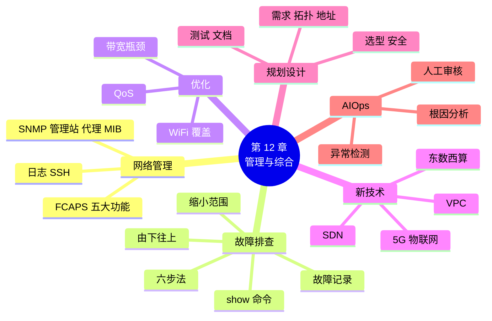

# 第 12 章 网络管理、新技术与综合项目

!!! abstract "本章学时"
    理论 5 学时（线上 4 + 线下 1）· 实验 1 学时（本章共 3 个实验，★ 必做 2 个；综合项目建议课外分组完成）

## 学习目标

学完本章，你应该能够：

1. **说出**网络管理的五大功能，**解释** SNMP 中管理站、代理和 MIB 的作用（记忆、理解）；
2. 按由下往上的顺序，**运用** ipconfig、ping、nslookup、tracert 和设备 show 命令**定位**常见网络故障（应用、分析）；
3. **说出** QoS、SDN、VPC、5G、物联网、算力网络等新技术解决什么问题（理解）；
4. 按“需求分析 → 拓扑设计 → 地址规划 → 设备选型 → 安全设计 → 测试验收 → 文档”的流程，**完成**一个小型网络的组网方案（创造）；
5. 用 Python **编写**简单的网络巡检工具（应用）。

!!! info "先修要求"
    本章是全书的总结和综合运用，需要用到前面各章的内容，特别是：

    - [实验 1-2 用 ping 测往返时间](../01-intro/index.md#1-2) 和 [8.2 ICMP](../08-arp-dhcp-nat/index.md#82)：ping 和 tracert 的原理；
    - [实验 6-2 为工作室规划 IP 地址](../06-ip-address/index.md#6-2)、[7.3 静态路由](../07-routing/index.md#73)：综合项目要用；
    - 第 5、8、10、11 章的 Packet Tracer 实验：VLAN、DHCP、NAT、服务器、ACL；
    - 《Python 编程》：会用字典、`for` 循环和函数。

??? abstract "本章概念清单（14 个，点击查看定义和例子）"
    1. [故障管理](../../appendix/glossary.md#g-故障管理)
    2. [配置管理](../../appendix/glossary.md#g-配置管理)
    3. [性能管理](../../appendix/glossary.md#g-性能管理)
    4. [安全管理](../../appendix/glossary.md#g-安全管理)
    5. [计费管理](../../appendix/glossary.md#g-计费管理)
    6. [SNMP](../../appendix/glossary.md#g-SNMP)
    7. [陷阱](../../appendix/glossary.md#g-陷阱)
    8. [由下往上](../../appendix/glossary.md#g-由下往上)
    9. [QoS](../../appendix/glossary.md#g-QoS)
    10. [软件定义网络 SDN](../../appendix/glossary.md#g-软件定义网络-SDN)
    11. [VPC](../../appendix/glossary.md#g-VPC)
    12. [5G](../../appendix/glossary.md#g-5G)
    13. [物联网](../../appendix/glossary.md#g-物联网)
    14. [智能运维](../../appendix/glossary.md#g-智能运维)

## 情景导入

周一早上九点，工作室群里炸开了锅。

阿美：“上不了网了！”陈姐：“我这边也是，网页打不开。”小周：“我的微信还能发消息，就是网页不行。”分店店员：“我们这边收银正常。”

小林这一年跟着老周学了不少，这次老周出差，禾姐让他来处理。小林一开始有点慌：几十台电脑，两台交换机，两个路由器，还有服务器和无线，从哪里查起？

他想起老周说过的话：“排查网络故障，别东一榔头西一棒子，要按层来。先看是一个人的问题还是大家的问题；再从最底层往上一层一层验证：线通不通、地址对不对、网关通不通、外网通不通、域名能不能解析。”

小林在自己电脑上依次试了一遍：网线灯亮着，ipconfig 地址正常，ping 网关通，ping 外网的 IP 地址也通，可是 nslookup 查域名超时了。“微信能用、网页不行，外网 IP 能通、域名查不了，问题在 DNS！”他跑到机柜前一看，DNS 服务器那台旧电脑因为周末停电，一直没有开机。开机后，五分钟内大家都恢复了。

禾姐很满意：“小林，你把这一年工作室网络的建设整理一下吧，从需求到拓扑、地址、配置、安全，写成一份完整的方案，以后新同事来了也能看懂。”

本章我们学习网络管理和故障排查的方法，浏览网络的新技术，最后完成全书的综合项目：小禾设计工作室的组网方案。

## 12.1 网络管理做什么 { #121 }

### 12.1.1 网络管理的五大功能 { #1211 }

网络建好之后，日常的管理工作通常分为五大功能<sup class="cite">[[1]](#ref12-1)</sup>（考点）：

| 功能 | 做什么 | 工作室里的例子 |
|---|---|---|
| [**故障管理**](../../appendix/glossary.md#g-故障管理 "网络管理功能之一：发现、定位、排除故障并记录处理过程"){ .term } | 发现、定位、排除故障，记录故障处理过程 | 周一早上 DNS 服务器没开机 |
| [**配置管理**](../../appendix/glossary.md#g-配置管理 "网络管理功能之一：记录、修改、备份设备配置，管理设备清单"){ .term } | 记录和修改设备配置，备份配置，管理设备清单 | 交换机配置改动前先备份 |
| [**性能管理**](../../appendix/glossary.md#g-性能管理 "网络管理功能之一：监控带宽利用率、时延、丢包等，找出瓶颈"){ .term } | 监控带宽利用率、时延、丢包，找出瓶颈 | 下午视频会议时出口带宽跑满 |
| [**安全管理**](../../appendix/glossary.md#g-安全管理 "网络管理功能之一：管理账号权限、ACL、防火墙，检查安全日志"){ .term } | 管理账号权限、ACL、防火墙，检查安全日志 | 财务服务器只允许财务部访问 |
| [**计费管理**](../../appendix/glossary.md#g-计费管理 "网络管理功能之一：统计用户或部门使用的网络资源"){ .term } | 统计每个用户或部门使用了多少资源 | 运营商按流量计费；公司内一般不需要 |

这五大功能按英文首字母简称 FCAPS。小单位不一定有专门的管理软件，但这五件事都要有人做、有记录。

### 12.1.2 SNMP：设备的“体检报告” { #1212 }

几十台设备，管理员不可能每天逐台登录查看。[**SNMP**](../../appendix/glossary.md#g-SNMP "简单网络管理协议，管理站通过 UDP 161 向设备上的代理查询状态，代理用 UDP 162 主动发送陷阱"){ .term }（简单网络管理协议）让管理员在一台电脑上集中查看和管理所有设备<sup class="cite">[[2]](#ref12-2)</sup>：

- **管理站**：管理员电脑上运行的网络管理软件，定期向各设备询问状态；
- **代理**：运行在交换机、路由器、服务器上的程序，回答管理站的询问；
- **MIB**（管理信息库）：规定了设备有哪些可以查询的信息，比如接口的收发字节数、CPU 利用率、开机时间；
- 管理站向代理查询用 UDP **161** 端口；设备发生重要事件（如接口断开）时，代理主动向管理站发送[**陷阱**](../../appendix/glossary.md#g-陷阱 "SNMP 代理在发生重要事件时主动发给管理站的报告"){ .term }（Trap）报告，用 UDP **162** 端口。

比喻：管理站像医院的护士站，代理像每个病房里的监护仪。护士站定时查看每台监护仪的读数（查询），病人情况异常时监护仪主动报警（陷阱）。

早期的 SNMP 版本用明文的“团体名”当密码，不安全；现在推荐使用支持认证和加密的 SNMPv3。

### 12.1.3 日志与远程管理 { #1213 }

**日志**是设备和服务器自动记下的“流水账”：什么时候哪个接口断开了、谁登录了设备、哪条 ACL 拦截了什么。出了问题，先看日志往往能最快找到线索。网络设备一般用 syslog 协议把日志集中发到一台日志服务器保存。

管理员需要远程登录交换机和路由器修改配置。[10.7.2 节](../10-application/index.md#1072)说过，Telnet 是明文的，应该用 **SSH**。在 Cisco 设备上开启 SSH 的配置如下（Packet Tracer 中可以照做）：

```text
R1(config)#hostname R1
R1(config)#ip domain-name xiaohe.com                      ← 生成密钥需要域名
R1(config)#crypto key generate rsa                        ← 生成 RSA 密钥对，提示长度时输入 1024
R1(config)#username admin secret Xh@admin2026             ← 管理员账号和密码  ← 改这里
R1(config)#line vty 0 4                                   ← 远程登录的虚拟线路
R1(config-line)#login local                               ← 用本地账号登录
R1(config-line)#transport input ssh                       ← 只允许 SSH，不允许 Telnet
R1(config-line)#end
```

然后在 PC 的命令提示符中执行 `ssh -l admin 192.168.8.1`，输入密码即可登录。

## 12.2 故障排查方法（考点） { #122 }

### 12.2.1 排查的基本思路 { #1221 }

排查网络故障的第一步，是**收集信息、缩小范围**：

1. **影响范围**：是一个人、一个部门，还是所有人？一个人的问题多在他的电脑和网线；一个部门的问题多在这个部门的交换机、VLAN 或网关；所有人的问题多在出口路由器、DNS、运营商；
2. **故障现象**：是什么都上不了，还是只有某些网站、某些应用不行？“微信能用、网页不行”这种细节非常有价值；
3. **什么时候开始的**：之前做过什么改动？停过电吗？很多故障是“昨天改了一下配置”引起的。

然后选择排查顺序，常用的有三种：

| 方法 | 怎么做 | 适合 |
|---|---|---|
| [**由下往上**](../../appendix/glossary.md#g-由下往上 "从物理层开始逐层往上验证的故障排查方法"){ .term } | 从物理层开始，逐层往上验证：线 → 地址 → 网关 → 路由 → DNS → 应用 | 最常用，初学者首选，不会漏掉 |
| 由上往下 | 从应用开始往下查 | 怀疑是某个应用的问题时 |
| 分段排查 | 用 ping、tracert 找出数据在哪一段断了，再集中查那一段 | 路径长、设备多的网络 |

### 12.2.2 命令组合：六步法 { #1222 }

在一台上不了网的 Windows 电脑上，按下面的顺序检查（考点）：

| 步骤 | 命令或动作 | 正常的结果 | 如果不正常，说明 |
|---|---|---|---|
| ① | 看网线、指示灯，WiFi 是否连上 | 灯亮；WiFi 已连接 | 物理层问题：网线、接口、网卡、无线信号 |
| ② | `ipconfig`（或 `ipconfig /all`） | 地址、掩码、网关、DNS 都正确 | 169.254.x.x：DHCP 没分到地址；网段不对：手工配置错误 |
| ③ | `ping 127.0.0.1` | 通 | 本机网络协议有问题（很少见），可重置网络设置 |
| ④ | `ping 网关地址` | 通 | 本地网络问题：网线、交换机、VLAN、网关地址写错 |
| ⑤ | `ping 外网 IP 地址` | 通 | 出口问题：路由、NAT、运营商线路；可用 `tracert` 看断在哪一跳 |
| ⑥ | `nslookup 域名` | 能解析出 IP 地址 | DNS 问题：DNS 服务器宕机或设置错误 |

六步都正常，网页还是打不开，就是应用层的问题了：浏览器设置了代理、网站本身出了故障（看状态码，[10.3.4 节](../10-application/index.md#1034)）、被防火墙或 ACL 拦截等。

!!! tip "ping 的几种失败提示"
    - “请求超时”：发出去了，但规定时间内没收到回复，可能是对方不在、对方防火墙不回应 ping，或者路上丢了；
    - “无法访问目标主机 / 目标网络”：路上某台路由器（或本机）明确告诉你“没有路去那里”，提示中会写出是谁报告的；
    - “传输失败。常见故障。”：本机就没能发出去，多半是网线断了或没有地址；
    - 注意：很多服务器和 Windows 电脑默认不回应 ping，ping 不通不一定是网络断了。

在交换机和路由器上，常用的检查命令（Cisco）：

| 命令 | 看什么 | 对应章节 |
|---|---|---|
| `show ip interface brief` | 各接口的地址和状态（up / down） | 第 7 章 |
| `show interfaces` | 接口的详细状态、错误计数 | 第 4 章 |
| `show vlan brief` | 每个 VLAN 包含哪些接口 | 第 5 章 |
| `show interfaces trunk` | 哪些接口是 Trunk | 第 5 章 |
| `show mac address-table` | MAC 地址表 | 第 4 章 |
| `show ip route` | 路由表 | 第 7 章 |
| `show ip dhcp binding` | DHCP 分配出去的地址 | 第 8 章 |
| `show ip nat translations` | NAT 转换表 | 第 8 章 |
| `show access-lists` | ACL 规则和匹配次数 | 第 11 章 |
| `show running-config` | 当前全部配置 | 全书 |

`show ip interface brief` 中接口状态的含义（**输出格式示意**）：

```text
Interface              IP-Address      OK? Method Status                Protocol
GigabitEthernet0/0     192.168.8.1     YES manual up                    up         ← 正常
GigabitEthernet0/1     10.0.12.1       YES manual up                    down       ← 物理接上了，但对端有问题
GigabitEthernet0/2     unassigned      YES unset  administratively down down       ← 没有 no shutdown
```

<iframe class="sim-frame" src="../../sims/troubleshoot/main.html" height="640" loading="lazy" title="故障排查闯关"></iframe>

动画：5 个故障现象，每关选择排查手段（看指示灯、ipconfig、ping、nslookup、tracert）查看结果，再判断故障原因，看看你能否用最少的步骤找到问题。
{ .sim-caption }

### 12.2.3 常见故障案例库 { #1223 }

| 现象 | 排查发现 | 原因 | 处理 |
|---|---|---|---|
| 一台电脑上不了网 | ipconfig 显示“媒体已断开连接” | 网线松了、坏了 | 插紧或换网线、换交换机接口 |
| 新电脑上不了网 | 地址是 169.254.x.x | DHCP 没分到地址：地址池用完、DHCP 服务停止、接口 VLAN 不对 | 检查 DHCP 地址池和 `show ip dhcp binding`；检查交换机接口 VLAN |
| 能访问同网段，不能访问其他网段 | ping 网关不通，或网关地址写错 | 默认网关错误 | 改正网关 |
| 外网 IP 能通，网页打不开 | nslookup 超时 | DNS 服务器故障或设置错误 | 检查 DNS 服务器；换一个可用的 DNS |
| 部门之间不通 | `show ip route` 中缺少某个网段 | 缺少路由；三层交换机没开 `ip routing` | 补路由；开启路由功能 |
| 同一 VLAN 跨交换机不通 | `show interfaces trunk` 中没有该接口 | 交换机之间的接口不是 Trunk，或 Trunk 不允许该 VLAN | 配置 Trunk |
| 两台电脑时断时通，提示地址冲突 | 两台电脑的 IP 地址相同 | 手工配置的地址和 DHCP 分配的重复 | 用 DHCP 排除手工地址；改用 DHCP |
| 下午网速特别慢 | 出口带宽利用率接近 100% | 有人在下载大文件或备份占满带宽 | 限速、错峰备份、配置 QoS；升级带宽 |
| 某些人能访问服务器，某些人不能 | `show access-lists` 中拒绝规则匹配次数在增加 | ACL 规则顺序或范围写错 | 调整 ACL |
| WiFi 信号满格但很慢 | 周围同频的 WiFi 很多 | 信道干扰 | 换信道；改用 5 GHz（第 5 章） |

排查完要写**故障记录**：时间、现象、影响范围、排查过程、原因、处理方法、预防措施。下次遇到同样的问题，几分钟就能解决；记录多了，就是单位自己的“案例库”。

## 12.3 网络优化（了解） { #123 }

网络能用之后，还要好用。常见的优化方向：

- **找出带宽瓶颈**：用性能监控看哪条链路利用率长期很高。出口是瓶颈就升级带宽或增加线路；内部是瓶颈就把百兆设备换成千兆，服务器用更快的链路或链路聚合（第 5 章）；
- **改善 WiFi 覆盖**：一台路由器覆盖不了整层楼时，用多台无线接入点（AP）组网，配合无线控制器或 Mesh 组网实现漫游；选择干扰少的信道，优先使用 5 GHz（[5.5 节](../05-vlan-wlan/index.md#55)）；
- [**QoS**](../../appendix/glossary.md#g-QoS "服务质量，为不同流量设置优先级，带宽不足时优先保证时延敏感的业务"){ .term }（服务质量）：带宽不够时，让重要的、对时延敏感的流量优先通过。比如给视频会议、语音通话的数据包打上“优先”标记，路由器排队时先发它们，大文件下载往后排。就像道路上给救护车让行。

## 12.4 新技术一览（了解） { #124 }

| 技术 | 解决什么问题 | 一句话理解 |
|---|---|---|
| [**软件定义网络 SDN**](../../appendix/glossary.md#g-软件定义网络-SDN "把控制功能与转发功能分离，由中央控制器统一编程管理网络的技术"){ .term } | 传统网络中每台设备各自配置，改一个策略要逐台登录，容易出错 | 把“决定怎么走”（控制）和“按规则转发”（转发）分开，由一个中央控制器统一下发规则，网络可以像软件一样编程<sup class="cite">[[1]](#ref12-1)</sup> |
| 云网络与 [**VPC**](../../appendix/glossary.md#g-VPC "虚拟私有云，在云上为用户隔离出的虚拟网络，可自行划分子网和安全规则"){ .term } | 企业把服务器搬到云上后，怎样在云里划分自己的网络 | VPC（虚拟私有云）是在云上为你单独隔出的一块虚拟网络，可以自己划子网、配路由和安全规则（详见《云计算及应用》） |
| 数据中心网络 | 成千上万台服务器之间要高速互通 | 用多层交换机组成“叶脊”结构，任意两台服务器之间跳数少、带宽大；AI 训练集群还用专门的高速网络把成千上万块加速卡连起来 |
| [**5G**](../../appendix/glossary.md#g-5G "第五代移动通信技术，具有高速率、低时延、大连接的特点，支持网络切片"){ .term } | 手机上网更快、时延更低，能连更多设备 | 不只是手机网速快，还支持低时延的工业控制、车联网，以及给不同业务划分独立的“网络切片” |
| [**物联网**](../../appendix/glossary.md#g-物联网 "把传感器、摄像头、电表、家电等各种物品连入网络的技术"){ .term } | 让各种“物”联网：传感器、摄像头、电表、家电 | 设备数量巨大、多数耗电低，常用 NB-IoT、LoRa、ZigBee、蓝牙等低功耗技术；大量设备需要 IPv6 地址 |
| **算力网络与“东数西算”** | 东部数据需求大但电力、土地紧张，西部能源充足 | 像“西电东送”一样，用高速网络把东部的数据处理需求引导到西部的数据中心。2022 年 2 月，国家在京津冀、长三角、粤港澳大湾区、成渝、内蒙古、贵州、甘肃、宁夏 8 地启动建设国家算力枢纽节点，规划了 10 个国家数据中心集群，“东数西算”工程全面启动<sup class="cite">[[3]](#ref12-3)</sup> |

这些新技术的基础，仍然是本书讲的分层、IP 地址、路由、TCP/UDP、DNS、HTTP。把基础打牢，新技术学起来就快。

## 12.5 小型网络规划设计流程 { #125 }

做一个网络项目，通常按下面的流程进行（考点）：


| 步骤 | 做什么 | 小禾设计工作室的答案（全书回顾） |
|---|---|---|
| ① 需求分析 | 有多少人、几个部门、哪些应用、哪些安全要求、预算多少、以后会不会扩张 | 3 个部门约 30 人 + 访客；内部网站、邮件、共享上网；财务数据保密；将开分店（第 1、6 章） |
| ② 拓扑设计 | 画出网络结构：核心、接入，有线、无线，总部和分店怎样连 | 星形拓扑；三层交换机做核心，接入交换机连电脑；路由器连分店和外网（第 1、4、7 章） |
| ③ 地址规划 | 按部门划分 VLAN 和子网，留出增长空间；确定网关、服务器地址 | 192.168.8.0/24 划为设计部 /26、财务部 /27、访客 /27、服务器 /29；分店 192.168.9.0/24（第 5、6 章） |
| ④ 设备选型 | 选择交换机（端口数、速率、是否三层、是否 PoE）、路由器、无线 AP、服务器 | 千兆接入交换机、三层核心交换机、支持 NAT 的出口路由器、双频 AP（第 3、4、5 章） |
| ⑤ 安全设计 | VLAN 隔离、ACL、防火墙、无线加密、账号密码、备份 | 访客 VLAN 隔离；ACL 保护财务服务器；WPA3；SSH 管理；HTTPS（第 5、11 章） |
| ⑥ 测试验收 | 按需求逐条测试：连通性、访问控制、性能、故障切换 | ping 和浏览测试表、ACL 测试表、无线覆盖测试（第 7～11 章的实验记录表） |
| ⑦ 文档交付 | 拓扑图、地址表、设备配置、账号清单（单独保管）、测试报告、运维手册 | 实验 12-2 要提交的方案文档 |

!!! tip "地址规划表是网络的“户口本”"
    文档中最常用的是地址规划表：每个网段的 VLAN 号、网段、掩码、网关、用途、可用地址范围，以及每台服务器、网络设备的固定地址。没有它，过半年谁也记不清哪个地址给了谁。

## 12.6 本章常见问题对照 { #126 }

| 现象 | 用大白话说 | 怎么查、怎么改 |
|---|---|---|
| 不知道从哪里开始查 | 没有按顺序排查 | 先问清影响范围和现象，再按六步法由下往上 |
| ping 不通服务器，但网页能打开 | 服务器防火墙不回应 ping | 正常现象；用浏览器或 `Test-NetConnection 地址 -Port 80`（PowerShell）测试端口 |
| `show ip interface brief` 中接口是 administratively down | 接口被手工关闭了 | 进入接口执行 `no shutdown` |
| 接口状态 up，协议 down | 线接上了，但对端没配好或封装不一致 | 检查对端接口是否开启、地址是否同网段 |
| 改了配置，重启设备后又没了 | 没有保存配置 | 修改后执行 `copy running-config startup-config`（或 `write`） |
| SSH 登录提示连接被拒绝 | 没生成 RSA 密钥，或 vty 没设置 `transport input ssh` | 按 12.1.3 节检查配置 |
| 巡检程序中某地址显示“不通”，但实际在用 | 对方不回应 ping | 改为检查它提供的服务（如网页） |

## 12.7 AI 与网络：智能运维 AIOps { #127 }

一个大型网络每天产生几百万条日志和告警，靠人一条条看根本看不过来。[**智能运维**](../../appendix/glossary.md#g-智能运维 "用人工智能做网络和系统运维，如异常检测、故障预测、告警归并、日志分析"){ .term }（AIOps）就是用 AI 帮管理员做运维：

- **异常检测与故障预测**：模型学习每条链路、每台设备平时的流量、温度、错误计数的规律，发现“和平时不一样”时提前报警。比如某个光模块的接收光功率在慢慢下降，模型预测它几天后可能故障，提醒提前更换；
- **告警归并与根因分析**：一台核心交换机故障，可能引发下游几百条告警。AI 把这些告警关联起来，指出“根源是这台交换机”，管理员不用在告警的海洋里大海捞针；
- **日志分析与对话式运维**：管理员可以用自然语言问“昨晚 10 点到 11 点出口带宽为什么跑满了”，大模型读取监控数据和日志，给出分析和处理建议，甚至生成配置命令供管理员审核。

要注意两点：一是 AI 给出的配置命令必须由人审核后再执行，网络配置错一条就可能让整个单位断网；二是交给 AI 分析的日志和配置中可能有密码、内部地址等敏感信息，要按单位的规定处理，不能随便上传到外部服务。

## 本章实验

!!! abstract "实验总览"
    | 实验 | 类型 | 建议时长 | 内容 |
    |---|---|---|---|
    | 实验 12-1 | ★ 必做 | 25 分钟 | 故障排查闯关 |
    | 实验 12-2 | ★ 必做 | 课内 25 分钟布置与检查，课外 2～3 周分组完成 | 综合项目：小禾设计工作室组网方案 |
    | 实验 12-3 | ☆ 选做 | 25 分钟 | 用 Python 做网络巡检小工具 |

    实验 12-3 的程序在 `labs/ch12/`，书中的运行结果是编者实际运行得到的。Packet Tracer 和 Windows 命令的显示为**输出格式示意**。

### 实验 12-1 ★ 故障排查闯关 { #12-1 }

**实验目的**

1. 按由下往上的顺序使用排查命令，定位常见故障；
2. 在 Packet Tracer 中排查同伴设置的故障，写出规范的故障记录。

**实验环境**：浏览器；Cisco Packet Tracer。

**实验数据**：[故障排查闯关](../../sims/troubleshoot/main.html)；实验 11-2 完成的拓扑文件（没有保存的，用实验 10-2 的拓扑也可以）。

**实验步骤**

第一档 · 跑通：

1. 打开故障排查闯关，完成 5 关，记录每关用了哪些排查手段、判断的原因是否正确。
2. 两人一组，互相为对方的 Packet Tracer 拓扑“埋”故障：A 从下面的故障卡片中选 3 个设置到自己的拓扑里（不告诉 B 选了哪几个），然后交给 B 排查；B 找到并修好后，交换角色。

| 故障卡片 | 怎么设置 |
|---|---|
| ① 网线 | 删掉某台 PC 和交换机之间的连线，或把它接到另一个 VLAN 的接口 |
| ② IP 地址 | 把某台 PC 的 IP 地址改到别的网段，或改成和另一台 PC 相同 |
| ③ 网关 | 把某台 PC 的默认网关改错 |
| ④ VLAN | 把某个交换机接口划到错误的 VLAN |
| ⑤ 接口关闭 | 在交换机或路由器的某个接口上执行 `shutdown` |
| ⑥ DNS | 把某台 PC 的 DNS 服务器改错，或关闭服务器的 DNS 服务 |
| ⑦ ACL | 在 ACL 中加一条范围过大的 deny 规则 |

第二档 · 改一改：B 每找到一个故障，按下表写一条故障记录，要求写出用了什么命令、看到了什么、据此得出什么结论。

第三档 · 挑战（选做）：A 设置一个“组合故障”（同时设置两个故障，如网关错误 + DNS 错误），B 只修好一个时现象会怎样变化？写出你的分析。

**实验记录表（故障记录）**

| 序号 | 现象 | 排查过程（命令 → 看到的结果 → 结论） | 原因 | 处理方法 |
|---|---|---|---|---|
| 1 | | | | |
| 2 | | | | |
| 3 | | | | |

**常见问题排查**

| 现象 | 原因 | 解决 |
|---|---|---|
| 修好了但 PC 还是不通 | Packet Tracer 中 PC 的 ARP 缓存或 DHCP 地址还是旧的 | 在 PC 上重新获取 DHCP；稍等几秒再 ping；在 PC 命令行执行 `arp -d` |
| 刚连好线 ping 第一次超时 | 交换机接口还没进入转发状态，或 ARP 还在解析 | 等指示灯变绿后再试，多 ping 几次 |
| 找不到故障在哪 | 没按顺序排查 | 从故障 PC 开始，按六步法逐步检查，再在交换机、路由器上用 show 命令 |

**思考与练习**

1. 为什么说“由下往上”的排查顺序不容易漏掉问题？
2. 你的同伴设置的哪个故障最难找？它的现象和其他故障有什么相似之处？

**实验报告要求**：提交闯关结果截图和故障记录表。

### 实验 12-2 ★ 综合项目：小禾设计工作室组网方案 { #12-2 }

**实验目的**

1. 综合运用全书知识，按规划设计流程完成一个小型网络；
2. 在 Packet Tracer 中实现并测试完整的网络；
3. 撰写规范的组网方案文档，体验团队协作。

**实验环境**：Cisco Packet Tracer；文字处理软件。3～4 人一组。

**实验数据**：无。评分标准和方案文档模板见[附录 E](../../appendix/e-project.md)。

**项目需求**

小禾设计工作室总部在一栋两层的小楼里，另有一家分店：

1. 总部：设计部 20 人（一楼和二楼都有）、财务部 6 人（二楼）、访客区（一楼，最多 20 台设备），服务器区放内部网站、DNS、邮件、财务服务器；
2. 分店：5 台电脑和 1 台收银机，通过专线与总部的路由器相连；
3. 设计部、财务部、访客分别在不同的 VLAN，设计部跨两层楼；
4. 电脑通过 DHCP 自动获取地址（服务器和网络设备用固定地址）；
5. 总部和分店都能访问互联网（用一台“运营商路由器”和一台“外网服务器”模拟），共用总部一个公网地址；
6. 员工用 `www.xiaohe.com` 访问内部网站，能互发内部邮件；
7. 只有财务部能访问财务服务器；访客只能上互联网，不能访问内网；
8. 一楼和二楼各有一个无线接入点，员工 WiFi 使用 WPA2/WPA3 加密；
9. 网络设备只允许用 SSH 远程管理。

**实验步骤**

第一档 · 跑通（必做）：

1. **需求分析与地址规划**：在第 6 章规划的基础上，补充分店、总部与分店之间的互联网段、出口公网地址，写出完整的地址规划表和 VLAN 表。
2. **拓扑设计**：在 Packet Tracer 中搭建拓扑。建议：一台三层交换机做核心，一楼、二楼各一台接入交换机（Trunk 连核心），总部出口路由器 R1 连核心交换机、分店路由器 R2 和运营商路由器。
3. **分步配置并测试**，每完成一步就测试一次，不要全部配完再测：

| 步骤 | 内容 | 参考 | 测试 |
|---|---|---|---|
| 1 | VLAN、Trunk、VLAN 间路由 | 实验 5-1、5-2、7-1 | 同一部门跨楼层能 ping 通；不同部门经网关能 ping 通 |
| 2 | 静态路由或 OSPF 连通分店 | 实验 7-1、7-2 | 分店电脑能 ping 通总部服务器 |
| 3 | DHCP（三层交换机或路由器上为每个 VLAN 建地址池） | 实验 8-2 | 各部门电脑自动获取到正确网段的地址 |
| 4 | NAT 共享上网 | 实验 8-2 | 总部和分店电脑能访问外网服务器 |
| 5 | Web、DNS、邮件服务器 | 实验 10-2 | 用域名访问内部网站；互发邮件 |
| 6 | ACL | 实验 11-2 | 按需求 7 逐项测试 |
| 7 | 无线和 SSH | 实验 5-3、12.1.3 节 | 笔记本通过 WiFi 获取地址并上网；PC 能用 SSH 登录 R1，Telnet 被拒绝 |

4. **测试验收**：按需求 1～9 逐条设计测试项，填写测试表（附录 E 有模板）。

第二档 · 改一改（必做）：

1. 写方案文档，包括：需求分析、拓扑图、地址规划表、VLAN 表、设备清单、主要配置说明、安全设计、测试报告、分工与总结（模板见附录 E）。
2. 对照第 12.5 节的流程，在文档中说明每一步你们做了哪些决定、为什么这样决定（比如为什么设计部用 /26）。

第三档 · 挑战（选做）：

1. 总部到分店增加一条备份链路，用 OSPF 实现主链路断开时自动切换，演示切换过程；
2. 分店改为从总部的 DHCP 服务器获取地址（提示：在 R2 上配置 `ip helper-address`）；
3. 给每个部门的 WiFi 设置不同的名称，分别对应不同的 VLAN。

**提交物**：Packet Tracer 拓扑文件（.pkt）、方案文档、测试表；每组 10 分钟答辩演示。

**常见问题排查**：分步测试，出问题时用实验 12-1 的六步法和 12.2.2 节的 show 命令定位；各步骤的具体问题见对应实验的“常见问题排查”表。

**思考与练习**

1. 如果工作室明年扩张到 60 人，你们的地址规划需要怎样调整？
2. 你们的方案中，哪一台设备坏了影响最大？可以怎样降低这种风险？

**实验报告要求**：按附录 E 的评分表自评，与提交物一起上交。

### 实验 12-3 ☆ 用 Python 做网络巡检小工具 { #12-3 }

**实验目的**

1. 用 Python 批量 ping 一组地址、检查网站能否打开；
2. 生成一份简单的巡检报告，体会自动化运维的思路。

**实验环境**：Python；实验 10-3 中的 `mysite` 网站（用于检查网站）。

**实验数据**：无。

**实验步骤**

第一档 · 跑通：

1. 打开命令提示符，进入 `labs/ch10/mysite` 目录，执行 `python -m http.server 8000`，让网站保持运行。
2. 另开一个窗口，运行 `labs/ch12/lab12_3_check.py`。程序的前半部分是设置和两个检查函数：

```python
import platform, subprocess, urllib.request     # 系统信息、运行命令、访问网页
from datetime import datetime

hosts = {"本机": "127.0.0.1", "不存在的设备": "10.255.255.1"}   # ← 改这里：换成网关、服务器等的地址
sites = ["http://127.0.0.1:8000/", "http://127.0.0.1:8001/"]  # ← 改这里：要检查的网站
flag = "-n" if platform.system() == "Windows" else "-c"       # Windows 的 ping 用 -n 指定次数


def ping_ok(ip):
    r = subprocess.run(["ping", flag, "1", ip], capture_output=True)   # ping 一次，收集输出
    return r.returncode == 0 and b"TTL=" in r.stdout.upper()           # 收到带 TTL 的回复才算通
```

   后半部分检查网站并打印报告：

```python
def web_status(url):
    try:
        with urllib.request.urlopen(url, timeout=3) as resp:   # 像浏览器一样请求网页
            return f"正常（状态码 {resp.status}）"
    except Exception as e:                                     # 连不上、超时、404 等都会到这里
        return "异常：" + type(e).__name__


print("网络巡检报告", datetime.now().strftime("%Y-%m-%d %H:%M"))
for name, ip in hosts.items():
    print(f"  [ping] {name}  {ip}  {'正常' if ping_ok(ip) else '不通'}")
for url in sites:
    print(f"  [网站] {url}  {web_status(url)}")
```

   **运行结果**（编者在 Linux 上运行，ping 不通的地址要等几秒）：

```text
网络巡检报告 2026-11-01 05:25
  [ping] 本机  127.0.0.1  正常
  [ping] 不存在的设备  10.255.255.1  不通
  [网站] http://127.0.0.1:8000/  正常（状态码 200）
  [网站] http://127.0.0.1:8001/  异常：URLError
```

   8000 端口有网站在运行，返回状态码 200；8001 端口没有程序在监听，连接被拒绝，报 URLError。

   程序中判断“通”的条件是“返回码为 0，并且输出中有 TTL=”。这是因为 Windows 的 ping 收到路由器的“无法访问目标主机”回复时，返回码也可能是 0，只看返回码会误判。

第二档 · 改一改：

1. 把 `hosts` 改成你家里或机房的网关、一台同学的电脑、一个外网地址，运行并记录结果。
2. 在 `sites` 中加入 `http://127.0.0.1:8000/abc.html`，看报告中显示什么异常类型（提示：404 会让 `urlopen` 抛出 HTTPError）。

第三档 · 挑战（选做）：把巡检结果同时写入一个文本文件 `report.txt`（提示：用 `open("report.txt", "a", encoding="utf-8")` 和 `print(..., file=f)`），每次运行追加一份带时间的报告；或者从一个文本文件中读取要巡检的地址列表。用 Windows 的“任务计划程序”每天定时运行它，就是一个最简单的自动巡检。

**实验记录表**

| 检查对象 | 地址或网址 | 结果 |
|---|---|---|
| | | |
| | | |
| abc.html 的检查结果 | | |

**常见问题排查**

| 现象 | 原因 | 解决 |
|---|---|---|
| 所有网站都显示异常 | 没有先启动 `http.server`，或端口不一致 | 先在另一个窗口启动网站 |
| 运行很慢 | 不通的地址要等 ping 超时（Windows 约 4 秒） | 正常现象；可在 ping 命令中加超时参数（Windows 用 `-w 1000`，单位毫秒） |
| 能打开的网站显示 ProxyError 之类的异常 | 电脑设置了代理 | 关闭代理，或在程序中改用不经过代理的方式 |
| 输出中文乱码 | 命令提示符编码问题 | 在 Thonny 中运行，或执行 `chcp 65001` |

**思考与练习**

1. 为什么只看 ping 的结果来判断服务器是否正常是不够的？
2. 如果要巡检 200 台设备，一台一台 ping 太慢，你能想到什么办法？（提示：同时 ping 多台，可以了解“多线程”。）

**实验报告要求**：提交修改后的程序、运行结果截图和记录表。

## 本章小结

- 网络管理的五大功能：**故障管理**、**配置管理**、**性能管理**、**安全管理**、**计费管理**（FCAPS）。**SNMP** 由管理站、代理和 MIB 组成，查询用 UDP 161，代理主动报告的**陷阱**用 UDP 162；推荐使用 SNMPv3。日志是排查的重要线索；网络设备应使用 SSH 远程管理。
- 故障排查先收集信息、缩小范围（影响范围、现象、何时开始），再按**由下往上**的顺序排查。Windows 上的六步法：看线和灯 → `ipconfig` → `ping 127.0.0.1` → `ping 网关` → `ping 外网 IP` → `nslookup 域名`。设备上用 `show ip interface brief`、`show vlan brief`、`show ip route`、`show access-lists`、`show running-config` 等命令。
- 网络优化：找出带宽瓶颈、改善 WiFi 覆盖、用 **QoS** 让时延敏感的流量优先。
- 新技术：**SDN** 把控制与转发分离、集中编程；**VPC** 是云上的虚拟私有网络；**5G** 低时延、大连接、网络切片；**物联网**连接海量低功耗设备；“东数西算”用网络把东部的算力需求引向西部。
- 小型网络规划设计流程：需求分析 → 拓扑设计 → 地址规划 → 设备选型 → 安全设计 → 测试验收 → 文档交付。地址规划表是网络的“户口本”。
- **智能运维** AIOps 用 AI 做异常检测、故障预测、告警归并和日志分析；AI 生成的配置必须人工审核。



**全书结语**

从第 1 章摸清家里的网络，到今天完成一份完整的组网方案，我们沿着五层模型从下往上走了一遍：物理层把比特变成信号，数据链路层和交换机把一个办公室连起来，VLAN 和 WiFi 让网络更好管理，IP 地址和路由让数据跨越网络，ARP、DHCP、NAT 在背后默默帮忙，TCP 和 UDP 把数据交给正确的程序，DNS 和 HTTP 让我们一输入网址就能看到网页，而安全和管理让这一切可靠地运转。

网络技术还在飞快地发展，但分层、封装、地址、路由、可靠传输这些基本思想几十年来没有变。带着本书打下的基础，接下来的《云计算及应用》《网络爬虫技术》《linux操作系统》等课程，以及将来的工作中，你会一次又一次遇到它们。

## 参考文献

正文中的上标编号（如<sup class="cite">[[1]](#ref12-1)</sup>）对应下面的文献。带链接的可以直接打开；书籍可在图书馆或电子书平台查阅。

<div class="refs" markdown>

**教材与专著**

- <span id="ref12-1"></span>[1] 谢希仁. 计算机网络[M]. 8 版. 北京: 电子工业出版社, 2021.
    <span class="ref-note">第 4 章“网络层”中的软件定义网络 SDN，第 6 章“应用层”中的网络管理和简单网络管理协议 SNMP，对应 12.1、12.4 节。</span>

**标准**

- <span id="ref12-2"></span>[2] HARRINGTON D, PRESUHN R, WIJNEN B. RFC 3411: An Architecture for Describing Simple Network Management Protocol (SNMP) Management Frameworks[S/OL]. IETF, 2002[2026-11-01]. <https://www.rfc-editor.org/rfc/rfc3411>.
    <span class="ref-note">SNMP（含 SNMPv3）的体系结构标准，说明了管理站、代理和管理信息的关系，对应 12.1.2 节。</span>

**新闻与政策**

- <span id="ref12-3"></span>[3] 陈文涛. “东数西算”工程正式启动 全国数据中心这样布局[EB/OL]. 中国新闻网（来源：科技日报）, 2022-02-22[2026-11-01]. <https://www.chinanews.com.cn/gn/2022/02-22/9682548.shtml>.
    <span class="ref-note">报道国家发展改革委、中央网信办、工业和信息化部、国家能源局联合同意在 8 地启动建设国家算力枢纽节点、规划 10 个国家数据中心集群，对应 12.4 节。</span>

</div>

## 课后练习

选择题和判断题可以直接点击选项作答，系统会马上告诉你对错，并展开答案与解析；多选题选好后点“提交答案”。简答和实操题请先自己作答，再点开“答案与解析”核对。每道题的解析下方都有“回看”链接，做错了可以直接跳回正文复习。

**一、单项选择题**

<div class="quiz" data-answer="B" markdown>

**1.** 网络管理员定期备份交换机和路由器的配置，并记录每次配置修改，这属于网络管理中的（　　）。

- A. 故障管理
- B. 配置管理
- C. 性能管理
- D. 计费管理

</div>

??? tip "答案与解析"
    **答案：B**

    记录、修改、备份设备配置属于配置管理。

    考查：网络管理五大功能 · 认知层次：理解 · [回看 12.1.1](#1211)
    { .quiz-meta }

<div class="quiz" data-answer="C" markdown>

**2.** SNMP 中，运行在被管理设备上、负责回答管理站查询的程序叫（　　）。

- A. 管理站
- B. MIB
- C. 代理
- D. 陷阱

</div>

??? tip "答案与解析"
    **答案：C**

    管理站在管理员电脑上，代理在被管理设备上，MIB 规定能查询哪些信息，陷阱是代理主动发出的报告。

    考查：SNMP · 认知层次：记忆 · [回看 12.1.2](#1212)
    { .quiz-meta }

<div class="quiz" data-answer="A" markdown>

**3.** 一台电脑上不了网，执行 `ipconfig` 看到 IPv4 地址为 169.254.10.20，最可能的原因是（　　）。

- A. 没有从 DHCP 服务器获取到地址
- B. DNS 服务器故障
- C. 默认网关设置错误
- D. 网站服务器宕机

</div>

??? tip "答案与解析"
    **答案：A**

    169.254.x.x 是 Windows 获取不到 DHCP 地址时自己配置的地址。

    考查：故障排查 · 认知层次：应用 · [回看 12.2.2](#1222)
    { .quiz-meta }

<div class="quiz" data-answer="D" markdown>

**4.** 某电脑能 ping 通网关和外网 IP 地址 203.0.113.10，但用域名打不开任何网站，最可能的故障是（　　）。

- A. 网线松动
- B. 网关错误
- C. 路由器缺少路由
- D. DNS 故障

</div>

??? tip "答案与解析"
    **答案：D**

    外网 IP 能通，说明物理层、地址、网关、路由都正常，问题在域名解析，用 nslookup 进一步确认。

    考查：故障排查 · 认知层次：分析 · [回看 12.2.2](#1222)
    { .quiz-meta }

<div class="quiz" data-answer="B" markdown>

**5.** 路由器上执行 `show ip interface brief`，某接口的 Status 显示 “administratively down”，应该执行的命令是（　　）。

- A. `shutdown`
- B. `no shutdown`
- C. `ip routing`
- D. `copy running-config startup-config`

</div>

??? tip "答案与解析"
    **答案：B**

    administratively down 表示接口被手工关闭了，进入接口执行 `no shutdown` 开启。

    考查：设备检查命令 · 认知层次：应用 · [回看 12.2.2](#1222)
    { .quiz-meta }

<div class="quiz" data-answer="C" markdown>

**6.** 带宽不足时，让视频会议的数据包优先通过、文件下载往后排的技术是（　　）。

- A. NAT
- B. VLAN
- C. QoS
- D. DHCP

</div>

??? tip "答案与解析"
    **答案：C**

    QoS（服务质量）为不同流量设置优先级。

    考查：网络优化 · 认知层次：理解 · [回看 12.3](#123)
    { .quiz-meta }

<div class="quiz" data-answer="A" markdown>

**7.** 把网络的控制功能和转发功能分离，由中央控制器统一编程管理的技术是（　　）。

- A. SDN
- B. VPN
- C. CDN
- D. P2P

</div>

??? tip "答案与解析"
    **答案：A**

    软件定义网络 SDN 让网络像软件一样可编程。VPN 是加密隧道，CDN 是内容分发网络，P2P 是对等网络。

    考查：新技术 · 认知层次：记忆 · [回看 12.4](#124)
    { .quiz-meta }

<div class="quiz" data-answer="B" markdown>

**8.** 在小型网络规划设计流程中，紧接在“拓扑设计”之后的一般是（　　）。

- A. 需求分析
- B. 地址规划
- C. 测试验收
- D. 文档交付

</div>

??? tip "答案与解析"
    **答案：B**

    需求分析 → 拓扑设计 → 地址规划 → 设备选型 → 安全设计 → 测试验收 → 文档交付。

    考查：规划设计流程 · 认知层次：记忆 · [回看 12.5](#125)
    { .quiz-meta }

**二、多项选择题**

<div class="quiz quiz-multi" data-answer="ABC" markdown>

**9.** 下列属于网络管理五大功能的有（　　）。

- A. 故障管理
- B. 性能管理
- C. 安全管理
- D. 采购管理

</div>

??? tip "答案与解析"
    **答案：ABC**

    五大功能是故障、配置、性能、安全、计费管理（FCAPS）。

    考查：网络管理五大功能 · 认知层次：记忆 · [回看 12.1.1](#1211)
    { .quiz-meta }

<div class="quiz quiz-multi" data-answer="ACD" markdown>

**10.** 设计部所有电脑都不能访问服务器区，但设计部内部互访正常，可能的原因有（　　）。

- A. 设计部 VLAN 的网关接口被关闭
- B. 某一台设计部电脑的网线松了
- C. 三层交换机没有开启 ip routing
- D. ACL 中有拒绝设计部访问服务器区的规则

</div>

??? tip "答案与解析"
    **答案：ACD**

    影响整个部门、且只影响跨网段访问，说明问题在网关、路由或 ACL；一台电脑的网线问题只影响那一台。

    考查：缩小故障范围 · 认知层次：分析 · [回看 12.2.1](#1221)
    { .quiz-meta }

<div class="quiz quiz-multi" data-answer="BD" markdown>

**11.** 关于 SNMP，正确的有（　　）。

- A. 管理站向代理查询使用 TCP 80 端口
- B. 代理可以主动向管理站发送陷阱报告
- C. SNMPv1 的团体名经过加密，非常安全
- D. MIB 规定了设备有哪些可以查询的管理信息

</div>

??? tip "答案与解析"
    **答案：BD**

    查询用 UDP 161，陷阱用 UDP 162；早期版本的团体名是明文的，推荐 SNMPv3。

    考查：SNMP · 认知层次：理解 · [回看 12.1.2](#1212)
    { .quiz-meta }

**三、判断题**

<div class="quiz quiz-judge" data-answer="√" markdown>

**12.** 排查网络故障时，由下往上（从物理层开始）的顺序不容易遗漏问题，适合初学者。（　　）

</div>

??? tip "答案与解析"
    **答案：√**

    下层不通，上层一定不通；从下往上逐层确认，每一步都有明确结论。

    考查：排查思路 · 认知层次：理解 · [回看 12.2.1](#1221)
    { .quiz-meta }

<div class="quiz quiz-judge" data-answer="×" markdown>

**13.** ping 一台服务器不通，就可以断定这台服务器已经关机或网络已经断开。（　　）

</div>

??? tip "答案与解析"
    **答案：×**

    很多服务器和 Windows 电脑的防火墙默认不回应 ping，应进一步检查它提供的服务（如网页能否打开）。

    考查：ping 的局限 · 认知层次：评价 · [回看 12.2.2](#1222)
    { .quiz-meta }

<div class="quiz quiz-judge" data-answer="√" markdown>

**14.** 在 Cisco 设备上修改配置后，如果不执行保存命令，设备重启后修改会丢失。（　　）

</div>

??? tip "答案与解析"
    **答案：√**

    修改的是运行配置（running-config），要用 `copy running-config startup-config` 保存到启动配置。

    考查：配置管理 · 认知层次：记忆 · [回看 12.6](#126)
    { .quiz-meta }

<div class="quiz quiz-judge" data-answer="×" markdown>

**15.** 为了方便管理员远程管理网络设备，应该开启 Telnet。（　　）

</div>

??? tip "答案与解析"
    **答案：×**

    Telnet 明文传送密码，应使用 SSH，并用 `transport input ssh` 禁止 Telnet。

    考查：远程管理 · 认知层次：评价 · [回看 12.1.3](#1213)
    { .quiz-meta }

<div class="quiz quiz-judge" data-answer="√" markdown>

**16.** 智能运维中，AI 生成的设备配置命令应该经过管理员审核后再执行。（　　）

</div>

??? tip "答案与解析"
    **答案：√**

    网络配置错一条就可能导致大面积断网，AI 的建议必须人工审核。

    考查：AIOps · 认知层次：评价 · [回看 12.7](#127)
    { .quiz-meta }

**四、简答题**

**17.** 一台 Windows 电脑上不了网，请按顺序写出六步排查法，并说明每一步不正常时说明了什么问题。

??? tip "答案与解析"
    **参考答案：** ① 看网线、指示灯、WiFi 连接：不正常说明物理层问题；② `ipconfig`：地址为 169.254.x.x 说明 DHCP 没分到地址，网段、网关不对说明配置错误；③ `ping 127.0.0.1`：不通说明本机协议有问题；④ `ping 网关`：不通说明本地网络问题（网线、交换机、VLAN、网关地址）；⑤ `ping 外网 IP`：不通说明出口问题（路由、NAT、运营商线路），可用 tracert 看断在哪里；⑥ `nslookup 域名`：失败说明 DNS 问题。六步都正常而网页仍打不开，是应用层问题（代理设置、网站故障、被防火墙拦截等）。

    考查：故障排查六步法 · 认知层次：应用 · [回看 12.2.2](#1222)
    { .quiz-meta }

**18.** 分店电脑能 ping 通分店路由器（192.168.9.1），ping 总部服务器 192.168.8.130 时，显示“来自 192.168.9.1 的回复: 无法访问目标网络”。请分析原因，写出在分店路由器 R2 上的检查命令和一种解决方法（R1 与 R2 互联地址：R1 10.0.12.1，R2 10.0.12.2）。

??? tip "答案与解析"
    **参考答案：** 分店电脑到网关正常，网关 R2 明确报告“无法访问目标网络”，说明 R2 的路由表中没有去往 192.168.8.0 的路由。检查：在 R2 上执行 `show ip route`，确认没有 192.168.8.0 的条目；再用 `show ip interface brief` 确认连接 R1 的接口是 up/up。解决：在 R2 上添加静态路由 `ip route 192.168.8.0 255.255.255.0 10.0.12.1`（或配置 OSPF）；同时确认 R1 上有回到 192.168.9.0/24 的路由，否则回程不通。

    考查：路由故障排查 · 认知层次：分析 · [回看 12.2.3](#1223)
    { .quiz-meta }

**19.** 简述小型网络规划设计的七个步骤，并以小禾设计工作室为例，说明“地址规划”这一步要确定哪些内容。

??? tip "答案与解析"
    **参考答案：** 七个步骤：需求分析、拓扑设计、地址规划、设备选型、安全设计、测试验收、文档交付。地址规划要确定：按部门划分的 VLAN 号和对应子网（如设计部 VLAN 10 用 192.168.8.0/26、财务部 VLAN 20 用 192.168.8.64/27、访客 VLAN 30 用 192.168.8.96/27、服务器区 192.168.8.128/29）、每个子网的网关地址、DHCP 分配范围和排除的地址、服务器和网络设备的固定地址、分店网段及互联地址，并为将来扩张留出空间，最后形成地址规划表。

    考查：规划设计流程 · 认知层次：理解 · [回看 12.5](#125)
    { .quiz-meta }

**五、实操题**

**20.** 补全下面在路由器 R1 上开启 SSH、禁止 Telnet 的配置：

    R1(config)#ip domain-name xiaohe.com
    R1(config)#crypto key generate ____①____
    R1(config)#username admin secret Xh@admin2026
    R1(config)#line vty 0 4
    R1(config-line)#login ____②____
    R1(config-line)#transport input ____③____

??? tip "答案与解析"
    **参考答案：** ① `rsa`（生成 RSA 密钥对，SSH 需要）；② `local`（使用本地创建的用户名和密码登录）；③ `ssh`（只允许 SSH，Telnet 会被拒绝）。配置完成后在 PC 上用 `ssh -l admin 192.168.8.1` 测试，并用 `copy running-config startup-config` 保存。

    考查：SSH 配置 · 认知层次：应用 · [回看 12.1.3](#1213)
    { .quiz-meta }
