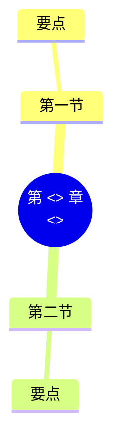

# 第 <<num>> 章 <<title>>

!!! abstract "本章学时"
    <<hours_line>>

## 学习目标

学完本章，你应该能够：

1. **说出**……（记忆）；
2. **解释**……（理解）；
3. **计算 / 实现**……（应用）；
4. **比较 / 判断**……（分析、评价）。

!!! info "先修要求"
    学习本章前，你需要掌握：

    - 本书前文的小节（链接到小节锚点）；
    - 其他课程的内容（写课程名和章节）；
    - 附录 A 中的 Python 知识点。

??? abstract "本章概念清单（0 个，点击查看定义和例子）"
    1. 写好术语表后运行 python tools/glossary_links.py concepts <<num>> 自动生成

## 情景导入

用一个学生熟悉的生活或工作场景引出本章问题，300–600 字。

## <<num>>.1 第一节标题

### <<num>>.1.1 小节标题

正文……

<<cert_block>>
## <<num>>.N <<frontier_title>>

介绍与本章内容相关的最新技术、产品或案例。

<<labs_block>>
## 本章小结

- **要点一**：……
- **要点二**：……

**下一章预告**

用两三句话说明下一章学什么、和本章怎样衔接。

## 参考文献

正文中的上标编号（如[[1]](#ref<<num>>-1)）对应下面的文献。带链接的可以直接打开；书籍可在图书馆或电子书平台查阅。

**教材与专著**

- >-1">[1] 作者. 书名[M]. 出版地：出版社，年份.
    一两句话说明这本书和本章哪一节有关、适合谁读。

## 课后练习

选择题和判断题可以直接点击选项作答，系统会马上告诉你对错，并展开答案与解析；多选题选好后点“提交答案”。简答和实操题请先自己作答，再点开“答案与解析”核对。每道题的解析下方都有“回看”链接，做错了可以直接跳回正文复习。

**一、单项选择题**

**1.** 题干（　　）。

- A. 选项
- B. 选项
- C. 选项
- D. 选项

??? tip "答案与解析"
    **答案：A**

    解析：为什么对，错误选项错在哪里。

    考查：知识点 · 认知层次：理解 · [回看 <<num>>.1.1](#<<num>>11)
    { .quiz-meta }

**二、多项选择题**

**1.** 题干（　　）。

- A. 选项
- B. 选项
- C. 选项
- D. 选项

??? tip "答案与解析"
    **答案：AC**

    解析……

    考查：知识点 · 认知层次：理解 · [回看 <<num>>.1.1](#<<num>>11)
    { .quiz-meta }

**三、判断题**

**1.** 题干。

- √ 正确
- × 错误

??? tip "答案与解析"
    **答案：√**

    解析……

    考查：知识点 · 认知层次：记忆 · [回看 <<num>>.1.1](#<<num>>11)
    { .quiz-meta }

**四、简答题**

**1.** 题干。

??? tip "答案与解析"
    **参考答案：** ……

    **解析：** ……

    考查：知识点 · 认知层次：理解 · [回看 <<num>>.1.1](#<<num>>11)
    { .quiz-meta }

**五、实操题**

**1.** 题干。

??? tip "答案与解析"
    **参考答案：** ……

    考查：知识点 · 认知层次：应用 · [回看 <<num>>.1.1](#<<num>>11)
    { .quiz-meta }
